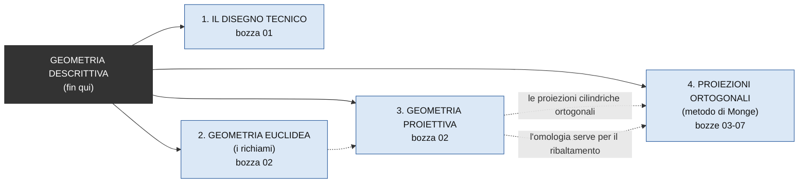
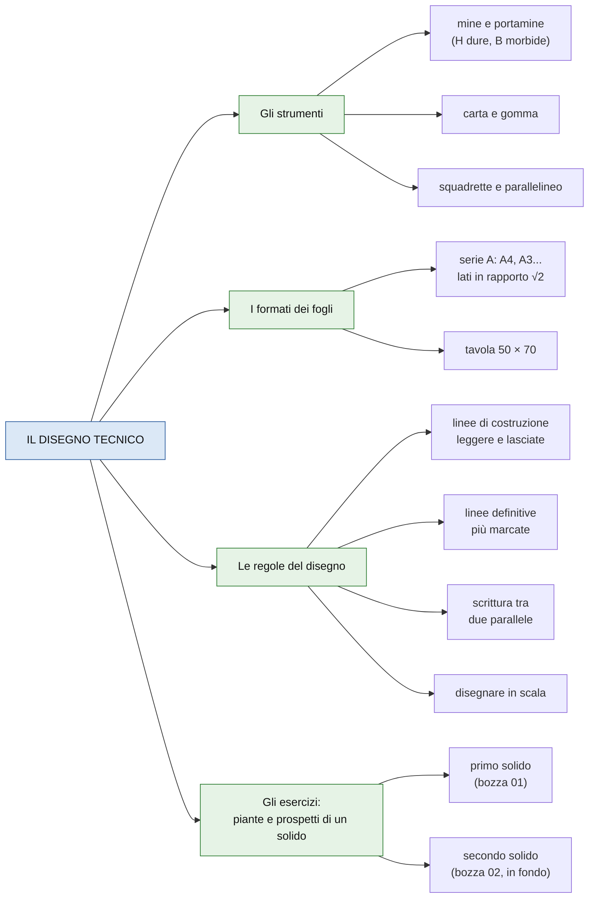
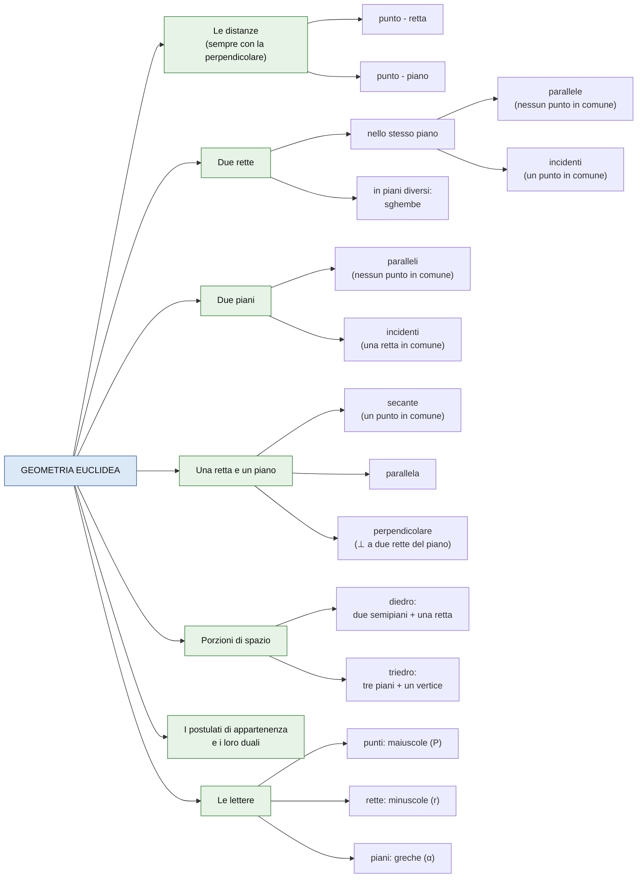
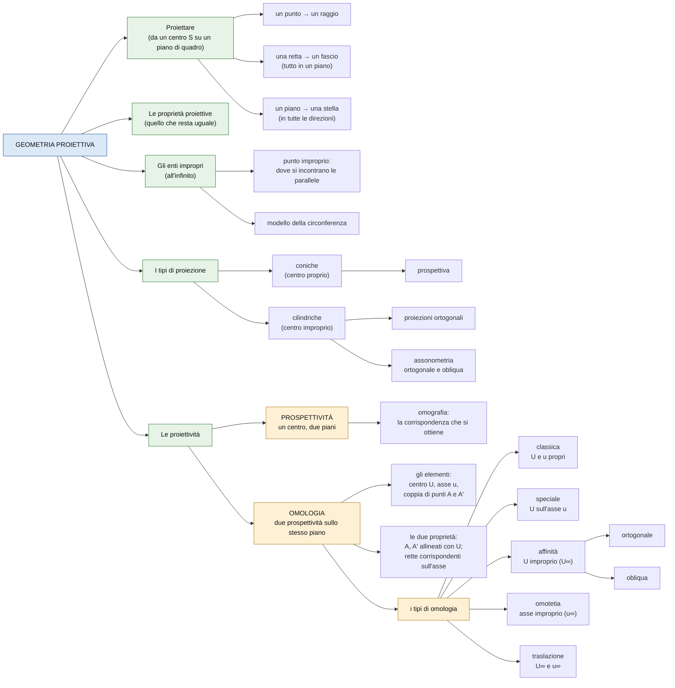
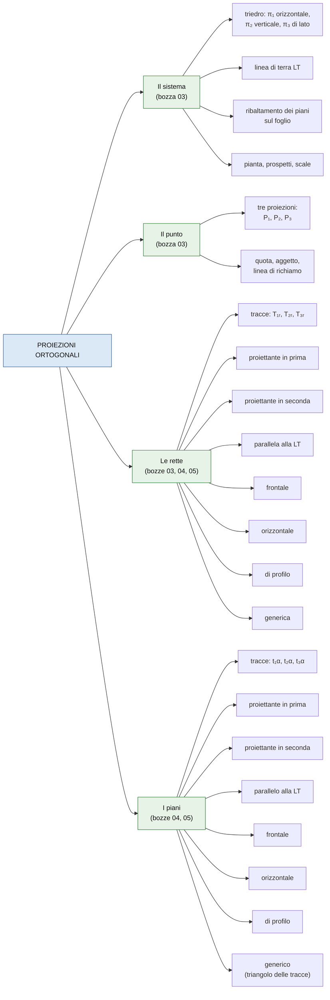
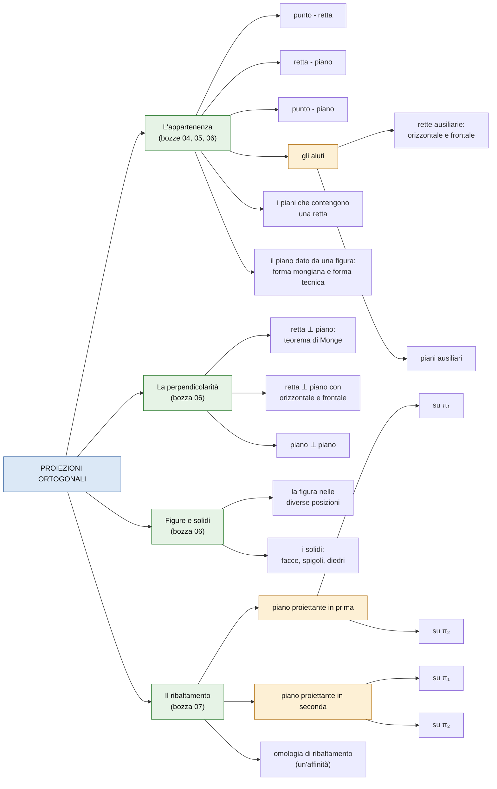

# Mappa degli argomenti di geometria descrittiva

La mappa di tutto quello che si è fatto finora, dalla lezione del 1 ottobre a quella del 22 ottobre, per vedere che cosa sta dentro che cosa. Si legge da sinistra a destra: a sinistra i gruppi grandi, poi i sottogruppi, poi i tipi.

> [!info] Note collegate
> Bozze: [[01-strumenti-materiali-e-regole]] · [[02-proiezioni-e-omologia-schema]] · [[03-proiezioni-ortogonali-punto-e-rette]] · [[04-rette-e-piani-nelle-varie-posizioni]] · [[05-appartenenza-e-rette-ausiliarie]] · [[06-piani-ausiliari-e-perpendicolarita]] · [[07-il-ribaltamento]]
>
> Ripasso: [[00-ripasso-prova-1]]

## IL QUADRO GENERALE

Il corso finora è fatto di quattro gruppi grandi. Le frecce tratteggiate dicono che cosa serve per capire che cosa: per esempio l'omologia serve per il ribaltamento.

## 1. IL DISEGNO TECNICO

Le regole e gli strumenti per disegnare bene, dalla prima lezione ([[01-strumenti-materiali-e-regole]]).

## 2. GEOMETRIA EUCLIDEA (I RICHIAMI)

La geometria "di scuola", ripassata all'inizio della lezione del 6 ottobre ([[02-proiezioni-e-omologia-schema#RICHIAMI DI GEOMETRIA EUCLIDEA|bozza 02]]).

## 3. GEOMETRIA PROIETTIVA

Che cosa succede quando si proietta, e le proiettività: prospettività e omologia ([[02-proiezioni-e-omologia-schema#I FONDAMENTI DELLA GEOMETRIA PROIETTIVA|bozza 02]]).

Attenzione a due parole che si somigliano: la prospettività è un tipo di proiettività (una corrispondenza tra due piani), mentre la prospettiva è un metodo per disegnare, che nasce dalle proiezioni coniche.

## 4. PROIEZIONI ORTOGONALI (METODO DI MONGE)

Come si rappresentano punti, rette, piani e figure con le tre proiezioni, dalla lezione dell'8 ottobre in poi ([[03-proiezioni-ortogonali-punto-e-rette]], [[04-rette-e-piani-nelle-varie-posizioni]], [[05-appartenenza-e-rette-ausiliarie]], [[06-piani-ausiliari-e-perpendicolarita]], [[07-il-ribaltamento]]). Le diramazioni sono tante, quindi lo schema è diviso in due parti.

### Prima parte: il sistema, il punto, le rette e i piani

### Seconda parte: appartenenza, perpendicolarità, figure e ribaltamento

## Collegamenti

La mappa segue l'ordine delle bozze. Il [[01-strumenti-materiali-e-regole|disegno tecnico]] serve in tutti gli esercizi. La geometria euclidea e la geometria proiettiva della [[02-proiezioni-e-omologia-schema|bozza 02]] sono la base delle proiezioni ortogonali, che partono dalla [[03-proiezioni-ortogonali-punto-e-rette|bozza 03]]. L'omologia torna nel [[07-il-ribaltamento|ribaltamento]] come omologia di ribaltamento. Per ripassare gli esercizi tipo c'è il [[00-ripasso-prova-1|ripasso per la Prova n.1]].
