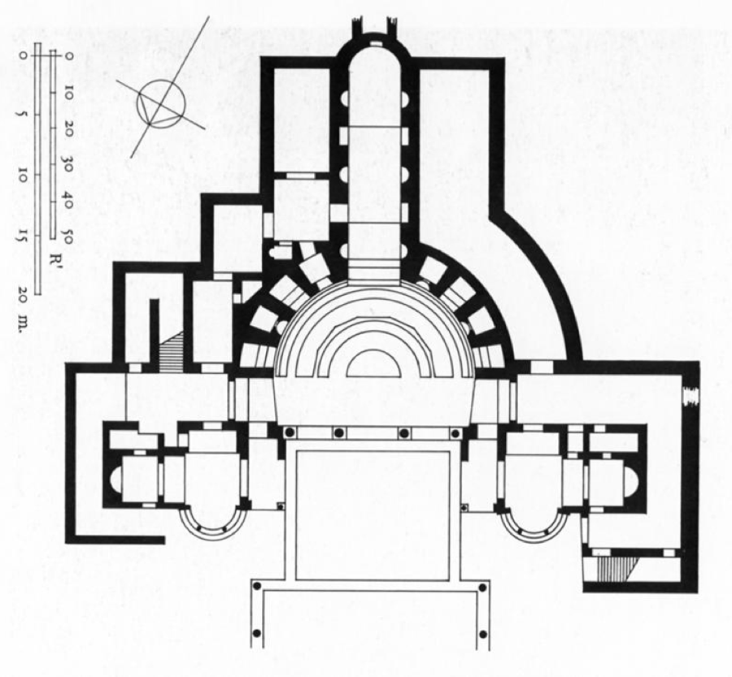

# La villa romana e Villa Adriana a Tivoli

> [!info] Note collegate
> Sbobina: [[09-la-villa-romana-villa-adriana]]
>
> Argomenti collegati: [[04-via-appia-cecilia-metella-massenzio]] · [[06-potere-imperiale-spettacolo-pompei]] · [[07-residenza-romana-palatino-domus-aurea]] · [[08-terme-di-caracalla]] · [[10-pantheon-da-agrippa-ad-adriano]]

Nel percorso dedicato ai tipi di abitazione del mondo antico, accanto alla *domus*, casa di città, e al palazzo, residenza degli imperatori sul Palatino, si colloca la villa. È una residenza suburbana o extraurbana: può sorgere a poche centinaia di metri dalla cinta muraria, come la Villa dei Misteri a Pompei, oppure in piena campagna, lontano dalla città. La sua posizione rispetto alla città è legata al tipo di utilizzo che se ne fa. Se la *domus* è collegata alle attività lavorative, la villa è il luogo dell'*otium*, cioè della contemplazione della natura, della lettura e del distacco dal *negotium*, l'attività politica, commerciale e lavorativa. Nelle fonti scritte di età romana la villa ricorre spesso come luogo dedicato alla contemplazione della natura, e assume per questo una connotazione non soltanto architettonica ma anche simbolica. I primi esempi incontrati nel corso, la Villa di Massenzio lungo la via Appia e la Villa dei Misteri, trovano qui un quadro più ampio, che passa dalle ville sul lago e sul mare alle grandi residenze degli imperatori e culmina in Villa Adriana a Tivoli, l'esempio più ricco e più famoso dell'intera categoria.

## LA VILLA NEL MONDO ROMANO

### I tipi di villa

Già le fonti antiche distinguono diversi tipi di villa in base alla funzione predominante, anche se, come avviene ancora oggi, le categorie non sono nettamente separate. La *villa rustica* ha una funzione agricola, assimilabile a quella che oggi chiameremmo una fattoria, ed è destinata in primo luogo alla raccolta dei prodotti della terra. Altre ville non hanno invece alcuna funzione produttiva specifica e sono luoghi dedicati esclusivamente all'*otium* del committente; le loro denominazioni, in molti casi, ne identificano la collocazione. Si parla così di villa marittima per le ville costruite vicino al mare, e gli archeologi impiegano anche la definizione di villa panoramica per gli edifici concepiti per godere del paesaggio circostante. Sono definizioni intuitive e descrittive, che riassumono in un aggettivo la posizione dell'edificio e la sua relazione con lo spazio circostante, e che permettono di riconoscere e commentare anche ville non studiate in precedenza.

### James Ackerman e *The Villa*

Ogni discorso sulla villa nella storia dell'architettura deve confrontarsi con *The Villa. Form and Ideology of Country Houses* dello storico dell'arte e dell'architettura James Ackerman (1919-2016), pubblicato in inglese alla fine degli anni Ottanta e tradotto in italiano con il titolo *La villa. Forma e ideologia delle case di campagna*. Il libro, che raccoglie i testi delle conferenze tenute da Ackerman nel corso degli anni Ottanta, ha conosciuto moltissime edizioni ed è uno dei testi più fortunati della storia dell'architettura. Come dichiara il sottotitolo, il suo obiettivo è dimostrare che le case di campagna portano con sé caratteristiche formali ma anche ideologiche, cioè simboliche. Una delle tesi principali, qui semplificata, è che la villa possa assumere forme architettoniche molto diverse, mentre la sua ideologia, cioè il suo significato, resta sostanzialmente invariata: in ogni epoca la villa è la residenza destinata ad accogliere lo svago del committente.

Comprendere la funzione della casa nel mondo antico è fondamentale per riconoscerne l'evoluzione nei periodi successivi, e la conoscenza dei modelli storici è anche uno strumento del progetto, perché permette di trarre dalle residenze antiche esempi che funzionano anche per l'abitazione contemporanea. Parlare di villa significa inoltre, quasi automaticamente, parlare del rapporto tra architettura e paesaggio: la villa è uno dei casi in cui il dialogo tra storia e geografia dell'architettura risulta più immediato, e questo legame assume valenze diverse a seconda del luogo in cui l'edificio sorge.

### Villa «cubica» e villa «aperta e articolata»

Ackerman propone di distinguere le ville in due grandi categorie in base alla loro forma. La prima è la villa «cubica». Il termine non si riferisce alla proporzione del cubo, ma all'idea che il cubo sia una forma chiusa in se stessa: la villa cubica è uno spazio raccolto, rivolto verso l'interno. Ackerman ne indica come esempio la Villa dei Misteri, che ha una pianta rettangolare dalle proporzioni prossime al quadrato, organizzata intorno a un cortile centrale, lo spazio attorno al quale ruotano gli ambienti interni, come nella *domus*.

La seconda categoria è la villa «aperta e articolata», di cui è esempio la villa gallo-romana di Montmaurin, nel territorio della Gallia corrispondente all'attuale Francia, databile tra il II e il IV secolo d.C. Qui una grande terrazza pone lo spazio della villa in continuità con l'esterno, e gli ambienti che si dipartono dal corpo principale e si distribuiscono nello spazio aperto circostante fanno dell'edificio non più un corpo chiuso, ma una serie di ambienti diffusa nel paesaggio. Questa distinzione è una delle molte letture possibili, ma offre un primo strumento per riconoscere i caratteri formali delle ville, tenendo presente che la loro funzione resta quella dell'*otium*.

## VILLE SUL LAGO E SUL MARE

### La conoscenza delle ville antiche

Le ville antiche erano diffuse non solo nella penisola italiana, ma in tutto il contesto europeo. La possibilità di studiarle dipende, come sempre, dalla stratificazione dei luoghi: intorno alle città vesuviane, Pompei ed Ercolano, sorgevano molte altre ville oltre a quella dei Misteri, ma nel tempo sono state coperte da strati successivi di terreno e poi da nuove costruzioni, e scavarle è impossibile. Lo stesso accade intorno al lago di Garda, dove sono note varie presenze di età romana che non si possono indagare senza demolire le costruzioni che vi si sono sovrapposte. Le ville antiche si conoscono dunque attraverso i resti archeologici, quando sono accessibili, e attraverso le fonti scritte; nei casi più fortunati, come quello delle ville imperiali, le due testimonianze si possono incrociare.

### Le Grotte di Catullo a Sirmione

Proprio dal lago di Garda provengono i resti di una delle ville più affascinanti, le cosiddette Grotte di Catullo a Sirmione, databili ai primi decenni del I secolo d.C. Si tratta di una villa panoramica, affacciata sul lago, la cui posizione fu scelta per godere del clima lacustre e di una vista spettacolare sull'acqua. Il nome si spiega con la storia del luogo. Si parla di grotte perché dell'edificio restano soltanto le sostruzioni, cioè la base su cui era costruita la villa, nelle quali si riconoscevano delle grotte più che un vero edificio. Il riferimento a Catullo deriva dal fatto che il poeta, vissuto nel I secolo a.C., era originario di Verona, nella Gallia Cisalpina, e secondo le fonti possedeva una villa a Sirmione; il complesso fu perciò identificato con la sua residenza. Gli studi archeologici hanno dimostrato che l'edificio non ha in realtà alcuna attinenza con Catullo, ma è con questo nome che lo si conosce e lo si identifica.

Lo stato attuale permette di leggere la collocazione originaria della villa, direttamente affacciata sul lago, ma le condizioni di conservazione sono molto alterate: la parte centrale è oggi occupata da un uliveto, che rende impossibile leggere sul terreno l'impianto originario. Le ricostruzioni elaborate dagli archeologi mostrano un edificio articolato su diversi livelli, una caratteristica legata alla conformazione del terreno: per affacciarsi sul lago, la villa segue con i suoi piani la pendenza della costa, arroccata sul promontorio. Un piano inferiore e un piano intermedio, composti in gran parte da piccoli ambienti, costruiscono il basamento dell'edificio; sopra di essi si trovava il piano nobile, con ambienti in parte residenziali e in parte destinati a funzioni comuni.

![[grotte-catullo-piante.png|650]]
*Grotte di Catullo a Sirmione: piante del piano inferiore, intermedio e nobile e sezione sulla costa del lago (dalle slide del corso).*

Al piano nobile l'ingresso avveniva non dal lato del lago, ma dalla parte interna del territorio. Il cuore dell'edificio era il *viridarium*, un grande giardino rettangolare intorno al quale si disponevano gli ambienti, circondato da un doppio criptoportico a pilastri, cioè da un portico coperto; verso il lago si apriva la terrazza belvedere settentrionale, l'elemento che rende più esplicita la connessione tra l'edificio e il paesaggio. Nonostante questo affaccio, secondo le categorie di Ackerman le Grotte di Catullo sono una villa cubica: l'edificio mantiene una forma a blocco, e lo spazio aperto del *viridarium* si sviluppa all'interno della pianta stessa. Le dimensioni, 105 metri di larghezza per 167 di lunghezza, indicano un impatto sul territorio considerevole. Delle sostruzioni in laterizio, in parte restaurate, si conoscono l'ingombro e il funzionamento, mentre mancano molti elementi dello sviluppo in alzato; il complesso resta comunque un esempio monumentale di villa affacciata sul lago, che conferma la funzione della villa come luogo dell'*otium* in rapporto privilegiato con il paesaggio.

### Le fonti: Plinio il Giovane e la villa Laurentina

Come la storia, anche la storia dell'architettura si costruisce sulle fonti, cioè sulle testimonianze che forniscono informazioni dirette su un'opera. Tra le più importanti per conoscere le ville antiche vi sono le lettere di Plinio il Giovane, avvocato e console, nato a Como nel 61 d.C. e morto nel 114 d.C., nipote di quel Plinio il Vecchio che morì durante l'eruzione del Vesuvio del 79 d.C. Le lettere ai familiari, la sua opera maggiore, sono una testimonianza preziosa non solo sulla sua biografia, ma sull'epoca in cui visse, e permettono di conoscere dettagli delle sue ville che i resti archeologici non lasciano vedere.

In una di queste lettere (*Lettere*, II, 17) Plinio descrive la sua villa Laurentina, sulla costa nei pressi di Ostia. La descrizione si apre con le ragioni del suo amore per questo luogo: la villa è gradevole, il sito comodo, «ampia la spiaggia», e si tratta dunque di una villa marittima; dista «diciassette sole miglia dall'Urbe», così che vi si può giungere dopo aver sbrigato ogni faccenda, attraverso la via Ostiense o la via Laurentina; e «vario da entrambi i lati è il paesaggio». La villa, scrive Plinio, «è grande e comoda, né di costosa manutenzione». L'ingresso dà su un atrio semplice ma decoroso, cioè su quello spazio scoperto e circondato da ambienti che è uno dei primi grandi vuoti della *domus* e della villa; segue un porticato «che s'incurva in forma di D» e cinge un piccolo cortile, munito di vetrate e protetto dalle sporgenze dei tetti, rifugio contro il maltempo. Di fronte al centro del portico si apre il cavedio, un altro cortile, e poi un triclinio, la sala da pranzo, che si spinge sulla spiaggia ed è lambito dalle onde quando soffia l'Africo, con porte su tutti i lati e finestre grandi come le porte.

La descrizione prosegue con le camere da letto e con una stanza di forma ellittica che «con le sue finestre segue il corso del sole», segno di una relazione consapevole tra la forma architettonica, l'esterno e l'illuminazione. Nella sua parete è inserito un armadio a uso di libreria, che raccoglie «non i libri che si leggono ma quelli che si rileggono spesso»: un'immagine chiarissima della villa come luogo dell'*otium*, dedicato a un'attività fine a se stessa. Plinio conclude parlando del giardino, popolato di gelsi e fichi, le sole piante a cui il terreno sia propizio, e di un orto rustico ma fruttifero. L'edificio appare così in dialogo con l'esterno sotto ogni aspetto: con il paesaggio naturale, attraverso la vista sul mare e sulla campagna, e con il giardino, piantato con alberi adatti alle condizioni del luogo.

Le slide accostano a Plinio un'altra fonte, una lettera di Seneca a Lucilio scritta durante un soggiorno nella villa di Scipione l'Africano. Seneca descrive la villa austera del vincitore di Cartagine, costruita in pietre squadrate, con una piccola stanza da bagno buia secondo l'uso antico, e la confronta con il lusso dei bagni del suo tempo, dove le pareti risplendono di specchi, i marmi alessandrini si combinano con incrostazioni di marmo numidico, l'acqua sgorga da rubinetti d'argento e le colonne non hanno funzione di sostegno, ma sono poste solo per ornamento e per ostentazione di ricchezza.

### La fortuna della villa di Plinio

Della villa Laurentina restano pochi resti, ma la lettera di Plinio è stata letta da moltissimi architetti nel corso dei secoli ed è diventata uno stimolo per progettare nuovi edifici. Villa Madama a Roma, progettata da Raffaello a partire dal 1516 e nota attraverso un disegno di Antonio da Sangallo il Giovane, è un tentativo consapevole, documentato dalle fonti, di attualizzare la villa di Plinio. Nell'Ottocento Karl Friedrich Schinkel, l'architetto che trasforma Berlino per volontà del re di Prussia, dedica grande attenzione alla ricostruzione della villa Laurentina: tra il 1833 e il 1835 ne disegna la pianta e la veduta, non come progetto di un nuovo edificio, ma come interpretazione delle parole di Plinio.

## LE VILLE IMPERIALI SUL MARE

### La villa di Tiberio a Sperlonga

Le ville degli imperatori si conoscono meglio delle altre, perché le fonti dedicano più attenzione alle figure più importanti del mondo antico, e in questi casi è possibile abbinare le fonti materiali a quelle letterarie. La villa di Tiberio a Sperlonga, nel basso Lazio, risalente al I secolo d.C., cerca in modo immediato il rapporto con il mare: è insieme una villa marittima e una villa panoramica, come quella di Sirmione, perché consente di apprezzare il panorama circostante. Dei resti si riconoscono una serie di ambienti in corrispondenza dell'acqua e una serie di stanze disposte intorno a un giardino centrale, anch'esse proiettate verso la costa.

![[villa-tiberio-sperlonga-pianta.png|650]]
*La villa di Tiberio a Sperlonga: in rosso il dato archeologico, in nero la ricostruzione (dalle slide del corso).*

La ricostruzione proposta dagli archeologi mostra un impianto molto articolato ed esteso. Come spesso accade nelle piante archeologiche, il rosso indica le parti documentate da resti materiali, che permettono di proporre una ricostruzione su basi oggettive, mentre il nero indica le parti ricostruite su base ipotetica, in questo caso secondo una forma simmetrica; l'azzurro rappresenta l'acqua. Il molo costituiva il punto di approdo; al centro si trovava l'appartamento principale, affiancato da appartamenti secondari, e due corpi laterali ospitavano le caserme dei pretoriani. Le diverse parti del complesso erano collegate da un lungo corridoio porticato, lo *xystus*.

### La grotta di Tiberio

La villa di Sperlonga è famosa per la peschiera con triclinio e per la grotta con gruppi statuari e un secondo triclinio. La peschiera era una vasca in cui si allevavano i pesci, sulla quale si affacciava una sala da pranzo; la grotta, ricavata in un piccolo promontorio sul mare, ospitava una seconda sala da pranzo di forma circolare. L'insieme costituiva una monumentale *cenatio*, termine che indica il complesso della sala da pranzo, giocato sulla variazione tra una prima parte rettangolare e una parte circolare. La grotta era decorata da gruppi scultorei, oggi conservati al Museo archeologico di Sperlonga, dedicati alle vicende di Ulisse, il tema iconografico scelto da Tiberio per una villa sul mare. Al di là dell'eccezionalità di questi edifici, la villa di Sperlonga mostra una ricerca architettonica fondata sulla relazione armonica e funzionale tra gli elementi naturali e quelli progettati, ed è uno degli esempi più spettacolari della villa marittima panoramica.

### La villa di Nerone ad Anzio

Anche Nerone (37-68 d.C., imperatore dal 54), il committente della Domus Aurea, si dota di una residenza sul mare ad Anzio, rivolta direttamente sull'acqua. Il luogo era già occupato da una villa fin dal II secolo a.C., in età repubblicana: si trattava di un complesso di *domus* affacciate sul mare, che Augusto acquisì e unificò per costruirsi una villa. Nerone vi sovrappose la propria, e le ricostruzioni archeologiche mostrano la sovrapposizione tra l'impianto augusteo e quello neroniano.

![[villa-nerone-anzio-pianta.png|650]]
*La villa di Nerone ad Anzio: pianta ricostruttiva e prospetto verso il mare (dalle slide del corso).*

Nella villa di Anzio affiorano la monumentalità e la dimensione straordinaria già osservate nella Domus Aurea. L'impianto è simmetrico: al centro si trovano gli appartamenti principali, e verso il mare si apre una grande terrazza panoramica a esedra, cioè a semicerchio, di cui restano le tracce del muro incurvato. Lungo la terrazza si dispone una serie di sale da cui si godeva la vista sull'acqua. Questa sperimentazione formale è stata messa in relazione con il padiglione della Domus Aurea sul Colle Oppio. Insieme alla villa di Sperlonga, la villa di Anzio mostra come le collocazioni paesaggistiche più straordinarie diventassero lo stimolo per soluzioni architettoniche spesso senza precedenti: a Sperlonga la grotta naturale trasformata in sala da pranzo, ad Anzio la linea della costa sfruttata per costruire una grande esedra rivolta verso il mare.

## ADRIANO COMMITTENTE

### L'imperatore e il modello di Augusto

Con Villa Adriana si passa dalla villa marittima alla villa extraurbana. Tivoli si trova a pochi chilometri da Roma, raggiungibile a cavallo in un paio d'ore, e consentiva quindi anche spostamenti quotidiani. Il suo committente, Adriano (76-138 d.C., imperatore dal 117), è una figura di grande importanza per la storia dell'architettura romana. Adriano riportò la pace nell'impero dopo una serie di guerre cruente e prolungate, e proprio per questo assunse Augusto come proprio modello. A circa cento anni di distanza dall'imperatore che aveva celebrato la pace con l'*Ara Pacis*, Adriano si richiama esplicitamente alla politica augustea, sia sul piano geopolitico sia su quello della committenza architettonica: molti dei templi commissionati da Augusto vengono da lui ricostruiti, anche se Adriano presentava questi interventi come restauri. L'architettura diventa così lo strumento di una continuità ideologica e della rappresentazione del potere imperiale. La sua figura ha ispirato anche le *Memorie di Adriano* di Marguerite Yourcenar, autobiografia immaginaria dell'imperatore scritta dalla romanziera.

Tra le molte opere commissionate da Adriano, due legano il suo nome a questa stagione dell'architettura: la villa di Tivoli e il Pantheon, che Adriano ricostruisce e che è forse il tempio meglio conservato del mondo antico.

### Il Mausoleo di Adriano

Tra le altre opere adrianee spicca il mausoleo che l'imperatore fa costruire per se stesso. Appartiene alla categoria dei mausolei a pianta circolare, come quello di Cecilia Metella sulla via Appia, ed è il più grande in assoluto di questo tipo: un confronto in scala tra i mausolei antichi mostra quanto superi gli altri, come è naturale trattandosi dell'imperatore. Nel corso dei secoli il monumento ha cambiato completamente destinazione, diventando Castel Sant'Angelo, una delle residenze del pontefice, e subendo trasformazioni radicali. Della decorazione antica si conservano notizie grazie ad alcuni disegni, come quelli del Codice Escurialense, nei quali si riconosce l'alternanza di bucrani, cioè teste di bue, e ghirlande già osservata nel mausoleo di Cecilia Metella, dove la documenta anche un'incisione di Piranesi della serie dedicata alle antichità di Roma. Questo motivo decorativo appartiene all'architettura funeraria, ed è a essa che va associato quando lo si incontra.

## VILLA ADRIANA A TIVOLI

### La costruzione e il territorio

Nel quadro della committenza di Adriano, la villa di Tivoli è una delle opere più straordinarie. L'imperatore non sceglie per sé una residenza sul Palatino, nel cuore di Roma, ma una zona extraurbana, dove poter coltivare con agio il proprio *otium*. I lavori iniziano subito dopo la sua ascesa al trono: già dal 118 d.C., secondo i biografi, si avviano i lavori preparatori, che proseguono per vent'anni, fino al 138, ma già nel 125 alcune parti del complesso consentono all'imperatore di stabilirvi la propria residenza. L'impatto sul territorio è molto significativo: per realizzare un complesso così articolato, i lavori ridisegnano tutta la campagna circostante, deviando in parte il corso dell'Aniene, il fiume di Tivoli, e creando terrazzamenti, cioè sbancamenti che ricavano un suolo pianeggiante per le diverse parti dell'edificio.

### Villa Adriana negli occhi degli architetti

La percezione della villa nei secoli successivi è testimoniata da una veduta di G. Stracha del 1657, copia di un affresco che si trovava in un edificio di Tivoli. La rappresentazione non corrisponde ai resti archeologici, ma rivela come l'opera venisse percepita: il complesso appare sopra una grande sostruzione, quasi come una cittadella fortificata, e senza la didascalia si potrebbe scambiare per una piccola città. La prima caratteristica che rende eccezionale Villa Adriana è infatti la sua dimensione: se le Grotte di Catullo misurano poco più di un centinaio di metri per lato, Villa Adriana si estende per diversi chilometri quadrati.

La seconda caratteristica emerge dalla grande pianta che Giovanni Battista Piranesi le dedica, la *Pianta delle fabbriche esistenti nella Villa Adriana*, in sei tavole riunibili con dedica al re di Polonia Stanislao Augusto: l'impianto risulta dall'assemblaggio di molte componenti diverse. Non è una villa cubica e ha un impianto aperto, ma è talmente articolato e ricco di parti da sembrare una cittadella più che un singolo edificio, e non rientra in nessuna delle categorie formali viste in precedenza. È certamente un edificio concepito per l'*otium* dell'imperatore, e in questo senso ne conserva l'ideologia, per riprendere il titolo di Ackerman; ma sfugge a ogni altra classificazione formale.

L'impatto sul territorio, la varietà delle forme, la relazione con il paesaggio e l'eccezionalità del complesso hanno reso Villa Adriana una delle opere più osservate dagli architetti di ogni epoca. Oltre alle vedute di Piranesi, come le *Rovine d'una Galleria di Statue nella Villa Adriana a Tivoli*, la villa compare negli schizzi di Le Corbusier, che vi si ferma nel 1911 durante i suoi viaggi nel Mediterraneo e disegna il grande muro di spina del Pecile e la luce che si diffonde nel Serapeo. Qualche decennio più tardi Louis Kahn, durante il suo viaggio in Italia, ne esegue disegni coloratissimi: alle linee veloci di Le Corbusier, che colgono la struttura compositiva, si contrappongono qui gli effetti cromatici e la relazione tra materiali, luce e vegetazione. La pianta del Florida Southern College di Frank Lloyd Wright (1938) è stata letta come una variazione sul tema di Villa Adriana: la composizione di spazi e forme centrifughe, che rinuncia alla simmetria e a ogni regolarità, riprende per analogia, senza corrispondenze dirette tra le parti, le relazioni di forme e di spazi del modello ricostruttivo della villa, visibile ancora oggi all'ingresso del sito.

### La pianta della villa

![[villa-adriana-pianta-generale.png|600]]
*Villa Adriana: pianta del complesso con la legenda delle parti (dalle slide del corso).*

L'articolazione spaziale della villa è stata interpretata da alcuni archeologi come il risultato di un progetto *work in progress*: le parti sarebbero state costruite man mano, nel corso dei vent'anni del cantiere, per aggregazione e senza seguire un progetto originario. In mancanza di conferme specifiche, si tratta di un'ipotesi. Gran parte degli ambienti, inoltre, porta nomi moderni, che salvo rare eccezioni derivano da una tradizione posteriore all'età di Adriano e possono risultare fuorvianti rispetto alla funzione originaria.

## GLI SPAZI DELLA VILLA

### Il Pecile

Il Pecile è un quadriportico, cioè un porticato sviluppato su quattro lati, che circonda una grande vasca d'acqua. Secondo le fonti, Adriano intendeva evocare con questo spazio l'*agorà* di Atene, la piazza della città considerata dal mondo romano un modello culturale assoluto. È il primo esempio di un carattere ricorrente della villa: molte sue parti nascono dalla memoria dei luoghi dell'impero che Adriano aveva visitato durante i suoi viaggi. Del recinto resta l'ultima parte del muro perimetrale, il grande muro di spina disegnato da Le Corbusier; nelle ricostruzioni il colore più scuro indica, come sempre, il dato archeologico visibile e quello più chiaro il dato interpretato. Il modello della villa restituisce l'aspetto del quadriportico, mentre Piranesi lo rappresenta come una grande rovina.

La maggior parte delle murature di Villa Adriana è in *opus reticulatum*, l'opera muraria in cui piccoli elementi accostati disegnano un reticolo sulla faccia esterna, quella visibile. Ogni elemento ha la parte esterna di forma quadrata, che garantisce la regolarità dell'apparecchio, mentre la parte interna è sagomata a cuneo, per ancorarsi più saldamente nella malta che costituisce il legante della muratura, composta di calce, sabbia e acqua.

Accanto al Pecile si sviluppano le Cento Camerelle, numerosi ambienti di dimensioni ridotte, da cui il nome, destinati alle persone che prestavano servizio nella villa e perciò lontani dagli ambienti principali riservati all'imperatore.

### Il Teatro Marittimo

Il cosiddetto Teatro Marittimo deve il nome all'anello d'acqua che lo circonda e ai soggetti marini della sua decorazione. In realtà è una piccola villa all'interno di Villa Adriana, un padiglione immerso nell'acqua destinato ad accogliere l'imperatore. Un anello di colonne ioniche separava un corridoio coperto e porticato dal canale circolare, al centro del quale sorgeva la villa vera e propria.

![[teatro-marittimo-pianta.png|620]]
*Il Teatro Marittimo: legenda, pianta e dettagli del portico ionico sul canale (dalle slide del corso).*

Nella pianta si riconoscono gli ambienti già noti dalla *domus*: le *fauces*, gli spazi di accesso, un atrio curvilineo, un peristilio porticato di forma polilobata, il *tablinum*, ambienti di servizio, *cubicula* di forma cruciforme, un piccolo impianto termale con *frigidarium*, *tepidarium* e *calidarium*, e la sala da pranzo rivolta verso il canale anulare. All'interno di un complesso così esteso, l'imperatore si era creato uno spazio raccolto, nel quale il canale artificiale ricreava la sensazione di affacciarsi sul mare o sul lago. Le ricostruzioni ipotizzano il rivestimento di lastre policrome di pietra di cui in origine era rivestita l'intera villa; questi materiali pregiati furono però i primi a sparire. Del portico ionico resta oggi la struttura in laterizio della grande trabeazione curva, sulla quale erano fissate le lastre che rivestivano di materiali pregiati l'intero complesso.

### Il Palazzo imperiale e la Piazza d'Oro

Il Palazzo imperiale era il nucleo residenziale dell'imperatore, la sua casa all'interno della villa. Fu il primo nucleo completato, dopo i primi sette anni di cantiere, e divenne quindi la prima residenza di Adriano nella villa. Era la residenza ufficiale, destinata anche alle funzioni di rappresentanza, in dialogo con il Teatro Marittimo, più vicino all'idea di un ritiro per l'*otium*.

Vicino al Palazzo si trovava la Piazza d'Oro, destinata con ogni probabilità alle funzioni pubbliche del palazzo e da intendere come una sua appendice aperta. Di forma grosso modo rettangolare, rispondeva ai caratteri del foro: un grande spazio scoperto, porticato e delimitato, sistemato a giardino, completamente simmetrico, attraversato in senso longitudinale da una grande vasca centrale tra due grandi aiuole. Il nome deriva dalla ricchezza della decorazione originaria, interamente in marmi intarsiati, cioè in *opus sectile*, il rivestimento di marmi colorati incastrati tra loro. La spoliazione della piazza è iniziata nel Rinascimento, e se ne conoscono perciò fonti relativamente recenti: dal Cinquecento parte delle decorazioni architettoniche e della collezione di sculture di Villa Adriana fu portata nella villa che il cardinale Ippolito d'Este costruiva nel centro di Tivoli, Villa d'Este. La costruzione di questo secondo grande complesso, a pochi chilometri dal primo, fu così una delle cause della spoliazione di Villa Adriana.

### Il Canopo

La porzione del Canopo e del Serapeo è una delle più interessanti per la ricerca formale della villa. Il nome Canopo deriva da un canale artificiale che collegava la città egizia omonima con Alessandria, una delle città fondate da Alessandro Magno, il principe macedone che nel IV secolo a.C. conquistò vari territori del Mediterraneo, tra cui l'Egitto, fondando una dozzina di città che portano il suo nome. Il riferimento rimanda ai viaggi di Adriano e alla sua conoscenza dell'Egitto, ma anche alla fascinazione che l'antico Egitto, conquistato da Alessandro e poi annesso all'impero romano, esercitava sul gusto degli imperatori. Se il Pecile evocava l'*agorà* di Atene, il Canopo evoca in modo ancora più esplicito, già nel nome, l'antico Egitto.

Il Canopo si presenta come una grande vasca di proporzioni allungate, in origine interamente circondata da una sequenza di colonne collegate da archi alternati a segmenti di trabeazione. Tra le colonne erano collocate sculture, alcune delle quali sono ancora visibili *in loco* e restituiscono la suggestione di un luogo in cui si fondevano l'elemento naturale, l'acqua, e la statuaria scelta dall'imperatore. Anche alcune di queste sculture finirono nella collezione del cardinale Ippolito d'Este, che fece condurre scavi a Villa Adriana anche sotto la guida di Pirro Ligorio, e negli arredi dei giardini di Villa d'Este.

### Il Serapeo

 A una delle estremità del Canopo si trova il Serapeo, o Tempio di Serapide. Il nome evoca il culto di Serapide, divinità proveniente dai culti orientali, ma l'edificio non è un tempio: è una scenografica sala da pranzo, un triclinio costruito sull'acqua per offrire una vista gradevole a chi cenava con l'imperatore, e il suo nome esprime soltanto la passione di Adriano per l'Oriente. Il complesso comprendeva una sala principale di forma semicircolare, coperta da una cupola in opera cementizia, e una serie di colonne che, come una scenografia, separava lo spazio del triclinio dal Canopo. Secondo le biografie di Adriano, il luogo era attrezzato per le estati più calde: una serie di cascate artificiali raffrescava costantemente la sala.

Il Serapeo riunisce i caratteri dell'intera villa: la memoria dei viaggi di Adriano attraverso l'impero, le citazioni architettoniche che mescolano la tradizione romana con quella orientale ed egizia, la grande sapienza tecnica nella costruzione di spazi voltati e cupolati, la capacità di governare l'ingegneria delle acque. La volta del Serapeo è detta a spicchi, un tipo che caratterizza molte cupole della villa. Come sappiamo dalla biografia di Adriano, queste coperture furono realizzate da Apollodoro di Damasco, l'architetto di Traiano, autore del Mercato e della Colonna di Traiano, che alla morte dell'imperatore continuò a lavorare per il suo successore; secondo le biografie di Adriano, la loro forma nuova fu anche oggetto di scherno, e le cupole vennero paragonate a grandi zucche. Una veduta di Piranesi accentua l'andamento a spicchi della volta.

### Le sculture egittizzanti: Antinoo

Le sculture del Canopo e del Serapeo in parte proseguivano la tradizione classica, con copie romane di statue greche, in parte erano frutto dell'egittofilia, la passione per l'Egitto che divampava tra gli imperatori romani. Alcune furono realizzate appositamente per la villa, ispirandosi alla statuaria egizia, e oggi permettono di ricostruire l'allestimento del Serapeo nella Sala III del Museo Gregoriano Egizio, nei Musei Vaticani. Tra queste vi è la statua di Antinoo divinizzato, il giovane amante di Adriano, ritratto nella forma di un faraone: un'opera di età adrianea che è in tutto e per tutto un'evocazione della statuaria faraonica. Lo stesso gusto si ritrova in un ritratto di Augusto rappresentato come faraone, conservato al Museo Egizio del Cairo. Questo culto dell'Egitto lascia traccia anche negli studi della prima età moderna, come mostrano i disegni settecenteschi di statue egizie donate al Campidoglio da papa Clemente XI, e contribuisce a costruire la passione per l'Egitto nei secoli successivi.

### Le terme

Villa Adriana comprendeva tre complessi termali di dimensioni diverse, le Terme con *heliocaminus*, le Grandi Terme e le Piccole Terme, che occupano una posizione centrale e testimoniano l'attenzione di Adriano per l'ingegneria e per l'acqua calda. A differenza delle Terme di Caracalla, terme pubbliche con cui l'imperatore dava prova della propria magnificenza, si tratta di terme private, con una committenza molto diversa da quella delle Terme di Traiano o di Caracalla. I caratteri restano però gli stessi: vasche d'acqua a diverse temperature, con il *frigidarium*, la sala dell'acqua fredda, il *tepidarium*, qui articolato in più ambienti, e il *calidarium*, l'ambiente più caldo. Nella villa si sommano così edifici dalle funzioni molto diverse: complessi per la ricreazione, l'appartamento ufficiale, quello per l'*otium* del Teatro Marittimo, ambienti che esibiscono la memoria della vita itinerante di Adriano e complessi che raccontano la sua ricerca tecnologica, in particolare nella tecnologia dell'acqua.

### Materiali e decorazione

Villa Adriana è anche un grande osservatorio di tecniche, strutture e materiali. Pur in un luogo ampiamente depauperato, vi si conservano opere scultoree che offrono uno sguardo articolato sulla produzione artistica di età adrianea, dalle opere immerse nella tradizione romana di derivazione greca, come le cariatidi, a quelle ispirate alla cultura egizia. Un frammento di *opus sectile* lascia immaginare l'aspetto dell'intero rivestimento delle superfici prima della spoliazione, e l'*opus reticulatum* resta l'opera muraria più diffusa nella villa. Tra gli esempi di decorazione architettonica di grande qualità e raffinatezza vi sono alcuni capitelli rinvenuti nei pressi del Pecile, decorati con delfini che si ricongiungono al centro e che evocano nuovamente la componente acquatica del complesso. Villa Adriana non è una villa marittima, perché non sorge sul mare, ma l'acqua è forse il filo rosso che collega più di ogni altro i suoi ambienti: il Pecile, il Teatro Marittimo, il Canopo, le terme.

## I VIAGGI DI ADRIANO

### Gli itinerari

I biografi raccontano che Adriano avrebbe avuto la passione di viaggiare e di visitare tutti i territori dell'impero, e che quasi in ogni città visitata avrebbe fatto costruire qualcosa. Le ricostruzioni dei suoi itinerari distinguono un primo viaggio all'inizio del regno, nel 117-118 d.C.; un secondo viaggio, dal 121 al 125, che lo portò nelle province orientali ma anche nelle regioni più remote e settentrionali dell'impero; e altri viaggi nel 128 e tra il 128 e il 134. Gran parte della vita di Adriano si svolse dunque in viaggio, e nei momenti di sosta a Roma l'imperatore si stabiliva nella villa di Tivoli, luogo tranquillo dove riposare dalle fatiche del viaggio. I viaggi lo portarono a visitare quasi tutto l'impero, articolato in territori di status diverso: l'Italia, luogo centrale, le province e gli stati clienti. Essi rispondevano alla volontà di conoscere le periferie dell'impero, ma anche di portare lontano da Roma l'immagine dell'imperatore, esibendone la presenza e difendendo, almeno simbolicamente, i confini.

### Atene

Luogo privilegiato dei viaggi di Adriano è Atene, città simbolo del mondo greco che tanto aveva influenzato culturalmente Roma, e per questo uno dei luoghi in cui la sua committenza si avverte di più. Nel 131 d.C. circa Adriano vi fa erigere un arco interamente in marmo pentelico, con epigrafi che celebrano le sue imprese; nei dintorni della città fa inoltre ricostruire e restaurare alcuni templi antichi, durante e dopo il suo soggiorno.

### L'Egitto: i colossi di Memnone

Anche l'Egitto fu molto amato e visitato da Adriano. Nella biografia dell'imperatore si ricorda il suo passaggio nell'attuale Luxor, dove sorgono i colossi di Memnone, due grandi sculture egizie del XIV secolo a.C. Sulle loro gambe la poetessa Giulia Balbilla, che accompagnava l'imperatore insieme alla moglie Sabina e al resto della corte, incise alcuni epigrammi che ricordano la visita al colosso in compagnia dell'Augusta Sabina, datata con precisione al quindicesimo anno di regno di Adriano. Queste iscrizioni sono un esempio di un tipo particolare di fonte: monumenti di molti secoli più antichi diventano il supporto su cui si deposita la memoria del passaggio dell'imperatore.

### Efeso

Nel suo viaggio verso Oriente Adriano attraversa anche l'attuale Turchia. A Efeso, città di fondazione greca, sorge il tempio di Adriano, la cui facciata presenta una soluzione che richiama quella del Canopo: una sequenza di colonne collegate da segmenti di trabeazione e, al centro, un arco che poggia su due colonne. Questa soluzione, insieme alla decorazione scultorea che corre sulla superficie del tempio, comincia a mostrare i caratteri dell'architettura tardoantica e il dialogo tra l'architettura romana e quella dei territori orientali. Nella stessa città le slide ricordano anche la Biblioteca di Celso, con la sua facciata a due ordini sovrapposti.

### Gerasa

Adriano si spinse anche nell'attuale Giordania. I resti più monumentali si trovano a Gerasa, dove nel 129-130 d.C. fu costruito un arco monumentale che ricorda il suo passaggio e segna l'ingresso alla città, che Adriano fece in parte ricostruire dandole una nuova impronta. Alla città appartengono anche un grande circo, l'ippodromo, legato ai giochi già incontrati in Italia, e una grande strada colonnata che ne segna il tracciato: su questo luogo si disegna una nuova città romana, con un foro che non è più rettangolare, ma di forma circolare. Le slide accostano l'arco di Gerasa al Tesoro di Petra, sempre in Giordania. L'espansione dei confini dell'impero porta con sé anche la costante diffusione dei suoi tipi edilizi, a cominciare dalle terme: una storia della diffusione del modello romano in tutti i territori conquistati.

## Collegamenti

La lezione completa il percorso sulla residenza nel mondo romano. Riprende la distinzione tra *negotium* e *otium* e la [[06-potere-imperiale-spettacolo-pompei|Villa dei Misteri]], qui riletta come esempio di villa «cubica», e la [[04-via-appia-cecilia-metella-massenzio|Villa di Massenzio]] sulla via Appia, prima villa incontrata nel corso; la stessa visita aveva mostrato il mausoleo circolare di Cecilia Metella e i suoi bucrani, ai quali si confronta il Mausoleo di Adriano. La villa di Nerone ad Anzio e la composizione libera di Villa Adriana proseguono il discorso sulla [[07-residenza-romana-palatino-domus-aurea|Domus Aurea]] e sul palazzo imperiale del Palatino, al quale Adriano preferisce una residenza fuori città. Le terme private della villa si comprendono nel confronto con le grandi terme pubbliche visitate alle [[08-terme-di-caracalla|Terme di Caracalla]], mentre l'*opus reticulatum*, la malta e le cupole in opera cementizia rimandano alla [[05-costruzione-nel-mondo-antico|costruzione nel mondo antico]]. Il Pecile come evocazione dell'*agorà* e l'arco in marmo pentelico riportano ad [[02-acropoli-e-partenone|Atene e all'Acropoli]], e il nome di Apollodoro di Damasco lega la villa ai [[03-roma-foro-e-fori-imperiali|Fori Imperiali]] di Traiano. L'altra grande opera di Adriano, il [[10-pantheon-da-agrippa-ad-adriano|Pantheon]], è l'oggetto della lezione successiva, e le soluzioni del Canopo e del tempio di Efeso annunciano l'architettura tardoantica. La riflessione sulla casa e sulle funzioni dei suoi ambienti accompagna il lavoro svolto nel [[01-laboratorio-come-funziona|laboratorio di composizione architettonica]], e il rapporto tra villa e paesaggio introduce il tema di storia e geografia dell'architettura che si ritrova nella lettura del volume *L'architettura del Rinascimento. Storia e geografia*, dove la fortuna della villa di Plinio continua con Villa Madama di Raffaello.
