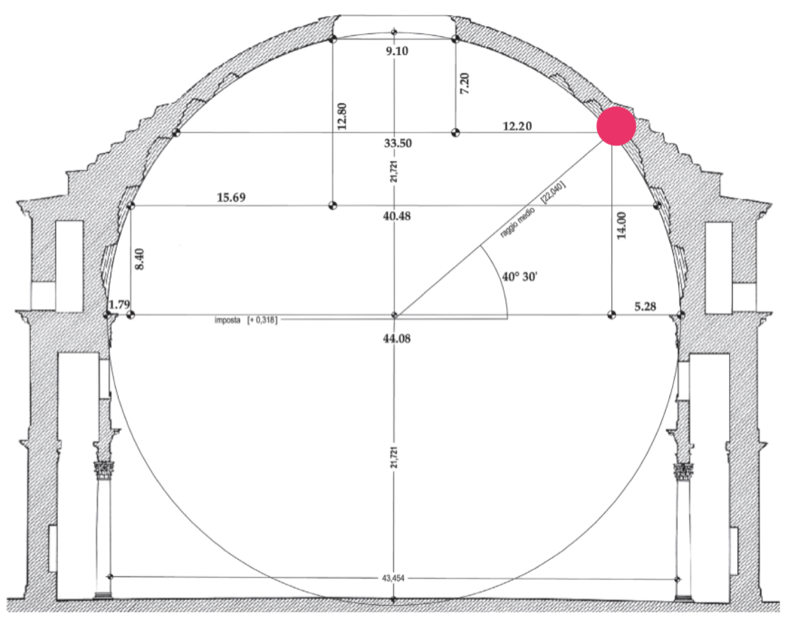

# Il Pantheon: da Agrippa ad Adriano

> [!info] Note collegate
> Sbobina: [[10-adriano-pantheon]]
>
> Argomenti collegati: [[09-villa-romana-e-villa-adriana]] · [[02-acropoli-e-partenone]] · [[05-costruzione-nel-mondo-antico]] · [[08-terme-di-caracalla]] · [[11-architettura-tardoantica-da-baalbek-a-spalato]]

Accanto alla villa di Tivoli, l'altra grande opera legata alla committenza dell'imperatore Adriano (76-138 d.C.) è la ricostruzione del Pantheon. Adriano sale al trono nel 117 e governa in una fase matura dell'impero, impegnato a mantenere la pace entro confini sempre più estesi e a richiamarsi esplicitamente ad Augusto, il primo imperatore e il portatore della *Pax Augustea*. Il Pantheon è considerato uno dei principali templi dell'età imperiale ed è certamente uno dei templi dell'antichità meglio conservati: la sua importanza è insieme storica, architettonica e culturale, per l'impero romano e per la città di Roma. Studiarlo significa seguire la storia di un edificio stratificato, nato in età augustea e rifondato da Adriano, comprenderne la composizione in tre parti, i materiali e le soluzioni costruttive che hanno reso possibile la sua cupola, e infine ripercorrerne le trasformazioni nei secoli.

## LA STORIA DEL PANTHEON

### Un tempio pagano diventato chiesa

Il monaco Beda il Venerabile, vissuto nell'VIII secolo, molti secoli dopo la morte di Adriano, scrive che chiunque lasci Roma senza aver visto il Pantheon la lascia come uno sciocco. La frase testimonia la centralità di questo edificio per la città, una centralità di lunghissima durata. Già prima che Beda scrivesse, intorno al VII secolo, il tempio pagano rifondato da Adriano era stato trasformato in chiesa cristiana: è un cambio di destinazione d'uso che dura ancora oggi, perché quello che continuiamo a chiamare Pantheon è in realtà la chiesa di Santa Maria *ad Martyres*.

Proprio questa conversione spiega lo stato di conservazione dell'edificio. Quando Roma e l'impero passarono dal paganesimo al cristianesimo, la maggior parte dei templi pagani, avendo perso la loro funzione originaria, fu progressivamente spogliata, danneggiata o demolita; il Pantheon, divenuto chiesa, fu invece risparmiato. Per questo, mentre tanti edifici con la stessa funzione ci sono giunti allo stato di rovina, il Pantheon si presenta ancora oggi riconoscibile nelle sue forme come uno dei più grandi templi del mondo antico.

### Il primo Pantheon: Agrippa e il Campo Marzio

La storia del Pantheon comincia ben prima di Adriano. Nel fregio della trabeazione del pronao corre un'epigrafe, M·AGRIPPA·L·F·COS·TERTIVM·FECIT, che significa «lo costruì Marco Agrippa, figlio di Lucio, nell'anno del suo terzo consolato». Marco Vipsanio Agrippa, console e militare dell'età di Augusto, è dunque il costruttore del primo Pantheon, che si data al I secolo a.C., qualche decennio prima dell'inizio dell'era cristiana.

Il tempio sorgeva nel Campo Marzio, che all'epoca di Augusto si andava riempiendo di grandi edifici: il Teatro di Pompeo, nell'area dell'attuale Largo del Pallaro, l'orologio solare (*Horologium*) presso l'Ara Pacis, il Mausoleo di Augusto. Un'intera porzione di quest'area era occupata da opere commissionate da Agrippa, tra cui le sue terme, realizzate tra il 25 e il 19 a.C., di cui resta ancora in piedi il cosiddetto Arco della Ciambella, e alcune abitazioni private.

Il primo Pantheon ebbe una vita travagliata. Fu distrutto da un incendio intorno all'80 d.C. e restaurato da Domiziano; colpito poi da un fulmine, bruciò nel 110 d.C. È questo secondo edificio, la ricostruzione domizianea, a diventare l'oggetto dell'attenzione di Adriano, che ne avvia la ricostruzione a partire dal 118 d.C.

### Adriano, Augusto e l'idea di restauro

Secondo Svetonio, il principale biografo degli imperatori, Augusto fece costruire decine di templi a Roma, una delle tante manifestazioni della sua magnificenza di committente impegnato a trasformare la città, che, nelle celebri parole che Svetonio gli attribuisce, trovò di mattoni e lasciò di marmo. Adriano, che considera Augusto il proprio riferimento politico, vuole istituire con lui una connessione culturale, ideologica e simbolica; per questo molti templi augustei diventano oggetto dei suoi interventi, con l'intento di restituire l'immagine di completezza delle opere volute dal suo illustre predecessore.

Il concetto di restauro va però inteso nella mentalità del II secolo d.C. Oggi si parla di restauro per indicare operazioni molto diverse: il consolidamento di una struttura per impedirne il crollo, come gli interventi ottocenteschi di Stern e di Valadier sulle arcate del Colosseo; la ricostruzione di ciò che è andato distrutto, come nel caso del teatro della Fenice o del campanile di San Marco a Venezia; i restauri funzionali, che rendono accessibile un'opera; e il restauro come conservazione delle caratteristiche di un edificio. Tutto questo è il frutto di un'elaborazione teorica che comincia a maturare alla fine del Settecento in diversi paesi europei e che darà vita alla disciplina della teoria del restauro. Per un imperatore del II secolo, invece, restaurare l'immagine di chi lo aveva preceduto attraverso gli edifici da lui commissionati poteva significare ricostruirli di sana pianta.

### Dal tempio di Agrippa al tempio di Adriano

La ricostruzione del Pantheon promossa da Adriano, riportata dalle fonti, è a tutti gli effetti una ricostruzione. Lo mostra il confronto tra la pianta ipotizzata per il primo Pantheon e quella del tempio adrianeo. Sulla forma dell'edificio di Agrippa gli archeologi hanno avanzato ipotesi molto diverse, e c'è anche chi ha pensato a un tempio a base circolare; l'ipotesi ricostruttiva più comune, quella che si trova nella maggior parte dei libri, è un tempio a cella rettangolare disposta trasversalmente, preceduta da un pronao. Le tracce materiali non sono tali da garantire una ricostruzione unitaria, e per questo si possono incontrare proposte differenti.

![[pantheon-agrippa-adriano-piante.png|600]]

La sovrapposizione tra la prima fabbrica e l'impianto successivo (con il termine fabbrica si intende, nella storia della costruzione, una costruzione nel suo complesso, o una sua fase) rivela uno scarto notevolissimo, anzitutto di dimensioni: il Pantheon di Adriano è nettamente più grande di quello costruito in età augustea, e si fonda su un'idea architettonica del tutto nuova.

### Il progetto adrianeo e la piazza davanti al pronao

La ricostruzione impegnò circa dieci anni, dal 118 al 128 d.C. Il tempio non era concepito come un edificio isolato, ma come parte di un complesso più articolato, che prevedeva l'apertura di un foro, cioè di una piazza porticata, davanti al pronao, con un arco al centro che inquadrava visivamente e prospetticamente la facciata del Pantheon. Oggi questa situazione è molto diversa: resta la traccia di una piazza antistante, ma si è perduto il disegno architettonico che inquadrava nel suo insieme il tempio. Come spesso accade, il tempio si è conservato sostanzialmente inalterato, mentre ciò che lo circondava è stato oggetto di trasformazioni successive.

La sistemazione adrianea aveva anche un preciso effetto percettivo. Chi oltrepassava il portale d'accesso alla piazza vedeva un tempio tradizionale, con un pronao ottastilo di colonne corinzie, non dissimile dalle facciate di molti altri templi; solo entrando scopriva un impianto del tutto diverso e originale. Il progetto giocava così sulla sorpresa tra la prima immagine del tempio e la scoperta del suo spazio interno.

## LA PIANTA E LA COMPOSIZIONE

### Tre volumi: pronao, corpo intermedio, rotonda

L'originalità del Pantheon rispetto agli altri templi di Roma risiede nell'articolazione dei suoi volumi. Osservato dall'alto, l'edificio presenta il pronao, poi un secondo volume più o meno a forma di parallelepipedo, e infine un volume circolare, la rotonda, che corrisponde alla cella del tempio e in cui culmina l'intero impianto. La pianta riflette fedelmente questa sequenza.

![[pantheon-pianta-pronao-corpo-intermedio-rotonda.png|650]]

Il pronao ottastilo è formato da tre file di colonne, ma soltanto quella esterna, sulla facciata, conta otto colonne; le altre due file ne hanno quattro ciascuna. Anche la distanza tra le colonne varia: l'intercolumnio tra le due colonne centrali è visibilmente maggiore di quello tra le colonne laterali, per porre l'accento sulla parte centrale del pronao e sottolineare il punto in cui si trova l'ingresso al tempio.

Superate le tre file di colonne si giunge al corpo intermedio, così definito dagli archeologi proprio perché si colloca a metà tra il pronao e la rotonda. La sua posizione intermedia ha un significato molteplice. Da un lato è uno spazio di servizio, che contiene le scale per raggiungere i piani superiori e le porte di accesso alla cella; dall'altro è uno spazio di passaggio, non soltanto fisico ma anche formale, perché segna la transizione dal sistema trabeato del pronao, il sistema rettilineo del tempio tradizionale, al sistema curvilineo della cella circolare. È dunque un elemento fondamentale della composizione dell'edificio.

La cella, infine, ha un perimetro esterno continuo, mentre all'interno il suo spazio è articolato da una serie di nicchie disposte lungo tutto il perimetro, di forma alternativamente rettangolare e curvilinea.

### Forme e materiali

Alle tre parti corrispondono forme diverse e anche un impiego prevalente di materiali diversi: la pietra per il pronao, il laterizio per il corpo intermedio, il calcestruzzo per la rotonda. Si tratta di una sintesi, utile per analizzare la storia e la composizione dell'edificio. Un modello in spaccato assonometrico permette di seguire la sequenza degli spazi anche nel loro sviluppo volumetrico: dal pronao ottastilo si arriva al corpo intermedio, che prosegue lo stesso sistema volumetrico del pronao ma è chiuso esternamente, perché le colonne libere scompaiono e sono sostituite da paraste addossate alla muratura; si giunge poi alla rotonda, con il suo impianto circolare coperto da una monumentale cupola.

## IL PRONAO

### Le colonne di granito

Il pronao ottastilo corinzio è formato complessivamente da sedici colonne: otto nella prima fila e altre otto nella seconda e nella terza. I fusti sono colonne monolitiche, cioè realizzate in un unico pezzo, di granito rosa e grigio proveniente da Assuan, in Egitto, uno dei principali luoghi di estrazione del granito. Le colonne giunsero a Roma già lavorate: probabilmente appartenevano a quella categoria di materiali che viaggiavano per l'impero e venivano reimpiegati in varie fabbriche. Estrarre e trasportare grandi volumi di pietra aveva costi molto elevati, e proprio per questo la scelta di colonne in un unico pezzo esprime l'idea di monumentalità che l'edificio doveva trasmettere. Le basi e i capitelli sono invece in marmo.

Le colonne sono alte circa 14 metri, l'equivalente di quattro o quasi cinque piani di un edificio, come si percepisce confrontandole con le case che si affacciano sulla piazza. Nell'immagine e nella costruzione del pronao prevale dunque la pietra, che si manifesta in una straordinaria sequenza di colonne dalle sfumature policrome.

### L'ordine corinzio e la sua fortuna

I capitelli presentano i caratteri del capitello corinzio, con i due registri di foglie d'acanto, oggi in parte lacunosi per la lunga età del tempio; anche le basi sono corinzie. Questi capitelli sono stati un modello per molti architetti: Michelangelo li assunse come riferimento per i capitelli della cupola di San Pietro, ma è soltanto uno dei tanti esempi di come gli architetti del Rinascimento abbiano guardato alle basi e ai capitelli del Pantheon. Nel Quattrocento e nel Cinquecento, nella stagione della rinascita dell'architettura antica, il Pantheon diventerà un modello imprescindibile di studio, documentato da numerosi disegni, come quelli di Giovanni Antonio Dosio, che ne rilevò l'ordine e il prospetto.

Tra le fonti più importanti vi è *Il libro delle antichità* di Sebastiano Serlio, pubblicato a Venezia nel 1540, uno dei trattati di architettura del XVI secolo in cui i monumenti antichi vengono studiati e ridisegnati. Il Pantheon è il primo degli edifici illustrati, segno della sua importanza, con una serie di tavole che vanno dalla ricostruzione della pianta ai dettagli. Le tavole della base mostrano una base canonica, con la sequenza toro, scozia, listello, astragalo, scozia, toro e plinto: è la forma che nel mondo antico si associa al capitello corinzio, cioè all'impiego dell'ordine corinzio.

### Il crollo delle colonne e il restauro di Bernini

Il pronao che vediamo oggi è il risultato di una serie di restauri: il fatto che il Pantheon sia uno dei templi antichi meglio conservati non significa che nei circa 1800 anni trascorsi dalla sua costruzione non abbia subito danni. Uno degli episodi più significativi è il crollo delle colonne del pronao. Un disegno del taccuino di Maarten van Heemskerck, l'artista fiammingo che negli anni Trenta del Cinquecento soggiornò a Roma disegnando molti edifici antichi, mostra il Pantheon nel contesto della città del tempo: la piazza antistante, le case che allora si addossavano all'edificio, sostituite oggi da costruzioni più recenti, e una serie di antichità emerse dal sottosuolo ed esposte davanti al pronao. Il disegno documenta il momento in cui erano crollate le tre colonne dell'estremità sinistra, cioè l'intera fila sul lato sinistro del pronao. Il crollo non compromise la stabilità dell'edificio, perché le colonne superstiti continuavano a garantire la tenuta della copertura, ma fu un danno significativo.

Nel Seicento il pontefice Urbano VIII Barberini, grande committente di architettura, incaricò Gian Lorenzo Bernini del restauro. Bernini ricostruì le colonne mancanti e rifece i capitelli corinzi esattamente nelle forme di quelli antichi, ma vi inserì un segno che ne dichiara la datazione: al posto del fiore dell'abaco scolpì una piccola ape, uno dei simboli dello stemma dei Barberini, quasi una firma del committente. Gli apparati murari, soprattutto in un contesto stratificato come Roma, conservano spesso iscrizioni che riportano la data dei restauri; qui la soluzione è più allusiva, perché al posto della data compare il segno del committente, che ricorda i lavori dei primi decenni del Seicento.

### Le travi di bronzo della copertura

Gli interventi di Urbano VIII riguardarono anche la copertura del pronao. Le travi che oggi sostengono il tetto, visibili guardando dal basso sopra i capitelli, sono in legno, ma in origine erano in bronzo, un materiale molto più pregiato. Il papa fece asportare questa grande quantità di metallo: a lungo si è creduto che fosse servito a fondere il baldacchino di San Pietro, ma gli studi più recenti hanno dimostrato, sulla base dei documenti, che fu impiegato per fondere circa ottanta cannoni destinati ad armare Castel Sant'Angelo. La struttura metallica originaria, con le sue capriate e i suoi perni, è documentata da disegni anteriori agli interventi seicenteschi, tra cui uno della serie di disegni di Andrea Palladio.

### I campanili e la storia delle trasformazioni

Divenuto chiesa, il Pantheon fu a un certo punto dotato di due campanili sopra il pronao, noti come i campanili di Bernini e documentati da molte vedute, che furono demoliti nel 1883 nell'ambito dei restauri, in senso proprio, volti a riportare il monumento alla sua immagine antica.

Questa vicenda invita a due riflessioni. La prima è che la lettura di un'opera architettonica tanto lontana nel tempo non può fermarsi al momento della sua costruzione, ma deve comprendere anche ciò che le accade dopo. La seconda è che l'immagine del Pantheon che abbiamo oggi, molto fedele alle forme del tempio completato da Adriano nel 128 d.C., è in realtà il risultato di una serie di costruzioni e demolizioni che prima ne hanno trasformato l'aspetto e poi lo hanno riportato all'idea antica. Del Pantheon possediamo una documentazione lunghissima, di disegni e di fonti, che permette di seguirne la vita quasi senza interruzioni, con momenti documentati in modo circostanziato e altri da ricostruire; per opere di minore importanza la storia presenta lacune più ampie, ma il principio resta lo stesso.

## IL CORPO INTERMEDIO

### Le porte di accesso

Il corpo intermedio assicura il collegamento fisico tra l'esterno del complesso e la cella attraverso due tipi di strutture: le porte di accesso e i corpi scala. Il Pantheon ha nel suo complesso tre ingressi. Due porte laterali si aprono in nicchie poste alle due estremità del corpo intermedio; al centro si trova il portale principale, reso ancora più monumentale dalla sua collocazione in uno spazio che si configura quasi come una grande nicchia. Questo accesso è coperto da una volta a botte ed è riccamente decorato da lastre lapidee e da una sequenza di paraste coronate da capitelli corinzi, che riprendono le forme dei capitelli delle colonne. Le stesse paraste si riflettono sul prospetto esterno del corpo intermedio, dove i capitelli corinzi sono oggi molto danneggiati e la decorazione è quasi scomparsa, ma restano coerenti con le forme del portale.

### Il rivestimento perduto

Quella che oggi si vede all'esterno del Pantheon è una grande massa muraria in laterizio: è la struttura portante, privata del rivestimento in pietra che in origine correva lungo l'esterno dell'edificio. In alcuni punti sono ancora fissati alla muratura i resti di una cornice, di un fregio e di un architrave, che lasciano immaginare la ricchezza della decorazione originaria. Il tempio di cui oggi vediamo l'ossatura era dunque rivestito da una seconda pelle di pietra, che richiamava i materiali del pronao.

### Le scale nello spessore murario

Le scale di servizio, che permettono di raggiungere le parti alte e i piani più elevati della costruzione, sono ricavate nello spessore murario del corpo intermedio. Si trovano in ambienti dalla forma insolita, pensata per sfruttare lo spazio di risulta che si crea nel punto di raccordo tra l'andamento rettilineo del corpo intermedio e la curva del perimetro della cella: la difficoltà geometrica del raccordo diventa così l'occasione per collocare i corpi scala.

## LA ROTONDA

### Le nicchie e la corona di colonne

Oltrepassato il portale si entra nella cella, il luogo destinato al culto, che occupa il cuore del tempio: un ambiente circolare di oltre 45 metri di diametro, caratterizzato dall'alternanza tra nicchie rettangolari e nicchie curvilinee. Le nicchie sono ricavate nello spessore del muro, che misura diversi metri, e sono separate dallo spazio della cella da due colonne, binate, come quelle del pronao. Le colonne mantengono però una continuità visiva: in corrispondenza dei tratti di muratura piena si trasformano in paraste, così che nel primo registro l'alternanza di colonne, paraste e segmenti di muro forma una sorta di corona visiva continua, che rende unitario il perimetro poligonale della cella. Lungo i tratti pieni si trovano edicole con coperture alternativamente curve e triangolari, che ospitavano statue. Le colonne mancano soltanto in corrispondenza del portale d'accesso e della grande nicchia che gli sta di fronte.

### Il disegno di Raffaello e la lettura critica delle fonti

Un bellissimo disegno di Raffaello, pittore e architetto, conservato al Gabinetto Disegni e Stampe degli Uffizi, raffigura l'interno del Pantheon e in particolare le colonne poste davanti alle nicchie. Il confronto con la pianta rivela però un'incongruenza: tra l'ingresso e la nicchia di fronte, lungo metà del perimetro, la pianta mostra una sequenza di tre nicchie uguali con le colonne binate, mentre il disegno ne rappresenta meno, come se mancasse un pezzo dell'edificio e, al posto di una nicchia, si trovasse già un'apertura più grande.

![[pantheon-raffaello-interno-e-pianta.png|650]]

Su questo disegno è stata scritta un'ampia bibliografia; ciò che conta è il principio di metodo che ne deriva, cioè la necessità di esercitare un giudizio critico nella lettura dei materiali a disposizione. Il disegno di Raffaello è una veduta prospettica, non una rappresentazione in proiezioni ortogonali come la pianta, il prospetto o la sezione, i tre tipi di rappresentazione attraverso cui passa il disegno dell'architettura: lo rivelano le linee curve degli alzati, che nelle proiezioni ortogonali non compaiono, perché tutto è proiettato su una superficie piana. Confrontare tra loro rappresentazioni diverse dello stesso monumento è dunque un esercizio fondamentale di lettura.

### I registri dell'alzato e il giallo antico

In alzato si riconoscono gli elementi visti in pianta: le nicchie, le colonne libere che disegnano una sorta di perimetro ideale all'interno dell'edificio, le edicole nei tratti di muratura piena. Sopra questo primo registro corre una seconda fascia, l'anello intermedio, in cui si alternano specchiature rettangolari, cioè decorazioni geometriche applicate su una superficie piana che non sono aperture, e vere aperture. Al di sopra di questa fascia di passaggio si imposta la grande cupola.

Per le colonne e per alcune decorazioni lapidee della rotonda fu impiegato il giallo antico, una pietra proveniente dalla Tunisia, il cui nome dice semplicemente che si tratta di un materiale antico e di colore giallo. Un frammento di colonna scanalata in giallo antico è conservato ai Musei Capitolini. Adriano amava questo materiale, presente anche in molte pavimentazioni di Villa Adriana. Si estraeva dalle cave di Chemtou, in Tunisia, oggi esaurite, presso le quali sorge un museo archeologico che espone diverse opere in giallo antico.

### L'anello intermedio e i restauri ottocenteschi

La decorazione che oggi vediamo nell'anello intermedio, con specchiature, aperture e nicchie dai frontespizi triangolari, non è quella originaria, ma un effetto dei restauri ottocenteschi. In quell'occasione fu conservata soltanto una piccola porzione della decorazione antica, mentre il resto della superficie fu sostituito, perché non piaceva la mancanza di allineamento tra le colonne del registro inferiore e le paraste dell'anello intermedio: la nuova decorazione garantiva l'allineamento tra le diverse parti dell'edificio. Allo studio del Pantheon nel corso del tempo appartengono anche i modelli in sughero, una tecnica molto diffusa nell'Ottocento, che restituiscono l'edificio in scala e, aperti, ne mostrano l'interno.

## LA CUPOLA

La caratteristica più spettacolare della rotonda è la cupola che la sovrasta, dalle caratteristiche geometriche, costruttive e formali quasi uniche nel mondo antico e anche nelle opere costruite successivamente.

### Il tamburo: *opus testaceum* e bipedali

La cupola è sorretta dal muro che disegna il perimetro circolare della cella, che è insieme la struttura che garantisce la solidità e la stabilità della copertura. Nella sua parte più spessa questo muro misura circa 6 metri, una misura che i Romani esprimevano in piedi e palmi. È una muratura articolata in pieni e vuoti, e il suo spessore non è interamente costituito dal laterizio visibile all'esterno: è una combinazione di *opus testaceum*, cioè di paramento in laterizio, con un nucleo di calcestruzzo che costituisce la parte più resistente, e di bipedali. I bipedali sono grandi mattoni quadrati con il lato di due piedi, cioè di 59,2 centimetri, considerando che un piede misura circa 30 centimetri; posti a intervalli regolari, attraversano lo spessore della muratura e funzionano come una sorta di ammorsatura, che collega tra loro le parti del muro e ne aumenta la tenuta.

![[opus-testaceum-e-bipedali.png|600]]

È una tecnica che si ritrova in altre opere romane ed è particolarmente resistente, tanto che gli architetti del Rinascimento la consideravano una sorta di struttura antisismica *ante litteram*. I Romani non conducevano ricerche specifiche sulla resistenza ai terremoti, di cui non comprendevano neppure la natura scientifica, ma alla prova dei fatti questo sistema regge molto bene le sollecitazioni sismiche ed è tra i fattori che hanno garantito la sopravvivenza del Pantheon. Un'incisione di Giovanni Battista Piranesi mostra in modo spettacolare come ogni segmento della struttura muraria sia chiuso da questi grandi elementi, che creano un'ulteriore connessione orizzontale.

### Gli archi di scarico nel tamburo

Il muro della rotonda, considerato nella sua funzione strutturale, prende il nome di tamburo: si chiamano infatti cupole su tamburo quelle sorrette da un anello continuo di muratura, come la cupola di San Pietro, il cui tamburo michelangiolesco è ornato da colonne binate corinzie. Il tamburo del Pantheon, costruito in *opus testaceum* e bipedali, è rafforzato da una serie di archi inseriti nella muratura, gli archi di scarico, visibili sulla superficie esterna anche se in modo un po' sfumato, e ben evidenziati nelle tavole di Antoine Desgodetz, *Les édifices antiques de Rome dessinés et mesurés très exactement* (Parigi 1682). L'arco, rispetto alla trabeazione, resiste meglio ai carichi: questi archi contribuiscono a sostenere il peso che grava sul tamburo, esercitato dalla grande massa della cupola che insiste su di esso.

La sezione longitudinale di Desgodetz mostra in sequenza il pronao con le sue tre file di colonne, il corpo intermedio e gli spessori murari della cella, sia in corrispondenza delle nicchie più profonde sia nella cupola, il cui spessore si assottiglia progressivamente verso l'oculo, la grande apertura alla sommità. La cupola semicircolare è sorretta dalla massa muraria del tamburo, profonda 6 metri, e da una serie di altri accorgimenti che permettono di sostenere una copertura di questa ampiezza.

### Una cupola emisferica di rotazione

Dal punto di vista geometrico la cupola del Pantheon è emisferica: vista dall'interno corrisponde alla metà di una sfera. Dall'esterno, invece, non appare emisferica ma molto più ribassata, e la sua superficie è segnata da una serie di gradini. La forma si genera facendo ruotare di 360 gradi un arco di circonferenza intorno a un asse verticale centrale; per questo una cupola di questo tipo si chiama cupola di rotazione.

![[cupola-di-rotazione.png|550]]

### L'*opus caementicium*

La geometria, però, non spiega come una massa di materia così pesante possa reggersi. La risposta sta nell'*opus caementicium*, o opera cementizia, il materiale già incontrato come nucleo resistente delle murature, che qui viene impiegato per dare forma alla cupola. I nuclei cementizi rimasti a vista dopo la spoliazione dei rivestimenti, come quello di una tomba sulla via Appia o quello del mausoleo di Lucio Sempronio Atratino a Gaeta, le cui lastre lapidee furono reimpiegate nel XII secolo per costruire il campanile della città, tanto che vi si riconoscono pezzi dell'iscrizione, ne mostrano la consistenza.

L'opera cementizia è un conglomerato: una malta a base di calce, materiale ottenuto per cottura nei forni, mescolata a pietre grezze o frammenti di pietra spezzata. Non è un mattone né un blocco di pietra, ma un materiale morbido e plastico, cioè modellabile secondo la forma desiderata, e proprio questa plasticità permette di realizzare strutture curve come le volte. È lo stesso principio del calcestruzzo moderno. Con questa tecnica sono costruite le grandi aule a cupola delle terme di Baia, come le Terme di Diana, del II secolo d.C., e il cosiddetto Tempio di Mercurio, anch'esso un ambiente termale, e a Villa Adriana il tempio di Serapide e le cupole a spicchi, a forma di zucca, attribuite ad Apollodoro di Damasco, come quella del vestibolo ottagonale della Piazza d'Oro. Queste strutture hanno però un diametro di circa 20 metri, mentre quello del Pantheon è più del doppio: un'ampiezza che ha richiesto ulteriori accorgimenti.

### Alleggerire la cupola: calotta, reni e oculo

Il diametro della cupola è indicato in circa 44 metri; si trovano valori che variano dai 43 ai 45 metri, a seconda dei sistemi di rilievo impiegati. Nella sezione si può inscrivere una circonferenza: la cupola è internamente emisferica e l'altezza del muro della rotonda corrisponde all'incirca all'altezza che va dall'imposta della cupola all'oculo, così che l'intero spazio interno contiene idealmente una sfera.

 Il primo accorgimento per garantire la stabilità di una cupola così ampia è l'alleggerimento progressivo verso la sommità. La calotta, cioè lo spessore della cupola, è molto più spessa all'imposta che in corrispondenza dell'oculo: assottigliandosi salendo, la struttura impiega meno materiale nelle parti alte, dove il peso la farebbe crollare su se stessa. Anche la composizione dell'opera cementizia varia in funzione dell'alleggerimento: gli inerti mescolati alla malta sono sempre più piccoli e leggeri man mano che si sale. L'assottigliamento diventa marcato in un punto preciso: congiungendo il centro della sfera con il punto in cui la sezione si è ormai ridotta, si ottiene, rispetto al piano d'imposta, un angolo di circa 40 gradi (40° 30' nello schema della sezione). Questo angolo corrisponde al punto in cui un arco smette di essere autoportante. In un arco i conci sono allineati idealmente verso il centro, e la chiave di volta ne garantisce la stabilità; se, in astratto, la si togliesse, i conci tenderebbero a cadere fino a quelli che formano con il centro un angolo di 40 gradi. Il punto di rottura dell'arco, struttura a due dimensioni, si colloca dunque a 40 gradi, e anche una struttura tridimensionale come la cupola si indebolisce oltre questo angolo: per questo i costruttori romani scelsero di assottigliare la calotta proprio da quel punto in poi, mantenendo al tempo stesso la massima solidità all'imposta. I punti in cui avviene questa variazione del sistema costruttivo si chiamano reni della cupola e si trovano a 14 metri di altezza dall'imposta della cupola interna.

L'alleggerimento è portato all'estremo con l'apertura di un foro alla sommità, l'oculo, in greco *opaion*, del diametro di 9 metri. L'oculo illumina la rotonda, che non ha finestre e riceve la luce soltanto dall'alto, ma ha anche un significato strutturale, perché eliminare la materia corrispondente al suo diametro alleggerisce ulteriormente la calotta. Un ulteriore alleggerimento si ottiene con i cassettoni: l'interno della cupola è interamente scandito da anelli di cassettoni, di dimensioni progressivamente decrescenti verso l'oculo, che riducono la massa della struttura. Le fotografie scattate durante alcuni restauri mostrano, all'imposta della cupola e senza il rivestimento decorativo, la struttura in cui è ancora impiegato il laterizio.

Le slide riassumono così le misure principali: altezza del tamburo 12 metri, altezza complessiva 45 metri, diametro circa 43 metri, oculo (*opaion*) di 9 metri.

### Chi progettò il Pantheon? Apollodoro di Damasco

Resta la domanda su chi fosse in grado, nel 118 d.C., di concepire una macchina architettonica di questo tipo. Per molto tempo non sono state avanzate ipotesi sul progettista; più recentemente gli studiosi concordano quasi tutti nel riconoscere l'artefice del progetto in Apollodoro di Damasco, l'architetto di Traiano, autore della Colonna Traiana e probabilmente di alcune parti di Villa Adriana. L'ipotesi è presentata nel volume di approfondimento sull'architettura romana della collana Electa, mentre nei manuali in genere non compare il nome di alcun architetto: è dunque una questione aperta, un'ipotesi su cui riflettere.

### Il Pantheon e le grandi cupole della storia

Un confronto tra i diametri delle grandi cupole costruite nei secoli rende evidente l'eccezionalità dell'impresa. Il Pantheon, con i suoi 43,30 metri, supera la cupola centrale di Santa Sofia a Costantinopoli (532-537), di 32,60 metri; la cupola di Brunelleschi per Santa Maria del Fiore a Firenze (1420-1434), di 42,20 metri, è di circa un metro più stretta; la cupola di San Pietro in Vaticano misura circa 42 metri. Le cupole delle epoche successive restano ancora più piccole: quella della Moschea di Solimano a Istanbul misura 26 metri, quella della cattedrale di Saint Paul a Londra poco meno di 31 metri, quella del Panthéon di Parigi 21 metri. Il Pantheon, oltre a essere uno dei templi meglio conservati del mondo antico, è dunque un'opera per certi versi insuperata per la qualità della sua costruzione.

## PARTENONE E PANTHEON: DUE CONCEZIONI DELLO SPAZIO

Con il Pantheon si chiude lo studio dell'architettura del mondo antico e si apre quello della tarda antichità. Il Partenone e il Pantheon sono i due edifici più famosi e iconici tra quelli incontrati, simboli rispettivamente del mondo greco e del mondo romano. Il loro confronto, maturato nella storia degli studi, mette in luce due concezioni diverse dell'architettura.

L'architettura greca, che il Partenone incarna, si manifesta nella sua esteriorità: nel rapporto con il contesto, nella possibilità di essere vista e percepita dall'esterno. Il Pantheon introduce invece una dimensione introiettata dell'architettura, perché raggiunge il suo effetto di stupore su chi lo visita soltanto quando se ne percepisce la qualità dello spazio interno. Al di là della distanza tecnologica che li separa, i due edifici esprimono così due interpretazioni diverse del concetto stesso di spazio in architettura.

## Collegamenti

Il Pantheon raccoglie molti fili del corso. Sul piano costruttivo è il punto più alto delle tecniche descritte nella lezione sulla [[05-costruzione-nel-mondo-antico|costruzione nel mondo antico]]: l'*opus testaceum*, i bipedali, l'arco, l'opera cementizia e la cupola, già sperimentata su scala minore nella [[07-residenza-romana-palatino-domus-aurea|sala ottagona della Domus Aurea]] e nel *calidarium* circolare delle [[08-terme-di-caracalla|Terme di Caracalla]], la cui storia comincia proprio con le terme di Agrippa nel Campo Marzio. L'ordine corinzio del pronao, con la sua base canonica, rimanda allo studio degli [[01-ordini-architettonici|ordini architettonici]], mentre la figura di Agrippa e il programma edilizio di Augusto riportano alla Roma augustea dei [[03-roma-foro-e-fori-imperiali|Fori Imperiali]], dove si incontra anche Apollodoro di Damasco, l'architetto del Foro di Traiano a cui si attribuisce il progetto. Il Pantheon completa il ritratto di Adriano committente avviato con [[09-villa-romana-e-villa-adriana|Villa Adriana]], con cui condivide il giallo antico, le cupole in opera cementizia e il richiamo ad Augusto. I nuclei cementizi spogliati e i segni dei restauri leggibili nei muri rimandano a quanto osservato lungo la [[04-via-appia-cecilia-metella-massenzio|via Appia]], e i restauri del Colosseo citati a proposito del concetto di restauro agli [[06-potere-imperiale-spettacolo-pompei|edifici per lo spettacolo]]. Il confronto finale con il [[02-acropoli-e-partenone|Partenone]] chiude il percorso sul mondo antico e introduce l'[[11-architettura-tardoantica-da-baalbek-a-spalato|architettura tardoantica]], in cui la conversione dei templi in chiese, qui all'origine della conservazione del Pantheon, diventa un tema centrale. Infine, la fortuna del Pantheon presso Serlio, Raffaello, Palladio, Michelangelo e Bernini, e il confronto con le cupole di Santa Sofia, di Brunelleschi e di San Pietro, anticipano gli argomenti delle prossime lezioni e del modulo sul Rinascimento. Il confronto tra la veduta di Raffaello e la pianta si lega a quanto si studia nel corso di [[geometria-descrittiva|Geometria descrittiva]] sulle proiezioni ortogonali e sulla prospettiva.
