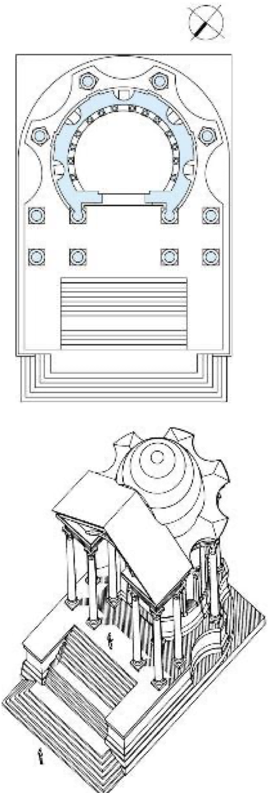
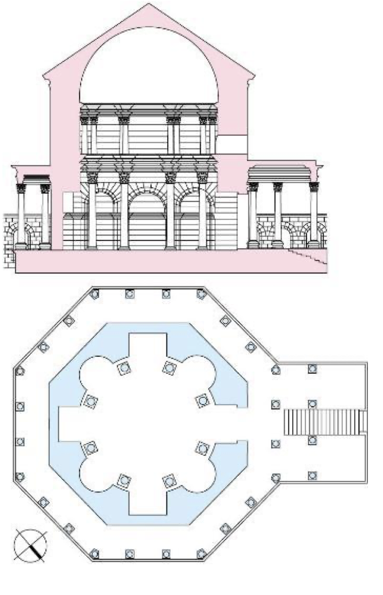

# L'architettura tardoantica: da Baalbek a Spalato

> [!info] Note collegate
> Sbobina: [[11-architettura-tardoantica]]
>
> Argomenti collegati: [[03-roma-foro-e-fori-imperiali]] · [[04-via-appia-cecilia-metella-massenzio]] · [[05-costruzione-nel-mondo-antico]] · [[06-potere-imperiale-spettacolo-pompei]] · [[08-terme-di-caracalla]] · [[09-villa-romana-e-villa-adriana]] · [[10-pantheon-da-agrippa-ad-adriano]]

Con l'espressione architettura tardoantica si indica un insieme di opere che appartengono a una fase tarda della storia dell'impero romano, successiva al periodo, culminato con l'età di Adriano, considerato l'apice della sua produzione artistica. È una definizione storica e cronologica, non stilistica: colloca le opere in un momento preciso, ma resta volutamente ampia, perché viene fatta iniziare genericamente dalla seconda metà del II secolo d.C. e abbraccia una porzione vastissima della produzione dell'impero. Il periodo arriva fino al conflitto tra Massenzio e Costantino e alla cristianizzazione dell'impero, che apre la stagione dell'architettura paleocristiana. Seguire questa fase significa chiedersi come cambi l'architettura nel momento in cui cambia il carattere del governo romano: le forme si trasformano, la trabeazione perde la sua continuità, entrano nel vocabolario soluzioni di origine orientale, e anche la concezione dello spazio, a partire da quello della casa, si fa più libera e articolata.

## IL TARDOANTICO: UNA DEFINIZIONE E UNA CRISI

### Da periodo di decadenza a indicazione cronologica

Si comincia a parlare di architettura tardoantica tra la fine dell'Ottocento e l'inizio del Novecento, quando storici e critici riscontrano una variazione delle forme artistiche e architettoniche che avevano caratterizzato la produzione dell'impero romano. In origine la definizione aveva un'accezione negativa: implicava l'idea di una decadenza, di un declino nel modo di produrre opere d'arte e di architettura dopo lo splendore e i fasti dell'epoca adrianea. Più di recente si è preferito considerarla in un'ottica più oggettiva, come una semplice indicazione cronologica.

### Dall'età dell'oro al ferro arrugginito

L'idea della decadenza è suggerita agli storici già dalle fonti antiche che assistettero all'evoluzione dell'impero. Lo storico Cassio Dione scrive che «dopo la morte di Marco [Aurelio] la storia passò da un impero d'oro a uno di ferro arrugginito»: dopo il periodo di massimo splendore, l'età dell'oro, si apre una fase più critica, leggibile come un declino. Il regno di Marco Aurelio, tra il 161 e il 180 d.C., due generazioni dopo Adriano, morto nel 138, rappresenta dunque l'ultimo momento prima che l'impero si avvii verso la tarda antichità. Ne resta un'immagine celebre nella statua equestre in bronzo dell'imperatore, oggi conservata ai Musei Capitolini: già negli anni Trenta del Cinquecento papa Paolo III Farnese l'aveva fatta collocare al centro della piazza del Campidoglio, dove l'originale rimase esposto alle intemperie fino agli anni Novanta del Novecento, quando per ragioni di restauro e di tutela fu trasferito nel museo e sostituito da una copia.

### Un impero troppo grande

La crisi descritta da Cassio Dione è prima di tutto politica ed economica, e solo in un secondo momento ha ricadute sulla produzione artistica. Essa nasce dalla progressiva espansione dei confini dell'impero, che, conquistando territori nel bacino del Mediterraneo, in Oriente e nelle regioni interne dell'Europa, diventa sempre più difficile da governare. Le annessioni compiute dopo la morte di Augusto, nel 14 d.C., e fino alla fine del II secolo sono meno estese di quelle augustee, ma spostano i confini sempre più lontano da Roma: il controllo dei territori e la repressione delle ribellioni che vi divampavano producono un'instabilità politica crescente, che si traduce a sua volta in difficoltà economiche.

Lo storico Peter Brown, nel suo *Il mondo tardo antico. Da Marco Aurelio a Maometto* (1971), è il primo a proporre una revisione del concetto di tarda antichità, sostituendo all'idea di decadenza una lettura neutrale e cronologica. «L'impero romano», scrive, «che nel 200 si era così pericolosamente esteso tanto lontano dal Mediterraneo, era tenuto insieme dall'illusione di essere ancora un mondo molto piccolo. Di rado era accaduto che uno stato dipendesse da un così delicato gioco di prestigio. Nel 200 l'impero era retto da un'aristocrazia di cultura e lingua straordinariamente uniformi». Tra le condizioni che determinano la trasformazione, Brown individua proprio la perdita di questa uniformità: le annessioni successive diversificano la cultura e la lingua dei territori dell'impero. La crisi che ne deriva crea difficoltà nella gestione dei confini e nella politica del territorio, ma per Brown è un'occasione di arricchimento e non di impoverimento, perché trasforma la cultura, la letteratura, le arti e, con esse, l'architettura.

### Il punto di partenza: l'architettura romana classica

Per misurare la trasformazione occorre richiamare i caratteri dell'architettura romana nel pieno del suo splendore. Il Teatro di Marcello, commissionato da Augusto in memoria del nipote Marcello, figlio della sorella Ottavia, morto giovanissimo, e associato a una biblioteca e alla sua tomba, ne mostra due tratti distintivi, collegati ma da tenere distinti: l'uso degli ordini architettonici in una sequenza che sale dal più semplice, il dorico, verso i più decorati, e l'arco inquadrato dall'ordine, detto anche motivo teatrale o motivo del *Tabularium*, che è una particolare applicazione degli ordini e che Sebastiano Serlio disegna con precisione nel suo trattato. Lo stesso linguaggio si ritrova, con un maggior numero di registri, nell'Anfiteatro Flavio, il Colosseo, dove gli ordini salgono dal dorico tuscanico fino al composito dell'attico. Il Pantheon aggiunge a questi caratteri un magistero costruttivo straordinario, cioè la capacità di realizzare opere estremamente impegnative dal punto di vista tecnico: la sua cupola, di circa 43 metri di diametro, rimarrà insuperata per secoli.

Le opere prodotte nei circa centocinquant'anni che vanno da Augusto a Marco Aurelio, e nel caso del corso fino ad Adriano, sono considerate canoniche: gli architetti dei secoli successivi vi riconosceranno l'antico per eccellenza, e da un certo momento in poi le definiranno classiche. Il termine classico, già incontrato per la Grecia, dove indica il periodo centrale tra l'arcaico e l'ellenistico, deriva dal lessico navale, dalle *classes*, le navi che stavano davanti alla flotta, e designa il momento di massimo splendore di un periodo, destinato a diventare modello. È un concetto fluido, che si estende all'antichità classica intesa come unione dell'arte greca e romana; per l'architettura romana identifica l'impiego degli ordini secondo determinati sistemi formali e un alto magistero tecnologico. Proprio su questi caratteri si misura il cambiamento del mondo tardoantico.

## LE NUOVE FORME: BAALBEK, LEPTIS MAGNA E L'ARCO SIRIACO

### Il santuario di Eliopoli

Il complesso sacro di Eliopoli, l'odierna Baalbek in Libano, fu realizzato in un lungo arco di tempo, tra il I e il III secolo d.C.; interessa soprattutto la sua fase più tarda, perché il complesso raggiunse le forme oggi ricostruite all'inizio del III secolo, quando, negli anni dell'imperatore Caracalla, committente delle [[08-terme-di-caracalla|terme]] romane, vi si lavorò intensamente in una serie di ricostruzioni e trasformazioni. Il percorso si sviluppa per sequenze: dal portico d'accesso, il propileo, si passa a un cortile esagonale e quindi a un grande cortile porticato a tre bracci, che segna il confine del recinto sacro (*tèmenos*), fino al tempio di Giove Eliopolitano; accanto sorgono il tempio di Bacco e il cosiddetto tempio di Venere. Al cantiere di Eliopoli era destinata anche la cosiddetta Pietra del Sud, l'enorme blocco estratto solo in parte e rimasto nella cava.

![[baalbek-pianta-santuario.png|560]]

*Il santuario di Eliopoli (Baalbek): 1 propileo, 2 cortile esagonale, 3 portico a tre bracci (tèmenos), 4 tempio di Giove Eliopolitano, 5 tempio di Bacco, 6 tempio detto di Venere.*

### Il tempio di Bacco e il risalto di trabeazione

Il tempio di Bacco, datato tra il 150 e il 200 d.C., era ancora in buono stato di conservazione all'inizio degli anni Duemila. Come il Pantheon, deve la sua sopravvivenza alla trasformazione in chiesa cristiana, avvenuta nel IV secolo, che lo sottrasse alle spoliazioni a cui erano normalmente sottoposti gli edifici antichi. È un tempio rettangolare, periptero, con la cella circondata su tutti i lati da colonne, e ottastilo, con otto colonne corinzie sul fronte, dove la fila di colonne si raddoppia accrescendo la monumentalità dell'edificio; al podio si accede da una scalinata di notevole altezza.

È all'interno della cella che compaiono caratteri lontani da quelli dell'architettura classica. Le pareti sono scandite da colonne addossate alla muratura, in alcuni punti accostate ma non del tutto appoggiate a essa, e la trabeazione che corre sopra i capitelli non è più continua: sporge in corrispondenza di ogni capitello e poi rientra, appoggiandosi alla superficie del muro. Questa soluzione, detta risalto di trabeazione, indica un sistema che non è più lineare ma varia la propria sporgenza, e diventa distintiva della fase tardoantica. La sua ragione non è strutturale: le colonne non sono portanti ma decorative, perché è la parete a dare stabilità alla cella. È invece una scelta di gusto, che conferisce maggiore plasticità alla decorazione architettonica. Il termine plastico, usato per l'*opus caementicium* per indicare un materiale che si può modellare, qui si riferisce a un effetto visivo: la trabeazione sembra modellata sulla forma dei capitelli, come se la pietra, che non può essere piegata, si lasciasse plasmare. Non c'è la volontà di rappresentare una deformazione in atto, perché le forme restano statiche, ma quella di rendere più tridimensionale l'apparato decorativo. Nella cella compaiono anche archi, ma in un rapporto proporzionale del tutto diverso da quello dell'arco inquadrato dall'ordine: sistema ad arco e sistema trabeato si combinano secondo una logica nuova rispetto al motivo teatrale.

### Il tempio di Venere e la trabeazione curva

 Il cosiddetto tempio di Venere, nello stesso complesso, fu rifatto all'inizio del III secolo, ancora sotto Caracalla, al posto di un edificio precedente. La nuova costruzione ha una cella circolare, la cui circonferenza non è completa perché intersecata dal pronao: un'alta scalinata conduce al podio, un pronao tetrastilo è sormontato da un frontone con timpano e la cella circolare è circondata da colonne che proseguono quelle del pronao. La pianta richiama idealmente quella del [[10-pantheon-da-agrippa-ad-adriano|Pantheon]], con la sua sequenza di parti prima rettilinee e poi curvilinee, dal pronao all'avancorpo alla rotonda; ma le dimensioni sono molto inferiori e il colonnato esterno che avvolge la cella costituisce una differenza sostanziale.

Anche qui la trabeazione rivela la nuova sensibilità. Sopra le colonne non disegna una circonferenza, come nei templi circolari del periodo precedente, ma si flette: sporge in corrispondenza dei capitelli e torna poi ad aderire alla muratura della cella, generando una forma curva e inedita. Il tempio di Venere mostra così i due volti dell'architettura tardoantica: la prosecuzione di temi ereditati da un grande modello come il Pantheon e la loro rielaborazione secondo un gusto nuovo.

### Leptis Magna e l'arco quadrifronte di Settimio Severo

Leptis Magna, in Libia, è una fondazione antichissima, la cui storia romana inizia con l'annessione all'impero, quando la città viene rifondata e ricostruita secondo i principi dell'architettura romana. All'inizio del III secolo vi si realizzano alcune opere per ricordare il passaggio di Settimio Severo, imperatore dal 193 al 211, che nel 203 visitò la sua città natale. In suo onore viene eretto un arco nel punto d'incontro tra il cardo e il decumano, le due strade perpendicolari che strutturano le città di fondazione romana.

L'arco è quadrifronte: a differenza degli archi di trionfo urbani, può essere attraversato in entrambe le direzioni, come richiede la sua posizione all'incrocio di due strade, che altrimenti avrebbe ostruito. È dunque un monumento celebrativo che deve assolvere anche una funzione pratica, con quattro fronti tutti uguali. Vi si riconoscono elementi già noti, come il fornice, cioè il passaggio a forma di arco, affiancato da colonne; ma queste sono colonne libere, staccate dalla parete e collegate a essa da una trabeazione che, come nel tempio di Bacco, sporge in corrispondenza dei capitelli e poi si appiattisce sulla parete. Sopra le colonne non c'è un timpano ma soltanto i frammenti di un timpano ideale: i due tratti inclinati, che ci si aspetterebbe congiunti in un vertice, restano spezzati. Rispetto al frontone continuo del tempio, la soluzione rende più movimentata la decorazione architettonica. Sopra corre un attico con un bassorilievo che rappresenta una processione, tema tipico degli archi di trionfo legato alla loro funzione cerimoniale, anche se questo arco non ricorda un trionfo ma il passaggio dell'imperatore; i soggetti celebrano la dinastia dei Severi, accompagnati dalle vittorie alate, simbolo di buon auspicio per il trionfo dell'imperatore.

A Roma un esempio di arco quadrifronte, utile per comprendere la doppia simmetria di questo tipo, è l'Arco di Giano al Foro Boario, del IV secolo d.C., accanto alla chiesa di San Giorgio al Velabro. Una stampa del Cinquecento lo mostra ancora con le sovrastrutture sulla sommità, poi eliminate.

### Continuità e rottura

Accanto alle variazioni formali, alcune consuetudini restano costanti, soprattutto nelle tecniche costruttive: la via principale di Leptis Magna è pavimentata in basolato, come la [[04-via-appia-cecilia-metella-massenzio|Via Appia]]. Al centro del mercato della città, una struttura architettonica tardoantica ripropone ancora il sistema dell'arco inquadrato dall'ordine, segno di una continuità che convive con innovazioni di rottura.

La più importante di queste è l'arco sostenuto da colonne. Fino a questo momento gli ordini conoscevano due sistemi: le colonne che reggono la trabeazione, come nei templi, e l'arco inquadrato dall'ordine, in cui però l'ordine continua a sostenere una trabeazione, mentre l'arco poggia su segmenti di muratura. Nella concezione antica degli ordini, infatti, le colonne, libere, semicolonne o paraste che siano, sostengono sempre un elemento lineare. Nella porta nord di una città della Siria, invece, gli archi poggiano direttamente sulle colonne: sopra i sostegni verticali non corre più una trabeazione ma una linea arcuata, e l'altezza degli archi varia con la luce, cioè con la distanza tra le colonne, perché quanto più questa è ampia tanto maggiori sono il diametro della semicirconferenza e quindi la sua altezza.

### L'arco siriaco

Una rottura analoga con la tradizione, che si manifesta in alcune opere commissionate da Diocleziano, è l'arco siriaco. La trabeazione corre rettilinea sopra i sostegni verticali ma, al centro, si rompe e si incurva verso l'alto, generando un arco: con il termine si indica l'intero blocco, formato da due segmenti di trabeazione rettilinea e da un segmento curvo al centro, che fonde sistema trabeato e sistema ad arco. Il nome stesso ne dichiara l'origine esotica: il sistema unisce ai modi costruttivi dell'impero un vocabolario formale proveniente dall'Oriente, dalla Siria, ed entra anche nella committenza imperiale, come mostra il Palazzo di Diocleziano a Spalato. È un processo già avviato da Adriano, che nella [[09-villa-romana-e-villa-adriana|villa di Tivoli]] aveva inserito soluzioni ispirate ai modelli esotici incontrati nei suoi viaggi: il confronto tra l'architettura di Roma e quella dei territori più lontani produce forme prima inedite, che diventeranno poi consuete. La trasformazione delle forme nell'età tardoantica si riassume così in due fenomeni: una nuova concezione della trabeazione, non più continua ma spezzata, e l'introduzione di soluzioni nuove come l'arco siriaco.

## LO SPAZIO DELLA DOMUS TARDOANTICA

### La domus canonica e la Forma Urbis

Le nuove forme hanno un riscontro nella concezione dello spazio, ben leggibile nella *domus*. La *domus* canonica, pur nelle sue molte declinazioni, come mostrano gli esempi di Pompei, è una struttura generalmente simmetrica, formata da una sequenza di ambienti concatenati, di forma regolare e per lo più rettangolare, e da un'alternanza di spazi coperti e scoperti: le *fauces*, l'atrio, il *tablinum* e il peristilio. La pianta della *domus* descritta da Vitruvio può essere ricostruita anche nelle sue dimensioni in piedi romani. Questo schema è confermato, oltre che dagli scavi di Pompei, dalla *Forma Urbis*, la pianta marmorea di tutta Roma incisa sulla pietra nell'età di Settimio Severo, all'inizio del III secolo d.C., oggi esposta nel Museo della *Forma Urbis* al Celio: in alcuni frammenti, come quello dell'area del Vicolo Patricius, si riconoscono file di *domus* che rispondono ancora alle forme consuete.

### Piante libere e sale polilobate

Nella *domus* tardoantica le funzioni degli ambienti restano sostanzialmente le stesse, mentre cambia la concezione delle loro forme. Le piante di *domus* provenienti da diverse parti dell'impero, come Ravenna, Afrodisia, Efeso, Tolemaide, Stobi, Apollonia ed Emerita, disegnate alla stessa scala, rendono difficile riconoscere lo schema canonico: si perdono la schematicità e il rigore della pianta rettangolare dal perimetro continuo, si perdono la simmetria e la regolarità, e in compenso gli ambienti si affollano e si moltiplicano. Compaiono inoltre stanze dalle forme elaborate, non più quadrate o rettangolari ma polilobate, cioè configurate come una sequenza di lobi, di curve, che rende lo spazio molto più articolato.

![[domus-tardoantiche-piante.png|640]]

*Piante di domus tardoantiche da diverse parti dell'impero, alla stessa scala.*

Permangono alcuni fattori di continuità: le corti interne, i cortili o vestiboli d'ingresso, le sale absidate, le terme private, le fontane e i ninfei, e l'appropriazione di spazi pubblici. Cambia invece la composizione planimetrica, che acquista una grande libertà formale e segue una logica aggregativa, aperta e multiassiale. Aggregativa, perché procede per aggiunte progressive di spazi; aperta, come la villa aperta contrapposta alla villa cubica, perché non è racchiusa in una geometria definita; multiassiale, perché non ha più la direzione unica che nella *domus* antica conduceva dalle *fauces* al peristilio, e chi la percorre è costretto a muoversi in più direzioni.

### Il cosiddetto tempio di Minerva Medica

Un esempio sopravvissuto di sala polilobata si trova a Roma, vicino a Termini e a Porta Maggiore: il cosiddetto tempio di Minerva Medica. I suoi resti furono inizialmente identificati con un tempio, ma gli studi archeologici hanno dimostrato che si trattava di una *cenatio*, un ambiente destinato alle cene e ai banchetti, padiglione di un complesso residenziale, gli *Horti Liciniani*. Costruita nel primo quarto del IV secolo e ampliata poco dopo, la sala ha un impianto centrale circondato da ambienti di forma arcuata e coperto da una cupola; secondo la ricostruzione, l'edificio era completato da un percorso d'accesso e da due esedre laterali che rendevano ancora più articolato lo spazio della *cenatio*. La variazione delle forme architettoniche si riflette dunque anche nella concezione dello spazio: sono i due livelli del progetto su cui agisce il cambiamento tardoantico.

## ROMA TRA MASSENZIO E COSTANTINO

### La battaglia di Ponte Milvio

La fase cruciale dell'età tardoantica coincide con il conflitto tra due imperatori, Massenzio e Costantino. Massenzio è il committente della [[04-via-appia-cecilia-metella-massenzio|villa sulla Via Appia]]; Costantino è il suo grande avversario, che lo sconfigge nella battaglia di Ponte Milvio del 312 d.C., in cui Massenzio muore. La compresenza di più imperatori dipende dalla nuova organizzazione politica dell'impero che, raggiunta una grande espansione, viene suddiviso in porzioni governate da più sovrani per garantire una gestione più sistematica dei territori, come nella tetrarchia istituita da Diocleziano. La vittoria di Costantino avvia la trasformazione dell'impero da pagano a cristiano, attraverso una serie di tappe: nel 313 viene concessa la libertà di culto ai cristiani, nel 325 il Concilio di Nicea ne fa la religione ufficiale dell'impero e nel 380 il cristianesimo diventa l'unica religione ammessa nello Stato. Il racconto di questo passaggio, dalla vittoria su Massenzio al riconoscimento del cristianesimo come unica religione, è al centro del libro di Paul Veyne *Quando l'Europa è diventata cristiana (312-394)*, e una delle sue immagini più celebri è il *Sogno di Costantino* dipinto da Piero della Francesca nella Basilica di San Francesco ad Arezzo.

### L'Arco di Costantino

La vittoria di Ponte Milvio determina la costruzione di una delle opere più significative della Roma tardoantica, l'Arco di Costantino, eretto tra il 312 e il 315 d.C. per ricordare la battaglia. Il committente ufficiale è il Senato, ma il beneficiario esplicito è Costantino, celebrato come imperatore vittorioso; l'epigrafe dell'attico celebra appunto i rapporti tra Costantino e il Senato. La forma è quella dell'arco di trionfo: tre fornici, con il centrale più alto dei laterali, e un'impaginazione scandita da colonne libere, sulle quali poggiano, sopra la trabeazione, le statue dei prigioni, cioè dei prigionieri, decorazione tipica di questo genere di monumenti. Le vittorie alate decorano il fornice centrale, mentre sopra si eleva l'alto attico con l'epigrafe, scolpita per l'occasione e non di reimpiego. Il carattere che permette sempre di riconoscere l'arco sono i tondi, quattro su ciascuno dei due lati: è l'unico arco di trionfo del mondo romano a presentarli.

### Il reimpiego: l'arco come bricolage

Essendo una committenza di Stato destinata all'imperatore, l'arco permette di capire che cosa stesse accadendo all'architettura ufficiale, soprattutto rispetto al reimpiego dei materiali, gli *spolia*. Gli studiosi lo hanno definito un esempio di *bricolage*, perché è un grande montaggio di frammenti provenienti da monumenti diversi, smontati e ricomposti per costruire il nuovo edificio. I pezzi reimpiegati provengono da opere dell'età di Traiano, di Adriano e di Marco Aurelio, edifici del II secolo. Dal monumento di Adriano provengono l'apparato scultoreo e decorativo della porzione centrale, compresi i quattro tondi e le paraste che sostengono gli archi; gli interventi di età costantiniana riguardano invece il fregio e le sculture poste sui piedistalli delle colonne, cioè la parte inferiore e quella superiore dell'arco. Si distinguono così tre categorie di pezzi: elementi antichi di reimpiego, elementi della stessa età di Costantino ricollocati, e nuove decorazioni realizzate per l'occasione. Le sculture che raffiguravano l'imperatore furono riscolpite, per cancellare la memoria della loro provenienza e adattarle al nuovo committente.

### I marmi colorati

Un disegno del Cinquecento mostra l'arco con i marmi e le pietre policrome che lo decoravano, oggi visibili solo in piccola parte: l'autore annota che era «tutto historiato di bellissime figure, le colonne dj mischio giallo, glj fregj di mischio verde, & in somma tutto era commesso di uarie sorte dj pietre». Il porfido è ancora presente come sfondo di una coppia di tondi, mentre le colonne di pregio in mischio giallo e mischio verde sono state quasi del tutto spogliate.

### La Basilica di Massenzio

Il passaggio da Massenzio a Costantino si legge anche in opere ancora più monumentali, avviate dal primo e completate dal secondo. La più celebre è la Basilica di Massenzio, iniziata nel 306 e, dopo Ponte Milvio, completata da Costantino, che ne proseguì il cantiere fino al 337; per questo in letteratura si trovano entrambe le denominazioni, Basilica di Massenzio e Basilica di Costantino. Sorge nell'area dei Fori, oggi nel Parco archeologico del Colosseo, ed è subito riconoscibile per le tre grandi arcate superstiti, che rappresentano solo una parte del complesso progettato, mai portato a termine. La sua funzione è la stessa delle basiliche già incontrate: vi si amministrava la giustizia e si trattavano gli affari. Il suo spazio monumentale ha conosciuto anche usi moderni: alle Olimpiadi di Roma del 1960 vi si disputarono le gare di lotta libera.

![[basilica-di-massenzio-pianta.png|560]]

*Basilica di Massenzio: 1 colonne, 2 vani di collegamento, 3 ingresso originale, 4 abside, 5 ingresso meridionale, 6 nuova abside.*

La basilica aveva due accessi: quello orientale, il primo a essere costruito, e quello meridionale. Da entrambi si entra in uno spazio suddiviso in navate da una sequenza di colonne e di pilastri, che disegnano una struttura interna molto frazionata; della costruzione restano riconoscibili le grandi arcate e le strutture murarie che contribuivano alla stabilità dell'insieme. La navata centrale, che dall'ingresso principale arriva fino all'abside, è lunga 80 metri e larga 25: una dimensione monumentale, di poco inferiore a quella delle parti centrali degli impianti termali, di circa 120-130 metri. Le coperture erano volte a botte cassettonate, con l'intradosso decorato da una sequenza di cassettoni come quelli della cupola del Pantheon. La costruzione impiegava i laterizi nei formati consueti dell'edilizia romana, misurati in piedi romani: i bessali di 20 centimetri di lato (due terzi di piede), i sesquipedali di 44 (un piede e mezzo) e i bipedali di 59 (due piedi). Il sistema costruttivo della basilica fu studiato nell'Ottocento da Auguste Choisy, mentre un'ipotesi ricostruttiva di H.-M.-D. d'Espouy, del 1889, ne restituisce le sezioni con la ricchezza cromatica dei materiali originari, e già nel Cinquecento Pirro Ligorio ne aveva disegnato la pianta. Il confronto con la Basilica Fulvia-Emilia, la prima basilica incontrata nel Foro, mostra variazioni evidenti, ma anche caratteri rimasti invariati, come l'impianto rettangolare e la ripartizione in navate.

### La statua colossale di Costantino

Per appropriarsi del complesso avviato da Massenzio e connotarlo in modo inequivocabile, Costantino vi collocò una propria statua colossale, datata tra il 313 e il 324, che occupava l'abside della basilica. Ne restano alcuni frammenti, tra cui la testa, una mano e un piede, esposti nel cortile del Palazzo dei Conservatori ai Musei Capitolini. Una ricostruzione a grandezza naturale, presentata qualche anno fa in una mostra alla Fondazione Prada di Milano, ha permesso di immaginarne le dimensioni originarie.

Con il conflitto tra Massenzio e Costantino si avvia il processo di cristianizzazione che porterà la più grande rivoluzione nella storia dell'impero. Sul piano dell'architettura essa si tradurrà nelle basiliche paleocristiane, che non saranno più edifici per amministrare la giustizia ma architetture concepite per ospitare il culto cristiano.

## IL PALAZZO DI DIOCLEZIANO A SPALATO

### Un imperatore lontano da Roma

Diocleziano, vissuto tra il 244 e il 313 d.C. e nato a Salona, in Croazia, è lo stesso imperatore che fece costruire a Roma le grandi Terme di Diocleziano, ma scelse di collocare la propria residenza non più nella capitale bensì nella sua terra natale, a Spalato, dove il palazzo fu costruito a partire dal 293. La scelta rivela come, in questa fase ormai molto tarda, tra il III e il IV secolo, Roma avesse perduto il ruolo di centro assoluto dell'impero: anche gli imperatori cominciano a scegliere altre sedi per i propri palazzi, nel quadro di un impero diviso tra più sovrani, ciascuno con la propria sede.

### Un palazzo sul mare

Il palazzo si configura come una piccola cittadella affacciata sul mare. In una pianta di Spalato dell'inizio del Novecento, con il porto commerciale ormai trasformato da nuove aggiunte, si riconosce ancora il perimetro del palazzo; in origine, però, Diocleziano lo volle a diretto contatto con l'acqua. Come le ville marittime e panoramiche, è dunque un palazzo in qualche modo marittimo, concepito per posizione e per forme architettoniche in diretta relazione con il mare: un'intera facciata poggiava le fondazioni sull'acqua, e la sua sequenza di archi e di finestre era pensata per offrire una visione privilegiata del paesaggio marino.

### Una città romana in miniatura

La pianta del palazzo ricorda una piccola cittadella fortificata, non molto diversa da una città romana in miniatura. Una cinta muraria, rafforzata da torri e bastioni in corrispondenza delle porte, si apre con tre accessi: la Porta di Ferro, la Porta d'Argento e la Porta d'Oro. Dalle porte partono due viali porticati tra loro perpendicolari, che riprendono la forma del cardo e del decumano e dividono l'area in quattro porzioni, occupate dagli ambienti di abitazione e da alcuni cortili. Gli ambienti destinati alla residenza dell'imperatore erano però soprattutto quelli affacciati sul mare, perché un palazzo rivolto verso il mare non avrebbe avuto senso se non per godere ogni giorno di quella vista: la zona residenziale è quindi quella della lunga facciata traforata da finestre sull'acqua. Accanto all'abitazione si trova la zona del culto, con il tempio che Diocleziano fece costruire all'interno della residenza e, esattamente di fronte, il suo mausoleo, posto sullo stesso asse del tempio con un chiaro messaggio simbolico.

![[spalato-palazzo-diocleziano-pianta.png|640]]

*Pianta del Palazzo di Diocleziano a Spalato, III-IV secolo d.C.*

### La facciata sul mare

L'elemento più caratteristico del palazzo è la facciata verso il mare, scandita da una sequenza di aperture ad arco la cui parte centrale è evidenziata da archi più alti. La ricostruzione di Ernest Hébrard e Jacques Zeiller, pubblicata nel 1912 in *Spalato, le Palais de Dioclétien*, mostra come la serie di archi uguali sia interrotta da pause segnate da grandi archi siriaci, con i due segmenti rettilinei di trabeazione e l'arco al centro, posti alle due estremità e al centro della facciata; un'ulteriore interruzione del ritmo si trova al centro delle due campate laterali, in corrispondenza di archi di dimensione leggermente maggiore. È uno schema ritmico, fondato sull'alternanza di parti tutte uguali e di pause dalle caratteristiche architettoniche diverse. Fu anche l'elemento più ridisegnato dagli architetti e dagli archeologi che visitarono il palazzo nel corso dei secoli: nel 1764 l'inglese Robert Adam e il francese Charles-Louis Clérisseau ne realizzarono insieme le vedute, pubblicate in *Ruins of the palace of the Emperor Diocletian at Spalato in Dalmatia*, che mostrano il rapporto diretto della facciata con l'acqua e insieme lo sfruttamento progressivo del suo basamento per costruire nuovi edifici.

### Il peristilio e il mausoleo

Il peristilio è la piazza rettangolare che segna il passaggio dalla parte posteriore del palazzo alla zona residenziale affacciata sul mare. È circondato da colonne sormontate da archi e, su uno dei lati corti, si apre il grande arco siriaco: tra il III e il IV secolo questo sistema decorativo è ormai di uso comune e si fonde con quello dell'arco su colonne.

 Il mausoleo di Diocleziano, costruito tra il 300 e il 306, è un edificio a pianta centrale. Come tutti i mausolei, è un monumento celebrativo, destinato a tramandare l'immagine di chi vi è sepolto. All'esterno la pianta è ottagonale, con un anello di colonne che circonda la cella; all'interno lo spazio è scandito da otto colonne disposte su due registri e da un'alternanza di nicchie semicircolari e rettangolari. La sezione rivela una cupola che, contenuta nella struttura del tetto, non è visibile dall'esterno e caratterizza soltanto lo spazio interno. Gli spaccati assonometrici di Hébrard e Zeiller mostrano il rapporto tra queste parti e l'anello di colonne che avvolge il mausoleo. Oggi l'edificio è il Duomo di Spalato: una trasformazione funzionale significativa, che ne ha garantito la conservazione.

### Un palazzo in forma di città

Il palazzo di Diocleziano è stato progressivamente cannibalizzato dalle costruzioni successive. L'intera struttura originale è stata inglobata nella città, che nel corso del tempo ha occupato anche l'area racchiusa dalle mura e dai bastioni, tanto che oggi è difficile distinguere con nettezza il palazzo antico dal tessuto urbano. Nato come una città in miniatura, il palazzo è diventato davvero una città.

## Collegamenti

L'architettura tardoantica si comprende solo misurandola su quella del periodo classico. Il risalto e la spezzatura della trabeazione rompono la continuità del sistema trabeato studiato con gli [[01-ordini-architettonici|ordini architettonici]], mentre l'arco su colonne e l'arco siriaco superano l'arco inquadrato dall'ordine visto nel [[03-roma-foro-e-fori-imperiali|Tabularium]] e nei [[06-potere-imperiale-spettacolo-pompei|teatri e anfiteatri]]. L'arco quadrifronte di Leptis Magna e l'Arco di Costantino proseguono la storia dell'[[06-potere-imperiale-spettacolo-pompei|arco di trionfo]], e la posizione del primo all'incrocio tra cardo e decumano richiama l'impianto delle città di fondazione; lo stesso schema riaffiora, in miniatura, nei viali del palazzo di Spalato. La Basilica di Massenzio va confrontata con la [[03-roma-foro-e-fori-imperiali|Basilica Fulvia-Emilia]] e con le grandi aule voltate delle [[08-terme-di-caracalla|terme imperiali]], da cui riprende la scala e la struttura, mentre la figura di Massenzio lega questa lezione alla [[04-via-appia-cecilia-metella-massenzio|villa sulla Via Appia]]. La trasformazione della *domus* si legge in rapporto alla casa canonica di Pompei e del Palatino descritta nella lezione sulla [[07-residenza-romana-palatino-domus-aurea|residenza romana]] e alla villa aperta della [[09-villa-romana-e-villa-adriana|villa romana]], dove Adriano aveva già accolto i modelli esotici che qui diventano linguaggio comune; il tempio di Venere a Baalbek, la sala di Minerva Medica e il mausoleo di Diocleziano rielaborano invece la pianta centrale del [[10-pantheon-da-agrippa-ad-adriano|Pantheon]]. Il reimpiego degli *spolia* nell'Arco di Costantino, la Pietra del Sud di Baalbek e i formati dei laterizi rimandano alla [[05-costruzione-nel-mondo-antico|costruzione nel mondo antico]]. Infine, la trasformazione del tempio di Bacco in chiesa, del mausoleo di Diocleziano in duomo e la cristianizzazione avviata da Costantino introducono l'architettura paleocristiana, argomento della lezione successiva, mentre i disegni di Serlio, Ligorio, Adam e Clérisseau mostrano come questi edifici siano diventati modelli per gli architetti dei secoli successivi.
