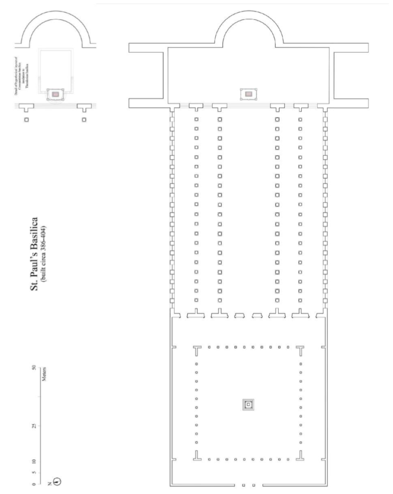
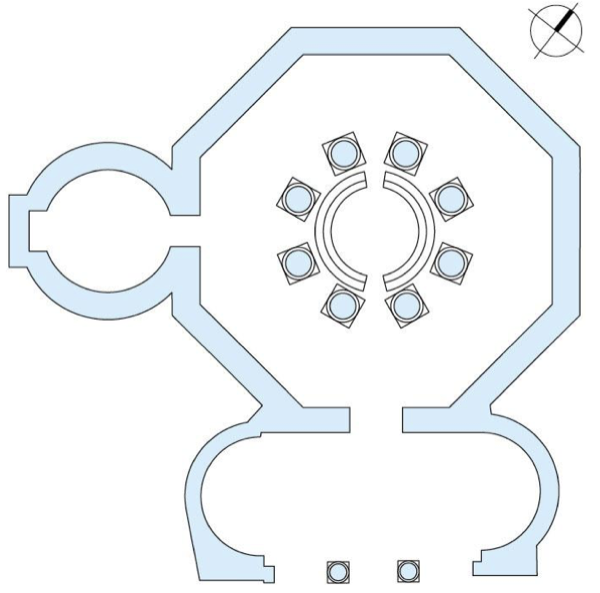

# L'architettura paleocristiana a Roma: basiliche e battistero

> [!info] Note collegate
> Sbobina: [[12-architettura-paleocristiana]]
>
> Argomenti collegati: [[01-ordini-architettonici]] · [[03-roma-foro-e-fori-imperiali]] · [[07-residenza-romana-palatino-domus-aurea]] · [[08-terme-di-caracalla]] · [[10-pantheon-da-agrippa-ad-adriano]] · [[11-architettura-tardoantica-da-baalbek-a-spalato]] · [[13-architettura-bizantina-costantinopoli-e-ravenna]] · [[14-san-vitale-longobardi-e-carlo-magno]] · [[15-introduzione-al-romanico-firenze-e-pisa]]

Con il termine paleocristiano si indica, nel campo delle arti, il periodo che corrisponde all'inizio dell'epoca cristiana. Non si tratta però dei primi decenni dopo la nascita di Cristo, come verrebbe da pensare, ma del momento in cui il culto cristiano viene concesso, poi ammesso e infine reso l'unico consentito all'interno dell'impero: finché il culto non è permesso, infatti, non è permessa neppure la costruzione di edifici destinati a praticarlo. A differenza di tardoantico, che è una definizione soltanto cronologica, non legata né a un tipo di edificio né a un'area geografica, l'architettura paleocristiana ha una collocazione geografica e corrisponde a uno specifico tipo di architettura, quella degli edifici per il nuovo culto. Il suo punto d'origine è il 312 d.C., quando Costantino sconfigge Massenzio nella battaglia di Ponte Milvio. Costantino aveva intuito l'importanza della rivoluzione religiosa che si stava manifestando nell'impero, e la sua vittoria apre la fase in cui il culto cristiano viene promosso. Seguire questa stagione a Roma significa chiedersi che cosa cambi nella costruzione delle opere architettoniche quando si passa da un impero pagano a un impero cristiano: quali edifici diventano necessari, a quali modelli si attinge per costruirli, e dove vengono collocati nella città.

## IL CRISTIANESIMO E L'IMPERO

### La cristianizzazione dell'impero

La vittoria di Ponte Milvio non segna un'adesione immediata al cristianesimo, ma l'avvio di un processo, la cosiddetta cristianizzazione dell'impero, attraverso cui l'impero romano passa da una fase in cui il culto dominante è quello pagano a una fase in cui il culto dominante è quello cristiano. Di quell'episodio resta una traccia materiale nell'[[11-architettura-tardoantica-da-baalbek-a-spalato|Arco di Costantino]], che il Senato fa erigere all'indomani della vittoria per celebrarla, ricomponendo come in un *bricolage* materiali scultorei provenienti da opere preesistenti. Il processo si sviluppa in circa settant'anni ed è scandito da alcune date. Nel 313 d.C., l'anno successivo alla vittoria, l'editto di Costantino garantisce la libertà al culto cristiano: chi lo pratica non viene più perseguitato. Nel 325 il concilio di Nicea stabilisce che la religione cristiana sia la religione ufficiale dell'impero; non c'è più soltanto la libertà di culto, ma il riconoscimento ufficiale. Nel 380, infine, il cristianesimo diventa l'unica religione ammessa nello Stato. In sessantotto anni si compie così un'inversione speculare: dal paganesimo religione di Stato al cristianesimo come unica religione consentita. Questa conversione porta con sé una serie di trasformazioni che hanno ricadute dirette sulla produzione architettonica.

Alla figura di Costantino è legato un episodio leggendario, il sogno che avrebbe avuto la notte prima della battaglia di Ponte Milvio: in esso l'imperatore avrebbe visto una croce con la scritta *In hoc signo vinces*, «in questo segno vincerai», e avrebbe dunque combattuto nel nome della religione cristiana. Lo rappresenta Piero della Francesca, con i suoi aiuti, negli affreschi della Basilica di San Francesco ad Arezzo (1458-1466). L'episodio è stato fortemente strumentalizzato dalla Chiesa nei secoli successivi, perché visto come un momento fondativo della storia del cristianesimo. La conversione dell'impero a partire dalla vicenda di Costantino è raccontata dallo storico Paul Veyne in *Quando l'Europa è diventata cristiana (312-394)*.

### Un processo graduale: la continuità delle forme

Come tutti i processi di trasformazione che si sviluppano in un lungo periodo, la cristianizzazione non conosce una cesura netta tra un prima e un dopo. È un processo lento e progressivo, legato anche a questioni economiche, che incontra la resistenza di alcune grandi famiglie romane, legate agli ideali del paganesimo. Questa gradualità, insieme religiosa, storica e culturale, si riflette nell'arte e nell'architettura. Le catacombe, i cimiteri sotterranei dei cristiani, che secondo la loro religione dopo la morte devono essere sepolti, sono un'istituzione legata al culto cristiano, e a Roma molte zone ne sono caratterizzate. Le pitture delle catacombe di Domitilla (120 d.C.), con la loro trama geometrica e le piccole figure ornamentali, sono molto simili a quelle di una villa romana costruita in un contesto ancora pagano, oggi sotto la Basilica di San Sebastiano (affresco del 235 d.C. circa). C'è dunque una continuità nell'uso delle forme e della decorazione: l'arte paleocristiana è costellata di simboli con un significato religioso, ma questi simboli, come il pavone o i pesci, sono tratti dal repertorio iconografico già presente nelle decorazioni pagane, a cui viene attribuito un significato diverso.

La scoperta delle catacombe è successiva. Alla fine del Cinquecento si avvia una stagione di scavi molto sistematici dedicati a questi spazi, e nelle catacombe si trovano spesso scritte con le date in cui furono scavate ed esplorate. È lo stesso fenomeno già osservato per l'architettura pagana, quando gli artisti e gli architetti del Rinascimento scavarono e scoprirono progressivamente la [[07-residenza-romana-palatino-domus-aurea|Domus Aurea]] di Nerone, rimasta sepolta e dimenticata per secoli: con questi scavi comincia quella che diventerà l'archeologia cristiana.

### I primi spazi per la preghiera: la *domus ecclesiae* di Dura Europos

I primi spazi di cui si avverte la necessità sono quelli per la preghiera. Un'abitazione-chiesa cristiana del III secolo d.C. a Dura Europos, in Mesopotamia, è considerata uno dei primi esempi di chiesa così come la intende la liturgia cristiana, cioè uno spazio in cui i fedeli si riuniscono per compiere una preghiera comune, collettiva. Si parla di abitazione-chiesa perché questi primi spazi venivano ricavati all'interno delle case: accanto all'abitazione si trova una sala più grande, un'aula dove la comunità si riunisce per pregare. Sono le *domus ecclesiae*, le case all'interno delle quali si ritrova la comunità, e quella di Dura Europos ne è uno dei primi esempi.

![[dura-europos-domus-ecclesiae.png|480]]

*La casa-chiesa di Dura Europos, III secolo d.C., in una ricostruzione: B cortile, G l'aula in cui si riunisce la comunità; la legenda del disegno indica in D ed E il battistero e la vasca.*

### La diffusione del cristianesimo e le tre capitali

Il cristianesimo si diffonde in modo progressivo non solo nel tempo, ma anche nello spazio. Le comunità cristiane documentate nel I e nel II secolo sono concentrate soprattutto nell'area dell'attuale Turchia, ma sono disseminate in tutta l'area che oggi chiamiamo Europa e Mediterraneo. Nel III secolo la diffusione si fa più ampia e non più soltanto puntuale; si estende ancora nel IV secolo, e nel V ha ormai portato alla cristianizzazione globale dell'impero romano. La visibilità di questo processo nelle opere architettoniche è raccontata da Richard Krautheimer, storico dell'arte e dell'architettura paleocristiana, in *Tre capitali cristiane. Topografia e politica*, dedicato a Roma, Milano e Ravenna: la topografia, cioè il modo in cui cambia l'aspetto di queste città, e la politica, cioè il legame fortissimo tra il processo religioso e quello politico del tempo.

## LA BASILICA CRISTIANA

### Il Laterano: una scelta di compromesso

Roma, una delle tre capitali cristiane, va osservata in questa fase di profonda trasformazione. Il primo luogo interessato dalla costruzione di opere paleocristiane è la zona del Laterano, con la Basilica di San Giovanni in Laterano, costruita nel 315 d.C., due anni dopo l'editto di Costantino, e il Battistero Lateranense. Già all'inizio del processo di trasformazione, dunque, a Roma si decide di costruire una basilica cristiana, che esiste ancora oggi, anche se le sue forme non sono più quelle del IV secolo.

La scelta del luogo è significativa. Rispetto al tracciato delle Mura Aureliane la zona del Laterano è periferica, a ridosso delle mura, lontana dal cuore di Roma, cioè dal Campo Marzio, dove erano concentrati i principali segni del paganesimo e le opere che testimoniavano il radicamento della città alla cultura tradizionale. Un'opera destinata a diventare il simbolo del cambiamento viene istituita in un'area periferica per non entrare troppo in conflitto con chi continuava a praticare il culto pagano. La posizione va letta quindi come una scelta di compromesso, che all'indomani della liberalizzazione del culto cristiano consentiva ancora la convivenza tra pagani e cristiani. Il complesso del Laterano riunisce oggi la basilica, il battistero e il palazzo, edifici con funzioni molto diverse; il binomio tra palazzo e basilica rivela la volontà imperiale di porre la propria residenza nelle vicinanze della basilica, e quindi la posizione dell'imperatore in questa vicenda.

### Basiliche e *martyria* nelle parole di Isidoro di Siviglia

La liberalizzazione del culto porta con sé l'esigenza di costruire edifici che rispondano a necessità nuove, legate a un culto che prima non si poteva praticare pubblicamente. Una cosa è ricavare in una casa una stanza per la preghiera, come a Dura Europos, un'altra è edificare un edificio che diventi ufficialmente l'immagine del nuovo corso della storia di Roma. Isidoro di Siviglia, che osserva questi fatti da una prospettiva storica ormai successiva, nel suo testo sulle etimologie degli edifici sacri spiega quali edifici si cominciano a realizzare in questo periodo: «sono chiamati basiliche i templi divini, perché in essi si rende culto e si offrono sacrifici a Dio, re di tutte le cose. *Martyrium* è vocabolo di derivazione greca che significa luogo di martiri: il martirio, infatti, è stato così chiamato in quanto edificato in memoria di un martire, ovvero perché in esso si trovano i sepolcri di santi martiri». Il passo prosegue con l'ara, il cui nome deriverebbe secondo alcuni dall'ardere delle vittime, secondo altri dalle preghiere, che i Greci chiamano *arai*; con l'altare, da *altitudo*, «quasi a dire alta ara»; con il pulpito, da cui il lettore o il salmista, posti in pubblico, possono essere visti dal popolo; con la tribuna, il luogo da cui il sacerdote *tribuit*, cioè impartisce, i precetti di vita.

Le prime due parole indicano le due esigenze fondamentali. Le basiliche sono i templi divini, in cui si pratica il culto e si offrono sacrifici a Dio. I *martyria* sono gli edifici costruiti in memoria di un martire: la persecuzione dei cristiani, che spesso aveva portato al loro martirio, produce la necessità di edifici che ne conservino il ricordo.

### Perché la basilica e non il tempio

Il termine basilica era già in uso nell'architettura romana di età repubblicana, dove indicava i luoghi in cui si esercitava la giustizia, i tribunali, come la [[03-roma-foro-e-fori-imperiali|Basilica Emilia]] nel Foro Romano. Le basiliche paleocristiane, e poi le basiliche cristiane, hanno invece una funzione completamente diversa: sono edifici destinati al culto. Nel cercare forme adatte a funzioni prima inesistenti si attinge a edifici già esistenti, cambiandone alcuni aspetti e modificandone la funzione. Non si sceglie il tempio pagano, che pure aveva una funzione analoga, perché avrebbe creato una confusione troppo grande: nel momento in cui si deve affermare un nuovo corso della religione, replicare un tempio destinato al culto pagano dichiarandolo dedicato al culto cristiano non avrebbe avuto lo stesso impatto. Ci si ispira allora alle basiliche di età romana, che con la nuova funzione non avevano nulla a che fare, se ne riprende il vocabolario formale, e da questo momento basilica non indica più il luogo dell'amministrazione della giustizia, ma il luogo del culto cristiano. Con la fondazione di San Giovanni in Laterano, a partire dal 315, il passaggio è già compiuto: con questo nome la basilica è conosciuta nelle fonti fin dalla fondazione.

### La basilica costantiniana del Laterano

L'aspetto della basilica del IV secolo si ricostruisce attraverso gli scavi archeologici e le fonti iconografiche. Nella Basilica dei Santi Silvestro e Martino ai Monti due pitture parietali di Filippo Gagliardi, del Seicento, rappresentano l'una San Giovanni in Laterano, l'altra San Pietro in Vaticano, nelle forme che avevano in origine. Quella del Laterano mostra una grande navata centrale con una serie di colonne che sostengono una sequenza di archi, separando la navata centrale da quelle laterali, secondo un impianto che si ritrova nella chiesa dei Santi Giovanni e Paolo al Celio.

Il termine basilica allude alle forme dell'edificio pagano. La Basilica Emilia era un edificio più o meno rettangolare, suddiviso all'interno in navate, cioè in più porzioni, con l'ingresso sul lato lungo. La basilica costantiniana, così chiamata perché fondata durante l'impero di Costantino, riprende l'impianto rettangolare articolato in navate, in questo caso cinque: una navata centrale, separata da colonne dalle prime due navate laterali, a loro volta separate da altre due navate, in una struttura simmetrica. Cambia invece l'accesso, che avviene ora dal lato breve. Il percorso non si muove più in orizzontale, come accadeva entrando dal lato lungo, ma diventa longitudinale: invita a percorrere la navata centrale fino alla zona del transetto, che è una novità rispetto alla basilica pagana. Il transetto è il corpo trasversale, che interseca perpendicolarmente la navata, detta anche corpo longitudinale. Al termine della navata centrale si apre una zona a emiciclo, l'abside, dove è collocato l'altare di cui parla anche Isidoro: è il punto in cui si svolge la liturgia, il rito cristiano, e verso cui si proiettano sia le direzioni dello spazio sia l'attenzione dei fedeli. Nella ricostruzione, accanto all'abside si trovano delle cappelle, poste in continuità con essa.

![[laterano-basilica-costantiniana.png|620]]

*La basilica costantiniana del Laterano, ricostruzione in assonometria e in pianta: cinque navate, transetto e abside.*

L'impianto a cinque navate, longitudinale, è caratteristico delle basiliche costantiniane, cioè degli edifici paleocristiani costruiti durante l'impero di Costantino: edifici grandiosi, monumentali, che per la loro dimensione diventano quasi vere e proprie porzioni di città. L'assonometria mostra le forme in alzato e la gerarchia tra le navate. La navata centrale, più larga di quelle laterali, è la più importante, e a questa gerarchia in pianta corrisponde una gerarchia in alzato: in corrispondenza della navata centrale la copertura è più alta che sulle navate laterali. La facciata delle basiliche paleocristiane, con la sua variazione di altezze, denuncia così già dall'esterno l'articolazione dello spazio interno. Le navate sono separate da colonne che sostengono archi, e non più una trabeazione: lo stesso dispositivo divide tra loro tutte le navate. L'interno è dunque uno spazio che si può traguardare con lo sguardo: non ci sono partizioni né muri, ma file di colonne che distinguono con chiarezza le navate senza impedire di vedere la basilica nella sua totalità.

### La ricostruzione di Borromini

La Basilica di San Giovanni in Laterano che vediamo oggi è il risultato di un cosiddetto restauro, forse più una ricostruzione, condotta da Francesco Borromini, incaricato dei lavori tra il 1646 e il 1650. È un'operazione interessante perché Borromini costruisce una nuova basilica recuperando l'impianto di quella paleocristiana: entrando a San Giovanni in Laterano si ha una percezione dello spazio e della dimensione che corrisponde a quella dell'edificio paleocristiano. Borromini reimpiega inoltre frammenti dell'edificio antico, che restano visibili. Si parla di restauro usando un termine che nel Seicento non aveva ancora l'accezione odierna, proprio perché la ricostruzione convive con una reinterpretazione dell'edificio paleocristiano.

### Lo schema della basilica paleocristiana

Gli elementi della basilica paleocristiana si possono riassumere in uno schema ideale, che non corrisponde a un edificio specifico, anche se somiglia moltissimo a San Pietro in Vaticano. In pianta si riconoscono le cinque navate, con la centrale più larga delle laterali, il transetto e l'abside. Davanti alla facciata si trova il quadriportico, un portico che si articola su quattro lati e costituisce lo spazio di accesso alla basilica, come una sorta di grande piazza, scoperta ma delimitata sui lati, che anticipa l'ingresso.

![[basilica-paleocristiana-schema.jpg|440]]

*Schema di una basilica paleocristiana: ingresso, quadriportico, nartece, navata centrale e navate laterali, transetto, presbiterio.*

Il lato del quadriportico addossato alla facciata si chiama nartece, ed è lo spazio destinato ad accogliere i fedeli non ancora battezzati. La conversione, oltre che una questione di fede, era legata al sacramento del battesimo, il momento in cui si accettava di entrare ufficialmente nella comunità cristiana. Chi non lo aveva ricevuto sostava nel nartece, fuori dalla basilica, e poteva assistere in qualche modo al rito della messa senza entrare. Ne deriva che un altro edificio indispensabile nel contesto paleocristiano è il battistero, il luogo in cui si pratica il battesimo.

La copertura delle basiliche era realizzata con strutture in legno di forma triangolare, le capriate. Il legno consentiva di coprire spazi di luce notevole, come quello della navata centrale, con strutture non troppo pesanti, perché è un materiale più leggero della pietra. Il rovescio di questa scelta è che il legno prende fuoco facilmente: molte basiliche paleocristiane subiranno danni ingenti per incendi. In fondo alla navata, l'arco trionfale introduce all'abside, la cui copertura a quarto di sfera è il catino absidale.

![[basilica-paleocristiana-interno.jpg|560]]

*L'interno di una basilica paleocristiana: le capriate lignee della copertura, l'arco trionfale, l'abside e il catino absidale.*

### Croce latina, croce commissa, croce greca

Le basiliche si distinguono anche per la forma della pianta. La basilica costantiniana corrisponde al modello delle grandi fondazioni volute da Costantino ed è a croce latina: il corpo longitudinale e il corpo trasversale hanno lunghezze diverse, e la pianta assume la forma di una croce. La variazione tra croce latina immissa e croce commissa riguarda la posizione del transetto: se questo è collocato a due terzi della lunghezza della navata centrale si parla di croce latina immissa; se chiude la navata formando una T si parla di croce commissa. Nella croce greca, invece, non c'è più differenza di lunghezza tra il corpo longitudinale e il corpo trasversale.

![[forme-basilicali-croci.png|460]]

*Le forme basilicali: a croce greca (a), a croce latina o immissa (b), a croce commissa (c).*

## LE GRANDI BASILICHE DI ROMA

### San Pietro in Vaticano: la tomba dell'apostolo

San Giovanni in Laterano e San Pietro in Vaticano, le due basiliche che aprono la stagione delle costruzioni paleocristiane, hanno funzioni diverse. Nella Basilica Lateranense, costruita da Costantino, si trovava la cattedra del vescovo, cioè del papa: era questa la sua funzione nella città di Roma. La basilica paleocristiana di San Pietro ha invece un'importanza straordinaria all'interno del culto cristiano perché custodisce la tomba di Pietro, il primo papa. Le reliquie dei santi venivano conservate nelle basiliche, dapprima in spazi sotto l'altare, poi in veri e propri ambienti ipogei, cioè sotterranei, le cripte; nella configurazione originaria di San Pietro il corpo dell'apostolo si trova in corrispondenza dell'altare.

L'edificio paleocristiano precede di circa dodici secoli la fase michelangiolesca della ricostruzione della basilica e del tamburo della cupola. Segue il modello già descritto: un impianto a cinque navate con transetto e un grande quadriportico davanti alla facciata, con una pianta che può essere considerata a croce commissa, sebbene in una forma intermedia. La lunghezza del corpo longitudinale è di 119 metri, la larghezza complessiva di 63: dimensioni paragonabili a quelle del corpo centrale dei complessi termali, che fanno di San Pietro un edificio assolutamente monumentale.

![[san-pietro-paleocristiano.png|620]]

*La basilica paleocristiana di San Pietro in Vaticano: ricostruzione in assonometria e pianta, con il quadriportico davanti alla facciata.*

### Le fonti per una basilica scomparsa

La basilica paleocristiana di San Pietro fu demolita a partire dagli inizi del Cinquecento, per iniziativa di Bramante, per costruire la nuova basilica che vediamo ancora oggi. La demolizione fece scalpore, e per questo esistono numerose rappresentazioni che consentono di ricostruirne le forme in modo abbastanza dettagliato. Alcuni codici manoscritti ne raffigurano l'interno: si vedono le cinque navate, le capriate lignee che sostenevano la copertura e alcuni degli oggetti che vi si trovavano. Tra le piante, una delle più famose è quella di Tiberio Alfarano, del XVI secolo, che sovrappone l'edificio paleocristiano al progetto di Michelangelo per San Pietro, campito in un colore più chiaro, quasi in trasparenza, e permette così di cogliere i rapporti dimensionali tra l'edificio del IV secolo e quello che dà l'impostazione alla basilica attuale. Il dipinto di Filippo Gagliardi nei Santi Silvestro e Martino ai Monti, gemello di quello del Laterano, rappresenta infine l'interno di San Pietro. Benché l'edificio, i suoi mattoni e le sue pietre non esistano più, questi documenti ne hanno permesso una ricostruzione abbastanza precisa.

### Il quadriportico, la Pigna e i pavoni

Un altro codice rappresenta il cortile, cioè il quadriportico della basilica, al centro del quale, entro un'edicola, era allestita una grande pigna. Proveniva dalle Terme di Caracalla ed è oggi conservata nel Cortile della Pigna, nel complesso dei Palazzi Vaticani. È uno degli esempi più famosi di reimpiego: un oggetto proveniente da un complesso imperiale, diciamo laico, viene utilizzato nel quadriportico di San Pietro e poi riallestito nei Palazzi Vaticani. Una storia simile hanno i due pavoni di bronzo che la affiancano, oggi ai Musei Vaticani.

### Le colonne di spoglio

Le ricostruzioni digitali hanno lavorato anche sulla policromia dei materiali, indicando per ciascuna colonna della navata centrale la pietra di cui era fatta: granito bianco, granito rosso, cipollino, portasanta, africano. Oltre alle questioni di forma, emerge così la ricchezza dei materiali: questi grandi edifici erano ricchissimi di decorazione architettonica, interamente di spoglio. Le colonne colorate di San Pietro provenivano da grandi complessi antichi, da cui erano state trasportate.

![[san-pietro-colonne-di-spoglio.jpg|620]]

*San Pietro in Vaticano, sezione della navata centrale con i materiali delle colonne di spoglio: granito bianco, granito rosso, cipollino, portasanta, africano.*

I colori e i materiali delle colonne sono noti perché, al momento della demolizione, alcuni architetti ne eseguirono disegni. Le colonne, infatti, non furono abbattute ma rimosse integre, mentre il resto del complesso veniva demolito. Baldassarre Peruzzi le disegnò annotando per ciascuna le misure e il materiale (Firenze, Uffizi, 108 Ar), e non fu l'unico a preoccuparsi di raccogliere questo tipo di documentazione.

### La lunga durata dell'impianto basilicale

L'impianto basilicale avrà una lunghissima durata e sarà impiegato per secoli negli edifici destinati al culto cristiano. Lo riprende la chiesa dei Santi Giovanni e Paolo al Celio, mentre Santo Stefano Rotondo, sullo stesso colle, è una grande eccezione: è l'unica basilica paleocristiana, in questo caso più tarda, ad avere un impianto circolare, e non si è ancora capito perché le sia stata conferita una forma così peculiare. Nel mondo che si va cristianizzando il modello prevalente resta quello della basilica longitudinale.

Procedendo nella cronologia, l'impianto conosce molte variazioni. La Basilica di Santa Maria Maggiore, fondata tra il 432 e il 440, un secolo abbondante dopo le fondazioni costantiniane, riprende lo stesso tipo di impianto in forma semplificata: è un impianto longitudinale privo di transetto, articolato in tre navate. In questo edificio, di cui restano parti materiali importanti, si incontra la decorazione prevalente dell'architettura paleocristiana, il mosaico. Dal punto di vista tecnico è la stessa tecnica dell'*opus vermiculatum*, usata nei pavimenti degli ambienti termali come quelli delle [[08-terme-di-caracalla|Terme di Caracalla]]; la differenza è che il mosaico, l'opera musiva, si realizza sulle pareti verticali e non sul rivestimento dei pavimenti. Anche questo è un grande esempio di continuità tra il periodo pagano e quello cristiano: cambiano i soggetti, ma la tecnica resta invariata.

### San Paolo fuori le mura

 La Basilica di San Paolo si chiama fuori le mura perché si trova all'esterno della cinta muraria. È una delle sette chiese del percorso dei pellegrini: queste basiliche, costruite per ospitare il culto dei fedeli, facevano parte di un percorso processionale, lo stesso che si compie ancora oggi in occasione del Giubileo. Presenta le stesse caratteristiche architettoniche già descritte: cinque navate, transetto, altare, abside, il nartece e il quadriportico.

La sua storia è segnata dall'incendio che divampò nel 1823. Proprio per la struttura di queste basiliche, con le grandi componenti lignee delle capriate, l'edificio subì danni significativi, fino al crollo, come mostra l'incisione di Luigi Rossini che lo ritrae all'indomani dell'incendio. L'edificio attuale è l'esito della ricostruzione successiva, che riprende le forme di quello paleocristiano. Per questo San Paolo, pur non conservando la materia originaria, restituisce più di ogni altro edificio la dimensione e la forma delle basiliche paleocristiane: dall'inizio del quadriportico all'altare si attraversano un paio di centinaia di metri.

### Tre destini diversi

Le grandi basiliche paleocristiane di Roma hanno conosciuto tre destini diversi. San Giovanni in Laterano è stata restaurata e ricostruita da Borromini, che ne ha conservato l'impianto con forme diverse. San Pietro è stata demolita e ricostruita in forme completamente diverse. San Paolo fuori le mura, distrutta da un incendio, è stata ricostruita tale e quale. In nessuno dei tre casi l'edificio paleocristiano si è conservato nella sua materia originaria.

## IL BATTISTERO LATERANENSE E LA PIANTA CENTRALE

### Il battistero e la conversione

Questa fase della storia della religione, dell'arte e dell'architettura non richiede soltanto edifici per il culto, ma anche edifici funzionali alla conversione dei pagani al cristianesimo. Il battistero, il luogo in cui si svolge il sacramento del battesimo, diventa perciò un elemento fondamentale. Il Battistero Lateranense, associato alla Basilica Lateranense, è fondato da Costantino nel 315: la coincidenza cronologica mostra che fu pensato in relazione alla costruzione della basilica. Fu poi ricostruito nel secolo successivo da papa Sisto III, tra il 432 e il 440, e trasformato e ampliato con grandi interventi nel XVI e nel XVII secolo. Quello che vediamo oggi è ancora in parte l'edificio costantiniano, soprattutto nel suo impianto.

### La pianta centrale

 Il Battistero Lateranense è un esempio molto chiaro della caratteristica comune a tutti i battisteri, la pianta centrale. A differenza della pianta delle basiliche, che ha un orientamento, la pianta centrale ha forma poligonale, circolare od ottagonale; quella prevalente è ottagonale. La ragione sta nella funzione principale dell'edificio: al centro del battistero si colloca la vasca in cui si svolge il sacramento del battesimo, e la forma dello spazio architettonico è una sorta di riverbero, a scala maggiore, della centralità di questa funzione.

La ricostruzione delle forme del battistero costantiniano mostra uno spazio d'accesso racchiuso da due bracci curvi, da cui si entra nel corpo centrale ottagonale; otto sono anche le colonne che circondano la vasca battesimale, e una cappella è posta lateralmente. La pianta della forma attuale mostra invece come, da quella forma originaria, si sia arrivati a una struttura molto più articolata: sono stati aggiunti altri ambienti, e il battistero è oggi attaccato fisicamente alla basilica.

### Il porfido, i mosaici e la fortuna del battistero

Il Battistero Lateranense ha il suo elemento caratterizzante nelle colonne di porfido rosso, una delle pietre colorate dell'architettura antica. Il battistero è stato studiato da vari architetti nel corso del tempo: è un'opera cristiana che ha avuto un'importanza significativa negli studi degli architetti del Rinascimento. Nella Sala di Costantino dei Palazzi Vaticani, Raffaello e Giulio Romano ne rappresentano l'interno nel *Battesimo di Costantino* (1520-1524): la forma ottagonale è riconoscibilissima, ma le colonne non sono più rosse come il materiale di cui sono fatte, bensì grigie. Il battistero compare anche in un'incisione dedicata alla storia di Roma e nei *Quattro libri* di Palladio. Tra le aggiunte successive alla fondazione c'è la Cappella di San Venanzio, decorata con mosaici policromi, esempio dell'opera musiva che caratterizza l'edificio.

## Collegamenti

L'architettura paleocristiana nasce dove si chiude la lezione sull'[[11-architettura-tardoantica-da-baalbek-a-spalato|architettura tardoantica]]: la battaglia di Ponte Milvio, l'Arco di Costantino e la figura di Massenzio legano le due fasi, e la trasformazione in chiesa del tempio di Bacco e del mausoleo di Diocleziano anticipa il destino del [[10-pantheon-da-agrippa-ad-adriano|Pantheon]], salvato proprio dalla sua conversione in Santa Maria *ad Martyres*. La basilica cristiana si comprende a partire dalla basilica civile del [[03-roma-foro-e-fori-imperiali|Foro Romano]], di cui riprende l'impianto rettangolare in navate cambiandone l'ingresso e la funzione, mentre la scelta di non imitare il tempio rimanda al modello templare studiato con gli [[01-ordini-architettonici|ordini architettonici]]. Le colonne che sostengono archi invece di una trabeazione proseguono la rottura del sistema trabeato già osservata nell'arco su colonne di età tardoantica. Le colonne di spoglio di San Pietro, la Pigna del quadriportico e il porfido del Battistero Lateranense continuano la pratica del reimpiego e l'uso dei [[11-architettura-tardoantica-da-baalbek-a-spalato|marmi colorati]] già visti nell'Arco di Costantino; il mosaico parietale traspone sulle pareti la tecnica dei pavimenti delle [[08-terme-di-caracalla|terme]], dalle quali proviene, secondo la lezione, anche la Pigna, e alle cui aule centrali si possono paragonare le dimensioni di San Pietro. La pianta centrale del battistero riprende un tema già incontrato nel Pantheon e nel mausoleo di Diocleziano, e la riscoperta delle catacombe ricorda quella della [[07-residenza-romana-palatino-domus-aurea|Domus Aurea]]. Lo schema della basilica e il battistero a pianta centrale torneranno nell'architettura bizantina di Costantinopoli e di Ravenna, argomento della lezione successiva, mentre la demolizione di San Pietro da parte di Bramante, la ricostruzione di Borromini al Laterano e i disegni di Peruzzi, Raffaello e Palladio mostrano quanto questi edifici abbiano contato per gli architetti dei secoli successivi.
