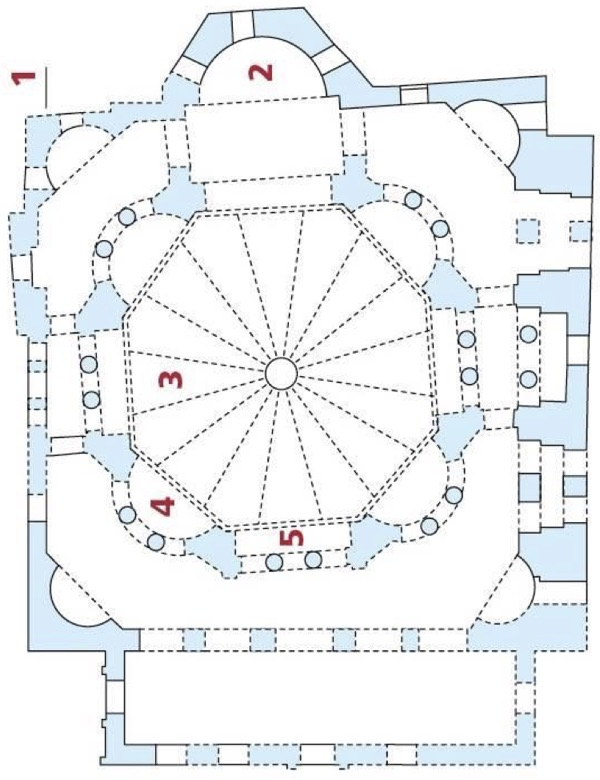
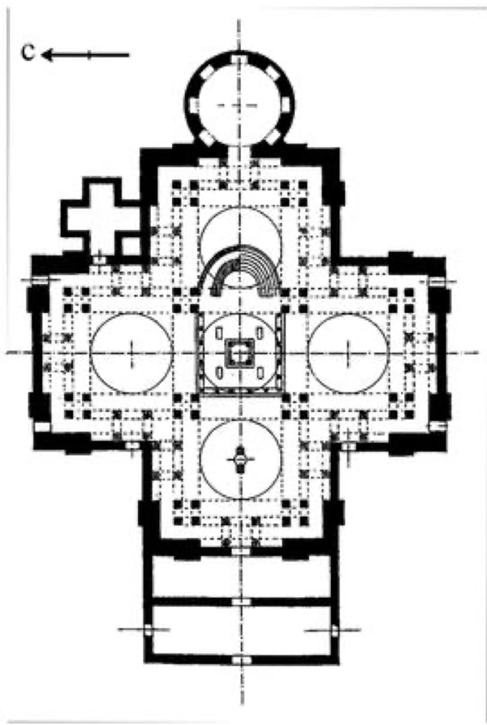
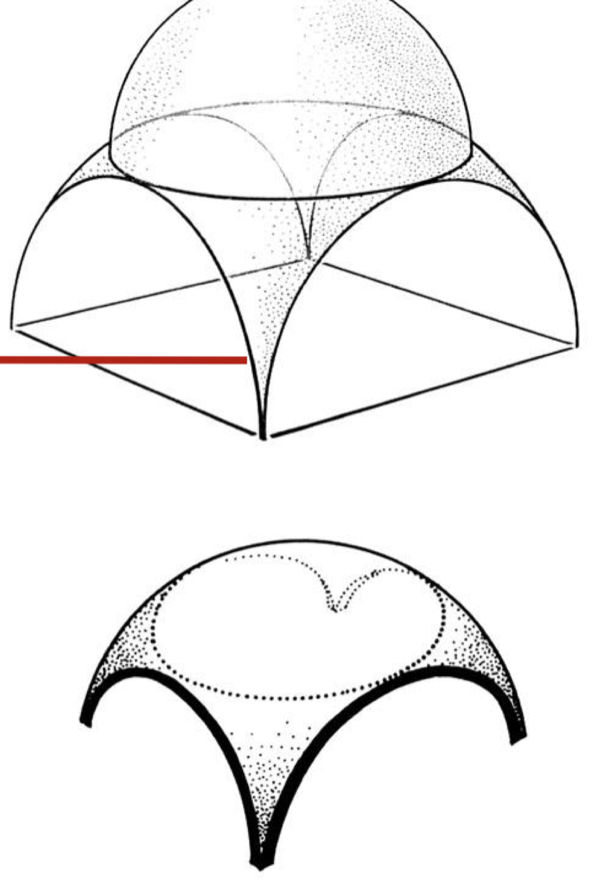
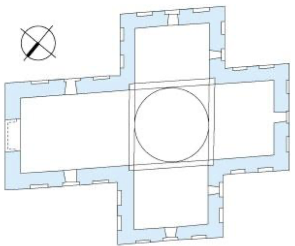
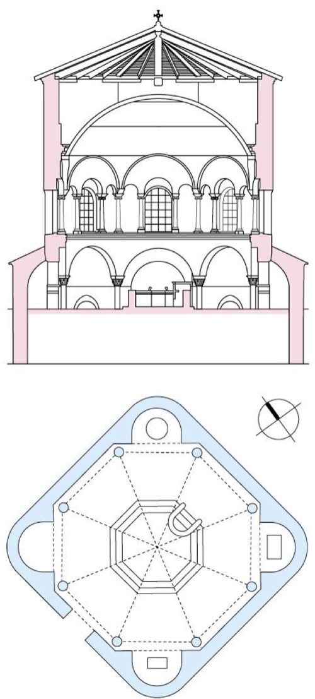
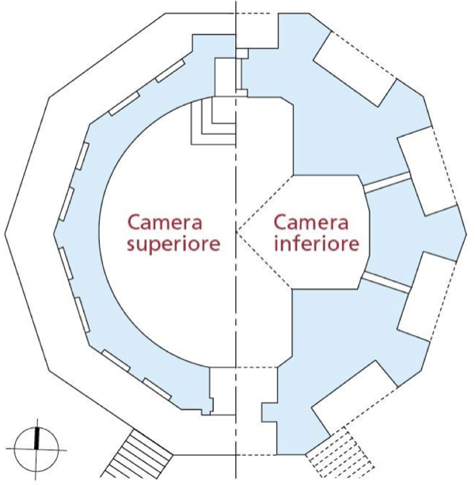
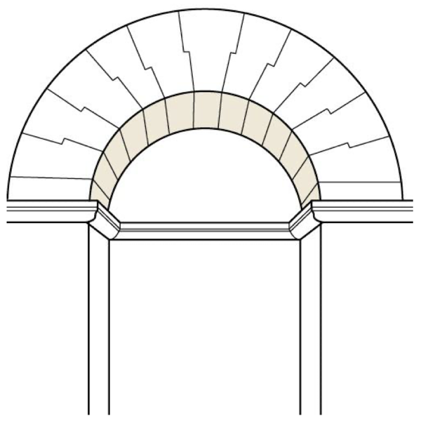

# L'architettura bizantina: Costantinopoli e Ravenna

> [!info] Note collegate
> Sbobina: [[13-architettura-bizantina]]
>
> Argomenti collegati: [[01-ordini-architettonici]] · [[03-roma-foro-e-fori-imperiali]] · [[04-via-appia-cecilia-metella-massenzio]] · [[05-costruzione-nel-mondo-antico]] · [[06-potere-imperiale-spettacolo-pompei]] · [[10-pantheon-da-agrippa-ad-adriano]] · [[11-architettura-tardoantica-da-baalbek-a-spalato]] · [[12-architettura-paleocristiana-a-roma]] · [[14-san-vitale-longobardi-e-carlo-magno]] · [[15-introduzione-al-romanico-firenze-e-pisa]]

Con l'espressione architettura bizantina si indica l'architettura che si colloca negli stessi anni dell'architettura paleocristiana, cioè agli esordi della liberalizzazione del culto cristiano, ma nella parte orientale dell'impero romano. Il termine contiene dunque due riferimenti insieme: uno cronologico, perché riguarda l'arte e l'architettura realizzate a partire dal IV secolo d.C., e uno geografico, legato alle vicende politiche che portarono alla separazione tra Oriente e Occidente. Due città sono protagoniste di questa scissione: Costantinopoli, la nuova capitale fondata da Costantino in Oriente, e Ravenna, capitale dell'impero d'Occidente e poi avamposto dell'impero bizantino nella penisola italiana. Seguirne la storia significa vedere come la cristianizzazione dell'impero diventi cristianizzazione dello spazio, e come in Oriente maturino impianti, strutture e tecniche costruttive diversi da quelli delle basiliche romane, fino al capolavoro di Santa Sofia.

## L'IMPERO D'ORIENTE E LA NUOVA ROMA

### La divisione dell'impero

L'espansione progressiva dei confini dell'impero romano aveva reso necessaria una riorganizzazione del territorio anche dal punto di vista della gestione politica. Alla fine del IV secolo, dopo la morte dell'imperatore Teodosio il Grande, avvenuta nel 395 d.C., l'impero viene definitivamente diviso in due parti, assegnate ai due figli e successori: Arcadio diventa imperatore della porzione orientale, Onorio di quella occidentale, e designa Ravenna come capitale. Ravenna resterà capitale dell'impero d'Occidente fino al 476, l'anno in cui l'ultimo imperatore, Romolo Augustolo, viene deposto dal barbaro Odoacre. Da quel momento non esiste più un impero romano nella porzione occidentale, e nella penisola italiana comincia una lunga stagione di dominazioni barbariche; l'impero romano continua invece a esistere in Oriente, ed è qui che si sviluppa la produzione artistica e architettonica che chiamiamo bizantina. A questo passaggio si accompagna anche un cambiamento linguistico: nell'impero d'Oriente la lingua è il greco, non il latino, segno della diversa cultura prevalente in quel contesto geografico. Sarà una fase politicamente travagliata, segnata da molti tentativi di ricomporre l'unità dell'impero.

### La fondazione di Costantinopoli

Già prima della scissione ufficiale, tuttavia, il baricentro dell'impero si era spostato lontano da Roma. Costantino aveva fondato fuori dalla penisola una capitale che porta il suo nome, per affermare la propria potenza in una geografia più ampia e disporre di un baluardo oltre Roma: Costantinopoli, la città che oggi conosciamo come Istanbul. Fondata nel 330 d.C. con l'ambizione dichiarata di essere una nuova Roma, diventa allora la capitale dell'impero. Come quasi tutte le fondazioni romane, è in realtà una rifondazione, una ristrutturazione di un centro già esistente e di origine antica, risalente al VII secolo a.C.: la città greca di Bisanzio. Bisanzio, Costantinopoli e Istanbul sono quindi tre nomi della stessa città, in tre momenti della sua storia.

![[costantinopoli-fasi-della-citta.jpg|620]]

*Ipotesi di ricostruzione di Costantinopoli con le fasi della sua crescita: il nucleo greco sul promontorio, l'ampliamento di Settimio Severo, la città di Costantino, chiusa dalle mura di Costantino (tratteggiate), e quella di Teodosio II, chiusa dalle mura di Teodosio. Sulla Mese, la strada principale, si allineano il Foro di Costantino, il Senato e, verso il promontorio, Santa Sofia, il complesso palaziale e l'ippodromo.*

La ricostruzione delle fasi della città mostra un processo di progressivo accrescimento. Il nucleo originario di fondazione greca, direttamente affacciato sul mare, viene ampliato in epoca romana sotto Settimio Severo; seguono gli interventi di Costantino e infine quelli di Teodosio II, che aggiunge un'ulteriore porzione portando la città alla sua massima espansione verso l'interno. Delle mura di Costantino oggi non resta sostanzialmente nulla, mentre le mura teodosiane segnano ancora il limite della città antica. La posizione di Costantinopoli è strategica e di prestigio: collocata sul mare, alle porte del Mediterraneo, si propone fin dall'inizio come luogo di scambi culturali.

### Il committente e il modello dell'opera

Un mosaico dell'XI secolo, nella lunetta del vestibolo sud di Santa Sofia, celebra i due episodi fondamentali della storia architettonica della città. Ai lati della Vergine con il Bambino, sulla destra Costantino tiene tra le mani una raffigurazione simbolica della città da lui fondata; sulla sinistra Giustiniano, l'imperatore che fece costruire Santa Sofia, offre il modello della basilica. L'immagine riunisce, in un'ottica non realistica e collocata fuori dal tempo, due figure vissute a più di due secoli di distanza, perché rappresentano i due momenti cruciali della città: la sua fondazione e la costruzione dell'edificio destinato a diventarne l'immagine stessa. Il mosaico documenta anche un'iconografia molto comune nella storia dell'architettura, quella del committente raffigurato mentre tiene in mano il modello dell'opera: un modo di esprimere il legame inscindibile tra committente e opera e di celebrare il gesto di chi l'ha voluta.

## LA CITTÀ DI COSTANTINO E DEI TEODOSIANI

### Il disegno di una capitale cristiana

Costantino concepisce la città come una nuova capitale cristiana, che doveva contrapporsi alla Roma antica. Le prime grandi basiliche costantiniane, San Giovanni in Laterano e San Pietro in Vaticano, sono più o meno coeve all'ampliamento di Bisanzio; a Roma, però, la basilica lateranense era stata collocata in periferia, a ridosso delle mura, perché l'imperatore non intendeva contrapporsi in modo troppo evidente al nucleo pagano della città. La nuova Roma d'Oriente poteva invece costituirsi come grande capitale cristiana senza che questo fosse percepito in modo conflittuale.

Gli interventi principali di Costantino si dispongono lungo l'asse della città. Nella parte più vicina al nucleo antico sorge un grande complesso palaziale, di cui conosciamo solo la posizione grazie alle tracce archeologiche, senza grandi evidenze architettoniche. Accanto al palazzo si trova l'ippodromo, la cui forma ricorda quella del Circo Massimo e del circo di Massenzio: destinato ai giochi e alle corse dei cavalli, misurava più di 400 metri di lunghezza e poteva ospitare 30.000 spettatori, dati che danno la misura della monumentalità dell'intervento. Costantino apre poi una piazza che porta il suo nome, il Foro di Costantino, sulla strada centrale della città, una via porticata detta Mese, e fonda la Chiesa dei Santi Apostoli. Non sono gli unici interventi di questo periodo, ma ne sono una sintesi: il palazzo, il foro, la strada principale e, ormai, una chiesa cristiana compongono l'idea stessa di città.

### Il Foro di Costantino e la colonna di porfido

Il Foro di Costantino ha una caratteristica peculiare: è circolare. I fori di Roma, dal Foro Romano al Foro di Traiano, erano spazi rettangolari, recintati ma scoperti, circondati da un grande portico che ospitava botteghe e taverne e che collegava tutti gli ambienti. A Costantinopoli ritornano gli stessi elementi, il portico che segna il perimetro, gli archi d'ingresso, un tempio affacciato sulla piazza e una grande colonna al centro che celebrava l'imperatore, ma riconfigurati in una forma nuova. Le ricostruzioni digitali proposte dal sito byzantium1200.com, che restituiscono l'aspetto di una città di cui restano tracce materiali molto esigue, mostrano il tempio in modo un po' enfatico, come una sorta di copia del [[10-pantheon-da-agrippa-ad-adriano|Pantheon]]. Costantino recupera dunque una serie di elementi tipici di Roma per creare un collegamento implicito con la città antica, ma li ricompone in modo originale per sottolineare l'innovazione che la nuova capitale portava con sé.

Di questo foro rimane soltanto la colonna che ne occupava il centro: una colonna di porfido rosso, sostenuta da un plinto e cinta per tutta l'altezza da cerchiature a forma di ghirlanda, che sulla sommità reggeva una statua bronzea dell'imperatore. Le ricostruzioni ipotizzano un capitello corinzio e una figura rappresentata come un eroe nudo, affine per iconografia alla statua colossale che Costantino aveva posto nella [[11-architettura-tardoantica-da-baalbek-a-spalato|Basilica di Massenzio]]. La statua precipitò nel XII secolo ed è andata perduta, ragione per cui le ipotesi sulla sua forma divergono; sembra probabile che l'imperatore tenesse il globo nella mano sinistra e la lancia nella destra, secondo un'iconografia comune per le statue imperiali. Un codice di disegni dedicato a Costantinopoli ritrae la colonna quando la statua era già scomparsa, ma permette di vedere bene la forma del blocco di porfido.

### Colonne e obelischi: lo spazio risignificato

Costantinopoli diventa progressivamente il luogo in cui colonne e simboli celebrativi segnano il panorama della città, indicando le zone di particolare importanza. Accanto alla colonna di Costantino, che una fonte grafica indica proprio come pilastro di porfido a conferma dell'importanza attribuita al materiale, sorgeva la colonna serpentina, eretta per celebrare la vittoria dei Greci contro i Persiani, di cui restano poche tracce ma che le raffigurazioni mostrano con le spire avvolte attorno al fusto. Una veduta tarda della città, una sorta di *skyline*, la identifica attraverso Santa Sofia, un obelisco e varie colonne collocate nei punti più significativi della sua topografia: è una riorganizzazione dello spazio fisico e insieme del suo significato, cioè una risignificazione semantica dello spazio.

Il confronto alla stessa scala tra le colonne onorifiche di Roma e quelle di Costantinopoli mostra la continuità di questa tradizione. A Roma la [[03-roma-foro-e-fori-imperiali|Colonna Traiana e la Colonna di Marco Aurelio]] sono entrambe centenarie e hanno il fusto della stessa altezza, ma la seconda sovrasta la prima grazie a un piedistallo più alto; la colonna di porfido di Costantino le supera entrambe. Costantinopoli si configura così come una nuova Roma che continua le tradizioni architettoniche, artistiche e celebrative della città antica, animata però dal nuovo spirito di una capitale cristiana.

### Teodosio I e l'obelisco dell'ippodromo

Un altro momento di grande splendore della città è legato alla dinastia teodosiana, che comprende alcuni imperatori di nome Teodosio, in particolare Teodosio I e Teodosio II. A Teodosio I, il primo della dinastia, alla cui morte l'impero fu diviso, si deve un momento di grande trasformazione di Costantinopoli e l'erezione di un obelisco all'interno dell'ippodromo. Gli obelischi provengono tutti dall'Egitto e sono simboli di un potere che trasla dalla magnificenza dell'Egitto a quella di Roma. L'obelisco poggia su un piedistallo il cui basamento, opera del periodo teodosiano, rappresenta lo stesso Teodosio nell'atto di inaugurarlo: è una sorta di metastoria, che racconta ciò che è accaduto prima dell'inaugurazione del monumento stesso. I rilievi narrano l'arrivo dell'obelisco, il suo trasporto e infine il suo innalzamento, operazione tutt'altro che facile, perché il pericolo più grande era che il monolite si spezzasse mentre lo si sollevava.

La stessa pratica, e lo stesso sguardo all'antico Egitto, permangono nei secoli anche a Roma. Alla fine del XVI secolo papa Sisto V fece spostare l'Obelisco Vaticano dalla zona dell'abside di San Pietro allo spazio antistante la basilica, impresa documentata da Domenico Fontana nel libro dedicato alla «trasportazione» dell'obelisco. Le due vicende non sono direttamente collegate, ma l'intervento sistino apre anche per Roma una stagione di trasformazioni e risignificazioni dello spazio urbano attraverso elementi che diventano identificativi e consentono di riconoscere i luoghi della città.

### Teodosio II: la massima estensione della città

Con Teodosio II, imperatore tra il 408 e il 450, Costantinopoli raggiunge la sua massima estensione. Il Colosso di Barletta, scultura colossale conservata in Puglia, è stato identificato con questo imperatore e può essere immaginato come un suo ritratto: anche qui Teodosio tiene nella mano sinistra il globo e nella destra una lancia, la stessa iconografia ipotizzata per la statua di Costantino sulla colonna di porfido.

La nuova estensione della città è delimitata e resa fisicamente visibile dalla cinta muraria che porta il nome dell'imperatore, le mura teodosiane. Costruite in pietra e mattoni, avevano dimensioni monumentali, con uno spessore superiore ai 6 metri, ed erano punteggiate a distanza regolare da torrioni, strutture militari che permettevano di osservare l'orizzonte da una notevole altezza e di proteggere la città. Tra le porte d'accesso si trovava la Porta Aurea, che nelle ipotesi di ricostruzione richiama le forme di una delle porte del [[11-architettura-tardoantica-da-baalbek-a-spalato|palazzo di Diocleziano a Spalato]], sicuramente una delle fonti usate per immaginarne l'aspetto.

### Le cisterne

Tra gli interventi teodosiani vanno annoverate anche le cisterne, come la Cisterna di Aezio. Con il termine cisterna si intende una grande vasca quadrangolare destinata a raccogliere e conservare l'acqua, collocata a 10-11 metri di profondità. Come le mura, le cisterne avevano una struttura mista in pietra e laterizio ed erano opere molto significative per dimensioni e monumentalità. Costituivano un'infrastruttura fondamentale per la città e rappresentavano un notevole avanzamento della tecnologia costruttiva; essendo strutture ipogee, cioè sotterranee, non lasciano però tracce in superficie: sopra la Cisterna di Aezio sorge oggi uno stadio.

## GIUSTINIANO E LA BASILICA DI SANTA SOFIA

### La cristianizzazione dello spazio

Il periodo di Giustiniano I, alla metà del VI secolo, è uno dei più fastosi della storia di Costantinopoli. Lo è dal punto di vista politico e legislativo, perché l'imperatore compie una serie di opere per proteggere i confini dell'impero e per riordinare e riorganizzare le leggi romane, ma anche dal punto di vista artistico. Il suo ritratto più noto si trova in un mosaico della Basilica di San Vitale a Ravenna. A Costantinopoli Giustiniano adotta una politica religiosa di monumentalizzazione della presenza cristiana: realizza cioè opere che, con il loro impatto architettonico sulla città, rendano visibile la presenza dei cristiani. La città di Costantino diventa la principale destinataria di questa politica.

La fonte principale su questo programma è Procopio di Cesarea, storico di corte, autore del *De aedificiis*, un trattato consacrato alla committenza architettonica di Giustiniano, che ne è il dedicatario. Procopio attribuisce all'imperatore la costruzione di Santa Sofia e la ricostruzione e il restauro di 32 chiese a Costantinopoli, e da lui provengono molte delle informazioni sulla storia dell'edificio. Il confronto con le biografie di Augusto e di Adriano è eloquente: i due imperatori erano celebrati per la ristrutturazione dei templi di Roma e per la costruzione di nuovi templi. A distanza di tre secoli gli imperatori non sono più celebrati per i templi, ma per le chiese: la cristianizzazione dell'impero si manifesta attraverso una più specifica cristianizzazione dello spazio, affidata a grandi interventi architettonici.

### La Cisterna Basilica

Anche Giustiniano si impegna nelle infrastrutture per la distribuzione dell'acqua. La Cisterna Basilica è una delle più importanti: un grande ambiente ipogeo perfettamente rettangolare, di 140 per 70 metri, scandito da 336 colonne alte 9 metri. Per misurarne la scala basta ricordare le colonne del pronao del Pantheon, alte 12 metri: queste sono più basse di 3 metri, ma raggiungono comunque i tre quarti della loro altezza, e sono 336. Lo spazio, restaurato di recente, accoglie numerosi elementi architettonici di spoglio, come le teste di Medusa provenienti dal foro e reimpiegate all'interno della cisterna, testimonianza della circolazione e del reimpiego delle opere. La sua dimensione sotterranea e la selva di colonne hanno esercitato un fascino notevole sui viaggiatori, come mostrano le rappresentazioni ottocentesche.

### Le fasi della costruzione

L'opera più importante della committenza di Giustiniano è la Basilica di Santa Sofia, centrale nel suo programma di cristianizzazione dello spazio. Come molti edifici già incontrati, è la ricostruzione di un edificio precedente: una prima chiesa viene inaugurata nel 360, Teodosio II costruisce una seconda chiesa nel 415, e tra il 532 e il 537 Giustiniano realizza la chiesa attuale. È dedicata alla Divina Sapienza: *Hagia Sophia* è il nome greco della basilica che chiamiamo Santa Sofia. Le fonti ne attribuiscono il progetto ad Antemio di Tralle e Isidoro di Mileto, due architetti scienziati, cioè architetti sperimentatori, ai quali si deve un impianto quasi quadrato, assolutamente innovativo rispetto alle basiliche paleocristiane.

La storia dell'edificio è travagliata, sia per i danni subiti sia per i cambiamenti di funzione. Nel 558 la cupola crolla e viene ricostruita tra il 562 e il 563. Dopo il 1453, quando Costantinopoli viene conquistata dal sultano Mehmet II, la basilica è trasformata in moschea e circondata da minareti; nel 1935 diventa un museo e nel 2018 viene riconvertita nuovamente in moschea. Lo stesso edificio ha dunque assunto funzioni e significati diversi: basilica cristiana, moschea, museo e di nuovo moschea.

### I modelli: la Chiesa dei Santi Sergio e Bacco

 Il progetto di Santa Sofia ha alcune tappe di avvicinamento in edifici realizzati poco prima. La prima è la Chiesa dei Santi Sergio e Bacco, costruita nel 527, sempre in età giustinianea, e convertita in seguito in moschea. La pianta ha un perimetro quadrato al cui interno si evidenzia una struttura centrale ottagonale, i cui lati sono aperti da nicchie circolari e quadrate, ciascuna identificata da due colonne; un grande deambulatorio circonda lo spazio centrale, coperto da una cupola.

Questo impianto è completamente diverso da quello delle basiliche paleocristiane di Roma. Giustiniano non sceglie lo schema longitudinale articolato in navate, con il transetto, la zona dell'altare e il quadriportico anteposto alla chiesa, ma un impianto centrale, che rinuncia all'orientamento imposto dalle basiliche longitudinali e crea uno spazio apparentemente privo di una gerarchia interna. Se la basilica paleocristiana recepisce l'eredità di modelli locali, la basilica civile pagana, risemantizzata e riarticolata nelle sue strutture interne, l'impianto centrale di forma quadrata rimanda invece all'Estremo Oriente e risente dell'influenza dell'impero persiano. A questi impianti si congiungono nuove tecniche costruttive, a cominciare dal modo di realizzare le cupole, e nuove tecniche murarie.

### I modelli: la Chiesa dei Santi Apostoli e la pianta a *quincunx*

 Il secondo modello è la Chiesa dei Santi Apostoli, fondata da Costantino ma ricostruita da Giustiniano, alla cui iniziativa si deve la forma che la chiesa acquisì in seguito. Dopo la conquista ottomana Mehmet II trasformò alcune basiliche in moschee, ma in altri casi scelse una strada più radicale e demolì gli edifici: i Santi Apostoli furono demoliti nel 1462. Alcune fonti permettono tuttavia di ipotizzarne la forma originaria, ed è importante farlo, perché fino a quando rimase visibile la chiesa fu un modello fondamentale per gli architetti di varie epoche: lo stesso impianto si ritroverà molto più avanti a Venezia, nella Basilica di San Marco.

La pianta dei Santi Apostoli è detta a *quincunx*. È una pianta a croce greca, nella quale cioè i bracci hanno tutti la stessa profondità, e in corrispondenza del centro e di ciascun braccio si innalza una cupola, per un totale di cinque cupole disposte come i punti del cinque sul dado, da cui il nome. Ne risulta anche qui uno spazio centrale, arricchito dalla presenza delle cupole. Un codice vaticano greco (Vat. gr. 1162) raffigura la chiesa con le sue cinque cupolette in una rappresentazione non realistica: in un vero prospetto due delle cupole resterebbero nascoste, ma l'immagine vuole rendere visibile lo spazio articolato e centrale dell'edificio.

### La pianta e lo spazio di Santa Sofia

L'impianto di Santa Sofia è quasi quadrato: misura 71 metri sul lato d'accesso, il più corto, e 77 metri sul lato più lungo. Come le basiliche paleocristiane, era preceduto da un quadriportico, il cui braccio addossato alla facciata formava il nartece, lo spazio destinato ai fedeli non ancora battezzati. A Santa Sofia i narteci sono due, con la stessa funzione e dimensioni leggermente diverse: un nartece esterno, o esonartece, e un nartece interno, o endonartece, un poco più profondo, entrambi articolati in campate coperte da volte a crociera. Attraverso di essi si entra nello spazio della chiesa.

![[santa-sofia-pianta-e-sezione.jpg|520]]

*Santa Sofia, sezione longitudinale e pianta: 1 nartece (con il quadriportico), 2 navata centrale con la cupola, 3 navate laterali, 4 abside, 5 esedre.*

All'interno di questa scatola quasi quadrata si riconoscono tre navate, una centrale e due laterali. Il principio è lo stesso delle basiliche paleocristiane, spazi che si sviluppano in lunghezza, ma l'effetto complessivo è molto diverso, soprattutto per la forma della navata centrale: aperta da absidi su entrambi i lati, essa non ha più una forma allungata e univocamente orientata, ma diventa uno spazio complesso e multiforme. Sul fondo si apre l'abside con l'altare, affiancata da due esedre che ne moltiplicano lo spazio. Sopra le navate laterali corre la galleria del matroneo, lo spazio riservato alle donne, affacciato sulla navata centrale. Al centro si innalza una grande cupola emisferica di 31 metri di diametro, affiancata da due semicupole. È meno ampia della cupola del [[10-pantheon-da-agrippa-ad-adriano|Pantheon]], che misura 43-45 metri, ma resta una cupola di dimensioni ingenti. Nel confronto tra le due versioni della basilica, la prima cupola, quella crollata nel 558, risulta più bassa di circa 6 metri rispetto alla seconda, compiuta nel 563 da Isidoro il Giovane, che ha uno sviluppo in altezza maggiore.

### La struttura: la cupola su pennacchi

L'impianto quadrato e l'articolazione così complessa dello spazio richiedono accorgimenti strutturali specifici, e la principale difficoltà risiede proprio nella grande cupola di oltre 30 metri, che esige la solidità della struttura che la sorregge. La sua costruzione è l'ultimo passaggio di una serie di accorgimenti che la rinforzano. La parte più solida e resistente dell'impianto è costituita dai quattro pilastri principali, grandi strutture murarie sulle quali si impostano gli arconi principali; su questi arconi poggia la cupola, che ne scarica il peso sui pilastri.

![[santa-sofia-pilastri-e-arconi.jpg|540]]

*Santa Sofia, il sistema dei pilastri e degli arconi: 1 pilastri principali, 2 e 3 arconi principali, 4 arconi di rinforzo, 5 pilastri secondari disposti lungo l'asse est-ovest, 6 volte a botte di mattoni di circa un metro di spessore, 7 galleria colonnata del matroneo, 8 cupola centrale.*

 La cupola di Santa Sofia è quindi molto diversa da quella del Pantheon. A Roma la cupola insisteva su una struttura muraria continua, il tamburo; qui non c'è una muratura continua, ma la cupola poggia sui quattro arconi. Gli elementi che raccordano la base circolare della cupola con il quadrato formato dagli archi sono i pennacchi: questa struttura si chiama cupola su pennacchi. I pennacchi distribuiscono il peso della cupola sugli archi, che diventano gli elementi di scarico, e questi lo trasmettono ai grandi pilastri, chiamati a contenere le spinte. Questa forma di cupola diventerà la soluzione prevalente nell'architettura dell'impero d'Oriente, e se ne trova una ricchissima presenza a Costantinopoli.

Poiché il peso della cupola grava sugli archi, il blocco centrale ha richiesto ulteriori rinforzi. Sono stati realizzati pilastri secondari, disposti lungo l'asse est-ovest della costruzione, sui quali poggiano volte a botte in mattoni di circa un metro di spessore: è una struttura secondaria che rinforza e irrigidisce il blocco centrale, schematizzabile come un insieme di pilastri e archi a sostegno della cupola. Anche tutte le altre murature della basilica, i blocchi angolari, i blocchi lineari a nord e a sud, l'ingresso occidentale con i due narteci, le navate laterali e il matroneo, contribuiscono alla stabilità del blocco centrale e possono essere considerate grandi strutture secondarie di rinforzo. Con la ricostruzione del 562, oltre alla nuova cupola, vengono aggiunti un nuovo quadriportico con una fontana, che a sua volta diventa un elemento di supporto dell'intera struttura, un nuovo battistero e quattro rampe d'accesso esterne.

### La cupola di luce e lo spazio disorientante

All'esterno la cupola tende a nascondersi, mascherata dalla struttura muraria; la sua forza sta nell'interno. Osservata dal basso, è una grande cupola di luce, grazie alla corona di piccole finestre aperte nel punto di contatto tra la cupola e i pennacchi, che produce a sua volta una corona luminosa e dà l'impressione che la cupola galleggi sopra la struttura della basilica. Le decorazioni interne facevano largo uso dell'oro, che accresceva i giochi di luce ed enfatizzava la ricchezza dell'apparato decorativo.

Dalla navata centrale si coglie il risultato di questa composizione, che tiene insieme l'impianto centrale dettato dalle murature quadrate, la cupola, le semicupole e le absidi che si moltiplicano. Ne nasce uno spazio completamente disorientante, in forte contrasto con lo spazio orientato delle basiliche paleocristiane. Questa polarità tra spazio orientato e spazio disorientante è uno degli elementi che distinguono l'architettura dell'impero d'Occidente dall'architettura bizantina dell'impero d'Oriente.

### Il mito di Santa Sofia e di Costantinopoli

Nel corso del tempo Santa Sofia è stata oggetto di molti elogi. Manuele Crisolora, studioso bizantino, scrive intorno al 1350 che non è mai esistito e non esisterà mai nulla di simile al mondo, e si sofferma sulla ricchezza delle porte, del pavimento, delle colonne, dei mosaici, dei rivestimenti marmorei, del vetro, del bronzo e dell'oro, ma anche sulla struttura, sulla larghezza, sull'altezza e sulla volta, che non si riesce a capire come possa reggersi. Dalla dimensione dell'edificio fino all'ultimo dettaglio della decorazione, tutto concorre a farne un esempio di architettura straordinario. Crisolora scrive nel pieno del Medioevo, quando il mito di Costantinopoli come città perfetta è ormai diffusissimo, alimentato proprio dalla politica di cristianizzazione dello spazio voluta da Giustiniano. Anche dopo la conquista turca sopravvive l'immagine di una città inespugnabile e intatta, ornata da torri e cupole, ultima città del mondo antico e insieme simbolo dell'epoca cristiana.

La città affascina viaggiatori e disegnatori. Cristoforo Buondelmonti, nel 1481, ne rappresenta la pianta punteggiata di edifici, tra cui Santa Sofia e le colonne. Giuliano da Sangallo, che non era mai stato a Costantinopoli, copia disegni di Santa Sofia che gli vengono forniti e li inserisce tra i suoi studi sull'architettura antica: implicitamente, gli architetti del Rinascimento consideravano la basilica importante quanto gli edifici antichi. Dopo la conversione in moschea, i minareti la riconfigurano dal punto di vista architettonico e soprattutto della funzione.

## RAVENNA

### Una città tra Occidente e Oriente

Ravenna si trova sul mare Adriatico, nell'attuale Romagna, e insieme a Venezia rappresenta una sorta di confine ideale tra la porzione orientale e quella occidentale dell'impero. All'inizio del VI secolo, caduto l'impero d'Occidente, la penisola italiana e parte dei territori ultra-alpini sono controllati dai regni dei popoli cosiddetti barbarici, i Franchi, gli Ostrogoti e i Vandali; la penisola è assoggettata agli Ostrogoti, mentre l'Oriente resta sotto il controllo di ciò che rimane dell'impero romano, con capitale Costantinopoli.

La storia di Ravenna oscilla tra questi poteri. Nel 402 la corte imperiale si trasferisce da Milano a Ravenna, che diventa capitale dell'impero d'Occidente per volontà di Onorio. Seguono la stagione dei Visigoti di Alarico, che nel 410 conquista Roma, l'occupazione di Odoacre nel 493 e il dominio degli Ostrogoti, di cui Ravenna diventa capitale sotto il re Teodorico. Con la guerra greco-gotica, tra il 535 e il 553, Giustiniano riconquista la città e la riporta nell'impero d'Oriente come esarcato. Per questo il ritratto dell'imperatore compare nella Basilica di San Vitale, come segno della presenza riconquistata dell'impero nella città.

La città ha una porzione antica di fondazione romana e un ampliamento successivo, di età tardoantica e medievale, racchiuso dalla cinta muraria. La sua storia si può dividere in tre fasi: la fase imperiale, prima della caduta dell'impero d'Occidente nel 476; il periodo ostrogoto, tra il 476 e il 540; e il periodo giustinianeo, dopo la riconquista del 540. A ciascuna corrispondono importanti interventi architettonici che punteggiano la città: tra questi la Basilica di San Vitale, il Mausoleo di Galla Placidia, il Battistero degli Ortodossi, la Basilica Ursiniana, il Battistero degli Ariani, Sant'Apollinare Nuovo e il Palazzo di Teodorico.

### Il Mausoleo di Galla Placidia

 Alla prima fase, quella imperiale, tra il 402 e il 476, appartiene il Mausoleo di Galla Placidia. Galla Placidia discendeva direttamente dalla famiglia imperiale: nipote dell'imperatore Valentiniano II, era figlia di Teodosio il Grande e sorella dei due imperatori Arcadio e Onorio, tra i quali l'impero era stato diviso. Il mausoleo celebrava dunque una figura centrale al vertice dell'impero e, come gli altri mausolei già incontrati, doveva eternare la memoria della persona a cui era dedicato.

La pianta è a croce latina, con una cupola nel punto di intersezione dei due bracci. All'esterno l'edificio presenta un apparecchio murario di laterizio privo di decorazione, con una serie di piccoli archi nella parte inferiore, e la cupola non è visibile, perché racchiusa in una struttura muraria detta tiburio. Il termine tiburio significa grotta: è come se la cupola fosse nascosta, celata all'interno di una grotta. È una costruzione semplice, lontanissima dallo sfarzo di materiali, colori e dorature di Santa Sofia, realizzata con materiali comuni ed economici. Il laterizio era la tecnica più diffusa nell'area padana, priva di cave di pietra, dove la fabbricazione dei mattoni costituiva la soluzione più semplice ed economica per costruire opere grandi e piccole. Anche le coperture sono in terracotta: la struttura che sostiene le tegole del tetto è formata da tubi fittili, cioè tubuli di terracotta fabbricati appositamente e incastrati tra loro, secondo una tecnica di origine antica e mediterranea.

### L'interno a mosaico: il corpo e lo spirito

La semplicità dell'esterno viene completamente stravolta all'interno, che diventa un tripudio di decorazione a mosaico. Nel braccio di fronte all'ingresso, dove è collocata la tomba di Galla Placidia, sopra un primo registro senza decorazione si dispiega un ricchissimo apparato musivo, con due santi che affiancano una finestra. Il contrasto ha un significato simbolico: la struttura esterna rappresenta il corpo, che deve essere umile e realizzato con materiali poveri, mentre l'interno, con i suoi materiali sfolgoranti, rappresenta lo spirito. Anche la cupola è una cupola su pennacchi, di dimensioni naturalmente molto inferiori a quella di Santa Sofia, ma espressione della stessa cultura costruttiva. La sua decorazione rappresenta un cielo notturno stellato, con stelle dorate disposte in cerchi concentrici, quasi generate dalla croce posta al centro; sui pennacchi compaiono i quattro evangelisti nelle forme degli animali a cui sono tradizionalmente associati. L'intera decorazione è ispirata a temi cristiani e si fonda su un binomio molto marcato tra interno ed esterno.

La tecnica prevalente, già intravista a Santa Sofia e caratteristica dell'architettura ravennate, è quella del mosaico. Il termine deriva da *opus musivum*, e indica opere realizzate sulle pareti inserendo tessere vetrate in un letto di posa di malta, che le fissava garantendo la stabilità della decorazione; i soggetti potevano essere geometrici o figurati. Il confronto con il pavimento della Casa del Labirinto a [[06-potere-imperiale-spettacolo-pompei|Pompei]] e con il mausoleo di Santa Costanza a Roma mostra la continuità di una tecnica che attraversa i secoli, mentre i temi passano dalle scene mitologiche a quelle simboliche della religione cristiana.

### Il Battistero degli Ortodossi e il pulvino

 Al periodo imperiale risale anche il Battistero degli Ortodossi, costruito tra il 400 e il 450 circa. Come il Battistero Lateranense, era funzionale alla conversione dei fedeli ed è caratterizzato da un impianto centrale, in questo caso ottagonale. L'esterno è di nuovo spoglio, in laterizio, privo di elementi di arricchimento; all'interno, come nel Mausoleo di Galla Placidia, si apre invece un tripudio di marmi policromi, che rivestono la vasca battesimale ottagonale posta al centro, e di mosaici che decorano le pareti. Nella cupola, impostata sopra la vasca, è raffigurato il battesimo di Cristo circondato dagli apostoli, che diventa il fulcro visivo e insieme semantico dell'opera. Anche la copertura del battistero è sostenuta da tubi fittili incastrati tra loro, che formano nervature a sostegno del tetto.

Nelle arcate interne compare un elemento nuovo, il pulvino, dal latino *pulvinus*, guanciale, cioè cuscino. È il blocco che si frappone tra il capitello e l'arco e su cui poggiano gli archi. Il pulvino appartiene a un contesto decorativo in cui la trabeazione sorretta da sostegni verticali scompare, sostituita da una sequenza di archetti che non poggiano direttamente sui capitelli ma su questo elemento di raccordo.

### Il Mausoleo di Teodorico

 Il periodo della dominazione ostrogota, tra il 476 e il 540, è rappresentato da un edificio che non rientra più tra le committenze imperiali: il mausoleo che Teodorico, re degli Ostrogoti e quindi la figura politica più importante della dominazione, fece costruire per sé prima della morte, avvenuta nel 526. La funzione è identica a quella del Mausoleo di Galla Placidia, ma il modo di costruire cambia radicalmente, segno che il succedersi delle dominazioni corrisponde a variazioni significative nella realizzazione delle opere. Resta l'idea di un impianto centrale all'antica, come quello dei mausolei di [[04-via-appia-cecilia-metella-massenzio|Cecilia Metella]], di Augusto e di Adriano. L'edificio ha un impianto poligonale e si sviluppa su due livelli: una camera inferiore a forma di croce e una camera superiore circolare.

All'esterno l'opera è interamente rivestita di pietra d'Istria, la pietra più facilmente procurabile a Ravenna, proveniente dall'altra sponda dell'Adriatico. Il suo colore candido, che quasi brilla sotto la luce del sole, conferisce all'edificio un aspetto apparentemente monolitico, segnato da un unico colore ma realizzato in un materiale ricchissimo. Il blocco inferiore è scandito da una sequenza di archi in corrispondenza dei lati del poligono, i cui conci non hanno una forma lineare ma presentano dei denti: per questo si parla di ghiera dentata. Sopra il blocco del mausoleo insiste una cupola monolitica, cioè ricavata da un unico blocco di pietra, che chiude la costruzione; una corona decorata congiunge la cupola al tamburo.

 È una piccola architettura, ma costruita con materiali di grande pregio, che al valore intrinseco della materia, la pietra, aggiungono quello della forma, la cupola monolitica, e che attraverso la cura della costruzione e la ricchezza della decorazione intende trasmettere l'importanza del committente. Pur appartenendo al periodo della dominazione barbarica su Ravenna, il mausoleo fu considerato dagli architetti del Rinascimento un'opera antica, alla stregua delle opere degli antichi. Giuliano da Sangallo, lo stesso che aveva copiato i disegni di Santa Sofia, lo disegna nel suo codice e lo annota come «Tenpio di Ravena anticho». Siamo nel VI secolo dopo Cristo, quando già da secoli si parla di architettura tardoantica; eppure lo splendore dei materiali, la cura della costruzione, l'accuratezza delle ghiere dentate e il pezzo unico della cupola rendono questo mausoleo paragonabile alle architetture antiche.

## Collegamenti

L'architettura bizantina si legge in parallelo all'[[12-architettura-paleocristiana-a-roma|architettura paleocristiana di Roma]], della quale condivide la cronologia ma non i modelli: allo spazio orientato della basilica longitudinale, con navate, transetto e quadriportico, Costantinopoli oppone l'impianto centrale e lo spazio disorientante di Santa Sofia, mentre Ravenna, con la [[14-san-vitale-longobardi-e-carlo-magno|Basilica di San Vitale]] oggetto della lezione successiva, porta questi modelli nella penisola italiana. La fondazione di Costantinopoli prosegue la storia dell'età di Costantino iniziata con la lezione sull'[[11-architettura-tardoantica-da-baalbek-a-spalato|architettura tardoantica]], da cui provengono la Basilica di Massenzio con la statua colossale dell'imperatore e il palazzo di Diocleziano a Spalato, richiamato dalla Porta Aurea. Il Foro di Costantino rielabora in forma circolare i [[03-roma-foro-e-fori-imperiali|fori imperiali]] di Roma, e la colonna di porfido si misura sulla Colonna Traiana e su quella di Marco Aurelio; l'ippodromo riprende il tipo del circo, già visto nel complesso di [[04-via-appia-cecilia-metella-massenzio|Massenzio sulla Via Appia]], dove sorge anche il mausoleo di Cecilia Metella, modello lontano dell'impianto centrale del Mausoleo di Teodorico. La cupola su pennacchi di Santa Sofia va confrontata con la cupola su tamburo del [[10-pantheon-da-agrippa-ad-adriano|Pantheon]], per dimensioni e per sistema strutturale, e il paragone tra le chiese ricostruite da Giustiniano e i templi restaurati da Augusto e Adriano misura il passaggio dalla città pagana alla città cristiana. I materiali e le tecniche, dal porfido alla pietra d'Istria, dal laterizio padano ai tubi fittili delle coperture, rimandano alla [[05-costruzione-nel-mondo-antico|costruzione nel mondo antico]], come il reimpiego degli elementi di spoglio nella Cisterna Basilica; il mosaico ravennate prosegue la tradizione musiva già incontrata nelle case di [[06-potere-imperiale-spettacolo-pompei|Pompei]]. Il pulvino, infine, segna un ulteriore distacco dal sistema trabeato degli [[01-ordini-architettonici|ordini architettonici]], mentre la pianta a *quincunx* dei Santi Apostoli e i disegni di Giuliano da Sangallo anticipano temi che torneranno con San Marco a Venezia e con l'architettura del Rinascimento.
