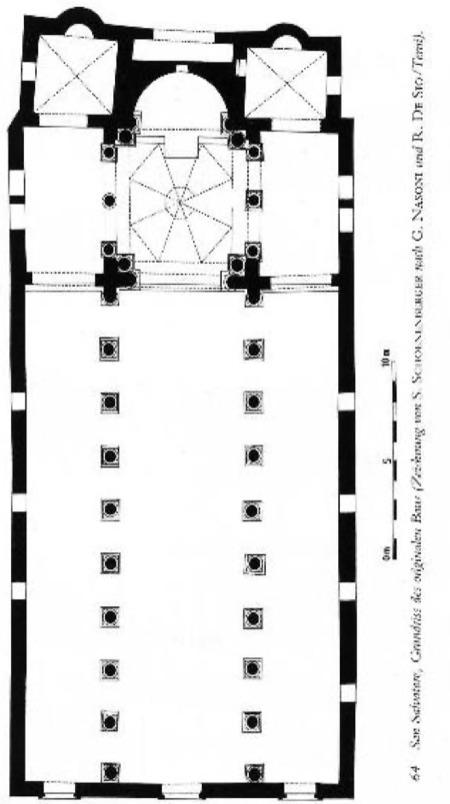
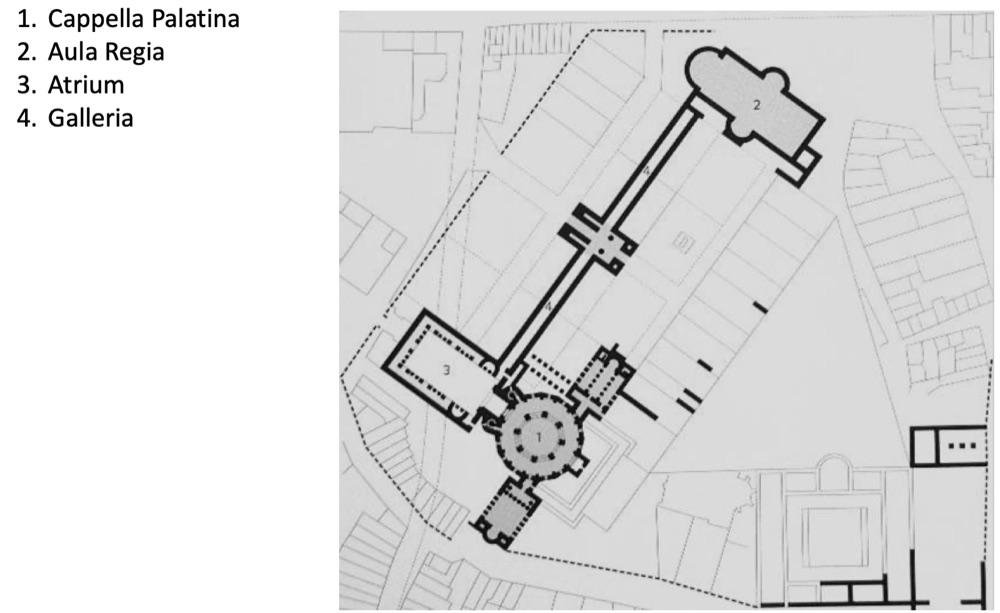
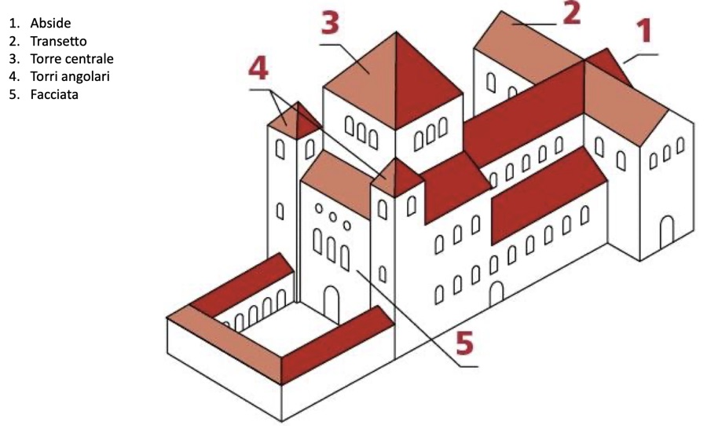

# San Vitale a Ravenna, i Longobardi e Carlo Magno

> [!info] Note collegate
> Sbobina: [[14-san-vitale-longobardi-carolingi]]
>
> Argomenti collegati: [[01-ordini-architettonici]] · [[05-costruzione-nel-mondo-antico]] · [[07-residenza-romana-palatino-domus-aurea]] · [[10-pantheon-da-agrippa-ad-adriano]] · [[11-architettura-tardoantica-da-baalbek-a-spalato]] · [[12-architettura-paleocristiana-a-roma]] · [[15-introduzione-al-romanico-firenze-e-pisa]] · [[13-architettura-bizantina-costantinopoli-e-ravenna]]

Questa lezione attraversa un arco cronologico molto ampio, dal VI al IX secolo, e lo percorre seguendo una domanda precisa: come il modello della Basilica di Santa Sofia di Costantinopoli e, più in generale, la ricerca bizantina sulle basiliche a impianto centrale abbiano preso forma nella penisola italiana. Dopo la caduta dell'impero romano d'Occidente, nel 476, la penisola conosce una situazione politica instabile, in cui si succedono diversi regni che chiamiamo barbarici, in forte contrasto con l'unità politica del lunghissimo periodo imperiale. Eppure, al variare delle dominazioni corrisponde una continuità nella cultura architettonica, fatta di materiali, di pezzi di architettura e di modelli che circolano da un capo all'altro del Mediterraneo. Il percorso parte dalla Basilica di San Vitale a Ravenna, passa per le chiese commissionate dai Longobardi a Benevento e a Spoleto e arriva all'età di Carlo Magno, con la Cappella Palatina di Aquisgrana, la rinascita carolingia di Roma e l'invenzione del *Westwerk*.

## RAVENNA E LA BASILICA DI SAN VITALE

### Dal periodo ostrogoto a Giustiniano

Ravenna conosce diverse fasi politiche, e la Basilica di San Vitale nasce in quella della dominazione ostrogota, quando, nei primi decenni del VI secolo, i Goti hanno preso il potere sulla città. La fondazione della basilica si colloca nel 532 per volontà del vescovo Ecclesio; quindici anni dopo, nel 547, l'edificio viene consacrato dal vescovo Massimiano. Parte delle decorazioni sarà però conclusa nel periodo successivo, quando Ravenna rientrerà nell'orbita dell'impero romano d'Oriente: la storia della basilica attraversa così due fasi, quella ostrogota della costruzione e quella imperiale, o giustinianea, del completamento.

### L'esterno, la pianta e la sezione

All'esterno San Vitale si presenta come gli altri edifici ravennati, dal Mausoleo di Galla Placidia ai battisteri: una fabbrica caratterizzata da una notevole semplicità di materiali, dall'assenza di decorazione e dalla prevalenza del laterizio. Soltanto il portale è realizzato con materiali di pregio; per il resto la costruzione comunica una grande semplicità, scandita dai volumi geometrici che derivano dalla forma stessa della basilica.

La pianta rovescia questa impressione: alla semplicità dei materiali e della decorazione corrisponde una notevole articolazione dello spazio. L'edificio è ottagonale all'esterno, e la stessa forma ritorna all'interno, dove pilastri e colonne disegnano lo spazio centrale e aprono attorno a esso una corona di nicchie curvilinee. Sull'asse principale si trovano il presbiterio e l'abside; ai lati dell'abside due ambienti circolari, il *diaconicon* e la *protesis*, erano destinati alla conservazione degli oggetti e delle suppellettili usati nelle funzioni liturgiche.

![[san-vitale-pianta-sezione.jpg|600]]

*Basilica di San Vitale a Ravenna, sezione e pianta: 1 ardica, 2 ingresso di fronte all'abside, 3 presbiterio, 4 abside, 5 diaconicon, 6 protesis, 7 ingresso non assiale.*

Nella sua porzione centrale la basilica mostra dunque un impianto fortemente geometrico e centralizzato, affine per concezione alle basiliche costantinopolitane dei Santi Sergio e Bacco e di Santa Sofia. Se a Roma, con le basiliche paleocristiane, prevale l'impianto longitudinale, nel mondo bizantino prevale quello centrale, e San Vitale si colloca pienamente in questa ricerca su uno spazio centrale e centralizzato. La sezione lo conferma: in corrispondenza dello spazio centrale si alza una cupola che apre lo spazio verso la dimensione verticale e ne accentua il cuore. All'esterno la cupola non si vede, perché è racchiusa e nascosta da un tiburio.

### L'ardica e i due ingressi

L'impianto, apparentemente così centralizzato e stabile, comprende un altro elemento: l'ardica. È il nome con cui nel mondo bizantino si indica lo spazio che ha la stessa funzione del nartece delle basiliche longitudinali, cioè il braccio del quadriportico addossato alla facciata, destinato ad accogliere coloro che non sono ancora stati battezzati. A San Vitale l'ardica ha una forma allungata, che riprende quella dei narteci paleocristiani, ma è collocata in modo singolare: è addossata a uno degli angoli dell'ottagono e non è allineata a nessuno dei lati della basilica. Dall'ardica si entra attraverso due accessi: uno porta in una posizione di fronte all'abside, l'altro conduce a un ingresso non assiale.

### Lo spazio agitato

La doppia possibilità di accesso ha un impatto molto forte sulla percezione dello spazio. Chi entra dall'ingresso assiale inquadra immediatamente l'abside, e il suo sguardo si rivolge alla dimensione liturgica già vista nelle basiliche paleocristiane longitudinali: si è portati a compiere un percorso che culmina nella zona absidale. L'abside, del resto, è gerarchicamente enfatizzata, perché è più profonda e più decorata delle altre parti. Chi entra invece dall'ingresso non assiale vede l'abside di sbieco e ha lo sguardo proiettato verso una delle campate della basilica, che non è dominata da uno spazio gerarchicamente più importante. Ci si trova allora in uno spazio indistinto, che perde la determinazione propria degli impianti longitudinali: è una caratteristica diffusa nel contesto bizantino, segnata da una perdita dell'orientamento all'interno dell'edificio.

![[san-vitale-percezione-spazio.jpg|640]]

*Basilica di San Vitale, la percezione dello spazio: le traiettorie visive dall'ingresso assiale (a sinistra) e da quello non assiale (a destra).*

Sergio Bettini, grandissimo studioso dell'architettura bizantina, ha definito questa concezione uno spazio agitato, che si contrappone allo spazio lineare e definito delle basiliche paleocristiane. A muoverlo ulteriormente contribuisce la decorazione, che sfuma i contorni degli elementi architettonici. Ne nasce un contrasto fortissimo tra l'esterno, monocromo, in laterizio, scandito da volumi geometrici, e l'interno, uno spazio indistinto rivestito da una decorazione a mosaico ricca e policroma, la cui luminosità rende ancora più mobili le linee della basilica.

### I mosaici di Giustiniano e Teodora

Nel presbiterio si trovano due mosaici fondamentali per la storia della basilica: l'imperatore Giustiniano con il suo seguito e l'imperatrice Teodora con la sua corte. Il soggetto rimanda alla fase in cui Giustiniano aveva annesso di nuovo Ravenna all'impero romano d'Oriente, e quindi al completamento della decorazione in periodo imperiale. Giustiniano è lo stesso imperatore che commissionò Santa Sofia a Costantinopoli: la sua scelta di farsi rappresentare a San Vitale, in una processione molto canonica con tutto il seguito, crea un ulteriore legame tra i due edifici, rafforzato dall'identità del committente.

La tecnica è quella del mosaico, già molto diffusa a Ravenna: piccole tessere dalla superficie vetrosa, lucida e tendenzialmente trasparente, che conferiscono alla superficie sfumature luminose. Lo sfondo dorato aumenta la luminosità ma appiattisce la composizione, come nei mosaici di Santa Sofia. Accanto alla grande ricchezza dei dettagli, soprattutto negli abiti, definiti da colori e decorazioni, lo sfondo genera un effetto piatto che a sua volta produce l'immobilità delle figure, congelate nel tempo.

### I capitelli e il pulvino

Anche la decorazione architettonica mostra una ricchezza di dettagli assoluta. Tra i grandi pilastri angolari dell'ottagono si collocano colonne libere che disegnano, o lasciano intuire, l'andamento della struttura. Sopra le colonne poggiano capitelli molto decorati, sormontati dal pulvino: il termine significa guanciale, cioè cuscino, e indica l'elemento di passaggio e di connessione tra il capitello e la struttura muraria che parte al di sopra. Questi capitelli non appartengono a nessuna delle categorie degli ordini architettonici: la loro forma è geometricamente essenziale ed è arricchita da elementi traforati che generano quasi l'effetto di un tessuto, di un pizzo. Gli altri capitelli della basilica mantengono la stessa grande ricchezza e mostrano una grande varietà. Secondo quanto ricostruito dagli studiosi, provengono probabilmente da Costantinopoli, da dove furono trasportati a Ravenna.

### La circolazione dei materiali, dei pezzi e dei modelli

Il trasporto dei capitelli è un aspetto comune nella storia dell'architettura, che conosce diverse forme di circolazione. La prima è quella dei materiali: i pavimenti cosmateschi della Basilica dei Santi Giovanni e Paolo al Celio mostrano la ricchezza cromatica e materica che crea a Roma una vera geologia di superficie, in cui alle pietre più comuni del territorio, il travertino in primo luogo, si affiancano materiali portati da luoghi lontanissimi, come il giallo antico e il porfido. La seconda è quella di interi pezzi di architettura, capitelli e colonne che attraverso il Mediterraneo si spostano da una città all'altra; avverrà anche nella Basilica di San Marco a Venezia, dove è come se Costantinopoli fosse stata portata nella laguna attraverso l'architettura. A Ravenna questa circolazione rivela un legame architettonico, oltre che storico e politico, con Costantinopoli, che trova nella figura di Giustiniano I il suo punto di connessione.

La terza è la circolazione dei modelli. Santa Sofia e San Vitale hanno forme molto diverse e non si possono sovrapporre, ma condividono alcune caratteristiche, soprattutto l'idea di una dissoluzione dell'unitarietà dello spazio. Un tipo di edificio viene ripreso, non copiato in modo schematico o rigido, anche in un contesto geografico molto diverso. Questa circolazione diventa ancora più intensa in un contesto politicamente instabile, perché la continua variazione dei sistemi politici che si succedono su un territorio produce una commistione di culture e quindi una maggiore variazione e circolazione dei modelli.

## I LONGOBARDI IN ITALIA

### I regni barbarici e l'inizio del Medioevo

Tra il VI e il VII secolo, nel periodo immediatamente successivo a Giustiniano, l'impero bizantino mantiene la propria vitalità in un dominio molto esteso attorno al Mediterraneo, mentre l'Europa occidentale è divisa tra i regni barbarici: i Visigoti nella penisola iberica, i Franchi nel territorio della Francia e in parte della Germania, e in Italia i Longobardi, popolazione giunta da nord delle Alpi. I Longobardi occupano due porzioni della penisola: la *Langobardia Maior*, nella parte settentrionale, fino a inglobare una parte dell'attuale Toscana, e la *Langobardia Minor*, nella parte centro-meridionale. Il resto della penisola rimane soggetto ai Bizantini. I Longobardi hanno un re e sono dunque un regno, e la distinzione tra le due *Langobardiae* è una suddivisione politica tra due unità geografiche dello stesso regno.

La discesa dei Longobardi, nel 568, segna convenzionalmente l'inizio del Medioevo, il periodo che si prolunga fino alla metà del Quattrocento. Si tratta di una convenzione storiografica: non c'è una cesura netta e immediata verso un nuovo periodo storico, ma la data offre un riferimento nella scansione cronologica.

### Un popolo multietnico e la sua committenza

I Longobardi si presentano già al loro interno come una popolazione multietnica, e la loro dominazione non solo modifica l'assetto precedente della penisola, ma introduce fortemente l'idea di una multiculturalità. È quindi molto difficile individuare caratteri comuni nelle committenze artistiche e architettoniche da loro promosse, che però rispondono in generale all'intenzione di legare alla propria presenza una serie di edifici capaci di rappresentare e ufficializzare il loro governo sulla penisola.

Un momento cruciale è la conversione in massa dei Longobardi al cattolicesimo: si avvia allora una collaborazione con il pontefice e cominciano a sorgere chiese la cui costruzione è legata al loro nome. Le vicende dei Longobardi in Italia, e con esse quelle della loro committenza architettonica, sono note grazie a una fonte d'eccezione, la *Storia dei Longobardi* di Paolo Diacono, uno storico vissuto in quel periodo. Da questa fonte diretta emerge come l'architettura fosse concepita come strumento per costruire l'identità di una popolazione multietnica e multiculturale.

### Benevento e la povertà delle tecniche costruttive

Benevento, nella *Langobardia Minor*, è una delle città principali dei Longobardi. Le mura costruite in periodo longobardo, con la porta che le attraversa, mostrano con chiarezza un carattere che contraddistingue l'intera produzione di questo regno: l'impoverimento delle tecniche costruttive e dei materiali. La muratura è fatta di ciottoli di fiume recuperati, materiali irregolari e di dimensioni tutte diverse. Questa disuguaglianza ha ripercussioni anche sulle prestazioni della muratura, perché quanto più un apparecchio murario è fatto di elementi regolari, tanto più si può contare sulla sua resistenza; un paramento come questo non promette la solidità dell'opera poligonale, che pur irregolare nella pezzatura deve la propria tenuta al peso e all'incastro dei singoli blocchi.

Nelle opere longobarde l'aspetto costruttivo è dunque del tutto secondario. Assume invece importanza la riflessione sull'uso delle forme architettoniche: l'identità del popolo longobardo non passa attraverso tecniche raffinate, ma attraverso una serie di riferimenti che devono nobilitare la forma e il significato degli edifici.

### Santa Sofia a Benevento

La chiesa di Santa Sofia a Benevento, ultimata entro il 760, dichiara il proprio riferimento fin dal nome. Rispetto a Giustiniano si è compiuto un balzo di due secoli. Il committente è Arechi II, uno dei duchi longobardi che governavano questa parte del territorio, raffigurato in una miniatura del *Codex Legum Langobardorum* dell'XI secolo. La dedicazione a Santa Sofia è un riferimento consapevole e immediato alla basilica di Costantinopoli: l'edificio deve richiamare idealmente la maestosità della chiesa dell'imperatore.

Davanti alla chiesa si trovava in origine un avancorpo, poi abbattuto, che costituiva lo spazio di accesso e di cui restano in facciata due colonne. La pianta mette in evidenza un forte contrasto tra le geometrie interne, dove le colonne alludono al disegno di figure poligonali, e il perimetro esterno, una linea che alterna tratti rettilinei e tratti curvi. Lo si può scomporre nelle figure geometriche che, combinate, generano la pianta: una porzione di circonferenza, una figura a stella e la zona absidale. Non importa sapere se la pianta sia stata davvero disegnata così; lo schema mostra però quanto sia articolata la sua geometria, che, per quanto se ne sa, non ha eguali né nella *Langobardia Minor* né altrove. Per la sua forma esterna Santa Sofia è un *unicum*, pur rimandando in un'ottica più ampia a un riferimento molto preciso.

![[santa-sofia-benevento-schema-pianta.jpg|640]]

*Chiesa di Santa Sofia a Benevento, ultimata entro il 760: la pianta e la sua scomposizione in figure geometriche (circonferenza, stella, zona absidale e avancorpo).*

Il riferimento a Santa Sofia, dichiarato nella dedicazione, non è dunque evidente nel disegno della pianta. Lo è di più nello spazio interno, che si avvicina a quelli di Costantinopoli e di San Vitale; entrando in asse con l'abside, lo sguardo si muove attraverso la composizione di elementi verticali e arriva a inquadrare la zona absidale, che fornisce una direzione e un orientamento. Rispetto alla raffinatezza delle piante dei Santi Sergio e Bacco e di San Vitale, l'impianto beneventano è una riduzione, un'astrazione dei principi alla base di quei disegni, ma vi si riconosce la volontà di costruire uno spazio paragonabile. Anche qui l'esterno è realizzato con materiali molto poveri e privo di decorazione, mentre all'interno le colonne di spoglio, di materiali lapidei diversi, e i capitelli molto decorati rendono lo spazio molto più sofisticato. L'intonaco giallo che oggi riveste l'esterno non è il colore originario: è il risultato di un restauro degli anni Sessanta del Novecento, che ha mascherato la struttura muraria.

### San Salvatore a Spoleto: la facciata e il portale

A Spoleto, ancora nella *Langobardia Minor*, la Basilica di San Salvatore permette di ragionare sui materiali di spoglio. Le opere longobarde, soprattutto nella *Langobardia Minor*, sono costruite con tecniche essenziali, ma il desiderio di arricchirne l'aspetto si esprime nel reimpiego di materiali, spesso antichi, usati per la decorazione. San Salvatore, dell'VIII secolo e quindi più o meno contemporanea a Santa Sofia di Benevento, ne è un esempio parlante. È una chiesa a pianta basilicale, costruita interamente in laterizio, spesso mescolato a materiali molto più poveri, ciottoli di fiume e altri materiali quasi di scarto.

Sul paramento della facciata, quasi frettoloso nell'esecuzione, si stagliano elementi di grande eleganza: il portale centrale e le tre finestre della parte sommitale. Sono tutti elementi di spoglio, reimpiegati per nobilitare l'aspetto della basilica. È un esempio quasi unico, perché non ci sono precedenti in cui il reimpiego abbia una portata così significativa per la definizione di un edificio, né avrà seguito; resta perciò l'esempio emblematico di questa pratica nella produzione architettonica longobarda.

Il portale ha una forma strombata, è attraversato in alto da mensole e porta una decorazione a bassorilievo nel fregio che corre al di sopra dell'apertura. Piacque moltissimo agli architetti del Rinascimento, che riconobbero questi materiali come elementi di spoglio, li studiarono e inserirono disegni della basilica nei loro trattati e nei loro codici. Andrea Palladio pubblica uno studio del portale nel quarto dei suoi *Quattro libri dell'architettura*, il trattato del 1570 che raccoglie, tra i vari temi, gli studi compiuti sull'antico; Baldassarre Peruzzi lo ridisegna e lo riprende nel progetto della Villa Chigi alla Lungara, a Roma. È un esempio della fortuna di un elemento architettonico, cioè della sua vita postuma, fatta di uso e di studio.

### San Salvatore a Spoleto: l'interno

 All'interno il riuso dei materiali ritorna in modo massiccio. La pianta è divisa in tre navate da colonne, oggi in parte murate; il transetto è incluso nello spessore del corpo longitudinale e non sporge dal perimetro murario, e l'abside è preceduta da una porzione coperta da una struttura poligonale. Nella zona absidale, ma anche nel corpo longitudinale, sono reimpiegate colonne scanalate e capitelli provenienti da opere antiche. Le colonne hanno diametri, forme e altezze diverse, tanto che in alcuni casi si è inserito una sorta di tassello per portare il sostegno all'altezza degli altri; anche i capitelli sono tra loro diversi, e alcuni sono ricavati da blocchi di trabeazione ritagliati e posati sopra la colonna. Le proporzioni del fenomeno sono uniche: a parte la struttura muraria, l'intera decorazione interna è il risultato di una ricomposizione di elementi antichi.

Anche questo piacque molto agli architetti del Quattro e del Cinquecento. Francesco di Giorgio Martini, nel XV secolo, mette a confronto in un disegno la facciata, in una versione un po' idealizzata in cui il portale non ha la sua forma reale, e la veduta dell'abside all'interno della chiesa.

### Il Tempietto del Clitunno

Nei pressi di Spoleto, a Campello sul Clitunno, poco fuori dal centro storico, sorge il cosiddetto Tempietto del Clitunno, un'opera del VII-VIII secolo che resta nel tema dei materiali di spoglio. È un edificio cristiano costruito come se fosse un piccolo tempio antico, di cui riprende le forme: è disegnato come un tempio corinzio tetrastilo *in antis*, cioè con quattro colonne sulla fronte comprese tra le testate dei muri laterali. Lungo il fiume Clitunno, che attraversa l'Umbria, sorgeva certamente un tempio dedicato al culto di Giove Clitunno, ed è probabile che la piccola chiesa sia stata costruita in corrispondenza di quel tempio, con i materiali dell'edificio antico: un edificio riconfigurato, che assume una nuova funzione restando un richiamo molto esplicito all'architettura antica.

Si entra superando l'alto podio, dal fianco del tempietto. La sopraelevazione non serve soltanto a enfatizzare la struttura, ma anche a difenderla dalle fluttuazioni della falda, perché l'edificio si trova a ridosso del fiume. Le quattro colonne del pronao sono diverse per materiale, colore e decorazione del fusto: alcune sono scanalate, altre decorate a squame. A differenza di San Salvatore, dove le colonne sono disposte in modo abbastanza casuale, qui sono abbinate secondo un principio di simmetria: le due colonne centrali sono uguali tra loro, e così le due laterali. L'idea di costruire con elementi di spoglio è la stessa, ma il modo di metterla in atto è del tutto diverso: a Spoleto un riuso quasi meccanico, funzionale a costruire l'opera; al Clitunno una ricomposizione che risponde anche a fini estetici e artistici. All'interno si conservano la nicchia absidale con l'altare e tracce della decorazione pittorica, ancora in parte leggibili. Anche il tempietto fu disegnato da Palladio, autore di circa trecento disegni di architettura, e inserito nei suoi studi.

### Tre edifici diversi

Santa Sofia a Benevento, San Salvatore a Spoleto e il Tempietto del Clitunno sono tre edifici molto diversi, difficili da collegare con un filo rosso. Sono tutti chiese, ma la prima richiama il mondo bizantino con un impianto centrale, la seconda ritorna all'impianto basilicale longitudinale, la terza ricostruisce un tempietto antico concepito come chiesa cristiana. La componente multiculturale del popolo longobardo si riflette nella mancanza di unità della sua architettura, il cui unico tratto comune è il generale tentativo di autorappresentare la propria presenza sul territorio della penisola.

## CARLO MAGNO E AQUISGRANA

### La fine del regno longobardo e l'incoronazione

A sconfiggere i Longobardi è Carlo Magno, re dei Franchi, un altro dei popoli barbarici d'Europa, nato nel 742 e morto nell'814; il suo ritratto più celebre, quello di Albrecht Dürer, è un ritratto postumo del Cinquecento. Attraversate le Alpi nel 773, Carlo Magno conquista Pavia, capitale della *Langobardia Maior*, e nel 774 sconfigge militarmente i Longobardi, ponendo fine alla loro supremazia e diventando re d'Italia.

La notte di Natale dell'800 Carlo Magno viene incoronato nella Basilica di San Pietro da papa Leone III. L'episodio sancisce l'alleanza tra il sovrano e la Chiesa: Carlo Magno si fa incoronare come sovrano, ma anche come protettore della cristianità, e avvia un grande rinnovamento delle istituzioni politiche nella penisola e in tutto il suo impero. L'incoronazione è considerata uno degli eventi fondamentali per la storia dello Stato Pontificio, che ne costruirà la tradizione anche per immagini, come nell'*Incoronazione di Carlo Magno* dipinta da Raffaello nelle Stanze Vaticane. L'impero si estende dal nucleo originario del regno dei Franchi con le conquiste compiute fino all'814, che comprendono anche il regno d'Italia; il Ducato di Benevento, nella *Langobardia Minor*, rimane invece autonomo.

### Il rinnovamento culturale: la minuscola carolina e Vitruvio

La volontà dell'imperatore di costruire una nuova unità passa anche attraverso una serie di riforme che vanno oltre il dominio politico. Tra queste c'è una riforma della scrittura: la minuscola carolina, che prende il nome da Carlo Magno, una scrittura corsiva che diventa la forma dei documenti ufficiali della cancelleria del regno.

Sono anche anni in cui si torna a guardare all'antichità con rinnovato interesse. Nell'Evangeliario di Godescalco, miniato tra il 781 e il 783 dalla Scuola del Palazzo di Carlo Magno, un edificio rappresentato in modo astratto e semplificato riprende le forme dei templi antichi a pianta circolare, come il Tempio di Ercole Vincitore a Roma. Riprende anche lo studio del *De architectura* di Vitruvio, l'unico trattato antico giunto fino a noi, almeno per quanto si sa oggi. Il testo è arrivato senza immagini, e alcuni manoscritti carolingi, come quello conservato a Sélestat, alla Bibliothèque Humaniste (ms. 360), provano a disegnare gli elementi architettonici descritti, tra cui i capitelli. Questi disegni mostrano come uno studioso dell'epoca abbia risolto il dissidio tra la parola scritta e l'assenza dell'immagine, e testimoniano la lunga durata del percorso che ha portato alla riscoperta delle forme antiche e le notevolissime difficoltà poste dall'interpretazione di Vitruvio.

### Eginardo e la committenza di Carlo Magno

Il cuore della committenza architettonica di Carlo Magno non è in Italia, ma ad Aquisgrana, in tedesco Aachen, la città più occidentale della Germania, al confine con il territorio francese. Qui l'imperatore fa costruire il suo palazzo e la Cappella Palatina, la cappella annessa al palazzo.

Le sue imprese sono raccontate da Eginardo, storico della corte di Carlo Magno, suo contemporaneo e autore della sua biografia, come Procopio di Cesarea lo era stato di Giustiniano. Fatta la tara alla retorica che pervade questi testi, sono fonti che permettono di avere un quadro abbastanza preciso degli avvenimenti. Eginardo scrive che Carlo, sebbene impegnato continuamente ad ampliare il regno e a sottomettere i popoli stranieri, «intraprese in diversi luoghi moltissime opere di ornamento e di utilità pubblica, e alcune le portò a compimento»; tra le più notevoli cita «la basilica della Santa Madre di Dio ad Aquisgrana», ricorda i due palazzi di eccellente fattura avviati vicino a Magonza e a Nimega, sul fiume Waal, e soprattutto il fatto che, quando veniva a sapere che in una parte qualsiasi del regno c'erano «edifici sacri caduti in rovina per vetustà, ne impose il restauro ai vescovi e ai prelati» competenti. È un elogio dell'attenzione di Carlo Magno per quello che oggi chiamiamo il patrimonio: restaurare gli edifici in rovina e commissionare opere di ornamento e di pubblica utilità. Non è molto diverso dagli elogi degli imperatori romani, come quello di Augusto scritto da Svetonio: la funzione retorica si ripete, ma alcune informazioni sono del tutto attendibili.

### Il palazzo di Aquisgrana

Il palazzo, costruito a partire dal 789, è un complesso in qualche modo simmetrico. A un'estremità si trova l'aula regia, destinata al cerimoniale di palazzo; all'estremità opposta, collegata da una lunga galleria, la Cappella Palatina, preceduta da un grande atrio, cioè un cortile quadriportico. Oggi il complesso è difficile da riconoscere nel tessuto della città.

 La relazione tra palazzo e cappella era abbastanza frequente. Già al Laterano, accanto alla grande basilica lateranense, sorgeva il palazzo: l'idea di associare il luogo del potere politico a quello religioso è un retaggio che Carlo Magno riprende dalle usanze della Roma paleocristiana.

### La Cappella Palatina

L'ingresso della cappella è affiancato da due corpi scala che conducono alla parte più alta, perché l'edificio ha un forte sviluppo verticale. All'interno lo spazio è centrale, con il centro disegnato da un ottagono di pilastri. All'esterno la forma ottagonale non si rispecchia: il perimetro è un poligono a sedici lati, che raddoppia il numero dei lati della figura interna. La sezione mostra la cupola che sovrasta la parte centrale e che all'esterno è nascosta dal tiburio; mostra anche l'articolazione dello spazio, con il deambulatorio esterno sviluppato su due piani e la parte centrale ottagonale, più alta, che culmina nella grande cupola.

### Marmi da Roma e da Ravenna

Eginardo racconta che Carlo Magno «innalzò in Aquisgrana una basilica di eccezionale bellezza, che adornò d'oro e d'argento, di lampadari e di balaustrate e porte di bronzo massiccio. Poiché non poteva procurarsi altrove le colonne e i marmi necessari alla sua costruzione, li fece trasportare da Roma e da Ravenna». Anche qui la narrazione storiografica mette l'accento sul riuso dei materiali, e la loro provenienza è significativa: Carlo Magno guarda sia a Roma, culla dell'impero romano, sia a Ravenna, baluardo dell'impero bizantino. È come se, nella sua concezione politica e nel suo progetto di rinnovamento artistico e culturale, i due imperi romani, quello d'Oriente e quello d'Occidente, dovessero fondersi di nuovo attraverso l'architettura, grazie al reimpiego di materiali che trovano una nuova collocazione nella cappella di Aquisgrana.

### La citazione di San Vitale

Il riferimento a Ravenna si riconosce anche nell'impianto: l'ottagono che identifica lo spazio centrale della cappella è una citazione della Basilica di San Vitale, che passa attraverso la forma architettonica ma poi se ne rende autonoma, moltiplicando all'esterno il numero dei lati. La somiglianza è molto evidente anche all'interno, nel deambulatorio del registro inferiore, nei pilastri che disegnano l'ottagono centrale e nello sviluppo dei registri superiori, che riprendono la struttura interna di San Vitale.

![[aquisgrana-cappella-e-san-vitale-piante.jpg|600]]

*Le piante della Cappella Palatina di Aquisgrana (a sinistra) e della Basilica di San Vitale a Ravenna (a destra).*

Anche la decorazione della cupola riprende il mosaico a fondo oro così diffuso a Ravenna. I mosaici attuali sono stati interamente rifatti e non hanno nulla di originale, ma riprendono le forme dell'epoca carolingia e vanno letti come un'evocazione di quelle originarie. Al secondo livello, sopra l'ingresso e direttamente di fronte all'abside e all'altare, si trova il trono di Carlo Magno: la posizione privilegiata da cui l'imperatore assisteva alle funzioni religiose.

## LA RINASCITA CAROLINGIA: ROMA E L'EUROPA

### Santa Prassede, una piccola San Pietro

Benché Aquisgrana sia il centro della committenza di Carlo Magno, l'alleanza tra il regno e lo Stato Pontificio ha una lunga durata e produce, in un contesto travagliato dall'alternanza dei regni barbarici, quella che viene chiamata la rinascita carolingia di Roma: tra il 771 e l'855, durante i pontificati da Adriano I a Leone IV, una serie di nuove committenze segna una nuova attenzione per l'architettura della città.

Tra queste, un'opera che segna in modo marcato la rinascita è la ricostruzione della chiesa di Santa Prassede, sull'Esquilino, riedificazione di un edificio già esistente voluta da papa Pasquale I, il cui pontificato va dall'817 all'824. La pianta è quella di una basilica paleocristiana: sviluppo longitudinale, tre navate con colonnati architravati, transetto, quadriportico antistante. È una riproposizione piuttosto meticolosa dell'impianto delle basiliche della Roma del IV secolo, cinque secoli dopo quelle di Costantino, e viene letta come il tentativo di riprodurre in scala ridotta la Basilica di San Pietro in Vaticano, come se la rinascita carolingia passasse attraverso il rimando ai grandi edifici paleocristiani. La scala è ridotta non solo nelle dimensioni, ma anche perché San Pietro aveva cinque navate e Santa Prassede ne ha tre; l'impianto è più semplice, ma ne conserva tutti gli elementi: il quadriportico, le navate, il transetto, la cripta, spazio ipogeo destinato alla conservazione delle reliquie dei santi, e l'abside.

![[santa-prassede-ricostruzione.jpg|600]]

*Ricostruzione della Basilica di Santa Prassede a Roma, inizi del IX secolo: 1 quadriportico, 2 navate con colonnati architravati, 3 transetto, 4 cripta, 5 abside.*

Il confronto con la pianta di San Pietro rende evidente questo recupero dei modelli paleocristiani. È un passaggio importante, perché gli edifici esaminati fino a questo momento nella penisola recuperavano convintamente i modelli bizantini, con i loro impianti centrali; questa fase della produzione architettonica li accantona per tornare all'architettura paleocristiana, con opere che parlano la lingua delle grandi basiliche costantiniane.

### Leggere una pianta archeologica

Lo stato attuale di Santa Prassede è molto modificato, e la sua pianta, di tipo archeologico, si legge come una sovrapposizione di fasi storiche, in cui il diverso colore delle murature corrisponde a una diversa cronologia. L'edificio originario del IX secolo è campito in nero: il corpo della basilica si è tramandato in modo abbastanza integro, mentre il quadriportico è scomparso e ne restano soltanto alcuni elementi in un angolo. Le campiture grigie e grigio chiare indicano le aggiunte successive, soprattutto le cappelle costruite nei secoli seguenti. Assonometria ricostruttiva e pianta stratigrafica sono due strumenti di rappresentazione diversi: la prima fa immaginare come doveva apparire il complesso nelle sue forme originarie, la seconda è una sorta di fotografia di come appare oggi. Le colonne superstiti del quadriportico sono ancora visibili, inglobate nella muratura che le ha chiuse in una fase successiva.

### La Cappella di San Zenone

Uno degli elementi più straordinari del complesso, per la decorazione, è la Cappella di San Zenone, costruita tra l'817 e l'824: un piccolo ambiente a croce, concepito come mausoleo di Teodora, madre del pontefice, e quindi in una condizione particolarmente importante all'interno dell'edificio. All'ingresso è reimpiegato un architrave di recupero, la cui parte frontale è scolpita mentre il lato è privo di decorazione: questa differenza è l'indizio che si tratta di un elemento di reimpiego, ed è uno dei segni che permettono di riconoscere il riuso dei materiali anche in un'opera che non si conosce.

La copertura, invece, guarda fortemente al mondo bizantino: un mosaico a fondo oro con la rappresentazione di Cristo e degli evangelisti. In questa fase si assiste quindi a un recupero esplicito e consapevole dei modelli paleocristiani, che non rinuncia però a combinarsi con quanto proviene dal mondo bizantino. È lo stesso processo che le parole di Eginardo descrivono per la Cappella Palatina di Aquisgrana, con i materiali portati da Roma e da Ravenna: la volontà di tenere insieme questi due contesti.

### Il *Westwerk*

Accanto al recupero di fonti e di modelli del passato, il periodo carolingio conosce anche un'innovazione nel lessico architettonico: il *Westwerk*, parola tedesca che significa opera occidentale, in italiano corpo occidentale. È la costruzione che insiste sulla facciata degli edifici religiosi. Si chiama occidentale perché le chiese sono orientate, con l'abside a est, e il corpo occidentale corrisponde perciò alla facciata.

 Il *Westwerk* è una ricerca volta a porre l'enfasi sulla facciata, che viene monumentalizzata da una serie di elementi architettonici: una torre centrale e due torri angolari. Lo si vede nella forma originaria dell'abbazia di Saint-Riquier e nella chiesa dell'abbazia di San Vito a Corvey, in Westfalia, fondata nell'822, ampliata e dotata del *Westwerk* tra l'873 e l'885, con modifiche alla facciata nel XII secolo. Il *Westwerk* non ha una connotazione univoca: può essere semplicemente un elemento dell'architettura della chiesa oppure lo spazio in cui si colloca la cappella imperiale. Dal IX secolo questa configurazione si diffonde in tutto il mondo carolingio, ma nella sua geografia d'oltralpe: le facciate che diventano quasi facciate fortezza, con corpi che stravolgono la forma della basilica tradizionale, hanno la loro origine in questo contesto.

## Collegamenti

San Vitale prosegue la ricerca bizantina sullo spazio centrale affrontata nella lezione sull'[[13-architettura-bizantina-costantinopoli-e-ravenna|architettura bizantina]], dove erano stati presentati Santa Sofia, i Santi Sergio e Bacco e gli edifici ravennati come il Mausoleo di Galla Placidia, e si contrappone all'impianto longitudinale delle basiliche dell'[[12-architettura-paleocristiana-a-roma|architettura paleocristiana]], a cui appartengono anche il nartece, il quadriportico, San Pietro in Vaticano e il Laterano ripresi da Santa Prassede e dal palazzo di Aquisgrana. La pianta centrale coperta da una cupola ha le sue radici nel [[10-pantheon-da-agrippa-ad-adriano|Pantheon]] e negli edifici ottagonali tardoantichi come il [[11-architettura-tardoantica-da-baalbek-a-spalato|mausoleo di Diocleziano a Spalato]], mentre il palazzo di Carlo Magno con la sua cappella si inserisce nella lunga storia della [[07-residenza-romana-palatino-domus-aurea|residenza imperiale]]. I capitelli di San Vitale, estranei a ogni categoria, si misurano sugli [[01-ordini-architettonici|ordini architettonici]], come il tempietto corinzio del Clitunno e i capitelli disegnati nei manoscritti carolingi di Vitruvio. La povertà delle murature longobarde va confrontata con le tecniche della [[05-costruzione-nel-mondo-antico|costruzione nel mondo antico]], dall'opera poligonale al laterizio, e il reimpiego degli elementi di spoglio a Spoleto, al Clitunno, ad Aquisgrana e a Santa Prassede continua la pratica già vista con gli *spolia* dell'[[11-architettura-tardoantica-da-baalbek-a-spalato|Arco di Costantino]], oltre a legarsi agli esercizi sulla geologia di superficie dei materiali lapidei di Roma. I disegni di Palladio, Peruzzi e Francesco di Giorgio Martini anticipano invece la riscoperta dell'antico nel Rinascimento, che verrà affrontata con i trattati di architettura, mentre la circolazione di pezzi da Costantinopoli tornerà con San Marco a Venezia. Il *Westwerk*, infine, mostra come accanto al recupero dei modelli il mondo carolingio sperimenti soluzioni nuove, mentre le chiese carolingie sopra cui sorgeranno edifici più tardi, come San Miniato al Monte, introducono la stratificazione dell'[[15-introduzione-al-romanico-firenze-e-pisa|architettura romanica]].
