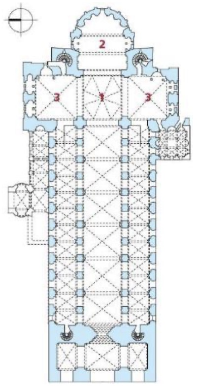
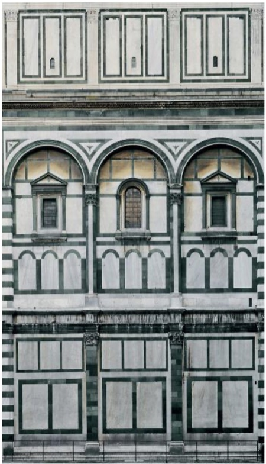
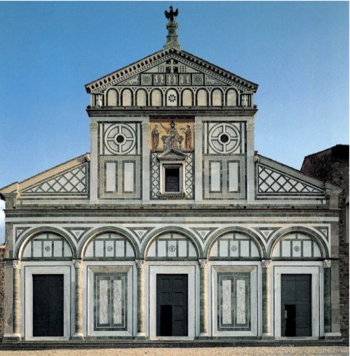
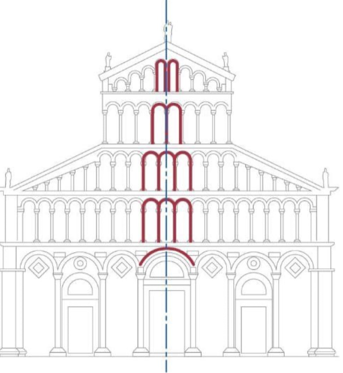

# L'architettura romanica: introduzione, Firenze e Pisa

> [!info] Note collegate
> Sbobina: [[15-architettura-romanica-firenze-pisa]]
>
> Argomenti collegati: [[01-ordini-architettonici]] · [[05-costruzione-nel-mondo-antico]] · [[07-residenza-romana-palatino-domus-aurea]] · [[08-terme-di-caracalla]] · [[10-pantheon-da-agrippa-ad-adriano]] · [[11-architettura-tardoantica-da-baalbek-a-spalato]] · [[12-architettura-paleocristiana-a-roma]] · [[14-san-vitale-longobardi-e-carlo-magno]] · [[13-architettura-bizantina-costantinopoli-e-ravenna]]

«Pareva che la terra stessa, come scrollandosi e liberandosi dalla vecchiaia, si rivestisse tutta di un candido manto di chiese». Con questa immagine il monaco Rodolfo il Glabro descrive la rinascita dell'architettura che si avverte all'inizio dell'XI secolo. Il candido manto di chiese è un modo poetico di indicare un fenomeno insieme quantitativo e qualitativo: si costruiscono molte più opere che in passato, e si costruiscono con una rinnovata attenzione al modo in cui vengono realizzate. L'immagine di Rodolfo contiene già un'informazione da tenere presente per tutta la storia dell'architettura romanica: è un fenomeno policentrico. Non c'è una città o un luogo da cui il rinnovamento si irradia, ma un risveglio che interessa contemporaneamente tutta l'Europa e che assume in ogni centro caratteri specifici. Per questo lo studio del romanico, che nel corso si concentra soprattutto sull'Italia, procede per luoghi: dopo aver definito il termine, il contesto storico e il sistema costruttivo della chiesa romanica, letto nel Duomo di Spira, il percorso comincia dalla Toscana, con Firenze e Pisa.

## L'EUROPA DELL'ANNO MILLE E IL ROMANICO

### Un termine dell'Ottocento

Proprio perché corrisponde a una fase generale di ripresa della costruzione, è difficile individuare un luogo in cui nasce l'architettura che chiamiamo romanica. Il termine stesso è ambiguo: è stato coniato dagli studiosi del XIX secolo e attribuito all'insieme delle opere realizzate intorno all'anno Mille. Non ha una vera connotazione critica, né l'accezione negativa che avrà invece il termine gotico; è piuttosto un termine evocativo. Con la sua etimologia, che rimanda a Roma e a romano, allude a un atteggiamento che, dopo un periodo di generale frammentazione della produzione architettonica, si riavvicina in alcune forme all'architettura antica. Si tratta però più di un'idea, di un immaginario antico che si riflette nelle opere, che di una vera ripresa: le differenze rispetto agli edifici romani sono molte.

Se si vuole riconoscere un'area più attiva delle altre, lo sguardo va alla Francia, ma le diramazioni sono numerosissime e acquistano caratteri propri in ogni città. Dal punto di vista cronologico l'architettura romanica si colloca tra il X e l'XI secolo; il policentrismo del fenomeno, che vede attivi molti centri e molti paesi con declinazioni assai diverse, impone però di considerare questi limiti in modo elastico.

### La *christianitas*

Intorno all'anno Mille la situazione politica europea è molto articolata. Accanto al Sacro Romano Impero Germanico, nato dall'impero di Carlo Magno e sviluppatosi nei secoli successivi, che comprende parte della Francia, buona parte della Germania e della penisola italiana, si sono affermati regni diversi: il regno di Francia, quello d'Inghilterra, i regni cattolici di Spagna, il regno d'Ungheria, mentre l'impero bizantino ha ridimensionato la propria estensione. Questa molteplicità di situazioni politiche è una delle ragioni del policentrismo anche architettonico.

Rispetto al mondo dell'impero romano d'Occidente, tuttavia, esiste ora un elemento comune: la diffusione generale del cristianesimo. La vera unità dell'Europa del tempo è religiosa, ed è decisiva per l'architettura, perché questa repubblica cristiana, come è stata definita da alcuni studiosi, genera una diffusa committenza di edifici religiosi. Il termine Europa non è ancora in uso: si parla di *christianitas*, la comunità dei popoli legati dalla fede, a cui corrispondono soluzioni politiche molto diverse, regni, principati, vescovati e anche le nuove istituzioni che cominciano a diffondersi in questo periodo, i comuni.

### La geografia del romanico

La rinascita della produzione artistica e architettonica si può mappare: i principali monumenti del periodo e le principali aree di diffusione si concentrano nei territori della Francia e della Germania, dalla Borgogna alla Catalogna, dalla Normandia al bacino renano. In Italia si riconoscono alcune aree uniformi negli esiti architettonici. Il romanico lombardo-padano corrisponde alla zona compresa tra Milano e Parma, con le città che oggi si trovano tra la Lombardia e l'Emilia. Il romanico toscano interessa una parte della Toscana di oggi e una porzione della Sardegna, che in questo momento ha rapporti molto stretti, soprattutto commerciali, con Lucca e Pisa, e ne condivide quindi gli orientamenti artistici e architettonici. Il terzo è il romanico pugliese. Queste zone di influenza offrono un filo per seguire i casi di studio; ma la disseminazione dei monumenti, estesa a quasi tutta l'Europa, mostra che si tratta davvero di un manto di edifici.

## IL SISTEMA COSTRUTTIVO DELLA CHIESA ROMANICA

### Il cantiere medievale

La crescente attività edilizia porta con sé nuove tecniche costruttive, o la ripresa di tecniche abbandonate da tempo. Un codice miniato del XIII secolo rappresenta un cantiere medievale: alcune figure sono intente a realizzare un apparecchio murario e si servono di macchine per sollevare i pesi non molto diverse da quelle impiegate nell'antichità. La muratura raffigurata è molto regolare, quasi un'opera isodoma; a giudicare dal colore degli elementi è presumibilmente in laterizio, con un apparecchio estremamente curato. L'immagine restituisce il clima di un'epoca in cui si torna a prestare grande attenzione al modo in cui gli edifici vengono costruiti.

### La volta a crociera

Pur nella grande diversità degli edifici riuniti sotto la definizione di romanico, alcuni sistemi costruttivi sono impiegati in modo particolarmente diffuso, e tra questi la volta a crociera. Dal punto di vista geometrico essa nasce dall'intersezione di due volte a botte: le due botti si incrociano e generano la crociera, che poggia su quattro sostegni.

![[volta-a-crociera-genesi.jpg|620]]

*La genesi geometrica della volta a crociera: due volte a botte si intersecano; dalle loro porzioni si ricavano le quattro vele della crociera, che scarica il peso sui quattro sostegni d'angolo.*

La volta a crociera è la protagonista delle cattedrali romaniche per due ragioni. Da un lato ha un'ottima capacità di resistenza: sostiene pesi significativi, come quelli determinati dalla grande quantità di materiale necessaria per realizzare edifici di notevole altezza. Dall'altro può essere aperta su tutti e quattro i lati, e si presta quindi a essere usata come struttura modulare all'interno delle navate: la crociera ha una dimensione data, e l'accostamento di più crociere produce un modulo che detta il passo e le dimensioni dell'edificio.

Questo sistema sostituisce le coperture a capriate lignee delle basiliche paleocristiane, articolate in tre o cinque navate e coperte da capriate, cioè da strutture triangolari di legno che sostengono il tetto insieme a una serie di altri elementi lignei. Il legno impone limiti dimensionali, legati alla lunghezza delle travi, ed è un materiale facilmente deperibile, che brucia più facilmente della pietra o del laterizio, come mostra l'incendio della basilica di San Paolo fuori le Mura. La volta a crociera, realizzata in laterizio o in materiali lapidei, garantisce invece una maggiore resistenza, perché porta un peso maggiore; si presta, come si è visto, a generare per moduli l'impianto delle chiese; ed è soprattutto più durevole, perché costruita con materiali ignifughi, resistenti al fuoco. La ricchezza del patrimonio architettonico di questo periodo ne è la prova: in Italia, e anche nelle isole, praticamente in ogni centro storico, città o borgo si conserva almeno un'opera che risale a questa stagione.

### Gli elementi della chiesa romanica

Gli elementi che caratterizzano l'architettura romanica si leggono in uno spaccato prospettico dell'interno di una chiesa: è una prospettiva, perché le linee non sono parallele ma convergono verso un punto di fuga molto lontano, ed è uno spaccato perché mostra l'interno dell'edificio. Non rappresenta un edificio esistente, ma è uno schema grafico che riassume gli elementi tipici e la terminologia con cui descriverli.

![[chiesa-romanica-spaccato-elementi.jpg|560]]

*Elementi architettonici di una chiesa romanica: 1 vele, 2 navata laterale, 3 matroneo, 4 volta a crociera, 5 archi trasversali a tutto sesto, 6 arco diagonale (costolone o nervatura), 7 monofore, 8 pilastri compositi, 9 navata centrale.*

In pianta si riconoscono una navata centrale e una navata laterale, da immaginare ripetuta specularmente sull'altro lato; la navata ha la stessa definizione già vista negli edifici religiosi dei periodi precedenti. La separazione tra le navate è affidata a pilastri compositi, così chiamati perché la loro sezione, campita in rosso nello schema, risulta dalla composizione di più strutture verticali: ha una superficie molto estesa e un perimetro articolato, generato dall'unione dei diversi elementi. È una forma richiesta dalla necessità di sostenere un peso notevole, quello di una copertura in laterizio o in pietra che grava sui pilastri.

Sui pilastri compositi si impostano archi trasversali a tutto sesto, cioè a semicerchio; con l'architettura gotica e gli archi a sesto acuto, od ogivali, la forma di queste strutture cambierà. Tutta la sequenza costruttiva è scandita da archi trasversali a tutto sesto, anche di dimensioni diverse. La volta a crociera copre sia le navate laterali sia la navata centrale: la struttura è la stessa, cambia la dimensione, maggiore nella navata centrale per la sua maggiore altezza. Le vele sono le porzioni, di forma all'incirca triangolare, in cui la crociera è suddivisa; l'arco diagonale, detto anche costolone o nervatura, è la struttura che internamente disegna la ripartizione tra le vele.

La navata laterale presenta nello schema anche un secondo livello, il matroneo, lo spazio separato dal resto della chiesa e destinato alle donne che assistevano alle funzioni. Le murature sezionate, anch'esse campite in rosso, hanno uno spessore molto consistente, perché devono farsi carico di tutte le spinte esercitate dalle volte a crociera delle navate laterali e della navata centrale.

### Il Duomo di Spira

 Un'opera che mostra l'impiego diffuso della volta a crociera è il Duomo imperiale dei Santi Maria e Stefano a Spira, nel Palatinato, una delle regioni meridionali della Germania. È un'opera canonica per l'architettura romanica, citata molto spesso perché presenta l'intero catalogo di soluzioni formali e costruttive dello schema appena descritto. L'impianto è basilicale: un corpo longitudinale con una navata centrale più ampia delle due laterali, il transetto e l'abside; in alzato l'edificio si sviluppa con due grandi torri in corrispondenza del transetto. La costruzione conosce una fondazione all'inizio dell'XI secolo, tra il 1027 e il 1030, e una successiva ricostruzione alla fine del secolo, conclusa intorno al 1106.

Nella pianta, oltre alle murature sezionate campite in azzurro, compaiono linee tratteggiate che rappresentano le volte a crociera: sono le proiezioni sul pavimento dei costoloni delle crociere, che disegnano a terra una croce in corrispondenza di ogni campata. È una convenzione grafica che mostra in pianta il sistema della copertura, e permette di vedere che navata centrale e navate laterali sono coperte allo stesso modo, con volte a crociera dappertutto. Le crociere della navata centrale hanno però un'ampiezza doppia rispetto a quelle delle navate laterali: a due crociere laterali ne corrisponde una centrale, così da rispettare il rapporto tra l'altezza e lo sviluppo della volta. Tra le navate si dispongono i pilastri compositi, e le murature perimetrali, di grande spessore, sono aperte da una serie di finestre che illuminano l'interno.

### L'interno e i capitelli figurati

All'interno del Duomo di Spira le volte a crociera caratterizzano l'intero sistema delle coperture; ai lati della navata centrale si riconoscono i pilastri compositi e gli archi che la separano dalle navate laterali. Tutta la struttura è realizzata in materiali lapidei, con una pietra locale del Palatinato, di grande resistenza, impiegata sia per la muratura sia per la decorazione architettonica. I capitelli sono di notevole qualità e si collocano completamente fuori dal sistema degli ordini architettonici antichi: sono capitelli figurati, decorati cioè con figure, tipici dell'architettura romanica e poi anche di quella gotica, e conferiscono all'edificio una spiccata qualità scultorea. Nel suo insieme il Duomo di Spira rappresenta il modello canonico della chiesa romanica, l'esempio classico in cui si ritrovano tutti gli elementi che la definiscono.

## L'ITALIA DELLE IDENTITÀ LOCALI: FIRENZE

### Identità locali e materiali del territorio

In Italia è difficile trovare edifici che corrispondano in modo puntuale a questo modello. Il patrimonio romanico della penisola è estremamente diversificato, e per descriverlo si parla di identità locali: ogni luogo e ogni città ha una propria identità, conseguenza diretta e inscindibile della frammentazione politica della penisola. Ogni comune si autorappresenta attraverso le opere architettoniche che produce e sceglie di farlo in modo autonomo, sicché le forme architettoniche si distinguono a seconda dei luoghi; il policentrismo è insieme la premessa e la conseguenza di questa autonomia. In molti casi l'identità è data proprio dai materiali, che provengono dal territorio e rendono visibile la matrice geologica del luogo in cui si costruisce. Il legame tra le opere, la loro storia e il luogo in cui sorgono, che si ritroverà nell'architettura del Rinascimento, si manifesta già nel romanico attraverso la scelta dei materiali.

La Toscana, che in questo periodo non è un'entità politica definita ma serve a orientarsi nello spazio, è la prima tappa del percorso. La produzione architettonica di Firenze ha una peculiarità: la volontà di ispirarsi ai modelli paleocristiani, di rifarsi cioè alla Roma del periodo paleocristiano.

### Il Battistero di San Giovanni

Il Battistero di San Giovanni, di fronte al Duomo, viene ricostruito nel 1059, in pieno periodo romanico, al posto di un edificio precedente. Secondo la tradizione locale sorgerebbe su un antico tempio di Marte, in una sorta di continuità tra il tempio pagano e il battistero cristiano; gli scavi archeologici non hanno però dimostrato la presenza di un tempio antico, ma di un edificio precedente che non era di epoca antica. È una tradizione puramente popolare, che tuttavia esprime già l'idea di un'identità locale: far corrispondere il battistero dell'XI secolo a un edificio pagano, immagine della Firenze antica.

![[battistero-firenze-sezione-pianta.jpg|600]]

*Battistero di San Giovanni a Firenze, ricostruzione del 1059: a sinistra prospetto e sezione accostati, a destra la pianta ottagonale.*

Il battistero riprende gli impianti dei battisteri paleocristiani a pianta centrale. La pianta è ottagonale, e a ciascuno degli otto lati sono addossate due colonne che non sono attaccate alla parete, ma rimangono autonome rispetto al sistema murario. All'esterno ogni lato dell'ottagono si articola in tre fasce orizzontali ed è suddiviso in tre campate. Nella fascia inferiore le campate sono separate da paraste che sorreggono una trabeazione; nella seconda fascia le paraste sorreggono un sistema di archi a tutto sesto; nell'ultima, una sorta di attico che corre tutto intorno all'edificio, le paraste scompaiono e restano soltanto specchiature geometriche, che mantengono però la stessa ampiezza delle campate dei due registri sottostanti.

### La bicromia: marmo bianco e serpentino di Prato

 Il carattere che colpisce subito nel battistero è la bicromia: tutta la decorazione architettonica è eseguita con materiali di due colori diversi, il bianco e il verde. Il bianco è dato dai marmi di Carrara e della Lunigiana; il verde cupo, ricco di sfumature e tonalità diverse, è una pietra detta serpentino di Prato. Carrara, Lunigiana e Prato sono zone, se non limitrofe, comunque a poca distanza da Firenze: i materiali vengono dal territorio. La bicromia compare su un edificio di grande importanza per l'identità della città. Nella repubblica cristiana, priva di unità politica ma unita nella fede, il battistero è l'edificio destinato alla conversione, cioè al battesimo dei fedeli, e gli si attribuiscono quindi significati molto importanti. L'accostamento di bianco e verde diventa una cifra tipica della tradizione costruttiva fiorentina: si ritrova nel periodo romanico, distingue poi l'architettura gotica e del Trecento, e nel Quattrocento Leon Battista Alberti se ne servirà ancora per alcuni dei suoi edifici.

Nella decorazione, oltre all'uso combinato di materiali di colori diversi, si notano altre tre caratteristiche. La prima è la combinazione di un sistema trabeato nel primo registro e di un sistema ad archi nel secondo, senza alcuna pretesa di affidarsi a un unico sistema costruttivo. La seconda è la varietà delle aperture: nella fascia intermedia, dove si aprono le finestre che illuminano l'interno, si alternano finestre coronate da un frontespizio triangolare e finestre ad arco. La terza è il rigore geometrico con cui la decorazione è eseguita: tutto si riconduce a rettangoli di diverse dimensioni, combinati in modi diversi, secondo una concezione geometrica della decorazione che accoglie anche elementi provenienti dal sistema classico.

### L'interno e il modello del Pantheon

All'interno torna il sistema decorativo dell'esterno: una fascia inferiore trabeata e una seconda fascia con piccoli archi disposti a due a due in corrispondenza delle campate del primo registro, che riprendono il sistema ad archi esterno. Su ogni lato le due colonne libere, separate dalla parete da un margine, sorreggono la trabeazione che corre intorno al battistero.

![[battistero-firenze-pantheon-piante.jpg|600]]

*Il Battistero di San Giovanni a Firenze (a sinistra) a confronto con il Pantheon (a destra).*

Queste coppie di colonne associate alle campate rimandano al [[10-pantheon-da-agrippa-ad-adriano|Pantheon]]: il confronto tra le piante mostra che il modello del battistero è la scansione delle nicchie che articolano la rotonda romana. Nel Pantheon le nicchie hanno una profondità maggiore, mentre nel battistero le colonne sono quasi attaccate al muro e le nicchie non hanno profondità; ma il riferimento è chiaro e sicuramente consapevole, perché l'architettura fiorentina del periodo romanico guarda proprio a Roma. Guarda in questo caso a una delle icone dell'architettura romana antica, che però nel VII secolo era stata convertita in chiesa cristiana: la citazione del Pantheon in un battistero è accettabile proprio perché il Pantheon è, allora come oggi, una chiesa.

Il battistero si presenta così, da un lato, come un'opera che vuole istituire una nuova tradizione costruttiva fiorentina, con l'abbinamento cromatico di bianco e verde destinato a diventare una linea formale e decorativa della città; dall'altro, come un'opera rivolta ai grandi modelli del passato, tra cui spicca il Pantheon. La definizione dello spazio resta molto diversa: l'interno del battistero è di dimensioni molto inferiori e di diversa spazialità, e la sua cupola è completamente diversa da quella del Pantheon per costruzione, geometria e forma. I riferimenti non nascono dalla volontà di copiare l'edificio, ma da quella di prendere a modello particolari soluzioni costruttive e formali.

### San Miniato al Monte

La Basilica di San Miniato al Monte, consacrata nel 1018, sorge fuori dalle mura, sul colle che domina la conca dell'Arno, sui resti di una chiesa carolingia: è una storia di stratificazione, di edifici che si sovrappongono e sostituiscono edifici precedenti. La basilica ha conosciuto anche importanti restauri, avviati con la campagna del 1860. L'Ottocento è il secolo della ricerca delle identità nazionali, e in tutta Europa si guarda al periodo dei comuni, all'XI secolo, come a un modello: nella ricerca di autonomia delle città medievali si vede il presupposto politico dell'autonomia delle nazioni. L'architettura del Medioevo diventa così un grande riferimento per gli architetti dell'Ottocento, con la diffusione del neoromanico e del neogotico, e questa passione si accompagna a una stagione di restauri impegnativi, che in molti casi hanno trasfigurato e tradito l'origine costruttiva delle opere, ma in altri sono stati fondamentali per preservarne la vita.

 La facciata riprende le forme delle facciate delle basiliche paleocristiane, nelle quali si legge la maggiore altezza della navata centrale rispetto alle laterali. Il primo registro è scandito da semicolonne, non più dalle paraste del battistero, su cui si impostano cinque archi: tre corrispondono alle tre porte di accesso, una per navata, mentre le due campate cieche sono decorate da specchiature bianche e verdi che riprendono la geometria dei portali. La porzione centrale è articolata invece da paraste che sostengono una trabeazione, e nella parte sommitale, sotto il tetto, torna una sequenza di piccoli archi. Anche qui è evidente la ricerca della geometria, l'accostamento di forme geometriche pure, in particolare del rettangolo, e torna la stessa bicromia del battistero, con gli stessi materiali: marmo di Carrara e della Lunigiana e serpentino di Prato.

Quella di San Miniato si definisce una facciata a lastra, perché si configura come una superficie piatta, una lastra marmorea addossata alla struttura in laterizio della basilica. Tutta la struttura portante è infatti realizzata in mattoni, e solo la facciata è rivestita con l'abbinamento di materiali lapidei diversi. È una caratteristica abbastanza comune degli edifici di questo periodo in Italia, dove prevale la costruzione in laterizio, molto diffusa soprattutto in Toscana e nell'area padana.

### La pianta di San Miniato: un criterio costruttivo

![[san-miniato-al-monte-sezione-pianta.jpg|600]]

*Basilica di San Miniato al Monte: sezione longitudinale e pianta. 1 navata centrale, 2 navate laterali, 3 presbiterio sopraelevato sulla cripta, 4 pilastri compositi, 5 colonne.*

La basilica è articolata in tre navate, con la centrale più ampia delle laterali, e termina con l'abside; il transetto è compreso nell'ampiezza del corpo longitudinale. Le scale in corrispondenza delle navate laterali, ben leggibili in sezione, conducono alla quota della zona dell'altare e, sopraelevando questa parte della basilica, creano lo spazio per ricavare una cripta sotto l'altare e l'abside. Nella pianta non compare alcuna croce tratteggiata: a San Miniato la volta a crociera è completamente ignorata, e la copertura è ancora affidata al sistema delle capriate lignee, che sorreggono il tetto.

I sostegni verticali hanno sezioni diverse: alle colonne si alternano pilastri compositi, con una sezione maggiore e quindi una maggiore capacità portante. I pilastri si trovano nei punti in cui la muratura che grava sulle colonne si interseca con gli archi trasversali che sostengono la copertura: lì la struttura è maggiormente sollecitata, perché deve sopportare insieme il muro che separa le navate e gli elementi che reggono il tetto, e per questo le colonne sono sostituite da pilastri compositi. La presenza in una stessa pianta di sostegni di sezione e forma diverse risponde dunque, di norma, a un criterio costruttivo e strutturale. È un caso diverso dal reimpiego di colonne di spoglio, dove la diversità dei sostegni discende dalla provenienza dei materiali e non c'è alcuna pretesa di uniformità: a San Miniato gli elementi sono realizzati appositamente per l'edificio, e la loro diversità è una scelta. L'interno mostra in alzato le stesse caratteristiche, con le scale che salgono al presbiterio e all'altare, più in alto, e la cripta che si sviluppa al di sotto.

### Una conferma: Santa Maria Novella

La facciata della Basilica di Santa Maria Novella, costruita a Firenze circa due secoli dopo San Miniato e completata da Leon Battista Alberti negli anni Cinquanta del Quattrocento, conserva lo stesso tipo di decorazione architettonica: gli stessi materiali, la stessa bicromia bianca e verde, gli stessi presupposti formali, con una decorazione interamente organizzata secondo forme geometriche distribuite sulla facciata. La continuità a distanza di quasi duecento anni conferma come a Firenze l'architettura istituisca un'identità locale, affidata a caratteri specifici e riconoscibili.

## PISA: IL DUOMO DI SANTA MARIA ASSUNTA

### Una repubblica marinara e il suo duomo

Nell'XI secolo Pisa non ha alcuna relazione con Firenze: le due città sono autonome, e Pisa si proclama proprio in questo secolo stato indipendente. È una delle repubbliche marinare italiane, città che devono importanza e autonomia ai numerosi scambi commerciali via mare, e intrattiene una vasta rete di relazioni, anche con città e comuni fuori dall'Italia: con la Liguria, con la Sardegna, una parte della quale rientra appunto nell'area del romanico toscano, e con la Corsica. Pisa vuole esibire la propria importanza con la costruzione di un grande duomo, iniziata nel 1064. Il Duomo di Santa Maria Assunta, con il campanile, la torre pendente divenuta icona della città, è insieme l'espressione della potenza di Pisa, affidata alla monumentalità dell'opera, e delle sue relazioni con altre città e regioni: questo internazionalismo si riflette nell'impiego di materiali che provengono da territori molto diversi, talvolta molto lontani.

### La cronologia del cantiere e la consacrazione

Il progetto è avviato dall'architetto Buscheto, di probabile origine bizantina. La chiesa è consacrata nel 1118 da papa Gelasio II. La consacrazione è il momento a partire dal quale in un edificio religioso si può celebrare il rito, ed è indipendente dalla costruzione: un edificio può essere concluso ma non consacrato e, viceversa, una chiesa può essere consacrata prima che il cantiere si chiuda; nella Basilica di San Pietro in Vaticano, per esempio, durante la ricostruzione la messa continuerà a essere celebrata, perché è fondamentale che il rito non si interrompa. Il campanile è fondato nel 1173, e la chiesa è ultimata nel XII secolo da un altro architetto, Rainaldo, affiancato da due maestri per le sculture. È un cantiere molto lungo, come accade a queste opere: sono imprese molto impegnative per il costo e per i capitali da investire, e hanno perciò una lunghissima durata.

### Buscheto, il nuovo Dedalo

Il sepolcro di Buscheto è murato nella facciata del Duomo, a celebrazione del suo ruolo. L'epigrafe che lo accompagna lo paragona a Dedalo, l'architetto del mito che costruì a Creta il labirinto in cui fu rinchiuso il Minotauro, il figlio mostruoso di Minosse. Di Buscheto non si sa molto altro, oltre al fatto che progettò il Duomo e a quanto discende dall'epitaffio; il paragone con Dedalo e l'elogio così enfatico fanno però pensare a una figura molto nota e importante. Il suo caso si accosta a quello di altri architetti già incontrati, come quelli di Santa Sofia a Costantinopoli o della [[07-residenza-romana-palatino-domus-aurea|Domus Aurea]], nomi che ricorrono nelle fonti associati a un grande cantiere senza che se ne conosca altro. Fa parte della storia della professione: l'architetto è ancora considerato un costruttore, un tecnico, e le fonti non dedicano quasi mai attenzione alla sua biografia, una condizione che si modificherà progressivamente fino al Rinascimento.

### Il paramento murario: calcare, bardiglio e *ablaq*

Già nell'aspetto esterno il Duomo mostra la cura con cui è realizzato il grande paramento lapideo che ne riveste tutta la superficie. La facciata riprende la forma di quelle degli altri edifici visti, con una netta separazione tra il primo registro, sostanzialmente chiuso e scandito da archi su colonne, e la parte superiore, completamente traforata. Anche nei prospetti laterali un registro inferiore si distingue da quello superiore, di altezza minore e con un diverso ritmo.

Comune a tutti i prospetti è la fattura del paramento murario, realizzato con due materiali del territorio, il calcare di San Giuliano e il bardiglio del Monte Pisano. Anche qui il loro accostamento genera una bicromia, meno gridata di quella fiorentina, con tonalità più simili, ma comunque evidente. La tecnica è detta *ablaq*, che significa pezzato, ed è di origine araba: già nel modo in cui è costruita, l'opera guarda al mondo orientale e arabo, e rivela l'internazionalismo di Pisa. L'accostamento può richiamare anche tecniche antiche, come l'opera pseudoisodoma studiata tra le [[05-costruzione-nel-mondo-antico|tecniche costruttive romane]]; in assenza di documenti scritti che chiariscano le intenzioni di Buscheto, conviene tenere presente questa doppia matrice. La somiglianza con opere orientali come il Khan di Azim Pascià a Damasco, in Siria, con le sue fasce alternate di pietra chiara e scura, indica comunque nell'*ablaq* un possibile riferimento.

### Le fasi del cantiere e la facciata di Rainaldo

 Il cantiere conosce diverse fasi. Alla prima, avviata nel 1064, segue un prolungamento del corpo longitudinale, corrispondente alle quattro campate che conducono alla facciata e realizzato in un'epoca successiva. La facciata, ultimata nel XII secolo da Rainaldo con i due maestri per le sculture, è caratterizzata dalla sua decorazione, e in particolare dalla sequenza di piccoli archi su colonnine che si distribuisce, in quattro ordini di logge sovrapposte, su tutta la porzione superiore, generando un effetto traforato molto peculiare e inedito per la facciata di un edificio religioso.

### L'Opera di Santa Maria Assunta

Il cantiere del Duomo è molto ben documentato: se ne conoscono molti aspetti e i nomi di due architetti. Lo si deve al fatto che proprio per la costruzione del Duomo viene istituita, per la prima volta, l'Opera di Santa Maria Assunta. Con il termine opera si indica una società che gestisce i lavori di costruzione della cattedrale, amministra i capitali investiti, assegna gli incarichi ai professionisti e assolve i compiti amministrativi. Documentato per la prima volta a Pisa, questo sistema amministrativo e contabile caratterizzerà la maggior parte dei cantieri delle grandi opere religiose. A Firenze, per esempio, il Museo dell'Opera del Duomo raccoglie la documentazione prodotta nei secoli dall'Opera del Duomo: i modelli architettonici, i disegni, le proposte di progetto, i conteggi per la fabbrica. Per la storia dell'architettura un'istituzione di questo tipo è fondamentale, perché costituisce la miniera di documenti e materiali necessari a ricostruire la genesi degli edifici.

### La pianta: cinque navate e un grande transetto

Il Duomo ha una pianta a croce latina in cinque navate, con un transetto molto sporgente e molto ampio, a sua volta diviso in tre navate: un'articolazione molto complessa. Oltre all'abside al termine della navata centrale, due absidi minori chiudono i bracci del transetto. Le navate sono separate da colonne; nel secondo registro interno l'ampiezza delle campate si riduce, con pilastri in corrispondenza delle colonne sottostanti e piccole colonne al centro degli archi. Le colonne che dividono la navata centrale dalle laterali provengono dall'isola d'Elba, controllata da Pisa in questo periodo, mentre quelle che separano tra loro le navate laterali sono di reimpiego: elementi costruiti appositamente per l'edificio convivono con elementi di spoglio. La navata centrale è coperta da un soffitto ligneo a cassettoni; le volte a crociera compaiono invece nelle campate delle navate laterali.

La pianta presenta due metà diverse perché rappresenta l'edificio a due quote. Lo indica la facciata: a destra si vede la muratura continua del primo registro, cioè la quota del pavimento; a sinistra la sequenza di piccoli punti corrisponde alle colonnine delle logge dei registri superiori. Rappresentare in uno stesso disegno due livelli di un edificio è una convenzione usata anche dagli architetti del Rinascimento, spesso per ragioni di economia, dato il costo della carta. La diversità tra le due metà di un disegno non ha però un significato univoco: può anche dipendere dal fatto che si tratti di un progetto con due soluzioni alternative, una a destra e una a sinistra, presentate a confronto al committente. Sono gli elementi del disegno a indicare, di volta in volta, da che cosa dipenda.

### Il confronto con San Simeone Stilita

![[pisa-duomo-san-simeone-piante.jpg|600]]

*Il Duomo di Santa Maria Assunta a Pisa, con la pianta disegnata a due quote (a sinistra), e la chiesa di San Simeone Stilita presso Aleppo, in Siria, V secolo (a destra).*

L'impianto del Duomo di Pisa è singolare soprattutto per il rapporto di proporzioni tra corpo longitudinale e transetto: il transetto non è meno monumentale del corpo longitudinale, ma quasi in continuità con esso. Per questa peculiarità alcuni studiosi lo hanno avvicinato alla chiesa di San Simeone Stilita, presso Aleppo in Siria, del V secolo, che presenta un impianto a croce molto simile. L'ipotesi è stata avanzata da Guido Tigler, grande studioso dell'architettura romanica e autore di *Toscana romanica*: poiché San Simeone Stilita si trovava lungo il percorso dei pellegrini in Oriente, il richiamo sarebbe un ulteriore segno della volontà di connotare in senso internazionale il Duomo di Pisa, inserendo elementi provenienti da contesti lontani ed esotici, legati dalla comune matrice cristiana delle rotte dei pellegrinaggi. Pur nella grande diversità degli edifici, il comune impianto potrebbe essere un elemento rivelatore, e mostra come anche opere molto lontane possano dialogare attraverso modelli formali condivisi.

### I capitelli: la firma araba e la varietà della decorazione

All'interno convivono elementi decorativi eseguiti appositamente per l'Opera del Duomo ed elementi di spoglio. Uno dei capitelli, datato al settimo decennio del X secolo e oggi conservato nel Museo dell'Opera del Duomo, è stato rimosso dalla sua sede e sostituito con una copia dopo che, durante un restauro di alcuni decenni fa, i restauratori hanno scoperto che alcuni segni sulla sua superficie non erano semplici decorazioni ma un'epigrafe in caratteri arabi. L'iscrizione ha permesso di identificare lo scultore, un arabo di nome Fath, che firma il capitello, e di capire che il pezzo non era stato eseguito a Pisa ma proveniva dall'Oriente: un esempio molto esplicito dell'idea di un duomo che deve trasmettere l'internazionalismo della città.

La decorazione scultorea dell'interno è di grandissima varietà: si passa da opere ancora anticheggianti nelle forme, come un capitello quasi ionico ma svuotato della sua materia, simile a un tessuto traforato, a vere sculture in miniatura come il capitello dell'Amazzone, così detto per la figura che vi compare. Quest'ultimo, del XII secolo e quindi dell'ultima fase costruttiva, fu forse eseguito appositamente per il Duomo ed è di straordinaria qualità scultorea. La compresenza in uno stesso edificio di sculture così diverse richiama la *varietas* già riconosciuta nella decorazione del mondo antico.

### La piazza

Il Duomo si inserisce nel contesto della piazza, una delle poche ancora verdi, dominata in primo piano dal battistero, ultima fase del complesso: un insieme che spicca, nel suo candore, nel tessuto della città di Pisa.

## Collegamenti

L'architettura romanica si comprende misurandola sull'antico a cui il suo nome allude e sulla tradizione paleocristiana da cui prende le mosse. La volta a crociera, generata dall'intersezione di due volte a botte, era già stata descritta tra le tecniche della [[05-costruzione-nel-mondo-antico|costruzione nel mondo antico]] e impiegata su grande scala nel *frigidarium* delle [[08-terme-di-caracalla|Terme di Caracalla]]; nelle chiese romaniche diventa il modulo che regola l'intero impianto e sostituisce le capriate lignee delle [[12-architettura-paleocristiana-a-roma|basiliche paleocristiane]], esposte al fuoco come mostrò l'incendio di San Paolo fuori le Mura. Alle tecniche romane rimandano anche l'opera isodoma evocata dal cantiere miniato e l'opera pseudoisodoma richiamata dal paramento *ablaq* di Pisa, già incontrate nei muri dell'[[02-acropoli-e-partenone|Acropoli]] e nelle murature descritte nella lezione sulla costruzione. Il Battistero di San Giovanni cita la rotonda del [[10-pantheon-da-agrippa-ad-adriano|Pantheon]], la cui conversione in chiesa ne rende possibile la ripresa in un edificio cristiano, così come la trasformazione in chiese del tempio di Bacco e del mausoleo di Diocleziano aveva garantito la sopravvivenza delle opere dell'[[11-architettura-tardoantica-da-baalbek-a-spalato|architettura tardoantica]]; lo stesso tema del reimpiego, che a Pisa si ritrova nelle colonne e nei capitelli di spoglio, ricorda l'Arco di Costantino; a San Miniato, al contrario, la diversità dei sostegni è una scelta costruttiva, diversa dalle colonne di spoglio eterogenee di San Salvatore a Spoleto viste nella lezione su [[14-san-vitale-longobardi-e-carlo-magno|longobardi e carolingi]]. Il Sacro Romano Impero dell'anno Mille discende a sua volta dall'impero di Carlo Magno, studiato nella stessa lezione. I capitelli figurati di Spira e la varietà della scultura pisana si collocano fuori dal sistema degli [[01-ordini-architettonici|ordini architettonici]], ma riprendono l'idea della *varietas* già riconosciuta nell'antichità, mentre la figura di Buscheto si accosta a quella degli architetti della [[07-residenza-romana-palatino-domus-aurea|Domus Aurea]], noti solo per il loro cantiere. La bicromia fiorentina e l'Opera del Duomo anticipano invece temi che torneranno con il gotico e con il Rinascimento, da Santa Maria Novella e Leon Battista Alberti alla ricostruzione di San Pietro, e l'idea di identità locale legata ai materiali del territorio prepara il rapporto tra storia e geografia dell'architettura al centro dell'esercitazione del corso. La lettura della pianta del Duomo di Pisa, disegnata a due quote, e dello spaccato prospettico della chiesa romanica si lega infine alle convenzioni di rappresentazione studiate in Geometria descrittiva.
