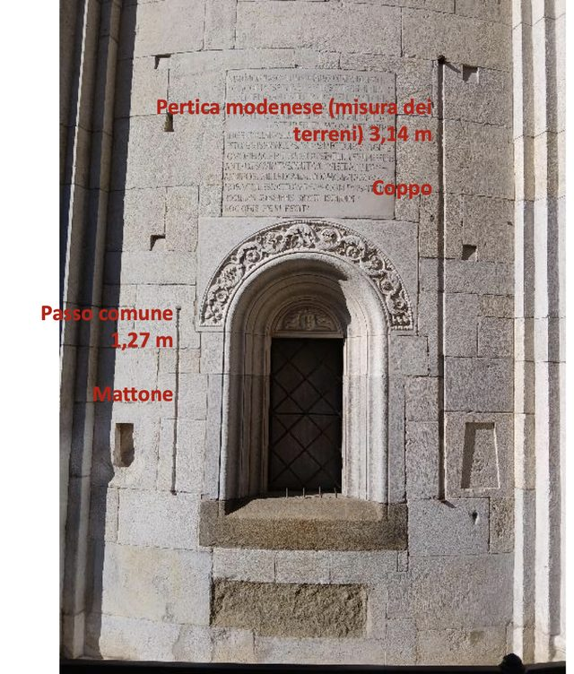
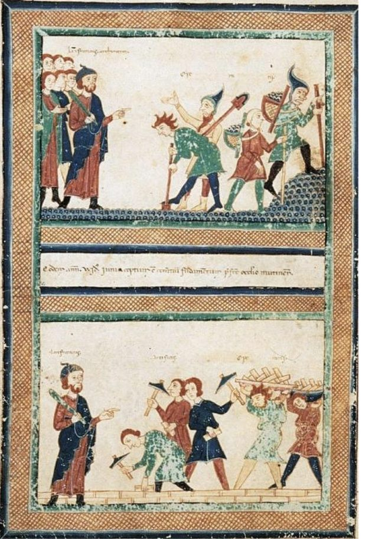
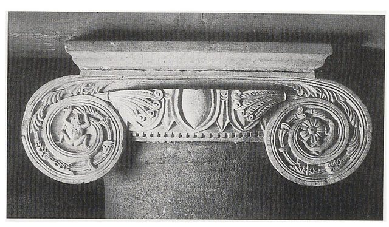

# Il romanico in Italia: Venezia, Modena, Puglia e Sicilia, Roma e Tuscania

> [!info] Note collegate
> Sbobina: [[17-romanico-venezia-modena-puglia-sicilia-roma]]
>
> Argomenti collegati: [[15-introduzione-al-romanico-firenze-e-pisa]] · [[13-architettura-bizantina-costantinopoli-e-ravenna]] · [[14-san-vitale-longobardi-e-carlo-magno]] · [[12-architettura-paleocristiana-a-roma]] · [[08-terme-di-caracalla]] · [[06-potere-imperiale-spettacolo-pompei]] · [[05-costruzione-nel-mondo-antico]] · [[01-ordini-architettonici]] · [[18-architettura-gotica-in-francia]] · [[19-gotico-italiano-federico-ii-e-primo-rinascimento]]

L'architettura romanica, che cronologicamente si colloca tra XI e XII secolo, è caratterizzata dal policentrismo: è un'architettura che cambia caratteri in funzione del luogo in cui viene realizzata. Dopo aver definito il sistema costruttivo della chiesa romanica, con la volta a crociera che sostituisce le capriate lignee della tradizione paleocristiana e i pilastri compositi che ne sorreggono il peso, e dopo aver visto il romanico toscano attraverso il Battistero e San Miniato a Firenze e il Duomo di Pisa, il percorso prosegue attraverso altri centri della penisola, ognuno dei quali presenta caratteristiche diverse dagli altri. Se nello studio dell'architettura imperiale romana si cercavano le costanti, in questa fase l'attenzione si concentra sull'unicità dei singoli casi. Si parte da Venezia, con la Basilica di San Marco, un'opera che guarda a Bisanzio; si passa al romanico lombardo-padano del Duomo di Modena; si scende in Puglia e in Sicilia, dove si incontrano lo schema cassinese e la fusione tra cultura bizantina e cultura costruttiva araba; si torna infine a Roma e nel suo territorio, dove le chiese del XII secolo riprendono il modello delle basiliche paleocristiane reimpiegando i materiali dei grandi edifici antichi.

## VENEZIA E LA BASILICA DI SAN MARCO

### Venezia, porta d'Oriente

Venezia, l'isola dell'alto Adriatico, è un caso assolutamente distinto rispetto ai centri del romanico toscano. Centro emergente dal punto di vista artistico e territorio legato all'impero bizantino, è solitamente identificata, insieme a Ravenna, come una delle porte d'Oriente, una delle città della penisola più vicine a Costantinopoli. Studiare come si manifestano qui, nel corso dell'XI secolo, i caratteri dell'architettura che cronologicamente appartiene al romanico permette di misurare quanto la geografia e la cultura di una città ne determinino l'architettura. L'esempio è la Basilica di San Marco, un'opera assolutamente unica nel panorama dell'architettura romanica.

### La cappella palatina del doge

La Basilica di San Marco non è la cattedrale di Venezia, cioè non è la sede del vescovo, che si trova invece nell'isola di Torcello: è la cappella palatina del magistrato supremo della città, il doge, ed è legata al Palazzo Ducale, che sorge proprio accanto alla fabbrica della chiesa. È intitolata all'evangelista Marco, patrono della città, le cui reliquie secondo la tradizione sono conservate al suo interno. Come spesso accade, per quel processo di stratificazione già incontrato molte volte, la basilica sorge in corrispondenza di un edificio eretto nel IX secolo proprio per dare sepoltura all'evangelista, e la nuova costruzione ne è la sostituzione.

Il cantiere si avvia nel 1063, negli stessi anni in cui comincia la costruzione del Duomo di Pisa, ma le due opere hanno caratteristiche completamente diverse. L'avvio dei lavori si colloca sotto il dogato di Domenico Contarini, cioè nel periodo in cui Contarini è doge di Venezia. Venezia ha un sistema politico unico nel quadro della penisola: è una repubblica, la Repubblica Serenissima come sarà poi denominata, in cui è presente anche un'aristocrazia, riunita nel Consiglio dei Dieci, a capo della quale si colloca il doge, la massima carica politica della città. Domenico Contarini appartiene a una delle famiglie più importanti di Venezia, di origini mercantili, che si guadagnerà poi i titoli aristocratici; sotto il suo dogato si collocano una serie di interventi che rientrano in un programma generale di abbellimento della città, tra cui la costruzione della basilica. La chiesa è consacrata nel 1094, trentuno anni dopo l'avvio del cantiere: con la consacrazione l'edificio può essere utilizzato per il rito, ma il completamento, e soprattutto il programma di abbellimento, si protraggono fino al XIV secolo.

### La facciata: un arco di trionfo

La facciata principale, rivolta verso piazza San Marco, ha caratteristiche completamente diverse dalle facciate delle basiliche toscane, che pur nelle loro differenze condividono più o meno la stessa configurazione. Il registro inferiore è formato da una sequenza di cinque archi a tutto sesto, in cui quello centrale è più alto dei quattro laterali; le forme ad arco sono richiamate anche nel secondo registro. Nel complesso il riferimento più vicino a questo impaginato è l'architettura trionfale, come se la facciata fosse ispirata a un arco di trionfo. L'idea trionfale comunica immediatamente l'importanza e la monumentalità dell'edificio, ed è uno degli elementi che collegano San Marco all'architettura di Costantinopoli: la grande capitale dell'impero bizantino viene evocata proprio attraverso le forme trionfali della facciata. Già questo basta a rendere il sistema architettonico di San Marco del tutto autonomo rispetto agli edifici del romanico toscano.

### La pianta a *quincunx* e l'Apostoleion di Costantinopoli

L'autonomia prosegue nell'impianto. Le chiese di Firenze e di Pisa riprendevano sostanzialmente la basilica paleocristiana, con impianto longitudinale a croce latina, *commissa* o *immissa*, pur con le loro differenze, come i particolari rapporti proporzionali tra transetto e corpo longitudinale del Duomo di Pisa. La pianta di San Marco guarda invece a modelli completamente diversi: è una pianta a *quincunx*, in italiano quinconce, cioè con cinque cupole disposte come i cinque punti sulla faccia di un dado. In pianta le cupole si riconoscono nelle circonferenze tratteggiate, che sono la proiezione del loro ingombro.

![[san-marco-pianta-quincunx.jpg|620]]

L'impianto a *quincunx* era già stato incontrato nell'architettura bizantina, nell'Apostoleion, la chiesa dei Santi Apostoli di Costantinopoli. L'edificio non è sopravvissuto: lo si conosce attraverso alcune descrizioni e alcune rappresentazioni conservate nei manoscritti, da cui sono state proposte nel tempo diverse ricostruzioni digitali. L'accostamento con la pianta di San Marco mostra che anche il modello dell'impianto veneziano appartiene al contesto bizantino. La facciata, con il richiamo all'arco di trionfo, rimanda all'impero e quindi a Costantinopoli; l'impianto a *quincunx* prende come riferimento non le basiliche longitudinali paleocristiane, e dunque Roma, ma l'architettura bizantina di Costantinopoli. Il riferimento è anche più preciso: la chiesa dei Santi Apostoli era stata voluta da Costantino in persona, agli albori dell'architettura paleocristiana, e fu poi ricostruita da Giustiniano, l'imperatore d'Oriente che fece costruire Santa Sofia. Il modello parla quindi la lingua delle opere bizantine e rimanda specificamente a una committenza imperiale. Nel Quattrocento la chiesa fu distrutta per costruire una moschea, e non ne restano tracce materiali; ma nell'XI secolo, quando si fonda San Marco, era ancora perfettamente visibile.

L'impianto veneziano non si limita alla struttura a *quincunx*. La pianta è a croce greca, con corpo longitudinale e transetto della stessa dimensione; a questa croce greca si aggiunge un'ulteriore campata, un nartece apposto alla facciata, che prolunga la croce. La sequenza di archi trionfali della facciata introduce proprio al nartece, che a sua volta conduce alla navata e allo spazio della chiesa. San Marco cita esplicitamente l'architettura bizantina con un impianto centrale che non ha paralleli nella penisola, soprattutto in questa cronologia, e che trasforma la concezione dello spazio rispetto all'impianto orientato longitudinalmente delle basiliche paleocristiane.

### Le cupole: cube murarie e sovracupole lignee

Parlare di un edificio a *quincunx* significa parlare di cupole, e quindi dell'effetto che l'opera ha nella sua proiezione verticale. Le cupole di San Marco, ricoperte di piombo che ossidandosi assume una colorazione grigiastra, sono diventate un simbolo dell'architettura veneziana e punteggiano il cielo della città. Quelle che si vedono dall'esterno, l'estradosso, sono quasi tutte il risultato di ricostruzioni compiute nel corso del Duecento e del Trecento, successive all'impianto originario. Tra la geometria delle cupole percepite dall'esterno e quella che hanno all'interno c'è una notevole differenza: dall'esterno sporgono con un volume molto definito, mentre dall'interno appaiono molto più ribassate. Le cupole di San Marco sono state infatti definite di recente cube murarie: la loro struttura si fonda sulla scatola muraria che le sostiene e viene poi ricoperta da altrettante sovracupole, strutture poste sopra la cupola che si vede dall'interno e sorrette da un'impalcatura lignea.

![[san-marco-cupola-san-giovanni.jpg|620]]

La pianta e la sezione della cupola di San Giovanni mostrano questa struttura. Le cinque cupole sono tutte diverse tra loro, perché sono il risultato di un susseguirsi di interventi di restauro dovuti ai danni subiti nel tempo, in particolare a un fortissimo incendio divampato nel Quattrocento, all'origine delle ultime ricostruzioni; il loro diametro varia dai 10 ai 12 metri. La cupola di San Giovanni è quella che conserva i caratteri più vicini alle strutture originarie: le altre quattro sono state restaurate anche nel Novecento, mentre per questa gli ultimi interventi risalgono al XV secolo, ai restauri successivi all'incendio. Le cupole sono impostate sui bracci murari e hanno un intradosso ribassato; sopra si colloca la sovracupola, che genera la sporgenza esterna, visibile anche a distanza. La struttura muraria della basilica è in laterizio, rivestita nel corpo principale di pietre preziosissime. Sopra le cupole in laterizio sono inserite le centine, anelli lignei orizzontali e concentrici posti a varie altezze, che insieme alle corbe o sesti, costolature verticali, sostengono il manto di copertura, un tavolato continuo in legno su cui è steso il rivestimento di piombo. È di fatto una doppia cupola, con caratteristiche diverse sia dal punto di vista geometrico sia da quello costruttivo: all'interno una struttura muraria, all'esterno una struttura sorretta da un'impalcatura lignea e coperta da un manto di piombo.

Questa soluzione risponde a un'intenzione formale, la volontà di rendere le cupole evidenti a distanza e lo *skyline* della città riconoscibile; ma l'esigenza principale è legata alla geografia di Venezia, città costruita sull'acqua. L'isola è una grande piattaforma sorretta da strutture di fondazione, e il problema più cogente è il peso delle opere architettoniche: la città, che peraltro sta sprofondando per il costante innalzamento del livello dell'acqua, non deve essere appesantita. La ricerca della leggerezza è un'esigenza sentita fin dalla fondazione della città, e nelle cupole di San Marco si manifesta nell'impiego della struttura lignea, che svuota parte della costruzione e consente una cupola di notevole impatto formale sorretta da una struttura estremamente leggera.

### La lunga durata del modello: San Zaccaria e Santa Maria dei Miracoli

Questi modi di costruire si protraggono per secoli a Venezia, sia nella componente formale, la scelta dell'impianto a quinconce, sia in quella costruttiva, la doppia calotta con la cupola interna in muratura e quella esterna sorretta dalle centine lignee. La chiesa di San Zaccaria, costruita a partire dal 1458, quattro secoli dopo la posa della prima pietra di San Marco, ha un impianto diverso e una sola cupola, ma questa è realizzata con lo stesso sistema, come mostra la struttura lignea che sorregge la sovracupola esterna. Nella chiesa di Santa Maria dei Miracoli, della seconda metà del Quattrocento, un edificio ad aula unica di dimensioni molto contenute su cui incombe una grande cupola, la sezione mostra la stessa identica struttura: in basso la cuba muraria, sopra le centine lignee su cui è apposto il manto di piombo. Sono solo due esempi delle numerosissime cupole veneziane concepite in questo modo nella lunga durata.

### L'interno: i mosaici dorati e la luce

All'interno la basilica continua a parlare la lingua dell'architettura bizantina: tutta la struttura architettonica e decorativa è una citazione della decorazione tipica degli edifici bizantini. La navata è caratterizzata da ricchissime decorazioni in materiali lapidei di diversa provenienza, in gran parte colonne portate da Costantinopoli a Venezia per costruire la basilica, mentre le cupole sono decorate con un mosaico dorato che riprende i colori e i rimandi dell'architettura bizantina. Il riferimento più immediato è l'interno di Santa Sofia a Costantinopoli, anche per la forma della cupola: come a Santa Sofia la cupola centrale sembra galleggiare sulla struttura muraria per le aperture collocate alla sua base, sopra i pennacchi, così a San Marco si ricerca lo stesso effetto di leggerezza e di sospensione. Il rivestimento di mosaici e dorature determina anche l'illuminazione: di giorno la luce solare si riflette sulle superfici dorate, e al calare del sole le candele generano ulteriori effetti di luce e di riflessi.

La cupola della Pentecoste, che copre il braccio di accesso della navata principale, è un mosaico del XII secolo, poi restaurato, con l'immagine degli apostoli: un'impostazione della decorazione interamente riferita al sistema di Bisanzio.

### I marmi di spoglio e il *book-matching*

Su alcune porzioni della basilica rimaste prive del rivestimento di marmi e pietre policrome si vede ancora la struttura in laterizio del nucleo costruttivo originario. Il contrasto con le parti concluse, dove le colonne in materiali diversi creano un effetto policromo, rivela come tutta la ricchezza della basilica sia ottenuta con decorazioni lapidee apposte sulla struttura muraria.

Chi fossero le maestranze capaci, nella Venezia dell'XI secolo, di costruire una basilica di queste dimensioni e con queste peculiarità, così uniche nella penisola, è ancora un problema aperto: forse erano maestranze locali formate alla costruzione attraverso l'impiego di questi materiali. Si sa invece da dove provengono i materiali. Le colonne, diffuse sulla facciata e negli interni, sono accostate tra loro e realizzate tutte in materiali diversi; all'interno hanno anche una funzione strutturale, mentre sulla facciata, dove la solidità è garantita dalla massa muraria in laterizio, la loro funzione è decorativa, ma ovunque hanno una forte componente simbolica. Le colonne di San Marco sono diverse centinaia, e circa l'80% proviene da Costantinopoli: sono materiali di spoglio messi in opera in questo grandioso cantiere. I marmi più diffusi provengono dalla Turchia, altri dall'Egitto e dal Mediterraneo, e la diversità delle cave genera sulla facciata un effetto multicolore e di grande varietà, accresciuto dalla varietà dei capitelli e dei modi di rivestire la struttura in laterizio.

Tra i sistemi di rivestimento impiegati c'è il *book-matching*, termine che non ha una traduzione italiana corrente e che indica l'accostamento come nelle pagine di un libro: lastre di marmo tagliate dallo stesso blocco vengono abbinate in modo da creare forme speculari, come pagine che si aprono, e le venature compongono così disegni geometrici. È un sistema presente nel mondo antico, utilizzato in questo edificio del XII secolo e ancora nell'architettura contemporanea: uno degli esempi più famosi è il Padiglione di Barcellona di Mies van der Rohe, del 1929, interamente costellato di questi disegni. Il *book-matching* dice qualcosa di importante sul cantiere: la disposizione non è casuale, ma è una scelta progettuale dell'architetto, che incide sia sulla scelta del materiale sia sul modo in cui viene messo in opera. Senza il controllo del cantiere tutte queste attenzioni della decorazione architettonica vengono meno.

### I capitelli e gli ordini floreali di Ruskin

La facciata di San Marco, meravigliosa composizione di colori, di materiali e di forme nata dalla commistione di preziosissimi materiali di spoglio che prendono forma nuova nel cantiere medievale, ha colpito gli osservatori e i viaggiatori. Uno dei suoi più grandi ammiratori è John Ruskin (1819-1900), figura rinomata soprattutto nella teoria del restauro e grandissimo studioso di Venezia, a cui si deve la frase: «I disegni dei capitelli di San Marco, da soli, riempirebbero un intero volume». L'affermazione è stata confermata da una pubblicazione più recente, *Le pietre di San Marco*, un intero volume dedicato allo studio dei materiali e delle forme architettoniche della basilica.

Accanto al materiale c'è infatti la decorazione. Alcuni capitelli di San Marco riprendono le forme dei capitelli della Basilica di San Vitale a Ravenna, del VI secolo; altri sono tipici della basilica, come il capitello con foglie mosse dal vento, decorato con motivi vegetali del tutto autonomi rispetto alle foglie d'acanto dei capitelli corinzi, con un andamento unico che le fa sembrare agitate dal vento. Proprio questa varietà ha ispirato a Ruskin la ricostruzione dei quattro ordini floreali di Venezia, un accostamento tra le forme dei capitelli della basilica e le corolle dei fiori, pubblicato tra le illustrazioni di *The Seven Lamps of Architecture* (*Le sette lampade dell'architettura*, 1849). È una dinamica del tutto diversa dagli ordini antichi, ma è una tassonomia della decorazione architettonica: come gli scienziati classificano le specie naturali, Ruskin classifica le forme architettoniche attraverso la classificazione delle specie floreali.

![[ruskin-ordini-floreali.jpg|560]]

### La quadriga

Sulla facciata della basilica era posta una quadriga, un gruppo di quattro cavalli in lega di bronzo, il cui colore verdastro è il risultato dell'ossidazione del metallo. Anche la quadriga proveniva da Costantinopoli: non più un elemento della costruzione o della decorazione, ma un vero gruppo scultoreo di spoglio, realizzato nell'antichità, secondo alcuni nel III secolo d.C. Nel mondo antico le quadrighe erano poste sugli archi di trionfo, e il gruppo dei quattro cavalli è quindi un ulteriore riferimento al linguaggio trionfale, evocato insieme dalla scultura e dal sistema di archi della facciata.

La sua storia è particolare. Alla fine del Settecento, quando parte della penisola, Venezia compresa, passa sotto il controllo di Napoleone, i cavalli vengono portati in Francia, insieme a molte altre opere d'arte che hanno poi popolato i grandi musei francesi; una stampa del tempo celebra l'evento come *Entrée triomphale des monuments des sciences et arts en France*, ma nella prospettiva italiana fu piuttosto una straordinaria sottrazione. Dopo la sconfitta di Napoleone, nel 1815, gli austriaci restituiscono i cavalli a Venezia. Restano sulla facciata fino al 1977, quando per ragioni di conservazione vengono rimossi e custoditi nel museo della basilica; sulla facciata sono oggi esposte delle copie, che mantengono l'integrità dell'immagine dell'edificio così come era stato concepito.

### Venezia, repubblica mercantile che guarda a Bisanzio

Il termine romanico rimanda, in maniera più evocativa che effettiva, a un ritorno al modo di costruire dei Romani, a un'arte che riprende Roma come modello principale. La Basilica di San Marco si colloca in una direzione completamente autonoma: mentre tutta l'Europa torna a volgere lo sguardo verso Roma, Venezia guarda all'Oriente e a Bisanzio. San Marco appartiene al romanico perché vi rientra cronologicamente, ma per forme, riferimenti e rimandi ha intenti e obiettivi del tutto diversi da quanto accade nella maggior parte d'Europa, come confermano la struttura e soprattutto la decorazione.

Il fatto che la basilica si configuri come una ricomposizione di materiali provenienti dall'Oriente dipende dalla struttura economica della città. Venezia è una repubblica dal punto di vista politico, ma dal punto di vista economico è una città mercantile, che fonda la sua economia sulla mercatura: il commercio con l'Oriente, soprattutto di spezie e di tessuti provenienti dall'Asia, è centrale. La lunghissima durata di questa vocazione è testimoniata da Marco Polo, il mercante viaggiatore che intorno al 1300 percorre la Via della Seta, trascorre molti anni in Oriente e racconta il suo viaggio nel *Milione*. Venezia è naturalmente predisposta alle vie d'acqua più che a quelle di terra, e lungo questi itinerari vengono trasportati in maniera massiccia anche i materiali del vicino Oriente. La storia dell'architettura si conferma così inseparabile dalla storia economica di un luogo: l'identità di Venezia, città lagunare, isola fondata sull'economia mercantile, rende possibile un edificio come San Marco, che non avrebbe potuto essere concepito né costruito in una città come Firenze.

## MODENA E IL ROMANICO LOMBARDO-PADANO

### La cattedrale di San Geminiano

Tra le aree di diffusione del romanico nella penisola, accanto al romanico toscano e al caso a sé di Venezia, si riconosce il romanico lombardo-padano. Il suo esempio più significativo in area emiliana è il Duomo di Modena, la cattedrale dedicata a San Geminiano. La costruzione comincia nel 1099; nel 1106, sotto papa Pasquale II, viene consacrata la parte orientale e le reliquie di San Geminiano sono traslate nella nuova cripta; l'intera chiesa è consacrata nel 1184, mentre la chiusura del cantiere arriva nel XV secolo. Anche questi edifici, consacrati qualche decennio dopo l'avvio dei lavori, hanno storie costruttive di lunghissima durata: occorrono secoli per portare a termine cantieri così impegnativi per dimensioni, costruzione, approvvigionamento dei materiali e spese.

### Lanfranco e Wiligelmo

Una delle peculiarità del Duomo di Modena è la ricchezza di informazioni sulla sua storia costruttiva. Una lapide posta sul lato dell'abside cita il nome dell'architetto che ha progettato l'edificio, Lanfranco, e la data precisa della posa della prima pietra, il 26 maggio 1099. Di Lanfranco, diversamente da molti architetti di cui si conosce soltanto il nome, si hanno anche altre notizie: lo si ritrova in diversi cantieri dell'area lombardo-padana, attivo tra la fine dell'XI secolo e i primi decenni del XII. Nella sua attività collabora frequentemente con lo scultore Wiligelmo, autore anche a Modena dell'apparato scultoreo, come le storie della Genesi sulla facciata principale. Per questo cantiere si conoscono quindi sia il progettista dell'edificio sia l'artista che ne ha eseguito la decorazione.

### Una facciata di pietra in una terra senza cave

Il Duomo di Modena è costruito con marmi romani, materiali di spoglio ritrovati nel territorio e rimontati per la nuova fabbrica. Dal punto di vista delle forme, dopo l'eccezione di San Marco si torna alla tradizione delle basiliche già incontrate. La facciata è a capanna e tripartita in tre campate, che alludono alle tre navate, di cui la centrale è più alta; le navate sono anticipate da tre portali. Sopra la fascia inferiore si sviluppa una sequenza di archi che a loro volta contengono tre piccoli archi, formando un loggiato, e il centro della facciata è caratterizzato da un rosone e coronato da torrette, entrambi successivi al progetto dell'XI secolo.

L'impiego di materiale di spoglio è un'assoluta eccezione nel contesto padano, naturalmente privo di cave di pietra. La pianura padana è una grande area piatta che corrisponde a circa un ottavo della superficie della penisola e comprende la parte settentrionale dell'Emilia e alcune zone del Veneto e della Lombardia; in una pianura le cave non ci sono. Dove il materiale può viaggiare via mare, come a Rimini o a Ravenna, si usano pietre dell'altra sponda dell'Adriatico; alcune città del basso Veneto si servono delle cave della zona di Verona; ma lungo la via Emilia, la strada di età romana che attraversa in larghezza la parte più alta della penisola, il materiale prevalente è il laterizio, che si può produrre facilmente in un territorio povero di pietra. Il trionfo di pietra della facciata di San Geminiano è dunque una prodigiosa eccezione a condizioni geologiche connaturate al territorio, e mostra come il cantiere volesse assumere fin dall'inizio un carattere molto peculiare e facilmente riconoscibile.

### La pianta e il sistema dei sostegni

La cattedrale è divisa in tre navate, la centrale più ampia delle laterali, tutte coperte da volte a crociera, riconoscibili in pianta dalle linee tratteggiate che formano delle croci. Il transetto è incluso nello spessore del corpo longitudinale. Alla navata centrale e alle laterali corrispondono l'abside centrale e le due absidi laterali; il presbiterio, separato dalla navata da un pontile e rialzato rispetto alla quota delle navate, è anticipato da una scala e sovrasta la cripta, dove sono conservati i resti di San Geminiano, segno del legame tra devozione e costruzione delle fabbriche.

![[modena-duomo-pianta.jpg|560]]

La separazione tra la navata centrale e le laterali è affidata a un sistema misto di pilastri compositi, o pilastri a fascio, e di colonne, che si alternano lungo le navate. È lo stesso sistema di sostegni di sezione e forma diverse già incontrato a San Miniato al Monte, e risponde alle sollecitazioni che la struttura impone sui sostegni verticali. Le volte a crociera sono però il risultato di una sostituzione del XIV secolo, volta a rinforzare la struttura e a sostituire le capriate lignee della copertura originaria: anche qui un sistema di copertura ancora legato ai modelli paleocristiani viene sostituito da una struttura più forte e resistente.

L'impianto della cattedrale è stato avvicinato a quello dell'abbazia di Notre-Dame a Jumièges, in Normandia, per l'analogo sistema di separazione tra navata centrale e laterali con colonne e pilastri compositi. La somiglianza è stata interpretata come segno che l'abbazia normanna abbia potuto costituire un modello per Modena, e secondo alcuni studiosi deriverebbe dalla provenienza dello stesso Lanfranco, che potrebbe essere originario della Normandia. È un'ipotesi, che mostra come un'opera si interpreti anche sulla base delle sue somiglianze con altri edifici.

### Il modulo lanfranchiano

Il sistema della facciata principale, con il registro inferiore delle porte e il loggiato continuo e modulare, caratterizza anche il prospetto laterale: la sequenza di archi che contengono ciascuno tre piccole arcate disegna un loggiato che corre lungo tutto il fianco della basilica. Questo modulo, cioè l'elemento formale ripetuto nel progetto che determina il ritmo della facciata, è definito modulo lanfranchiano: un sistema di progettazione impiegato da Lanfranco per generare il ritmo dei prospetti. È un esempio lampante del fatto che le proporzioni esistono in tutta la storia dell'architettura e non sono un'invenzione del Rinascimento. Nell'XI secolo un modulo costruttivo determina le proporzioni di un edificio, esattamente come farà Brunelleschi nell'Ospedale degli Innocenti o negli impianti delle chiese di San Lorenzo e di Santa Croce a Firenze. Senza un sistema modulare non è possibile concepire un progetto architettonico; cambiano i modi di concepire gli edifici, le proporzioni e i sistemi di misura, ma l'idea di una costruzione modulare è sempre esistita, e il modulo lanfranchiano ne è una conferma.

### I leoni stilofori e il protiro

Tra gli elementi più imponenti della decorazione, anch'essi di spoglio di origine romana, ci sono i leoni posti in corrispondenza della facciata laterale, detti stilofori perché portano elementi di sostegno verticale. Il reimpiego di sculture antiche come questi leoni è una peculiarità abbastanza unica nell'architettura padana. I leoni sorreggono le colonne del protiro, una struttura il cui nome deriva dal greco *próthyron* e che indica un elemento architettonico anteposto a un portale e dotato di un sistema autonomo di copertura e di sostegno. La forma più comune è quella di una volta a botte sormontata da un tetto a due spioventi e addossata alla muratura sopra una lunetta, appoggiata in genere su due colonne. Come un grande baldacchino, il protiro copre e ripara l'accesso, ed è sorretto da colonne indipendenti dal sistema murario della facciata.

Il protiro in facciata è un elemento comune a diversi edifici del romanico padano e contribuisce a identificare quest'area di influenza: lo si ritrova nella facciata principale del Duomo di Santa Maria Assunta a Verona, iniziato nel 1139, e della cattedrale di San Giorgio a Ferrara, iniziata nel 1135. È probabile che sia stato proprio il modello di Modena a influenzare questi esempi. Per Ferrara se ne è praticamente certi, perché l'architetto della cattedrale, Nicolò, noto da un'epigrafe nella chiesa, è un allievo di Lanfranco: la derivazione nasce direttamente dal suo alunnato presso l'architetto del Duomo di Modena.

### Il duomo come manuale: le unità di misura

 I grandi edifici medievali possono essere letti come manuali di architettura. Il cantiere medievale si svolge in maniera empirica: anche quando si conosce il nome del progettista, il cantiere è il luogo del progetto, e la costruzione è anche il modo in cui il progetto viene aggiornato e aggiustato. Nell'Italia dell'XI secolo, dove si diffondono i comuni, città autonome, il riferimento architettonico e culturale di ogni comune diventa la costruzione del duomo. Questi cantieri durano decenni e restano sotto gli occhi dei cittadini, che vedono trasformarsi la propria città; il duomo diventa il riferimento di ogni luogo.

Lo è anche per la costruzione, perché ogni comune adotta un proprio sistema di unità di misura. Non esiste ancora il sistema metrico decimale, per cui oggi il metro ha lo stesso nome e la stessa lunghezza in Italia e in Francia; nel Medioevo, e anche a Roma, unità con lo stesso nome, come il palmo romano o il piede romano, variavano di qualche millimetro o anche di qualche centimetro. Ogni città ha quindi il suo sistema, e la cattedrale ne è la testimonianza. Sulla muratura dell'abside di Modena, accanto alla lapide di Lanfranco, sono impressi i segni delle unità di misura usate per costruire il duomo, che diventano il riferimento per chiunque voglia costruire: lo stampo del mattone, che serve a fabbricarne altri della stessa misura, quello dei coppi, le tegole delle coperture, e le unità di lunghezza, la pertica modenese, usata per misurare i terreni, di 3,14 metri, e il passo comune, di 1,27 metri. Tutto quello che serve per costruire un edificio è esposto nel luogo più raggiungibile e visibile del comune. L'esposizione delle unità di misura è abbastanza comune in questo periodo e si ritrova anche in altre città.

### Il ruolo dell'architetto: la *Relatio* e la figura di Lanfranco

 Il Duomo di Modena non è il primo caso di cui si conosca il progettista: si sono già incontrati Apollodoro di Damasco e altri architetti antichi, e a Pisa Buscheto, primo architetto del Duomo. Per Lanfranco, oltre all'epigrafe che attesta la paternità del progetto, si conserva una sorta di racconto della sua biografia in un manoscritto dell'inizio del XIII secolo, quindi successivo agli anni in cui visse, dedicato alla storia del duomo: la *Relatio de innovatione ecclesiae Sancti Geminiani*, una relazione sul cantiere oggi conservata nell'Archivio Capitolare di Modena. Le sue pagine miniate rappresentano l'architetto, identificato dal nome scritto sopra la figura.

La miniatura dice molto sulla funzione di Lanfranco nel cantiere: l'architetto indica con la mano e dà ordini a coloro che lavorano, figure munite di attrezzi che trasportano i mattoni e sono impegnate nella costruzione. Lanfranco non ha più un ruolo operativo, di costruttore che contribuisce materialmente all'opera, ma un ruolo di coordinamento delle maestranze, in qualche modo intellettuale, per quanto il termine sia eccessivo per questa fase. Con il Duomo di Modena si incontrano così le prime fasi di una biografia degli architetti, che cominciano ad assumere un'identità professionale distinta da quella delle altre figure del cantiere, delineata da una serie di fonti.

## L'ITALIA MERIDIONALE: PUGLIA E SICILIA

### Tra Bisanzio, Islam e Normanni

Nell'Italia meridionale tra XI e XII secolo la Puglia è controllata dall'impero bizantino, mentre la Sicilia è sotto il dominio islamico e poi sotto quello normanno. Con il termine normanni si intendono le popolazioni venute dal nord, i *north-men*, che raggiungono progressivamente le coste settentrionali dell'Europa e l'Inghilterra e si spostano poi anche nell'Italia meridionale. Queste conquiste portano con sé una naturale mobilità di forme e di culture.

### La Basilica di San Nicola a Bari e lo schema cassinese

La Basilica di San Nicola a Bari, iniziata nel 1087 e consacrata nel 1197, si colloca nello stesso intervallo cronologico, dalla seconda metà dell'XI secolo fino al XII, e introduce un particolare impianto, lo schema cassinese. Il nome deriva dalla Basilica di San Benedetto a Montecassino, il complesso che ha origine dal monaco Benedetto, di cui si conosce un'ipotesi di schema della pianta di fine XI secolo; l'abbazia è stata poi distrutta e fortemente trasformata, e la si conosce soprattutto attraverso l'eredità lasciata negli impianti che vi si sono ispirati.

![[bari-san-nicola-schema-cassinese.jpg|600]]

La caratteristica più marcata dello schema cassinese è la presenza di tre absidi allineate alle tre navate: l'abside maggiore conclude la navata centrale, più ampia, e le due absidi minori le navate laterali. A San Nicola, in una forma diversa e meno marcata che a Montecassino, si ritrovano le tre absidi; accanto alle navate si dispongono una serie di cappelle laterali. Il transetto è incluso nell'ampiezza del corpo longitudinale e non è quindi leggibile all'esterno nella volumetria dell'edificio. Questo impianto è particolarmente diffuso nell'Italia meridionale, in Puglia ma non solo, e diventa una declinazione locale dell'architettura romanica: lo schema cassinese come interpretazione dell'impianto basilicale nell'Italia del sud.

All'interno le navate sono separate da colonne, e un grande arco segna la separazione tra la navata centrale e il presbiterio, dove si trova l'iconostasi, la struttura che separa la navata dal presbiterio. Arconi di rinforzo, tesi tra i pilastri e tra le colonne, irrigidiscono la struttura. Anche qui i sostegni verticali hanno forme diverse in relazione alla sollecitazione strutturale: pilastri compositi in corrispondenza delle spinte maggiori, colonne semplici dove la struttura è meno sollecitata.

### La pietra di Terra di Bari e la cattedrale di Trani

L'architettura della regione storica della Terra di Bari è caratterizzata dall'impiego di un materiale lapideo molto chiaro, cromaticamente uniforme, cavato proprio in questo territorio. La stessa pietra si ritrova nella cattedrale di San Nicola Pellegrino a Trani, costruita dal 1099 alla metà del XIII secolo e dedicata anch'essa a San Nicola, una delle figure di riferimento del territorio. La pianta presenta le caratteristiche dello schema cassinese: tre absidi in corrispondenza delle tre navate e il transetto incluso nel volume del corpo longitudinale, senza sporgenze.

La facciata è molto essenziale: le forme seguono l'andamento delle navate, l'impaginato è piuttosto liscio e la pietra è la vera protagonista, con la sola eccezione di una sequenza di piccoli archi che affiancano l'arco maggiore del portale. Si accede alla chiesa superando un dislivello con una scala a doppia rampa, simmetrica rispetto al portale, che rivela la sopraelevazione del presbiterio e la presenza della cripta sottostante, raggiungibile da due scale laterali poste nelle navate. L'idea di sopraelevazione è ripresa dal campanile, costruito su un arco come un edificio a ponte che si può attraversare. La collocazione straordinaria della cattedrale, direttamente affacciata sul mare, fa sì che attraverso questa apertura nel basamento del campanile si veda il mare retrostante, in una sorta di trasparenza dell'architettura. Il prospetto absidale, con i tre volumi delle absidi e la loro configurazione molto plastica, è tipico dello schema cassinese, che si riconosce proprio osservando la parte posteriore della chiesa.

Bari e Trani mostrano il ricorso costante ai materiali locali, funzionale alla diminuzione delle spese dei cantieri, diversamente dai materiali di spoglio fatti arrivare da lontano, come a Venezia, per esibire l'impegno profuso in un'opera. E mostrano un'ulteriore declinazione del policentrismo romanico: in quest'area la scelta dell'impianto, lo schema cassinese, diventa significativa del territorio.

### Identità locali e fusione di culture

Il percorso attraverso l'architettura romanica si muove costantemente tra due poli. Da un lato le identità locali: ogni luogo sceglie di rappresentarsi attraverso l'architettura con scelte specifiche, l'impiego di certi materiali, come la bicromia bianca e verde di Firenze, o l'adozione di un impianto legato a un territorio, come lo schema cassinese. Dall'altro la fusione tra culture differenti, che dipende dalla storia politica, economica e culturale di ogni centro: i capitelli del Duomo di Pisa raccontano storie di mobilità e di opere provenienti dall'Oriente, San Marco reimpiega una grandissima mole di materiali di Costantinopoli. A Palermo, per la storia di una regione che vede alternarsi diverse dominazioni, la fusione è tra la cultura bizantina, riconoscibile nella decorazione, e la cultura costruttiva araba, che si manifesta nella struttura degli edifici.

### La chiesa di San Cataldo a Palermo

La chiesa di San Cataldo viene avviata nel 1154 per volontà di un ammiraglio del re normanno. Alla prima fase seguono importanti trasformazioni e lavori di restauro, tra cui un significativo intervento ottocentesco che riporta l'edificio alla sua struttura medievale: quello che si vede oggi corrisponde alla costruzione del XII secolo, ma è il risultato di un restauro che ne ha ricostituito l'immagine originaria.

Un unico ingresso conduce a una navata centrale coperta da tre cupole, che si leggono anche all'esterno: sono le cupole rosse tipiche dell'architettura palermitana, che si stagliano sul volume in pietra dell'edificio. Le murature hanno uno spessore massiccio; le tre absidi corrispondono alla ripartizione dell'impianto, ma solo quella centrale è visibile all'esterno, perché le altre due sono incluse nello spessore murario, e si perde così l'articolazione in tre volumi che caratterizza il prospetto absidale di Trani. Al centro quattro colonne sostengono le coperture, le volte a crociera delle navate laterali e le cupole del corpo centrale. La facciata è essenziale, con aperture solo nella parte superiore e un livello inferiore quasi spoglio, disegnato soltanto da forme impresse nella muratura; colpiscono invece le cupole che sporgono dal volume centrale. San Cataldo combina dunque un impianto basilicale a tre navate separate da colonne con una sequenza di tre cupole, del tutto estranee all'architettura basilicale e incontrate piuttosto nell'architettura bizantina.

![[san-cataldo-pianta-cupole.jpg|600]]

All'interno, guardando in basso, si è immersi in un contesto bizantino: la decorazione dei pavimenti combina materiali pregiati in motivi geometrici, e i capitelli bizantineggianti riprendono le forme di quelli di San Vitale a Ravenna, gli stessi a cui guarda la decorazione di San Marco. Tutto cambia alzando lo sguardo alla sequenza delle tre cupole, che determinano il volume esterno dell'edificio e contraddistinguono internamente l'impianto, sorrette dalle quattro colonne.

### La stereotomia

Le cupole appartengono a un mondo costruttivo che guarda al mondo arabo. Sono realizzate nella stessa pietra arenaria locale impiegata per la chiesa, tagliata secondo le regole della stereotomia. Il termine, di etimologia greca, indica l'insieme delle regole geometriche e delle tecniche tradizionali usate per la tracciatura, il taglio e l'assemblaggio di blocchi o conci di pietra, impiegati per costruire strutture architettoniche complesse come archi, volte e cupole. È un termine molto specifico, perché identifica una tecnica precisa di taglio della pietra, ma anche ampio, perché comprende moltissime categorie di edifici e opere realizzate in zone molto diverse d'Europa e del Mediterraneo. La specifica espressione palermitana, la costruzione di cupole in pietra, appartiene al mondo arabo e si ritrova anche nella chiesa di San Giovanni degli Eremiti, costruita nel 1132, le cui cupole sono anch'esse in materiale lapideo, tagliate e concepite con le stesse tecniche.

Il principio della stereotomia si coglie con efficacia in una volta a crociera in pietre di colori diversi della Basilica della Madonna di Ekatontapyliani, la «chiesa dalle cento porte», nell'isola di Paros. Ogni pietra è stata disegnata e progettata per essere tagliata in modo da comporre la superficie curva, e può stare soltanto nel punto in cui è collocata: invertendo due pietre non si otterrebbe la struttura, né dal punto di vista geometrico né da quello della resistenza. La composizione di materiali lapidei in superfici curve è regolata da norme specifiche, come in un gioco di costruzioni. Nei cantieri antichi e medievali queste norme sono empiriche, frutto di un saper fare acquisito sul posto, e le regole venivano disegnate direttamente sulla pietra con le *trazas*, la tracciatura che indica come tagliare i conci. Nel Cinquecento diventano oggetto di trattati dedicati al taglio della pietra, come quello dell'architetto spagnolo Alonso de Vandelvira, composto tra gli anni Settanta e Ottanta del secolo, con schemi che spiegano come tagliare i conci per ottenere archi e cupole; in Francia ne è un esempio l'opera di Philibert de l'Orme.

È una tecnica del mondo antico che si trasmette fino al Cinquecento. A Roma l'Arco di Dolabella, vicino a Santo Stefano Rotondo, è costruito con pietre pensate per comporre superfici curve, e lo stesso sistema è tipico degli archi, diffusissimi, dei teatri e degli anfiteatri romani come il Colosseo. La stereotomia non è quindi un'esclusiva palermitana: ciò che contraddistingue San Giovanni degli Eremiti e San Cataldo è il suo impiego per costruire cupole, e non soltanto archi.

## ROMA E LO STATO PONTIFICIO NEL XII SECOLO

### Il ritorno al modello paleocristiano

L'ultima tappa riporta a Roma e allo Stato Pontificio tra XI e XII secolo, cioè nel luogo in cui erano stati costruiti gli edifici che in alcuni casi sono i modelli stessi dell'architettura romanica. Roma è sempre il centro dei pellegrinaggi, e una delle esigenze del periodo è la realizzazione di edifici capaci di accogliere i pellegrini. Queste chiese sono costruite tenendo presente l'eredità dell'architettura paleocristiana, in cui individuano i loro riferimenti principali: l'impianto basilicale torna con prepotenza, combinato con pratiche costruttive fondate soprattutto sull'impiego di materiali di spoglio, capitelli e colonne prelevati dai grandi complessi antichi. È di nuovo una fusione di culture: quella paleocristiana per i modelli architettonici, quella antica per la provenienza dei materiali.

La produzione di decorazioni architettoniche di questo territorio fa capo a due botteghe, i Cosmati e i Vassalletto. Ai primi si devono i pavimenti cosmateschi, come quello del duomo di San Cesareo a Terracina, ai secondi opere come il chiostro di San Paolo fuori le Mura.

### La Basilica di Santa Maria in Trastevere

La Basilica di Santa Maria in Trastevere, costruita tra il 1140 e il 1148, è voluta da papa Innocenzo II su una precedente basilica del IV secolo, crollata in seguito al terremoto della fine dell'XI secolo. L'impianto paleocristiano è quindi anche la memoria specifica dell'edificio preesistente. La facciata attuale, con il portico, è un progetto di Carlo Fontana del 1700 e non ha nulla a che fare con la costruzione del XII secolo; riprende però le forme della facciata delle basiliche paleocristiane, dove il portico, uno dei bracci del quadriportico, accoglieva il nartece davanti alla facciata, ed è quindi un'ulteriore evocazione della volontà di rifarsi al modello paleocristiano.

![[santa-maria-in-trastevere-pianta.jpg|560]]

In pianta le murature della fabbrica originaria sono distinte dalle aggiunte successive, come le cappelle laterali che hanno trasformato il volume dell'edificio e il portico di Fontana. Il corpo del XII secolo si articola secondo l'impianto basilicale paleocristiano: tre navate, la centrale più ampia delle laterali, un transetto incluso nell'ampiezza del corpo longitudinale e un'unica abside, con una scala che allude alla presenza di una cripta. Le navate sono separate da colonne e la copertura è piana: si rinuncia al sistema voltato per tornare, anche dal punto di vista costruttivo, al modello paleocristiano.

### I capitelli delle Terme di Caracalla

Nella fusione tra impianto paleocristiano ed elementi antichi conta soprattutto il reimpiego della decorazione architettonica. Tutti i capitelli ionici delle colonne di Santa Maria in Trastevere provengono dalle Terme di Caracalla, come ha identificato una studiosa: appartengono tutti allo stesso ordine, ma ciascuno ha caratteristiche particolari. Uno dei più caratteristici è il capitello con testa di Serapide, nel colonnato nord, un capitello ionico che al posto del fiore d'abaco presenta la testa della divinità. Il fenomeno è comune ad altre basiliche: i grandi complessi antichi, ricchissimi di opere e ormai privi della loro funzione (le Terme di Caracalla non erano più usate come impianto termale), erano divenuti a tutti gli effetti cave di materiale per i nuovi edifici. La pratica dello spoglio è incentivata proprio in questo periodo, in cui gli edifici romanici inglobano elementi provenienti dagli edifici antichi.

### La Basilica di San Lorenzo fuori le Mura

La Basilica di San Lorenzo fuori le Mura è legata formalmente a Santa Maria in Trastevere, perché anche qui il riferimento principale è il modello delle basiliche paleocristiane. Il portico si antepone alla facciata, che in origine era interamente decorata con mosaici. Anche San Lorenzo sorge sopra una basilica paleocristiana del IV secolo: le due chiese hanno una storia simile, perché entrambe sostituiscono basiliche effettivamente paleocristiane.

A differenza di Santa Maria in Trastevere, San Lorenzo è una delle sette chiese dell'itinerario percorso dai pellegrini a Roma durante il giubileo, un itinerario che è rimasto lo stesso dal Cinquecento a oggi, e questa appartenenza conferisce all'edificio una particolare importanza. Le sette chiese sono rappresentate, con il pellegrinaggio, in un'incisione di Antonio Lafrery, incisore francese attivo nella seconda metà del Cinquecento, compresa nello *Speculum Romanae Magnificentiae* (1589), la raccolta di incisioni che celebrava la bellezza di Roma: vi si riconoscono San Pietro in primo piano, Santa Maria Maggiore, San Sebastiano e la stessa San Lorenzo.

Nel 1943 un bombardamento distrusse parte delle strutture della basilica, poi restaurate e ricostruite. Andò distrutta soprattutto la copertura, e le fotografie del tempo mostrano il sistema di capriate lignee che la sosteneva. La distruzione fece molto scalpore sulla stampa e si lega alla storia dei *Monuments Men*, il corpo speciale americano che durante la Seconda guerra mondiale si occupava di preservare i tesori dell'arte.

### L'interno e il capitello della rana e della lucertola

 L'interno di San Lorenzo presenta i caratteri già visti: un pavimento decorato dalla bottega dei Cosmati, colonne che separano la navata centrale dalle laterali e una copertura a capriate lignee. L'impianto è paleocristiano, con un'unica abside e il transetto incluso nello spessore del corpo longitudinale. Come a Santa Maria in Trastevere, i capitelli sono ionici di spoglio, uniti ad alcuni capitelli medievali realizzati per la basilica; una pianta numerata ne identifica ciascuno.

Tra i quaranta capitelli ionici della basilica ce n'è uno particolarmente famoso, con una rana nella voluta di sinistra e una lucertola in quella di destra. Si ritiene che metta in figura un aneddoto raccontato da Plinio il Vecchio nella *Naturalis historia*: due architetti spartani, Sauro e Batraco, i cui nomi significano lucertola e rana, avevano costruito dei templi a Roma ma non potevano firmarli, perché era loro impedito di personalizzare le opere, e decisero perciò di scolpire i propri nomi rappresentando una rana e una lucertola. Secondo una tradizione il capitello avrebbe quindi un'origine antica e verrebbe proprio dalle fabbriche dei due architetti. Al di là della possibilità di identificarlo davvero con quegli edifici, l'aneddoto riporta alla questione dell'identità dell'architetto, che nel mondo antico non era autorizzato a porre il proprio nome su un edificio. Il cantiere di San Lorenzo, con le sue decorazioni, è gestito dalle maestranze romane.

### San Pietro a Tuscania

Nel territorio di Roma, ma fuori dalla città, si colloca Tuscania, dove nel corso dell'XI secolo viene costruita la chiesa di San Pietro. È un esempio di quello che la storiografia definisce romanico laziale, la categoria delle opere del territorio vicino a Roma. Fondata nell'XI secolo e successivamente rimaneggiata, con una facciata del Duecento, la chiesa sorge sull'acropoli etrusca, la parte alta della città etrusca su cui è sorta Tuscania; si trova su un'altura, fuori dalle mura e in posizione periferica rispetto alla città, come si vede anche guardandola dall'altra chiesa di Tuscania, Santa Maria Maggiore. Davanti alla facciata si apre un grande prato, punteggiato di resti architettonici che testimoniano la stratificazione dell'area.

La pianta è basilicale a tre navate. L'edificio è costruito in laterizio, e solo la facciata è rivestita di decorazioni lapidee, più recenti: il rosone e la sua cornice mostrano una decorazione molto ricca e generosa, che si contrappone al carattere spoglio degli interni, dove le colonne separano la navata centrale dalle laterali e sostengono le arcate. I capitelli sono di reimpiego, tutti diversi l'uno dall'altro, di forme e di età molto varie. Una delle peculiarità dell'edificio è la compenetrazione tra le diverse fasi della sua storia: nelle navate laterali sono disposti sepolcri etruschi provenienti dall'acropoli, e qui l'uso dell'antico non si manifesta nel reimpiego di elementi costruttivi, ma nell'esposizione dei sepolcri all'interno della chiesa. La collocazione così peculiare ha alimentato anche l'immaginario successivo: nella chiesa sono stati girati diversi film, tra cui *Ladyhawke*.

## Collegamenti

Questa lezione completa il quadro del romanico italiano aperto con l'[[15-introduzione-al-romanico-firenze-e-pisa|introduzione al romanico, Firenze e Pisa]]: al romanico toscano si affiancano il caso a sé di Venezia, il romanico lombardo-padano, lo schema cassinese dell'Italia meridionale, la cultura mista della Sicilia normanna e il romanico di Roma e del Lazio, e il confronto tra questi centri dà concretezza all'idea di policentrismo. San Marco si comprende soltanto alla luce dell'[[13-architettura-bizantina-costantinopoli-e-ravenna|architettura bizantina]]: l'impianto a *quincunx* dell'Apostoleion, la cupola sospesa di Santa Sofia e la committenza di Costantino e Giustiniano tornano a Venezia come modelli consapevoli, mentre i capitelli di San Marco e di San Cataldo riprendono quelli di [[14-san-vitale-longobardi-e-carlo-magno|San Vitale a Ravenna]]. La facciata trionfale e la quadriga di San Marco rimandano agli archi di trionfo romani coronati dalla quadriga, studiati con l'[[06-potere-imperiale-spettacolo-pompei|architettura del potere imperiale]], dove si è visto anche il Colosseo, i cui archi in pietra sono un esempio della tradizione stereotomica; la stereotomia stessa e la volta a crociera, che a Modena sostituisce le capriate lignee, appartengono alle tecniche della [[05-costruzione-nel-mondo-antico|costruzione nel mondo antico]]. Il tema dello spoglio, già incontrato con l'Arco di Costantino e con le colonne eterogenee delle basiliche paleocristiane, ritorna a Venezia con i marmi di Costantinopoli, a Modena con i leoni stilofori e a Roma con i capitelli ionici che Santa Maria in Trastevere preleva dalle [[08-terme-di-caracalla|Terme di Caracalla]], capitelli che vanno letti alla luce dell'ordine ionico e del suo fiore d'abaco descritti negli [[01-ordini-architettonici|ordini architettonici]], mentre gli ordini floreali di Ruskin ne sono una reinvenzione ottocentesca. Le basiliche romane del XII secolo, con il portico, l'impianto a tre navate e la copertura a capriate, riprendono consapevolmente il modello delle [[12-architettura-paleocristiana-a-roma|basiliche paleocristiane di Roma]], sopra le quali sono costruite. La figura di Lanfranco, che dirige il cantiere nella miniatura della *Relatio*, prosegue la storia della professione dell'architetto iniziata con Apollodoro di Damasco e con Buscheto e che arriverà al Rinascimento, così come il modulo lanfranchiano anticipa il discorso sulle proporzioni in Brunelleschi. I temi dei materiali, dalla pietra di Terra di Bari al *book-matching* dei marmi veneziani, preparano infine l'approfondimento sui marmi e le pietre colorate richiesto nell'esercitazione del corso, mentre la lettura delle piante e delle sezioni delle cupole si lega alle convenzioni di rappresentazione studiate in Geometria descrittiva.
