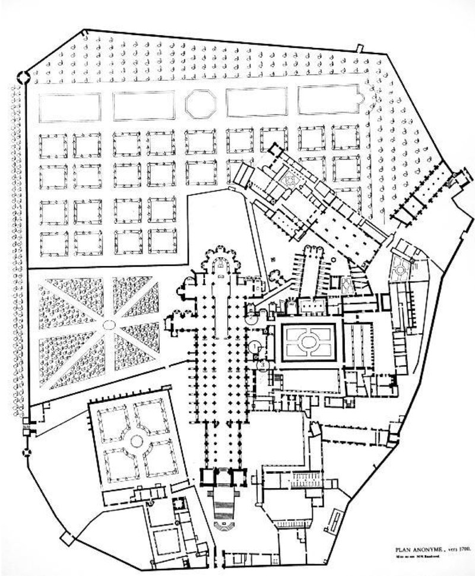
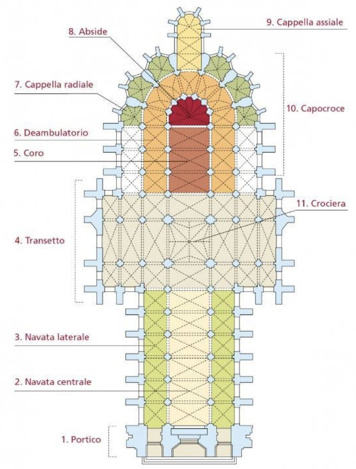
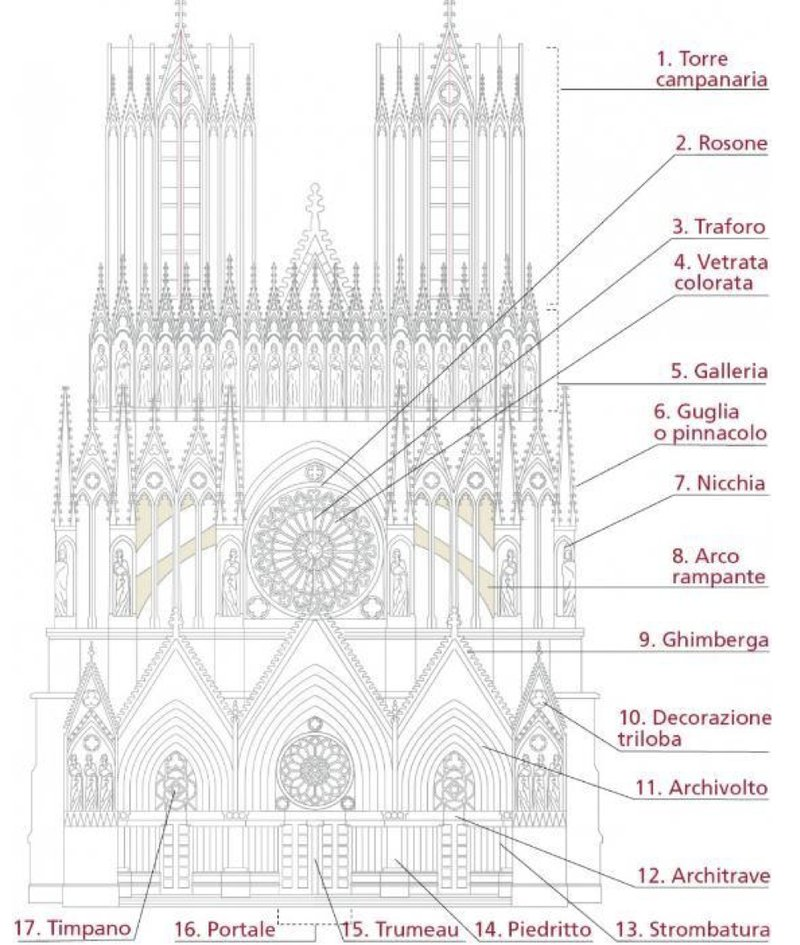
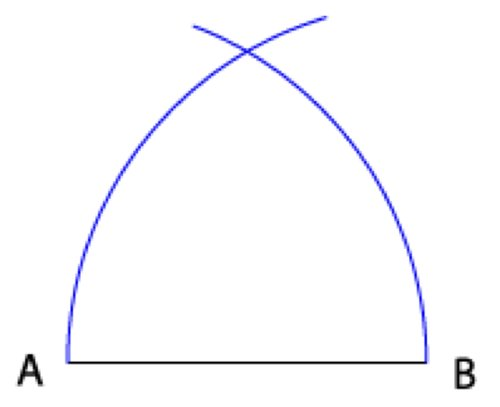
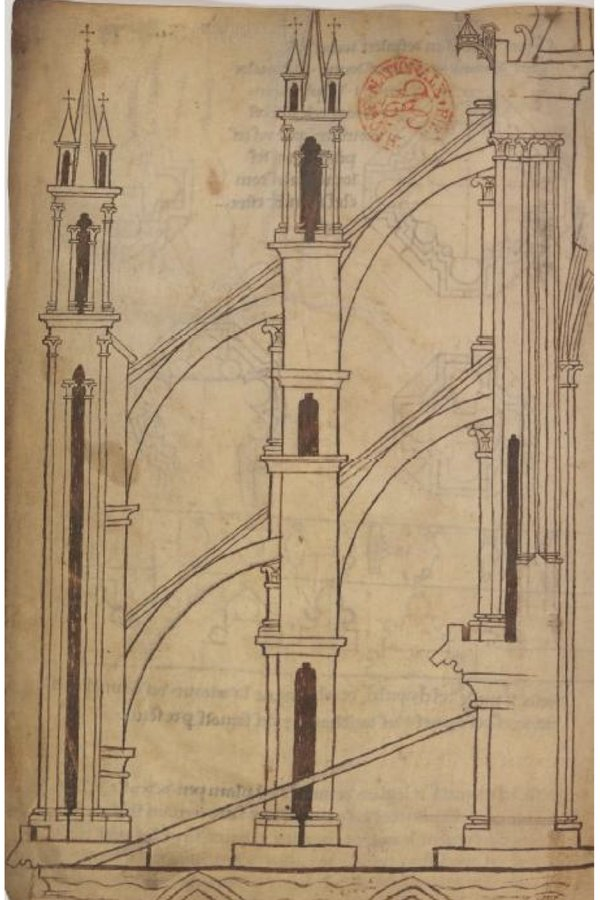

# L'architettura gotica in Francia: Cluny, Saint-Denis e Notre-Dame

> [!info] Note collegate
> Sbobina: [[18-architettura-gotica-francia]]
>
> Argomenti collegati: [[15-introduzione-al-romanico-firenze-e-pisa]] · [[05-costruzione-nel-mondo-antico]] · [[13-architettura-bizantina-costantinopoli-e-ravenna]] · [[14-san-vitale-longobardi-e-carlo-magno]] · [[12-architettura-paleocristiana-a-roma]] · [[17-romanico-in-italia-da-venezia-a-tuscania]] · [[19-gotico-italiano-federico-ii-e-primo-rinascimento]]

«Tutti convengono che lunghi viali di alberi, i cui rami si intrecciano insieme, ci fanno sempre venire in mente le navate laterali, i transetti e le altre parti di una cattedrale gotica». Così scriveva nel 1819 John Soane, architetto inglese dell'Ottocento che insegnava alla Royal Academy di Londra e accompagnava le sue lezioni con disegni e acquerelli preparati da lui stesso; quando dedicava una lezione all'architettura gotica, esordiva con la rappresentazione di una foresta. La frase di Soane non è una definizione e non dice quando l'architettura gotica si collochi nella storia dell'arte; è un'evocazione, che coglie però subito il carattere più distintivo di questa architettura: il grande slancio verticale, le forme acute che sembrano intrecciarsi come i rami degli alberi nelle navate, nei transetti e nelle altre parti dell'edificio. L'evocazione si riferisce inoltre a un tipo preciso di edificio, non un edificio pubblico o civile, ma la cattedrale. Per capire che cosa sia l'architettura gotica occorre partire dal suo nome, dai luoghi in cui nasce e dalla sua durata, per poi definire lo schema e la struttura della chiesa gotica e verificarli nei primi grandi cantieri francesi, Saint-Denis e Notre-Dame di Parigi.

## IL GOTICO: NOME, ORIGINE E DURATA

### Una definizione nata come critica

L'aggettivo gotico deriva dal nome dei Goti, il popolo di barbari che, venuto dai territori d'Oltralpe, si insediò nella penisola italiana distruggendo i resti ormai ammalorati dell'impero romano d'Occidente, e che si è incontrato soprattutto a [[13-architettura-bizantina-costantinopoli-e-ravenna|Ravenna]]. «Questa maniera fu trovata dai Goti»: con questa formula si indicava in modo dispregiativo l'architettura realizzata a partire dal pieno XII secolo. Se il termine romanico lasciava aperte molte ambiguità, richiamando in modo intuitivo un ritorno alle forme dell'architettura romana senza una definizione precisa, il termine gotico ha avuto per molto tempo uno specifico significato di critica. Oggi non lo ha più: è la definizione accolta dall'Enciclopedia dell'Arte Treccani, da tutti i manuali di storia dell'arte e dai saggi scientifici, ormai completamente spogliata della sua connotazione negativa. Ricordarne l'origine resta tuttavia importante, perché dice qualcosa sulla provenienza di questo modo di costruire.

### Francia e Germania

L'architettura gotica ha origine nel territorio della Francia e nelle zone al confine tra la Francia e la Germania. Se per il romanico si è parlato di policentrismo e di identità locali, di un fenomeno diffuso in quasi tutti i centri europei, per il gotico bisogna invece ricordare che i centri propulsori sono stati la Francia e la Germania. La carta delle cattedrali e delle università fondate in questo periodo mostra la concentrazione delle grandi fabbriche gotiche nella Francia settentrionale, da Parigi e Saint-Denis a Chartres, Reims, Amiens e Rouen, e la loro diffusione verso la Germania, l'Inghilterra e la Spagna. In Italia, invece, le opere che rispondono pienamente a questo tipo di architettura sono pochissime: per questo lo studio parte dai luoghi e dagli edifici in cui l'architettura gotica ha avuto origine, per poi vedere come sia stata declinata negli esempi italiani.

### Una lunga durata: Praga e Roma

Oltralpe il gotico è un fenomeno di lunghissima durata. All'inizio del Cinquecento, nel 1502, Bramante costruisce a Roma il Tempietto di San Pietro in Montorio; negli stessi anni, tra il 1490 e il 1502, Benedikt Ried realizza nel castello di Praga la Sala di Ladislao (*Wladislawsaal*), coperta da volte le cui nervature intrecciate non sono molto dissimili dai viali alberati evocati da Soane. L'accostamento di due opere sostanzialmente contemporanee rende evidente lo scollamento tra la situazione italiana e il resto d'Europa. In Europa si continuerà a costruire con le forme gotiche per tutto il XV e anche il XVI secolo; l'Italia costituisce invece un'eccezione poderosa, perché qui si innesta l'architettura del Rinascimento, cioè la rinascita del linguaggio dell'architettura antica, che prende piede prima a Firenze e poi a Roma, mentre altrove l'architettura dalle forme barbariche, come la consideravano i suoi detrattori, procede ancora a lungo.

## CLUNY E LO SCHEMA DELLA CHIESA GOTICA

### Cluny I, II e III

 Uno dei luoghi considerati la culla dell'architettura gotica è il monastero di Cluny, in Francia, che ha una storia molto stratificata. Il convento viene istituito nel 910 dall'abate Bernone e arriva a ospitare trecento monaci benedettini; la prima chiesa, molto semplice e di dimensioni ridotte, è indicata come Cluny I. Tra il 955 e il 981, ancora nel X secolo, viene sostituita da un complesso più articolato, Cluny II. La numerazione non è una semplificazione didattica, ma quella adottata dagli archeologi, che numerano gli strati corrispondenti alle diverse fasi costruttive di un edificio: è un criterio che si ritrova in tutti i contesti in cui resti archeologici documentano la sostituzione e la sovrapposizione di più edifici.

Ciò che interessa per comprendere lo sviluppo dell'architettura gotica è Cluny III. Tra il 1088 e il 1130, tra la fine dell'XI e l'inizio del XII secolo, il complesso viene ricostruito in forme molto più grandiose. La chiesa diventa estremamente monumentale: ha un impianto basilicale a cinque navate, due transetti e, nella zona dell'abside, una moltiplicazione di cappelle che consentono di collocare più altari all'interno della stessa chiesa e quindi di celebrare più messe contemporaneamente. Questa enfasi, architettonica e formale, posta sulla zona vicina all'altare è una delle prime caratteristiche dell'architettura gotica. Dell'edificio restano pochi resti materiali, e la sua storia si ricostruisce soprattutto per via archeologica; la ricostruzione della terza Cluny diventa però un riferimento fondamentale per molte altre chiese realizzate nello stesso periodo e nello stesso contesto, al punto che proprio dal modello di Cluny si può partire per ragionare sulla planimetria della chiesa gotica.

### Una questione di cronologia

La cronologia di Cluny III è quasi la stessa delle basiliche romaniche: anche l'architettura romanica si colloca tra l'XI e il XII secolo. Le periodizzazioni sono convenzioni, utili per ricordare e per orientarsi, ma ogni edificio va calato nel proprio contesto. Il complesso di Cluny è considerato il luogo d'origine dell'architettura gotica, e lo è in un periodo molto precoce rispetto a quanto accadrà in altri luoghi.

### La pianta: corpo longitudinale, transetto, capocroce

 Lo schema planimetrico di una chiesa gotica, che non corrisponde a un edificio specifico ma riassume le caratteristiche dell'architettura del periodo, si legge dall'ingresso all'abside. Si accede all'edificio attraverso un portico, non un semplice portale ma uno spessore architettonico da attraversare. Il corpo longitudinale è articolato in tre navate, con la navata centrale più ampia delle laterali; le singole campate sono coperte da volte a crociera, riconoscibili in pianta dalle linee tratteggiate dei costoloni. La ripartizione tra le navate avviene per mezzo di pilastri a sezione composita, come quelli già incontrati nelle basiliche romaniche.

Il transetto, il corpo trasversale dell'edificio, è molto più monumentale che negli esempi visti finora: è anch'esso diviso in navate e presenta un'articolazione dello spazio molto più complessa. Nel punto in cui la navata centrale del transetto interseca quella del corpo longitudinale si trova la crociera, una volta dalla forma molto più articolata delle altre, quasi a stella, che diventerà uno degli elementi distintivi dell'architettura gotica.

La chiesa gotica si divide così in tre parti: il corpo longitudinale, il transetto e il capocroce. Il capocroce è tutta la porzione dell'edificio che va dal transetto all'abside, e comprende il coro, circondato dal deambulatorio, e l'abside. Intorno all'abside si dispongono a raggiera le cappelle radiali, che moltiplicano gli spazi per le funzioni religiose; al centro, sull'asse della chiesa, si trova la cappella assiale. Rispetto all'architettura romanica si ritrovano dunque quasi tutti gli stessi elementi, ma con nuove gerarchie spaziali, che danno la preminenza alla zona vicina all'abside.

### La facciata: archivolti, guglie, rosone, torri campanarie

 In alzato, le forme che ricordano i rami intrecciati della foresta si sviluppano nella dimensione verticale, e la facciata gotica si caratterizza soprattutto per le forme architettoniche e decorative rivolte verso l'alto. È aperta da tre portali, circondati da archivolti ad arco acuto: invece di avere la forma di una semicirconferenza, la linea curva dell'arco si interrompe nel punto più alto e genera una forma che spinge verso la dimensione verticale. Questo slancio è richiamato ed enfatizzato da un sistema decorativo che diventa una caratteristica imprescindibile dell'architettura gotica, quello delle guglie o pinnacoli, decorazioni di forma appuntita che riverberano lo slancio verso l'alto. Le guglie non hanno alcuna funzione strutturale, architettonica o funzionale: sono elementi decorativi, e ricordano che nell'architettura gotica la scultura è una componente fondamentale dell'architettura stessa.

Al centro della facciata si apre il rosone, una vetrata colorata come quelle già viste in alcune facciate romaniche. In corrispondenza delle navate laterali si innalzano infine le torri campanarie, destinate a ospitare le campane, che accentuano ulteriormente lo slancio verticale del prospetto.

### I rosoni e la cattedrale di Rouen

L'architettura gotica non si può studiare senza considerare la sua componente decorativa e materiale. I rosoni gotici diventano gli elementi che contraddistinguono la decorazione delle facciate: sono costituiti da una ricchissima e articolatissima struttura lapidea, arricchita da vetrate colorate. Le due componenti si apprezzano da punti di vista diversi: dall'esterno si percepisce la struttura in pietra del rosone, mentre dall'interno, quando la luce del sole attraversa le vetrate, risalta la loro policromia.

Un esempio di questo affastellarsi della decorazione è la cattedrale di Rouen, costruita dal 1145 al 1250, con una dilatazione dell'arco temporale paragonabile a quella dei cantieri romanici. Il dettaglio della facciata, con il rosone, le guglie e i pinnacoli, mostra come la struttura della cattedrale gotica sia inscindibile dalla sua componente decorativa.

## LA STRUTTURA DELLA CATTEDRALE GOTICA

### Leggerezza apparente e cantiere

Nel cantiere gotico il rapporto inscindibile tra architettura e decorazione nasconde un implicito contrasto. Le forme traforate, ricche di abbellimenti e ornamenti, e il continuo riferimento allo slancio verticale lasciano pensare a costruzioni leggere; in realtà queste opere sono estremamente complicate dal punto di vista costruttivo e tutt'altro che leggere. Proprio perché le dimensioni diventano monumentali, richiedono una serie di accorgimenti costruttivi che ne garantiscano la solidità.

Una miniatura del *Roman de Girart de Roussillon* rappresenta un cantiere gotico, con figure impegnate nei diversi compiti tipici della costruzione: chi taglia e modella la pietra, chi trasporta i materiali, chi realizza le murature. La costruzione della cattedrale, per la lunga durata di questi cantieri, diventa un elemento che scandisce anche il tempo delle città.

### Lo schema di Viollet-le-Duc

La duplice componente della cattedrale gotica, la ricerca della leggerezza e dello slancio verso l'alto da un lato e la ricerca di una struttura solida dall'altro, si comprende confrontando uno schema assonometrico in sezione con un adattamento di un disegno di Eugène Viollet-le-Duc (1814-1879), riferito alla cattedrale di Amiens. Viollet-le-Duc è stato un grandissimo restauratore: ha restaurato Notre-Dame di Parigi e ha riportato all'antico splendore interi borghi della Francia. Proprio perché si è occupato del restauro di moltissime opere del periodo gotico, ha dovuto studiarne a fondo la struttura e la costruzione: per poter intervenire su questi edifici doveva capire come erano stati realizzati. Il suo disegno, nella versione rielaborata di recente, spiega quali siano i problemi di questo tipo di struttura.

### L'alzato interno: arco a sesto acuto, finto matroneo, claristorio

 In pianta la composizione è nota: una navata centrale e due navate laterali, tutte coperte da volte a crociera, come nella basilica romanica. Ciò che cambia è la forma degli archi che si susseguono nella struttura modulare dell'edificio: non sono più archi di circonferenza, ma archi a sesto acuto, detti anche archi ogivali o ad ogiva.

L'alzato della navata centrale si articola in tre registri. Il primo è quello delle arcate che la separano dalle navate laterali. Sopra la navata laterale si trova un finto matroneo, chiamato anche triforio: richiama il matroneo delle basiliche romaniche, ma è finto perché, come mostra la sezione, non è un vero piano dell'edificio e non vi si può accedere. È soltanto una forma architettonica che riempie lo spazio di passaggio tra la copertura della navata laterale e le finestre aperte nella parte più alta della parete, il claristorio. Il claristorio è la porzione superiore del muro in cui si aprono le finestre, ed è dunque una fascia trasparente, mentre il finto matroneo è una fascia cieca. Dal punto di vista della struttura architettonica interna, le novità rispetto al romanico riguardano quindi soprattutto la forma dei singoli elementi e l'impiego dell'arco a sesto acuto.

### Archi rampanti e contrafforti

All'esterno compaiono invece elementi che negli esempi romanici non si erano incontrati: gli archi rampanti e i contrafforti. L'arco rampante è un arco con i due punti d'imposta a quote diverse: mentre gli archi studiati finora avevano entrambe le imposte alla stessa altezza, questo sale verso l'alto, ed è una struttura che serve a rinforzare la muratura della cattedrale. L'arco rampante collega i pilastri a fascio, o polistili, le strutture verticali che si trovano all'interno della cattedrale, ai contrafforti, sezioni di muratura costruite in corrispondenza dei punti in cui scaricano le volte, cioè dei punti più sollecitati della struttura, che hanno il compito di rinforzarla. Le forme degli archi rampanti sono molto varie, ma tutte hanno in comune le imposte ad altezze diverse; archi rampanti molto blandi, con una variazione di quota minima, si vedono anche a Roma, nel Clivo di Scauro, presso la chiesa dei Santi Giovanni e Paolo al Celio.

### Le spinte

![[cattedrale-gotica-spinte-viollet-le-duc.jpg|420]]

*Lo schema delle spinte nella cattedrale gotica, da Viollet-le-Duc: in rosso le spinte delle volte, in giallo le controspinte degli archi rampanti, in verde le forze peso; in basso la stessa lettura in pianta.*

Il funzionamento della struttura si chiarisce seguendo le frecce disegnate da Viollet-le-Duc. La prima forza in gioco è il peso: ogni corpo, e quindi ogni edificio, esercita una forza peso che spinge verso il basso, secondo l'accelerazione di gravità. Il peso è anche ciò che garantisce la stabilità di un'opera, perché la ancora al suolo: lo mostrano le mura ciclopiche, fatte di grandi blocchi di pietra di forma spesso irregolare, che una volta messi in opera restano fermi proprio per il loro peso.

Le volte a crociera costruite con archi a sesto acuto tendono invece ad aprirsi verso l'esterno: per la sua forma geometrica l'arco acuto è una struttura più instabile della semicirconferenza, e le sue due metà tendono a far divaricare la volta, come indicano le frecce rosse. Per garantirne la stabilità non basta la chiave di volta, che negli archi a tutto sesto chiude la semicirconferenza e stabilizza la struttura: con l'arco acuto, geometricamente, non è sufficiente. Bisogna aggiungere spinte uguali e contrarie, le frecce gialle, che contengano le spinte della volta. Nel mondo della materia, e non in quello delle frecce della fisica, una spinta uguale e contraria si ottiene costruendo un muro: i contrafforti e gli archi rampanti sono appunto masse murarie che esercitano una forza opposta a quella dei semiarchi che compongono le volte a sesto acuto. Questi elementi formano quasi una scatola di contenimento esterna alla cattedrale e hanno una precisa funzione strutturale; il loro dimensionamento, cioè quanto debba essere spesso, alto e resistente un contrafforte, è materia di calcolo per la meccanica delle strutture.

### La geometria dell'arco ogivale

 La maggiore fragilità dell'arco ogivale dipende dalla sua costruzione geometrica. Per tracciare un arco a tutto sesto si punta il compasso nel punto medio di un segmento AB, lo si apre fino ad A e si disegna la semicirconferenza. Nella costruzione equilatera dell'arco ogivale, la più semplice, si punta invece il compasso in A, lo si apre fino a B e si traccia un arco; poi si punta in B con la stessa apertura e si traccia un secondo arco. L'arco a tutto sesto è un'unica costruzione geometrica, un solo arco di circonferenza; l'arco ogivale è invece composto da due archi distinti, ed è proprio questa composizione a renderlo più fragile: la geometria ha un impatto diretto sulla resistenza della struttura. Variando la costruzione si ottengono archi ogivali più stretti o più larghi, e le facciate delle cattedrali gotiche ne mostrano una grande molteplicità.

### Le volte ogivali

La costruzione dell'arco a sesto acuto genera anche le volte ogivali, che nelle cattedrali gotiche prendono il posto delle volte a crociera a tutto sesto delle chiese romaniche. Il confronto tra le due mostra che a cambiare sono soprattutto la forma e la geometria della costruzione, mentre l'impianto degli edifici resta affine. Le volte ogivali assumono geometrie molto diverse e articolate, e l'architettura gotica d'Oltralpe, in Francia, in Germania e in Inghilterra, è caratterizzata da una grandissima ricchezza di questo vocabolario.

![[volte-gotiche-vocabolario.jpg|460]]

*Il vocabolario delle volte gotiche: rib vault, tierceron vault, liern vault (in alto); star vault, net vault, fan vault o volta a ventaglio (in basso).*

I nomi dei diversi tipi di volta non esistono in italiano, tranne quello della volta a ventaglio (*fan vault*): poiché in Italia non ci sono esempi di questo genere, la terminologia non è mai stata tradotta, ed è rimasta inglese, perché l'Inghilterra presenta molti esempi di queste volte, oltre che francese. Si parla così di *rib vault*, la volta costolonata, di *tierceron vault* e *liern vault*, in cui alle nervature principali se ne aggiungono altre secondarie, di *star vault*, la volta stellare, di *net vault*, la volta a rete, e di *fan vault*. Tutte nascono da costruzioni geometriche che generano questa varietà di forme.

## SAINT-DENIS E NOTRE-DAME DI PARIGI

### L'abate Suger

La chiesa di Saint-Denis, a Parigi, è progettata dal suo abate, Suger. La chiesa viene consacrata nel 1081, e l'arco cronologico 1081-1151 riguarda la sua costruzione, nel pieno della cronologia del cantiere gotico. Saint-Denis ha in Francia un'importanza notevole, sia per la sua posizione a Parigi sia perché vi sono sepolti i re di Francia. Suger è colui che stabilisce le forme della chiesa, e la sua figura segna un punto di snodo nella storia dell'architettura: è un abate architetto, una figura che avrà poi altre declinazioni in altri grandi cantieri, in cui chi gestisce l'edificio religioso è anche implicato nella sua progettazione. Suger è inoltre l'autore di uno scritto che racconta la storia della costruzione della chiesa, pubblicato a cura del grande storico dell'arte Erwin Panofsky in una collana dedicata alla letteratura artistica, con il titolo *Suger, abate di Saint-Denis*.

### La facciata e il progetto di Viollet-le-Duc

Saint-Denis è uno degli edifici per i quali Viollet-le-Duc propose un restauro che non fu poi realizzato secondo la sua idea iniziale. Il suo progetto prevedeva la ricostruzione della torre campanaria mancante, con due torri coronate da alte guglie; si è invece deciso di non trasformare il restauro in una ricostruzione dell'edificio, e la facciata, restaurata tra il 2012 e il 2015, conserva ancora un carattere incompiuto e asimmetrico, con una sola torre campanaria. Un'incisione di Chatillon mostra la basilica vista da sud ancora abbastanza isolata rispetto al costruito: all'origine Saint-Denis è una chiesa periferica e isolata, mentre oggi si trova nella periferia settentrionale di Parigi, in un contesto completamente urbanizzato.

### Le fasi costruttive

Anche Saint-Denis ha una storia di stratificazione, e la ricostruzione voluta da Suger è solo una delle tappe della sua cronologia. Una pianta assonometrica le distingue con colori diversi: un mausoleo del IV secolo; i lavori dell'epoca merovingia, tra il V e il VII secolo; l'impianto carolingio, basilicale a tre navate. Il cantiere di Suger introduce variazioni determinanti rispetto all'impianto carolingio: allarga la pianta e soprattutto realizza nella zona absidale una serie di cappelle radiali, secondo le caratteristiche dello schema della chiesa gotica. Gli studi ottocenteschi dedicati all'edificio, come la pianta disegnata da Viollet-le-Duc, permettono di confrontare queste fasi.

### Il racconto di Suger: una fonte di prima mano

Lo scritto di Suger offre informazioni dirette sul suo lavoro. Nel capitolo dedicato alla decorazione della chiesa scrive: «dato che abbiamo iniziato la costruzione di questa chiesa per ispirazione di Dio, poiché le mura erano molto vecchie ed in molti punti minacciavano di crollare, ho chiamato i migliori pittori che ho potuto trovare da diverse regioni e con riverenza ho ordinato loro di restaurare le mura e di dipingerle bellamente con oro e colori preziosi». Racconta poi di essersi deciso «ad accrescere e ad ampliare la nobile chiesa consacrata dalla mano divina», sostenuto dal consiglio di uomini saggi e dalle preghiere di molti religiosi, e di aver cominciato «dal primo ingresso con le porte», abbattendo «una parte aggiunta, che si diceva fosse stata fatta da Carlo Magno»: «lavorammo incessantemente ad ampliare il corpo della chiesa, a triplicare le entrate e le porte, ad erigere torri alte e decorose». Fatti venire i fonditori e scelti gli scultori, furono erette le porte principali, «con molte spese e con molto dispendio per la doratura», e le altre «sotto il mosaico»; si eseguirono con cura anche la torre e i bastioni superiori della fronte. Infine: «ordinammo anche che l'anno della consacrazione, per non essere dimenticato, fosse scritto con lettere di rame dorate». Suger non indica l'anno nel testo: lo si conosce perché fu apposto all'interno della chiesa.

Il brano è l'esempio del racconto di un cantiere fatto da chi lo ha ordinato, cioè di una fonte primaria. Il linguaggio è narrativo e non tecnico: non è una relazione di lavori scritta da un direttore di cantiere, non parla di quantità né di misure, ma descrive il bisogno di restaurare le mura, la chiamata dei pittori, la scelta degli scultori. È una narrazione scritta soprattutto per lasciare memoria dell'intervento; proprio per questo è preziosa, perché rivela le maestranze coinvolte, fonditori, scultori e pittori, e alcune operazioni compiute per decorare la chiesa, come la doratura e il mosaico. Una descrizione così dettagliata non si era ancora incontrata: le biografie degli imperatori ricordano, per esempio, che Augusto fece ricostruire duecento templi, senza dire che cosa fu abbattuto, restaurato o costruito. Le fonti scritte si arricchiscono man mano che ci si avvicina all'età contemporanea, fino ai cantieri del Novecento e di oggi, documentati in ogni loro momento. Una fonte di prima mano è dunque la testimonianza di chi ha visto costruire un'opera e l'ha descritta; resta da verificare se dica la verità, ma il racconto di Suger è talmente poco tecnico da risultare credibile.

### Il deambulatorio e le cappelle radiali

![[saint-denis-deambulatorio-volte.jpg|560]]

*Saint-Denis, il sistema di copertura del deambulatorio e delle cappelle radiali: in pianta, le crociere a quattro vele (1-4) e quelle a cinque vele (1-5); a destra, le volte ogivali viste dal basso.*

Il deambulatorio di Saint-Denis, il corridoio che circonda la zona absidale e che si data intorno al 1140, è un trionfo di volte ogivali: vi si riconoscono subito gli archi a sesto acuto, sorretti da sostegni verticali che qui sono colonne. La costruzione è in pietra locale: in Francia la costruzione in pietra è diffusissima, perché il materiale proviene dal territorio ed è facilmente reperibile. Nella pianta si leggono la zona dell'altare e dell'abside, il deambulatorio che la circonda e, all'esterno, le cappelle radiali. Le volte a crociera, tracciate con i consueti tratteggi, in alcuni casi hanno quattro vele, come quelle incontrate finora, ma in altri ne hanno cinque: le geometrie diventano molto più complesse e le vele che compongono le volte si moltiplicano. Il sistema di copertura, molto più articolato, nasce dalla relazione tra una pianta arricchita dalle cappelle radiali e la necessità di una struttura che la sostenga. Visto dal coro, il deambulatorio mostra i pilastri a fascio, o polistili, gli archi ogivali e le vele delle volte. Saint-Denis è così importante per due ragioni: la vicenda del suo progettista, l'abate Suger, e le caratteristiche architettoniche che incarnano quelle generali della cattedrale gotica.

### Notre-Dame: Maurice de Sully e il cantiere

Un esempio affine è la cattedrale di Notre-Dame di Parigi, progettata dal vescovo della città, Maurice de Sully, che nel 1160 dà avvio alla costruzione: anche qui il progettista è un religioso, non un abate ma un vescovo. La cattedrale sorge su edifici precedenti e cambia dedicazione: la prima cattedrale di Parigi era dedicata a Santo Stefano, la nuova a Nostra Signora. Il cantiere ha origine dal coro, cioè dalla zona dell'abside: il completamento del deambulatorio e dell'abside risale al 1182, mentre la facciata è duecentesca, costruita tra il 1208 e il 1218, per un totale di circa cinquant'anni di lavori.

### L'incendio del 2019

Nell'aprile del 2019 Notre-Dame è stata colpita da un gravissimo incendio. Il fuoco non ha distrutto una grandissima quantità di materia, ma ha danneggiato la capacità portante della pietra: le alte temperature a cui è stato esposto il materiale lapideo ne hanno modificato e minato la resistenza. Il problema principale del restauro è stato perciò capire che cosa dell'opera originaria potesse essere mantenuto e che cosa dovesse essere smantellato, e i restauri sono stati avviati subito dopo l'incendio.

### La pianta e l'interno di Notre-Dame

![[notre-dame-parigi-pianta-abside.jpg|560]]

*Notre-Dame di Parigi: la pianta a cinque navate con il coro profondo e le cappelle radiali, e il fianco con l'abside e gli archi rampanti (prima dell'incendio).*

All'esterno, la zona del coro e dell'abside si confronta con le torri della facciata, e la serie di archi rampanti si riconosce subito come struttura di sostegno della muratura. La pianta è articolata in cinque navate, con un coro molto profondo, una serie di cappelle radiali e una cappella assiale; oltre alle cinque navate, cappelle laterali accompagnano tutto il corpo longitudinale e si interrompono solo in corrispondenza del transetto. L'impianto corrisponde in modo abbastanza fedele agli esempi visti, con una differenza: il transetto non è molto monumentale, ma è compreso nello spessore del corpo longitudinale e ha una sola navata.

All'interno, prima dell'incendio, si riconoscono le caratteristiche già descritte. La navata centrale è separata dalle laterali da sostegni verticali di sezione piuttosto massiccia, che qui non sono pilastri ma colonne. L'alzato aderisce pienamente al modello: il primo registro, il finto matroneo e infine il claristorio, nella parte superiore, in corrispondenza delle finestre. La copertura è affidata a volte a crociera con un numero di vele superiore alle quattro consuete.

## LA SCULTURA E L'ARCHITETTO

### L'Adamo di Notre-Dame e l'Afrodite Cnidia

La componente decorativa e scultorea è una delle caratteristiche delle cattedrali gotiche, e per Notre-Dame viene realizzata una serie di sculture, alcune destinate alla controfacciata. Tra queste un Adamo del 1260 circa, negli anni in cui si realizza la facciata, che nella posizione del corpo mostra una forte somiglianza con l'Afrodite Cnidia attribuita a Prassitele. Il confronto non significa che lo scultore dell'Adamo, di cui non si conosce l'identità, abbia copiato l'Afrodite Cnidia: non si sa se la conoscesse, e non si possono fare speculazioni in questo senso. Serve invece a tornare sul giudizio implicito nel termine gotico, la critica accesa a un'arte che si voleva generata dai barbari: alcune componenti della scultura di queste cattedrali sono profondamente vicine al carattere di una scultura classica per eccellenza. Bisogna dunque fare molta attenzione ai giudizi troppo assoluti sul carattere di un periodo artistico, e la stessa cautela varrà per l'architettura del Rinascimento, sempre associata all'idea di regolarità, di proporzione e di sguardo verso l'antico.

### Il Duomo di Naumburg

Una delle cattedrali più celebri per l'apparato scultoreo è il Duomo dei Santi Pietro e Paolo a Naumburg, in Germania. I suoi capitelli sono decorati con forme vegetali, tutti diversi gli uni dagli altri: le foglie sono talmente naturalistiche che è possibile identificare le specie a cui sono ispirate. Altrettanto realistiche sono le statue dei due sovrani di Naumburg, i dedicatari celebrati all'interno del duomo. La figura della regina di Naumburg è stata il modello della regina cattiva di Biancaneve: un segno dell'impatto fortissimo che la scultura di questo periodo ha avuto anche sull'immaginario.

### Villard de Honnecourt e il suo taccuino

 Il gotico offre anche documenti importanti per la storia della formazione e della professione dell'architetto. Nel mondo antico l'identità dell'architetto era tutto sommato accessoria rispetto a quella del committente: secondo l'aneddoto raccontato da Plinio il Vecchio, due architetti e scultori che non potevano firmare il loro capitello vi apposero un simbolo legato al proprio nome, la rana e la lucertola, come nei capitelli della basilica di San Lorenzo. Nel periodo gotico, invece, l'abate Suger consegna un testo a sua firma che descrive il progetto di Saint-Denis, e si conserva il primo taccuino di disegni di un architetto giunto fino a noi, quello di Villard de Honnecourt.

Il taccuino, noto come *Livre de portraiture*, è conservato alla Bibliothèque nationale de France a Parigi (fr. 19093). È di formato ridotto e ne restano soltanto 33 fogli, che permettono però di ricostruire il percorso di studio del suo autore: Villard de Honnecourt viaggiò per la Francia e restituì graficamente una serie di edifici che stava osservando. Accanto ad altre figure, il taccuino contiene i rilievi delle piante di alcune cattedrali gotiche e disegni dei loro alzati, con gli archi rampanti e i pinnacoli. Tutti questi disegni sono stati identificati con cattedrali esistenti, e spesso è lo stesso Villard ad annotarne le caratteristiche e i nomi.

## Collegamenti

L'architettura gotica si comprende in continuità e in contrasto con il romanico studiato nella lezione su [[15-introduzione-al-romanico-firenze-e-pisa|Firenze e Pisa]]: la cronologia di Cluny III coincide con quella delle basiliche romaniche, e lo schema della chiesa gotica conserva le tre navate, i pilastri compositi e le volte a crociera del Duomo di Spira, cambiando la forma degli archi e le gerarchie dello spazio a favore del capocroce; al policentrismo e alle identità locali del romanico si contrappone il ruolo propulsore di Francia e Germania. Il finto matroneo richiama il matroneo delle chiese romaniche e, prima ancora, delle [[12-architettura-paleocristiana-a-roma|basiliche paleocristiane]], di cui le chiese gotiche conservano l'impianto basilicale. La lettura delle spinte dell'arco ogivale si fonda su quanto si è visto dell'arco a tutto sesto e della chiave di volta nella [[05-costruzione-nel-mondo-antico|costruzione nel mondo antico]]. Il nome stesso dello stile rimanda ai Goti incontrati a [[13-architettura-bizantina-costantinopoli-e-ravenna|Ravenna]], mentre a Saint-Denis l'abate Suger abbatte una parte attribuita a Carlo Magno, della cui architettura si è parlato nella lezione su [[14-san-vitale-longobardi-e-carlo-magno|San Vitale, i Longobardi e i Carolingi]]. Le figure di Suger e di Villard de Honnecourt proseguono il filo della storia della professione dell'architetto, dagli architetti noti solo per il loro cantiere a Buscheto, celebrato sulla facciata del Duomo di Pisa, fino agli architetti del Rinascimento, mentre il racconto di Suger diventa il modello di che cosa sia una fonte di prima mano. Il confronto tra l'Adamo di Notre-Dame e l'Afrodite Cnidia e quello tra la sala di Benedikt Ried e il Tempietto di Bramante preparano infine il passaggio al gotico in Italia e all'architettura del Quattrocento, l'ultimo modulo del corso. La costruzione dell'arco ogivale con il compasso e la lettura delle piante con le volte tratteggiate si legano alle costruzioni geometriche e alle convenzioni di rappresentazione studiate in Geometria descrittiva.
