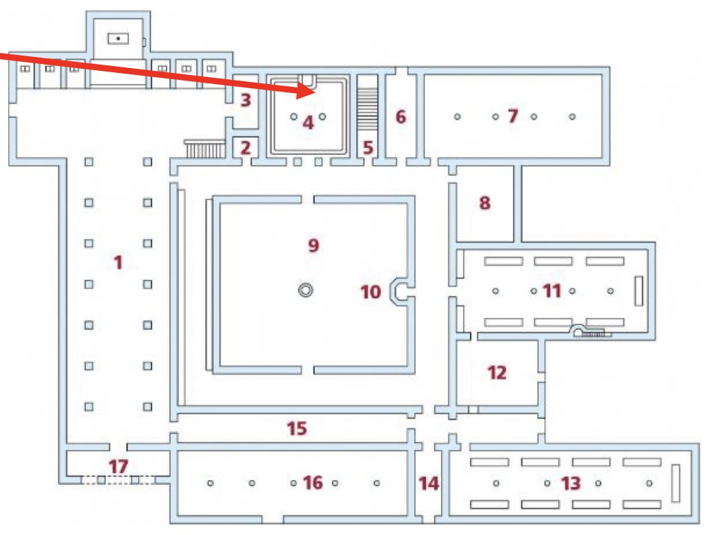
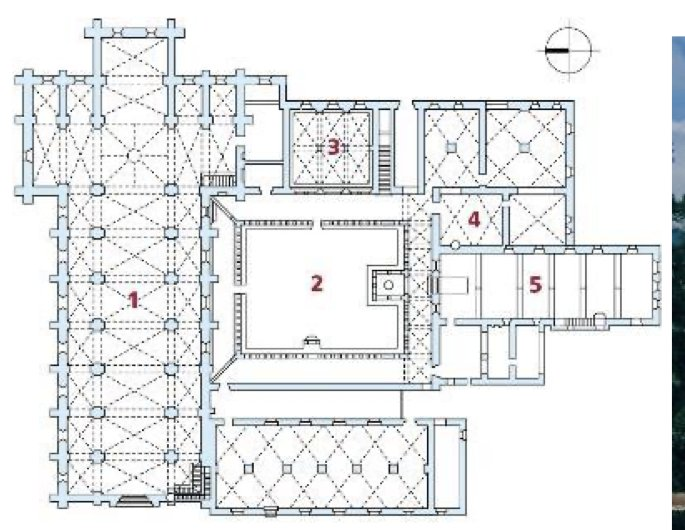
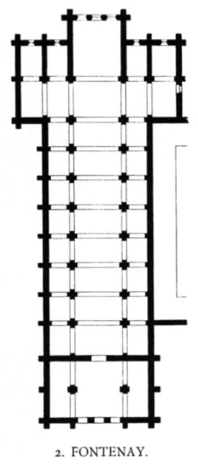
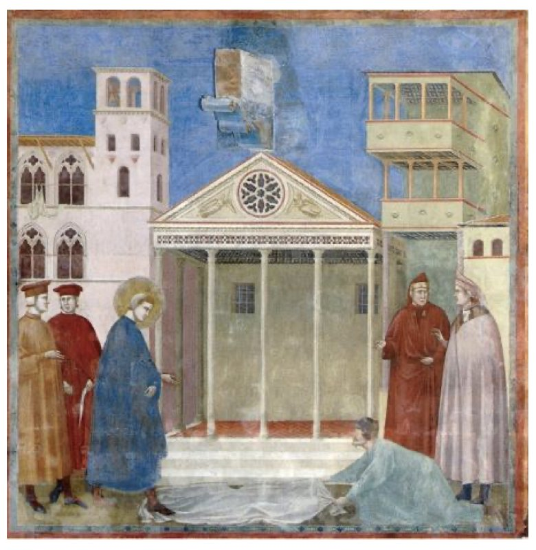
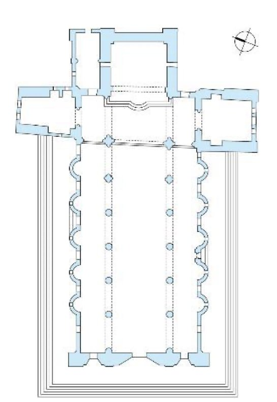
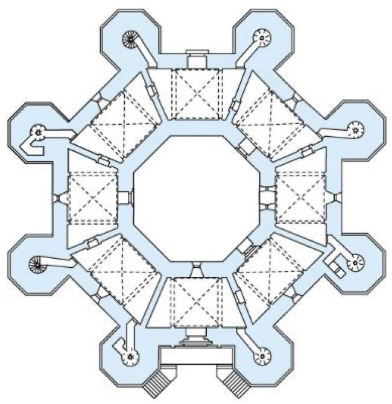

# Il gotico in Italia, Federico II e l'inizio del Rinascimento

> [!info] Note collegate
> Sbobina: [[19-gotico-in-italia-e-inizio-del-rinascimento]]
>
> Argomenti collegati: [[18-architettura-gotica-in-francia]] · [[15-introduzione-al-romanico-firenze-e-pisa]] · [[14-san-vitale-longobardi-e-carlo-magno]] · [[10-pantheon-da-agrippa-ad-adriano]] · [[05-costruzione-nel-mondo-antico]] · [[03-roma-foro-e-fori-imperiali]] · [[11-assonometria-cavaliera-e-sezioni-dei-solidi]] · [[17-romanico-in-italia-da-venezia-a-tuscania]] · [[21-bramante-giulio-ii-e-il-belvedere]]

L'architettura gotica, nata in Francia e in Germania tra XII e XIII secolo, non approda nella penisola italiana con la stessa potenza con cui si era affermata oltralpe. Per questo il gotico in Italia è di per sé un problema storiografico: si tratta di capire come si manifesti un modo di costruire in un territorio che oppone, in maniera spontanea, una certa resistenza ad acquisirne le forme. Gli archi ogivali, i pinnacoli, le guglie, gli archi rampanti, i contrafforti e le volte costolonate delle cattedrali francesi e inglesi non trovano qui una vera corrispondenza, tanto che la lingua italiana non possiede nemmeno una terminologia propria per definire queste forme: il lessico architettonico è strettamente legato ai luoghi in cui i progetti si realizzano, e dove i temi non sono stati costruiti mancano anche le parole per nominarli. Poiché la cronologia procede uguale per tutti, la domanda diventa che cosa accada all'architettura in Italia tra XII e XIII secolo. Le abbazie dei monaci cistercensi, la basilica di San Francesco ad Assisi e il Duomo di Orvieto mostrano tre modi diversi di accogliere le forme gotiche; le fortificazioni di Federico II di Svevia, e in particolare Castel del Monte, aprono il capitolo dell'architettura fortificata. Con Giorgio Vasari, l'Umanesimo e la figura di Filippo Brunelleschi si apre infine l'ultimo modulo del corso, dedicato all'architettura del Rinascimento.

## IL GOTICO IN ITALIA E LE ABBAZIE CISTERCENSI

### I cistercensi, veicolo del gotico?

Per osservare il fenomeno dell'architettura nella penisola del XII secolo, una buona prospettiva è quella delle opere commissionate dai monaci cistercensi. È una comunità che proviene dalla Francia e che, insediandosi in Italia, porta con sé una serie di forme architettoniche e di materiali tradizionali, che diventano tipici delle sue strutture. L'architettura cistercense è un tema molto studiato, e di recente proprio da questo punto di vista: gli studiosi si sono chiesti se sia possibile leggere nell'abbazia cistercense il veicolo con cui l'architettura gotica arriva in Italia. Per rispondere occorre anzitutto comprendere i caratteri di questi complessi, che non comprendono soltanto l'edificio destinato alle funzioni religiose, la chiesa abbaziale, ma anche tutti i luoghi in cui la comunità dei monaci vive.

### La crisi di Cluny e la riforma cistercense

L'ordine cistercense nasce dalla crisi di un ordine monastico precedente, quello cluniacense, che fa capo al monastero di Cluny, uno dei centri propulsori dell'architettura gotica. È una questione di carattere religioso, ma serve a comprendere la relazione tra ordine religioso ed espressione architettonica. Alla metà del XII secolo il modello di Cluny è considerato troppo ricco: l'architettura prodotta nei complessi cluniacensi appare troppo sfarzosa e inadatta a esprimere lo stile di vita che si riteneva proprio delle comunità monastiche. Si avverte allora un ritorno al pauperismo, cioè a uno stile di vita incentrato sull'ideale della povertà evangelica, e da questa riforma religiosa nascono nuovi tipi architettonici. Si afferma l'idea di complessi religiosi isolati, separati dalle città, che riproducano un modo di vivere in contrasto con lo sfarzo: il monastero viene definito eremo, un luogo appartato rispetto al resto della comunità.

L'ordine viene fondato nel 1098 da san Roberto di Molesme e si diffonde in Europa per opera di Bernardo di Chiaravalle (1091-1153), che è una delle sue figure di riferimento e autore di scritti che facilitano la diffusione dei principi alla base della vita dei monaci cistercensi, principi che si riflettono anche nell'architettura. Il nome viene da Cîteaux, in Borgogna, il luogo da cui deriva la parola cistercense. Nel XII secolo l'ordine raggiunge l'Italia, dove le sue abbazie si distribuiscono più o meno in tutta la penisola, con una concentrazione nella parte centro-settentrionale ed esempi anche nell'Italia meridionale e in Sardegna: tra le principali Morimondo presso Milano (1134), Staffarda presso Cuneo (1135), Cerreto presso Milano (1135), Follina presso Treviso (1146), Chiaravalle di Fiastra presso Macerata (1141), Fossanova (1135) e Casamari presso Frosinone (1152). Sono considerate i luoghi da cui si è attivata la diffusione delle forme gotiche nella penisola.

### L'impianto dell'abbazia: Casamari

 L'abbazia di Casamari, a Veroli, permette di leggere l'impianto dell'intero complesso cistercense. Tutto ruota intorno alla chiesa abbaziale (1 nella pianta), il luogo delle celebrazioni, che segue un impianto basilicale e longitudinale, in questo caso a tre navate. Due caratteri diventano propri delle chiese abbaziali cistercensi: l'abside di forma quadrata, che si distingue da quelle semicircolari incontrate finora, e le cappelle collocate nel transetto ai due lati dell'abside. Sono caratteri schematici, ma comuni ai diversi complessi.

Accanto alla chiesa si sviluppano gli altri ambienti, organizzati intorno al chiostro (9), di forma quadrangolare, che sorge accanto al corpo della chiesa e funziona da centro distributivo per raggiungere tutti gli spazi del complesso. Intorno al chiostro si dispongono gli ambienti destinati alle diverse funzioni, tra cui la sala capitolare (4), che occupa una posizione quasi di perno tra la chiesa e il chiostro e qui ha forma quadrata, senza che questa sia una regola assoluta. È la sala in cui l'abate, la figura che regge la comunità, riunisce il capitolo, cioè l'insieme dei monaci: per questo, se dal punto di vista architettonico il centro del complesso è il chiostro, dal punto di vista della vita dell'abbazia il fulcro è la sala capitolare. Seguono gli ambienti della vita quotidiana, dalle cucine al refettorio al lavabo, in un complesso in cui lo spazio della preghiera è strettamente collegato a quello della vita di ogni giorno in tutte le sue declinazioni.

Come regola generale, questi complessi si fondano su una costruzione modulare: tutti gli ambienti hanno forme regolari, quasi multiple le une delle altre. La progettazione è semplice e schematica perché la regola cistercense è ispirata al pauperismo, e anche l'architettura deve esprimere la rinuncia a qualsiasi sfarzo e decorazione: la forma delle opere deve essere semplice, geometrica e facilmente misurabile.

### L'isolamento e la sala capitolare

Collocata nel territorio, l'abbazia di Casamari rivela l'idea di una costruzione che sorge isolata e distante dalla città, circondata dal verde. Uno dei caratteri che colpiscono subito in questi luoghi è il silenzio: la ricerca dell'isolamento deve essere percepibile anche attraverso i sensi. La regolarità dell'impianto si traduce negli alzati, dove la decorazione è ridotta al minimo: nelle cattedrali gotiche francesi la scultura e l'ornamentazione hanno un ruolo centrale, qui invece non c'è nulla di tutto ciò. Se si assume il modello cistercense come veicolo del gotico in Italia, si comprende dunque che ciò che arriva è qualcosa di molto diverso dal modello delle cattedrali: un modello ispirato a uno stile di vita, che si riflette nell'architettura.

Questo non significa che le ricerche e le trasformazioni delle forme architettoniche in corso non vengano recepite. La sala capitolare di Casamari, a pianta quadrata, è coperta da un sistema di volte ogivali che si impostano, oltre che sulla struttura muraria, su due pilastri polistili collocati al centro della sala, ai quali è affidata la stabilità di tutto il complesso delle volte: è la stessa articolazione riscontrata negli esempi francesi. Nell'abbazia cistercense convivono così due componenti, la ricerca dell'essenzialità con la rinuncia alla decorazione e l'impiego di forme e sistemi costruttivi propri dell'architettura gotica.

### Fossanova e il modello di Fontenay

 L'abbazia di Fossanova, a Priverno, presso Latina, ha una cronologia un po' più avanzata, tra il 1135 e il 1208. Il suo impianto ripete gli elementi di Casamari: una chiesa (1) a impianto longitudinale scandito in tre navate, qui chiaramente coperta da un sistema di volte a crociera, riconoscibile dai consueti codici grafici della pianta; l'abside quadrata e non semicircolare; le cappelle nel transetto. Anche qui il chiostro (2) è il centro compositivo intorno a cui si dispongono gli ambienti del complesso, e accanto a esso si trova la sala capitolare (3). I due impianti seguono sostanzialmente lo stesso sistema.

Un impianto così schematico dice qualcosa sulla progettazione di questi complessi: non richiede la figura di un architetto, perché sono impianti replicati nei vari luoghi a partire da un modello originario. Richiede invece maestranze capaci di costruirli materialmente, nel cantiere e nella messa in opera, non di concepirne l'impianto. Un progetto tanto semplificato discende dal principio più volte ricordato: questi complessi non devono farsi notare per la loro qualità estetica, ma essere funzionali a ospitare determinate funzioni.

 L'interno della chiesa di Fossanova si confronta con quello dell'abbazia di Fontenay, in Borgogna, più o meno contemporanea, e i due impianti risultano sostanzialmente coincidenti. La navata centrale si articola in una sequenza di campate coperte da volte ogivali, di cui si riconoscono le vele; le navate sono separate da pilastri, anche in questo caso polistili, che diventano gli elementi destinati a contenere le spinte della copertura; nella parte più alta si aprono le finestre di quello che nelle cattedrali gotiche si chiama claristorio, rese possibili dalla differenza di quota tra le navate laterali e quella centrale, che consente di illuminare l'interno.

Fontenay, fondata nel 1118 e consacrata nel 1147, contemporanea o di pochi anni precedente, è considerata il modello sul quale viene esemplato l'impianto di Fossanova. Nella sua chiesa abbaziale si ritrovano gli stessi sistemi: una notevole semplicità nella distribuzione degli ambienti e nell'impianto, unita a sistemi strutturali e decorativi ripresi dal vocabolario dell'architettura gotica. Il confronto mostra quanto sia facile trovare punti di contatto tra i modelli francesi e quelli italiani, e come questa facilità dipenda proprio dalla volontà di riprodurre impianti schematici e facilmente replicabili.

## ASSISI E ORVIETO: LE FORME GOTICHE NELLA PENISOLA

### La basilica di San Francesco ad Assisi

Fuori dal contesto delle abbazie cistercensi, altre opere permettono di ragionare su come il gotico francese sia stato assimilato in Italia. Una di queste è la basilica di San Francesco ad Assisi, nella città in cui nel 2026 si celebra l'ottavo centenario della morte del santo. Siamo nel pieno del Duecento: Francesco nasce ad Assisi e muore nel 1226; viene subito santificato, e alla canonizzazione segue la decisione di costruire una basilica a lui dedicata, voluta dall'ordine da lui fondato, i francescani, un ordine mendicante che, insieme ad altri ordini nuovi, era ispirato all'ideale della povertà. Le date del cantiere scandiscono una vicenda rapidissima: la fondazione nel 1228, appena due anni dopo la morte del santo; nel 1230 la traslazione del suo corpo, le cui spoglie vengono conservate nella chiesa; la consacrazione nel 1253 e la conclusione del cantiere nel 1280. La basilica è stata in seguito oggetto di importanti restauri, perché fortemente danneggiata dal terremoto che nel 1997 ha colpito l'Italia centrale.

![[assisi-san-francesco-pianta.jpg|560]]

*Basilica di San Francesco ad Assisi, chiesa superiore: pianta a navata unica coperta da volte a crociera.*

La basilica è formata dalla sovrapposizione di due chiese, una basilica inferiore e una superiore, collocate a due quote diverse, una sopra l'altra: alla superiore si arriva attraverso un grande prato, mentre lateralmente si accede all'inferiore. Entrambe si articolano su una struttura longitudinale. La chiesa superiore è molto semplice: un'unica navata, divisa in campate coperte da volte a crociera, che dall'ingresso arriva alla zona dell'abside senza alcuna articolazione in navate, in una semplificazione assoluta dell'impianto basilicale. A questa semplicità corrisponde però l'assimilazione di alcuni elementi del repertorio gotico francese: all'esterno i contrafforti, cioè i rinforzi della muratura in corrispondenza del punto di scarico delle volte a crociera della copertura, e all'interno l'incrocio dei costoloni, che rende leggibile la struttura architettonica già osservata negli esempi francesi.

### Giotto e le architetture dipinte

 Oltre alla semplificazione dei caratteri del gotico francese, ciò che distingue la chiesa superiore è il ciclo pittorico eseguito da Giotto (1267-1337), pittore di origine fiorentina formatosi nella bottega di Cimabue, uno dei grandi esponenti della pittura del Duecento. Da Firenze Giotto raggiunge Assisi, dove il suo nome è legato alle Storie di San Francesco, dipinte intorno al 1292-1296: un ciclo di affreschi che racconta la biografia del santo a cui la basilica è dedicata.

Le scene interessano non solo perché collegano l'architettura a quanto accade nella pittura, ma per il ruolo che l'architettura assume al loro interno. La figura di san Francesco, sempre riconoscibile, è collocata in scenografie architettoniche che presentano forme affini a quelle della basilica e dell'architettura gotica; nel particolare del Dono del mantello, sullo sfondo, compare un'intera città murata. Ciascuna scena offre così dettagli utili a capire quali fossero le forme delle città e i caratteri architettonici dei luoghi in questo periodo.

Sono architetture che non pretendono di essere del tutto realistiche, perché le colonne sono troppo esili per sorreggere le strutture che portano, ma che mostrano un aspetto destinato a tornare con Brunelleschi: l'uso della prospettiva nella rappresentazione dell'architettura. Si tratta di un'assonometria in qualche modo prospettica, perché le linee che la compongono non sono perfettamente parallele. È un impiego ancora empirico, ma già rivolto a una sensibilità che porterà, circa centotrent'anni dopo le rappresentazioni di Giotto, alla formulazione della prospettiva retta da regole scientifiche, teorizzata da Piero della Francesca e poi acquisita anche nel campo dell'architettura.

### La cappella degli Scrovegni a Padova

A una fase successiva della biografia di Giotto appartiene la decorazione della cappella degli Scrovegni a Padova, la cappella dell'omonima famiglia padovana, costruita in un'area occupata nell'antichità da un anfiteatro, di cui la topografia conserva ancora le tracce: le ricostruzioni sovrappongono l'ingombro dell'anfiteatro e la posizione della cappella. L'interno è interamente rivestito da uno straordinario ciclo pittorico, caratterizzato in particolare dall'uso del blu come colore di fondo di tutte le scene; anche qui tra l'architettura della cappella e quella raffigurata nelle scene si instaura un dialogo molto stretto, un dialogo tra opere a distanza.

### Il Duomo di Orvieto: la pianta

 Il Duomo di Santa Maria Assunta a Orvieto è citato di solito nei manuali di storia dell'architettura come l'esempio assoluto dell'architettura gotica in Italia. È però una definizione da problematizzare, verificando se questa architettura sia davvero gotica come quella delle cattedrali francesi. La cronologia è certamente coerente: il cantiere viene avviato nel 1290 e una seconda fase dei lavori si svolge nei primi trent'anni del Trecento, tra il 1308 e il 1338, con gli interventi di Lorenzo Maitani.

La pianta presenta un impianto longitudinale articolato in tre navate, con un sistema di sostegni verticali che varia nella forma: colonne lungo la navata e pilastri polistili in corrispondenza di un transetto di forma del tutto irregolare. L'abside è rettangolare e i lati del corpo longitudinale hanno un profilo peculiare, che indica la presenza di cappelle aperte lungo le navate laterali. È un impianto basilicale, nel quale gli elementi caratteristici dell'architettura gotica non si ritrovano in maniera esplicita.

### La facciata di Orvieto e Notre-Dame di Parigi

![[orvieto-e-notre-dame-facciate.jpg|560]]

*Le facciate del Duomo di Orvieto (a sinistra) e della cattedrale di Notre-Dame di Parigi (a destra).*

La facciata riporta invece in modo più esplicito alle cattedrali gotiche, e il confronto con quella di Notre-Dame di Parigi ne mette in luce somiglianze e differenze. Il portale centrale del Duomo rinuncia all'arco ogivale e torna con decisione all'arco a tutto sesto, lontano dalle forme dei portali di Notre-Dame. I due archivolti laterali, che introducono alle navate minori, si avvicinano invece alle forme acute degli archi ogivali, e il tutto è enfatizzato da decorazioni di forma triangolare che sottolineano la dimensione verticale, lo slancio verso l'alto richiamato anche dalla parte sommitale della facciata e dalla serie di pinnacoli, ripresa e adattamento dei pinnacoli e delle guglie delle cattedrali francesi. Un altro carattere comune è il rosone, che si staglia al centro della facciata in entrambi gli edifici.

La differenza fondamentale è che a Orvieto tutti questi temi, che dal punto di vista formale rimandano a un gusto derivato dai modelli francesi, non hanno corrispondenza nella struttura architettonica. Nella pianta del Duomo non compare nessuna delle linee tratteggiate che denuncerebbero la presenza di volte a crociera, le strutture determinanti per la definizione della costruzione gotica: è una pianta del tutto priva di coperture riconducibili alle forme diffuse nell'architettura gotica. I temi gotici sono riproposti con intento decorativo, per connotare la facciata, ma restano assenti dalla struttura e privi di qualsiasi collegamento con essa. La facciata di Orvieto può dirsi gotica, se si considerano gli elementi indicati come propri del modo di costruire gotico, i pinnacoli, le guglie, i rosoni, ma è svincolata dalla concezione strutturale.

I dettagli della decorazione rivelano una finezza assoluta, anche nella lavorazione della pietra, che riconduce alla cultura dell'ornamentazione delle opere gotiche; vi si mescola la delicatezza delle piccole tessere vitree, impiegate per creare gli effetti luminosi che caratterizzano la facciata.

### La circolazione delle forme e la tradizione costruttiva

Dagli esempi esaminati emergono due aspetti. Da un lato il tema della migrazione delle forme, della loro circolazione in Italia e attraverso l'Europa, veicolata anche dalle persone: le comunità di monaci diventano i principali tramiti con cui un modo di costruire sperimentato in Francia raggiunge la penisola, per ragioni culturali e, in questo caso, religiose. Dall'altro lato, anche negli esempi legati ai monaci cistercensi, la ripresa delle forme architettoniche resta vincolata a una tradizione costruttiva radicata nella penisola. È una considerazione che non implica alcun giudizio di valore, ma risponde alla domanda di partenza, cioè attraverso quali vie di circolazione l'architettura gotica arrivi in Italia.

## FEDERICO II DI SVEVIA E CASTEL DEL MONTE

### Federico II committente

Un altro capitolo della storia dell'architettura in Italia tra XII e XIII secolo abbandona la committenza delle comunità monastiche per incontrare la figura di Federico II di Svevia (1194-1250), ritratto in un busto della metà del XIII secolo, probabilmente degli anni della sua morte, conservato nel Museo civico di Barletta. Figlio di Enrico VI, a sua volta figlio di Federico Barbarossa, Federico II conquista il controllo politico di una buona parte della penisola; viene consacrato imperatore a San Pietro nel 1220 da papa Innocenzo III e diventa una delle figure politiche più importanti negli ultimi trent'anni della sua vita.

Federico II è un collezionista di antichità e un grande committente di architettura, e può essere assunto come lente per osservare ciò che accade nelle arti nell'Italia meridionale, il territorio da lui controllato, nel pieno del XIII secolo. Commissiona tra l'altro il *De arte venandi cum avibus*, un trattato sull'arte venatoria, cioè sull'arte della caccia (*ars venatoria* in latino), oggi alla Biblioteca Apostolica Vaticana (Pal. Lat. 1071): un codice miniato in cui fa rappresentare una serie di raffigurazioni dedicate agli animali. Le cronache del tempo lo descrivono come un uomo saggio, conoscitore delle lingue, maestro di tutte le arti, con una formula che lo avvicina alle descrizioni degli imperatori antichi, sovrani illuminati che diventano punti di riferimento non solo per il loro ruolo politico ma anche per il loro interesse verso la committenza artistica e architettonica. Federico II commissiona inoltre moltissime fortificazioni nell'Italia meridionale, e permette così di uscire dal percorso attraverso l'architettura religiosa, seguito dall'inizio dell'architettura cristiana, per introdurre l'architettura fortificata.

### L'architettura fortificata: forme chiuse e torri

![[castelli-federico-ii-torri-e-piante.jpg|620]]

*A sinistra, lo schema delle linee di tiro di una torre a pianta circolare posta all'angolo di una cinta; al centro, le piante dei castelli di Bari, Trani, Ursino a Catania, Gioia del Colle, Maniace a Siracusa e Augusta; a destra, la pianta di Castel del Monte (rielaborazione da Romanini).*

Con architettura fortificata si intendono le architetture che presentano nelle forme e nelle strutture elementi legati all'architettura militare, con la funzione specifica di essere strutture difensive, cioè i castelli. Quelli legati alla committenza di Federico II, dal Castello di Bari al Castello di Trani, dal Castello Ursino a Catania al Castello di Gioia del Colle, presso Bari, dal Castello Maniace a Siracusa al Castello di Augusta, hanno piante abbastanza diversificate, nelle quali però si riconoscono gli elementi comuni che permettono di parlare di architettura fortificata. Si tratta di forme chiuse, quasi tutte a impianto quadrangolare, perché la chiusura serve a proteggere le persone che vi abitano. Accanto alla forma chiusa compaiono le torri, collocate di solito agli angoli o a metà dei lati, che sono i luoghi da cui osservare a distanza chi si avvicina al castello. Il rapporto tra la forma dell'architettura militare e la possibilità di difendere il castello si legge nello schema delle linee di tiro: la torre posta all'angolo permette a chi si trova all'interno della cinta di vedere lontano e di tenere sotto tiro chi tenta di attaccare e di invadere il castello.

L'esigenza di costruire architetture fortificate nasce da una situazione politica instabile, spesso attraversata da ribellioni e momenti di agitazione, che spinge ad abitare strutture capaci di offrire protezione.

### La rete dei castelli

I castelli e le residenze fortificate costruiti da Federico II occupano tutta la porzione della penisola e della Sicilia a sud di Roma, con qualche eccezione più a nord, come Prato. La loro diffusione mostra quanto fosse estesa la committenza architettonica del sovrano, ma anche quanto fossero indispensabili queste strutture: per garantire la propria sicurezza il sovrano doveva spostarsi continuamente dall'una all'altra, in modo che chi voleva attaccarlo non sapesse mai dove trovarlo. La molteplicità delle residenze faceva dunque parte del suo programma di difesa.

Nelle piante si ripetono alcuni elementi, come il cortile centrale intorno a cui si articolano gli ambienti. Il cortile consente di mantenere chiuso il perimetro esterno, con una muratura continua non interrotta da finestre o da altri elementi che sarebbero punti di debolezza, perché le sale del castello si affacciano verso l'interno; su questo schema si innestano poi le variazioni.

### Castel del Monte: un impianto ottagonale

 Castel del Monte, presso Andria, in Puglia, costruito nel 1240, appartiene all'ampio sistema di fortificazioni con cui Federico II difende il suo regno nell'Italia meridionale. Sorge in un'area isolata, su un colle, e già questa collocazione è una misura difensiva: si staglia su un manto vegetale, in un isolamento che, per ragioni del tutto diverse da quello delle abbazie, garantisce una maggiore capacità di difesa, perché intorno non c'è nulla e chi si avvicina è facilmente individuabile.

L'edificio è un *unicum* tra i castelli di Federico II, che si articolano su impianti simili tra loro, e più in generale tra le opere fortificate, perché la sua pianta è un ottagono. Risponde allo stesso criterio degli altri castelli: un cortile centrale su cui si affacciano gli ambienti, disposti lungo i lati dell'ottagono. Agli angoli si innalzano torri anch'esse ottagonali, e l'intera struttura gioca sulla ripetizione di questa figura, al punto da ricordare, nella sua forma, un fiocco di neve.

Non si conoscono le ragioni di questa scelta del sovrano, oltre alla più semplice, cioè che desiderasse un castello di questa forma: non esiste una documentazione che indichi motivazioni specifiche, per esempio difensive. Non è del tutto chiara nemmeno la funzione dell'edificio, perché tutti i castelli avevano una funzione difensiva ma potevano assumere connotazioni più specifiche; vista la posizione isolata nel verde, si è pensato a una residenza di caccia, uno dei luoghi prediletti da Federico II per dedicarsi alla sua passione per l'arte venatoria, la stessa che si manifesta nella committenza del manoscritto miniato.

### L'esterno: la pietra e il portale

Castel del Monte si presenta come una massa quasi monolitica, con rare interruzioni e aperture sulle singole facciate. Il materiale è la pietra di Bari, un materiale locale facilmente cavato dai giacimenti dell'entroterra, vicino ai luoghi di costruzione; ha un colore bianco molto luminoso, lo stesso che disegna tutta la costa della Puglia, costellata di residenze fortificate che sembrano tracciare una linea di pietra. Le aperture sono pochissime: i torrioni sono quasi ciechi, con poche feritoie che servono a osservare l'esterno. L'accesso avviene da un unico ingresso, su uno dei lati dell'ottagono, attraverso un grande portale raggiunto da due scale simmetriche, speculari rispetto al portale stesso.

Il portale è l'unica eccezione al carattere severo dei torrioni, perché presenta alcuni elementi decorativi: un'apertura di forma ogivale affiancata da due paraste che sorreggono una trabeazione, su cui si imposta un timpano spezzato ai lati; sopra si apre una piccola bifora, cioè una finestra divisa in due parti, lo stesso sistema di apertura che si ritrova sugli altri lati del castello. L'esterno deve apparire come un blocco compatto e impenetrabile, mentre all'interno era demandata la possibilità di accogliere elementi decorativi, come una testa di fauno ritrovata, una delle chiavi di volta della decorazione interna, che mostra la presenza di dettagli molto sofisticati in contrasto con l'essenzialità e la totale assenza di decorazione degli esterni.

### Il cortile e gli ambienti interni

All'interno dei torrioni sono collocate le scale che collegano il primo e il secondo piano. Verso il cortile l'ottagono torna a essere una forma geometrica pura, perché i torrioni sporgono solo all'esterno; le facciate sono disegnate da archi ciechi in cui si aprono le finestre, talvolta interrotte da altre aperture probabilmente inserite più tardi, frutto di interventi successivi al cantiere federiciano.

La struttura degli ambienti interni è assolutamente ripetitiva. A ogni lato dell'ottagono corrisponde un ambiente coperto da una volta a crociera, leggibile in pianta dai consueti segni grafici; tra gli ambienti non c'è alcuna gerarchia, perché hanno tutti la stessa dimensione e la stessa configurazione, e ogni sala dà accesso a una delle torri, con le scale che portano al piano superiore.

### La decorazione perduta

Le sale interne si presentano oggi molto diverse da com'erano in origine. Vi prevale lo stesso materiale delle superfici esterne, la pietra di Bari, mentre in origine tutti gli interni erano rivestiti di marmi e pietre policrome. Ne restano alcune tracce nei pilastri polistili collocati agli angoli degli ambienti, che sorreggono le volte e lasciano intuire quanto l'attuale uniformità del materiale fosse lontana dall'aspetto originario. La testa di fauno era collocata all'incrocio dei costoloni delle volte ogivali che coprono gli otto ambienti, aperti su due registri; altri resti del rivestimento lapideo mostrano la differenza cromatica tra la pietra da costruzione e i materiali usati per la decorazione, e sulle pareti si conservano tracce della decorazione scultorea, scalpellata.

Tra i temi decorativi compare anche un richiamo all'opera reticolata, che non ha alcuna attinenza costruttiva con l'opera reticolata dell'architettura romana: è un disegno tracciato sulla pietra, senza corrispondenza tra il disegno e la costruzione, una decorazione che vuole richiamare una tecnica costruttiva. Castel del Monte rivela così la compresenza di temi diversi in una stessa opera: un castello fortificato che deve difendere chi lo abita, ma anche un'architettura concepita con grande attenzione, sia nella configurazione, con la sequenza di torri e di ottagoni, sia nella decorazione; un'opera che, pur molto impoverita dalla spoliazione dei materiali, racconta ancora parte della sua storia. Con Castel del Monte si chiude il capitolo dell'architettura gotica.

## L'INIZIO DEL RINASCIMENTO

### Un racconto per architetti: Giorgio Vasari

L'ultimo modulo del corso attraversa la storia dell'architettura del Quattro e Cinquecento attraverso l'opera di alcuni architetti, rovesciando la prospettiva narrativa. L'architettura antica è stata affrontata soprattutto per edifici; il lunghissimo periodo che dall'architettura tardoantica porta al gotico ha mostrato la continua trasformazione delle forme, la permanenza di alcuni impianti e l'introduzione di nuovi sistemi costruttivi ed elementi. Ora il racconto si concentra su singole figure di architetto, perché il lungo arco cronologico del corso si accompagna a una sostanziale trasformazione della figura professionale. Nel mondo antico l'architetto è quasi sempre anonimo, o se ne conosce il nome senza informazioni sulla sua biografia e sul suo modo di progettare; nel Quattro e Cinquecento si incontra invece Giorgio Vasari.

Vasari è l'autore delle *Vite de' più eccellenti pittori, scultori e architettori italiani, da Cimabue insino a' tempi nostri*, pubblicate in prima edizione nel 1550: un'opera biografica che racconta le vite degli artisti che, secondo l'autore, meritavano di esservi trattati, a partire da Cimabue, il maestro di Giotto, fino al suo tempo. È stata letta e riletta da moltissimi studiosi, come mostra un esemplare postillato dal pittore Federico Zuccari, interamente corredato di annotazioni, perché è una fonte preziosa: vissuto nel Cinquecento, Vasari ha permesso di ricostruire molti aspetti dell'attività dei grandi maestri dell'arte e dell'architettura.

Il suo è anche un modo di raccontare la storia che inverte la prospettiva: dal punto di vista dei committenti si passa a quello degli artefici, di coloro che hanno realizzato le opere. Vasari, a sua volta pittore e architetto, scrive con un intento politico molto forte: vuole nobilitare la propria figura e far sì che l'artista, nella società cortigiana del Cinquecento, assuma una rilevanza diversa e superiore rispetto al passato. L'artista non è più soltanto l'esecutore della volontà di un committente, ma un intellettuale, una figura colta, con una propria identità, che l'opera di Vasari restituisce come in un manifesto. Questa idea passerà anche nella storia degli studi, perché la storia dell'architettura del Rinascimento è stata molto spesso raccontata attraverso la prospettiva dei grandi artisti. Accanto a essa è possibile una narrazione diversa, che scalza il racconto per protagonisti e osserva le opere attraverso il rapporto tra storia e geografia, cioè attraverso il legame che instaurano con i luoghi in cui vengono progettate: la geologia, i materiali, le identità locali e le caratteristiche politiche di ogni luogo.

Vasari è anche il primo grande critico dell'architettura gotica: buona parte dei pregiudizi sul modo di fare arte e architettura di quel periodo derivano da lui, che ne è uno dei più grandi detrattori.

### Umanesimo e Rinascimento

La parola Umanesimo ha un'etimologia precisa: deriva dall'espressione latina *humanae litterae*, che indica lo studio di quelle che oggi si chiamerebbero le materie letterarie. Parlare di Umanesimo significa dunque parlare di testi, e indicare il processo graduale ma progressivo di riscoperta dei testi classici, cioè degli scritti degli autori greci e latini. Questa riscoperta avviene in alcuni luoghi privilegiati: Firenze è uno dei primi in cui si ricomincia a leggere i classici, e il processo raggiunge poi Roma e Venezia, i grandi centri dell'Umanesimo.

Il ritorno alla lettura dei testi classici produce la volontà progressiva di rifarsi all'antichità non solo nei testi, ma anche nell'arte e nell'architettura. La riscoperta dei testi ha così un impatto crescente sulle arti e conduce al periodo chiamato Rinascimento, la cui etimologia rimanda alla rinascita dell'antico. Attraverso la lettura dei classici si arriva a una rivalutazione dell'arte antica, che diventa il nuovo punto di riferimento: prima per chi aveva letto quei testi, poi per gli artisti e gli architetti coinvolti in un processo di ritorno all'antico che ruota intorno all'idea di riprodurre le forme dell'architettura e dell'arte dell'antichità.

### Vitruvio e il volgare

Tra i testi riletti c'è senza dubbio il *De architectura* di Vitruvio, che non era mai scomparso ma che, nel contesto della riscoperta dei classici, torna a essere letto in modo più critico; era giunto attraverso la tradizione medievale in un testo latino. Nell'Italia del Quattrocento però non si parla più latino ma volgare, mentre nel Medioevo il latino era ancora molto spesso in uso: comincia così un processo di traduzione dei testi classici dal latino al volgare italiano. Anche il trattato di Vitruvio viene probabilmente riscoperto prima dai letterati e poi dagli architetti, che non sempre conoscevano il latino e che possono riappropriarsene solo quando il testo è disponibile in volgare.

Questa fase della storia dell'arte e dell'architettura intreccia dunque più fattori: la rinascita della cultura classica, uno studio rinnovato e sistematico dell'architettura del passato e, di conseguenza, la volontà di progettare opere ispirate al mondo antico. È un fenomeno culturale prima ancora che artistico, che incide sulla figura dell'artista e in particolare dell'architetto, portando con sé un'evoluzione culturale della sua identità professionale e artistica, la stessa che Vasari intende affermare.

### L'Italia dopo la pace di Lodi

Nel periodo che il modulo affronta, l'Italia è frammentata in una composizione di stati diversi. La carta dell'Italia dopo la pace di Lodi, del 1454, ne offre un'immagine. Nel Mezzogiorno si trova il Regno di Napoli, il più esteso della penisola, che comprende anche le isole. L'altra grande potenza è lo Stato della Chiesa, che include Roma, gran parte del territorio dell'attuale Lazio e una parte dell'Italia centrale fino alla Romagna. La Repubblica di Venezia controlla il Veneto, parte della Lombardia e alcuni territori sull'altra sponda dell'Adriatico, come l'Istria; la grande potenza dell'Italia settentrionale è il Ducato di Milano, che corrisponde a parte della Lombardia, e a ovest si trova il Ducato di Savoia. Tra queste grandi potenze si collocano molti stati minori, come il Ducato di Ferrara, la Repubblica di Siena, la Repubblica di Firenze e il Marchesato di Mantova.

È una situazione politicamente molto instabile e soggetta a continue variazioni: molti di questi assetti cambieranno, così come alcuni regimi politici, con marchesati che diventeranno ducati e repubbliche che diventeranno principati. La penisola è dunque molto disomogenea: l'unico re è quello di Napoli, mentre gli altri stati sono controllati da signori diversi. Questa frammentazione produce notevoli differenze anche nella produzione artistica e architettonica, che risponde alla diversità dei luoghi: un'opera commissionata da un re e una commissionata da una repubblica rispondono a criteri e intenti molto diversi.

### Filippo Brunelleschi e le sue biografie

In questo scenario si colloca il primo architetto del modulo, Filippo Brunelleschi (1377-1446), a cui sono legate opere che appartengono a un momento di passaggio e di riflessione sull'architettura antica. È un esempio significativo di architetto che assume un'identità professionale specifica, anzitutto perché gli sono dedicate due biografie: quella di Giorgio Vasari e quella di Antonio Manetti, un autore quasi contemporaneo. Il nome di Brunelleschi è associato di solito alla nascita dell'architettura del Rinascimento, ma è una visione da problematizzare: non si passa improvvisamente da un cantiere gestito con modalità medievali a un'architettura all'antica, e occorre seguire il processo di trasformazione culturale. Brunelleschi, inoltre, è soprattutto espressione di una trasversalità dei saperi, prima ancora che di una volontà di ispirarsi all'architettura antica.

Vasari lo presenta come «Filippo di ser Brunellesco, scultore e architetto», specificando come sempre a quale delle tre categorie trattate nelle *Vite*, pittori, scultori e architetti, appartenga ciascun personaggio. Il passo che segue è importante perché riguarda la formazione dell'architetto, in un periodo in cui si dispone finalmente di informazioni dettagliate sulle biografie. Gli architetti si formavano a bottega, come altri artisti e artigiani, e lì imparavano il mestiere, che era considerato un mestiere e non un'arte.

### Brunelleschi e Donatello a Roma: «quelli del tesoro»

Vasari racconta il soggiorno romano di Brunelleschi insieme allo scultore Donatello: «E poi arrivati a Roma, vedendo la grandezza degli edifizii e la perfezione de' corpi de' tempii, [Filippo] stava astratto che pareva fuor di sé. E così dato ordine a misurare le cornici e levar le piante di quegli edifizii, egli e Donato continuamente seguitando, non perdonavano né a tempo né a spesa, né lasciarono luogo che eglino e in Roma e fuori in campagna non vedessino, e non misurassino tutto quello che potevano avere che fussi buono». Incantati dagli edifici di Roma, i due cominciano a misurare le cornici, cioè le componenti decorative, e a levare le piante, cioè a eseguire i rilievi disegnando le piante degli edifici; senza badare né al tempo né alle spese, non tralasciano alcun luogo, a Roma e in campagna, e misurano tutto ciò che ritengono buono.

«E se per avventura avessino trovato sotterra pezzi di capitelli, colonne, cornici e basamenti di edifizii, eglino mettevano opere e gli facevano cavare per toccare il fondo. Per il che si era sparsa una voce per Roma, quando eglino passavano per le strade, [...] che andavano: "Quelli del tesoro", credendo i popoli che fussino persone che attendessino alla geomanzia per ritrovare tesori». Quando trovavano frammenti antichi sepolti li facevano dissotterrare per studiarli, tanto che i romani, vedendoli scavare, li chiamavano «quelli del tesoro». Nella Roma del Quattrocento la quota del terreno si era molto alzata e gran parte del mondo antico era sotto terra, come mostrano i disegni dei Fori imperiali: si comprende la meraviglia di chi, arrivando per la prima volta a Roma, poteva confrontarsi con l'antico e addirittura dissotterrarne i frammenti. All'origine della diceria, aggiunge Vasari, fu «l'avere eglino trovato un giorno una brocca antica di terra piena di medaglie».

Brunelleschi disegnò, secondo Vasari, «ogni sorta di fabbriche: tempii tondi e quadri e a otto facce, basiliche, acquidotti, bagni, archi, colisei, anfiteatri, et ogni tempio di mattoni [...]», cioè tutte le opere architettoniche del mondo antico, e «fruttò questo studio che il suo ingegno [divenne] capacissimo di poter vedere nella immaginazione Roma come ella stava quando non era rovinata»: attraverso questo studio il suo ingegno si formò fino a saper immaginare Roma integra, com'era prima della rovina.

### Il disegno come strumento di studio e di progetto

Il passo di Vasari documenta una svolta nella formazione degli architetti, per i quali da questo momento diventa indispensabile andare a Roma, studiare l'antico e disegnarlo: è l'occasione con cui si conosce il mondo antico, destinato a diventare oggetto dei progetti di architettura. Lo strumento di questa conoscenza è il disegno, il modo con cui gli architetti si appropriano dell'architettura del passato, ed è la ragione per cui ancora oggi si insegna a osservare l'architettura fissandone l'immagine nella mente attraverso il disegno.

Anche gli architetti precedenti avevano studiato e osservato l'architettura del passato, e disegni di architetto sono anche quelli di Villard de Honnecourt. Ciò che cambia è che, a partire dal Quattrocento, lo studio dell'antico passa sempre attraverso il disegno, e la possibilità di fissare sulla carta le opere del passato diventa uno strumento per richiamarle alla memoria quando si progetta: il disegno è insieme strumento di studio e base per i nuovi progetti. Di Brunelleschi, tuttavia, non è rimasto alcun disegno. Resta la descrizione affascinante di Vasari, ma tutta la ricchezza di opere da lui disegnate, che Vasari probabilmente vide, è andata perduta, perché i disegni sono materiali fragili: la carta si brucia, si disperde, si straccia, e spesso occorre affidarsi alle testimonianze senza potersi confrontare con il *corpus* grafico prodotto dagli architetti.

## Collegamenti

Il gotico in Italia si misura sul romanico che lo precede e sulle cattedrali francesi da cui provengono le sue forme. Il modello cluniacense, la cui ricchezza provoca la riforma cistercense, la struttura fatta di archi ogivali, contrafforti, volte costolonate e claristorio, e la facciata di Notre-Dame messa a confronto con quella di Orvieto sono stati studiati nella lezione sull'[[18-architettura-gotica-in-francia|architettura gotica in Francia]], dove compare anche il taccuino di Villard de Honnecourt, richiamato a proposito dei disegni di architetto prima di Brunelleschi. Le volte a crociera e i pilastri polistili delle abbazie cistercensi e di Castel del Monte proseguono il sistema costruttivo letto nella chiesa romanica, studiato nella lezione sull'[[15-introduzione-al-romanico-firenze-e-pisa|introduzione al romanico]], dove la volta a crociera diventa il modulo che regola l'impianto; nella stessa lezione il tema delle identità locali legate ai materiali del territorio, dal marmo di Firenze al calcare di Pisa, anticipa la pietra di Bari dei castelli pugliesi e il racconto per storia e geografia che si affianca a quello vasariano. L'impianto ottagonale di Castel del Monte richiama la geometria a otto lati già incontrata in San Vitale e nella Cappella Palatina di Aquisgrana, studiate nella lezione su [[14-san-vitale-longobardi-e-carlo-magno|San Vitale, i Longobardi e Carlo Magno]], mentre la figura di Federico II, sovrano colto e grande committente, si accosta a quella di Carlo Magno e degli imperatori antichi; nella stessa lezione il manoscritto carolingio di Vitruvio mostra come il *De architectura* non fosse mai scomparso prima della sua rilettura umanistica. L'opera reticolata disegnata sulla pietra di Castel del Monte rimanda all'*opus reticulatum* descritto tra le tecniche della [[05-costruzione-nel-mondo-antico|costruzione nel mondo antico]], qui ridotto a pura decorazione. I «tempii tondi e quadri e a otto facce» disegnati da Brunelleschi a Roma comprendono edifici come il [[10-pantheon-da-agrippa-ad-adriano|Pantheon]], e la stratificazione che a Roma aveva sepolto il mondo antico è quella già osservata nel [[03-roma-foro-e-fori-imperiali|Foro Romano e nei Fori imperiali]]; il rilievo delle piante a cui si dedicano Brunelleschi e Donatello è lo stesso esercizio compiuto nelle visite didattiche del corso. Con l'Italia frammentata dopo la pace di Lodi e con Brunelleschi si apre il modulo sul Rinascimento, che proseguirà con gli altri architetti del Quattro e Cinquecento. Infine, l'assonometria «prospettica» delle architetture dipinte da Giotto si comprende meglio alla luce dell'[[11-assonometria-cavaliera-e-sezioni-dei-solidi|assonometria cavaliera]] studiata in Geometria descrittiva, dove le linee parallele dell'oggetto restano parallele anche nel disegno.
