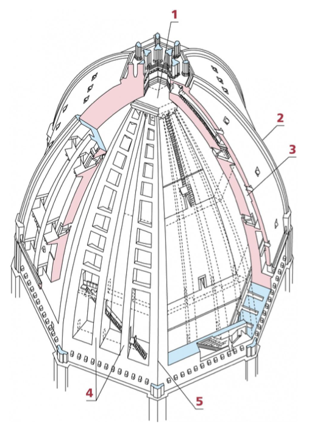
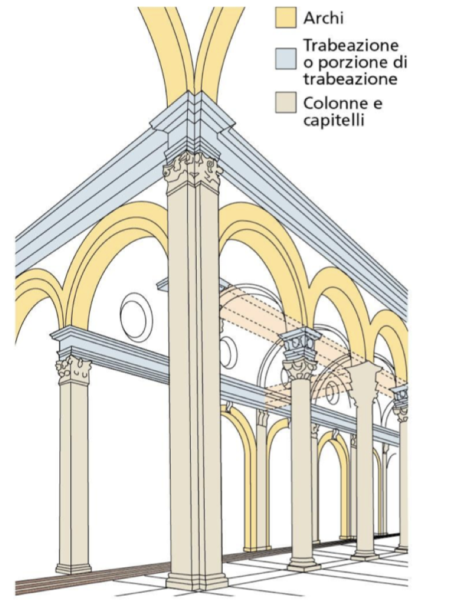
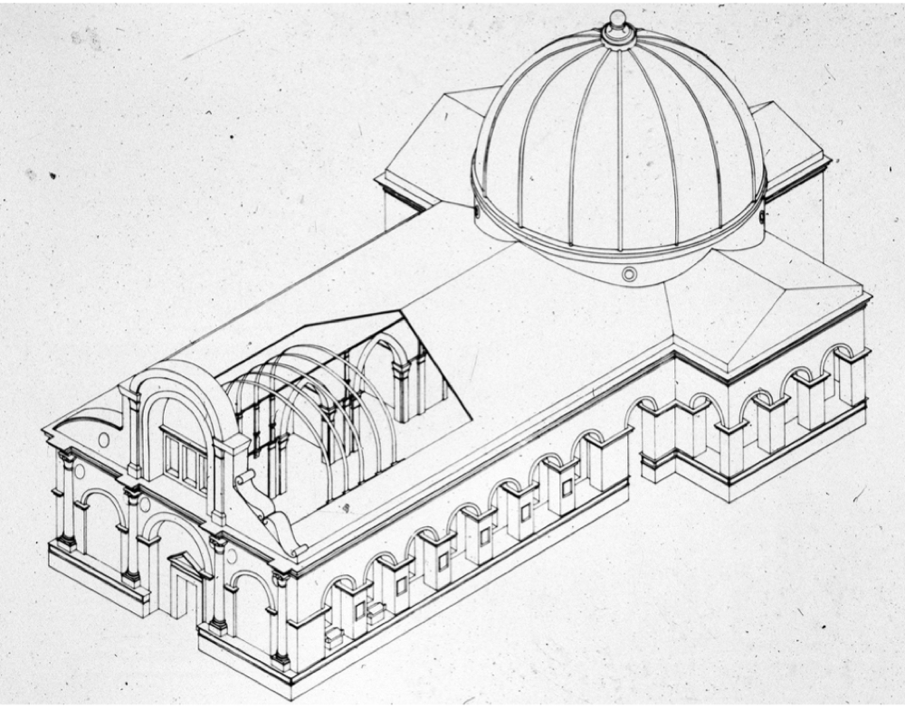
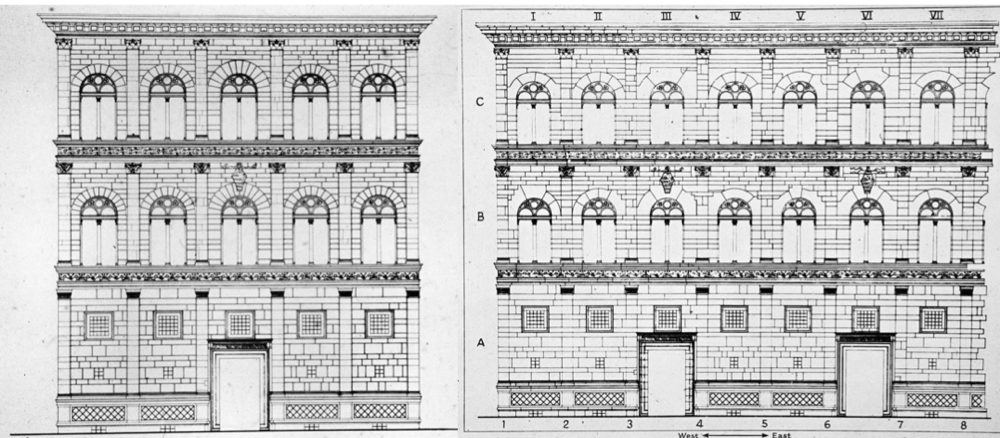
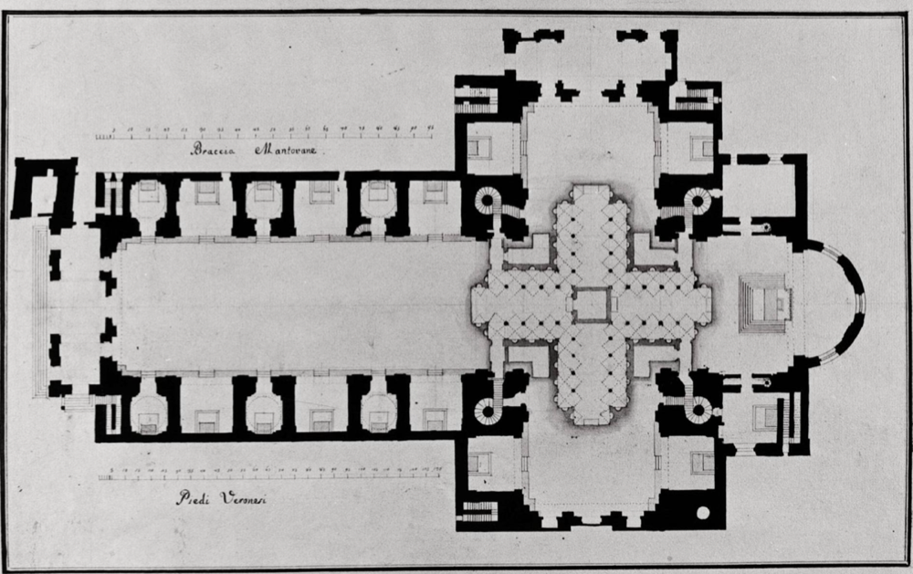

# Filippo Brunelleschi e Leon Battista Alberti

> [!info] Note collegate
> Sbobina: [[20-leon-battista-alberti]] · Sant'Andrea a Mantova e ricapitolazione: [[21-bramante-belvedere-e-palazzi]]
>
> Argomenti collegati: [[19-gotico-italiano-federico-ii-e-primo-rinascimento]] · [[21-bramante-giulio-ii-e-il-belvedere]] · [[10-pantheon-da-agrippa-ad-adriano]] · [[05-costruzione-nel-mondo-antico]] · [[15-introduzione-al-romanico-firenze-e-pisa]] · [[03-roma-foro-e-fori-imperiali]] · [[06-potere-imperiale-spettacolo-pompei]] · [[04-via-appia-cecilia-metella-massenzio]] · [[07-residenza-romana-palatino-domus-aurea]] · [[09-villa-romana-e-villa-adriana]] · [[11-architettura-tardoantica-da-baalbek-a-spalato]] · [[13-architettura-bizantina-costantinopoli-e-ravenna]]

Filippo Brunelleschi (1377-1446) e Leon Battista Alberti (1404-1472) sono i due architetti con cui il corso apre il racconto dell'architettura del Quattrocento, e rappresentano due estremi delle possibili identità dell'architetto. Brunelleschi si forma come orafo: è un tecnico, che padroneggia le tecniche costruttive e attraversa diversi ambiti del sapere tecnico, e la sua opera più celebre, la cupola di Santa Maria del Fiore, è prima di tutto una straordinaria macchina costruttiva; accanto a essa, all'Ospedale degli Innocenti e in San Lorenzo, Brunelleschi avvia uno studio graduale delle forme dell'architettura antica e del sistema degli ordini. Alberti si forma invece come umanista, comincia a occuparsi di architettura soltanto intorno ai cinquant'anni e lo fa da erudito: scrive in latino il primo trattato di architettura dell'età moderna, il *De re aedificatoria*, e nelle sue opere, a Rimini, a Firenze e a Mantova, fonde i riferimenti all'antichità romana con quelli alle antichità e alle tradizioni costruttive locali. Nel Quattrocento non esiste una scuola per diventare architetti: si arriva all'architettura attraverso la pratica delle botteghe e il confronto con gli altri artisti, e Alberti è in questo l'unica eccezione.

## FILIPPO BRUNELLESCHI, ORAFO E ARCHITETTO

### Una biografia tra Firenze e Roma

La biografia di Brunelleschi, di cui la lezione precedente ha presentato le due fonti principali, le *Vite* di Giorgio Vasari e la biografia di Antonio Manetti, si svolge prevalentemente tra due centri: Firenze, dove nasce e dove svolge la maggior parte dei suoi incarichi di architetto, e Roma, dove si reca con Donatello per un viaggio di studio che è per lui un'occasione straordinaria di conoscenza dell'antico. Vasari racconta come a Roma i due misurassero le cornici e levassero le piante degli edifici, tanto da essere chiamati «quelli del tesoro», e come lo studio rendesse l'ingegno di Brunelleschi capace di vedere nell'immaginazione Roma com'era quando non era rovinata. Nello stesso testo Vasari lo celebra come un ingegno «tanto elevato che ben si può dire che e' ci fu donato dal cielo per dar nuova forma alla architettura, già per centinaia d'anni smarrita», contrapponendolo agli uomini del suo tempo, che facevano «fabriche senza ordine, con mal modo, con tristo disegno», e riconosce nella cupola di Santa Maria del Fiore «la maggiore, la più alta fabrica e la più bella di tutte l'altre fatte nel tempo de' moderni et ancora in quello degli antichi». È il giudizio di chi, nel Cinquecento, vede in Brunelleschi l'iniziatore dell'architettura nuova; ma il percorso che porta al rinnovato interesse per l'antico è un percorso molto graduale, e non avviene da un giorno all'altro.

La Firenze in cui Brunelleschi si forma è ancora una città trecentesca, come mostra la veduta dipinta nella *Madonna della Misericordia* della Loggia del Bigallo, in cui si riconoscono Santa Maria Novella, San Lorenzo, San Piero Martire, il Battistero, Santa Maria del Fiore, il Palazzo della Signoria e Santa Croce. Il Battistero di San Giovanni (1059) è il monumento al centro della memoria civica della città, e la sua decorazione bicroma, come quella di San Miniato al Monte, costituisce la tradizione locale con cui tutti gli artisti fiorentini si confrontano. In questo ambiente si coltivano anche gli studi sulla rappresentazione prospettica dello spazio, di cui sono testimonianza nel Trecento la *Presentazione della Vergine al Tempio* di Taddeo Gaddi nella Cappella Baroncelli in Santa Croce (1332-1338) e, negli stessi anni in cui Brunelleschi lavora alla cupola, il *Banchetto di Erode* di Donatello per il fonte battesimale del Battistero di Siena (1423-1427), dove le architetture del fondo sono costruite con archi e paraste all'antica.

### La formazione di un orafo e il concorso del 1401

Brunelleschi si forma come orafo, cioè in una bottega in cui si lavorano i metalli: una formazione molto tecnica, da cui gli deriva la capacità di attraversare diversi ambiti del sapere. Gli vengono attribuiti i due *Profeti* di San Iacopo a Pistoia, figure a mezzo busto in argento e oro chiuse entro cornici polilobate. La prova più nota della sua attività di orafo e scultore è però il concorso bandito nel 1401 per le formelle della porta del Paradiso del Battistero di San Giovanni. Le due formelle di Lorenzo Ghiberti e di Filippo Brunelleschi, conservate oggi al Museo del Bargello, mettono a confronto due modi diversi di rappresentare lo stesso soggetto entro la medesima cornice. Nella formella di Brunelleschi è già evidente il dialogo con l'antico: la figura seduta che si toglie una spina dal piede, nell'angolo in basso a sinistra, è una citazione dello *Spinario*, il bronzo del I secolo a.C. conservato oggi ai Musei Capitolini.

## LA CUPOLA DI SANTA MARIA DEL FIORE

### Il completamento di una cattedrale trecentesca

L'opera a cui è legata la fama di Brunelleschi, la cupola della cattedrale di Santa Maria del Fiore, non ha in realtà nulla da spartire con l'architettura antica. Dal punto di vista formale è considerata il naturale completamento di una chiesa con impianto basilicale costruita in una lunga durata: quella con cui Brunelleschi si confronta è una cattedrale trecentesca, e la cupola su tamburo ottagonale era già prevista nel progetto che nel Trecento Francesco Talenti propone per l'impianto della cattedrale. Le piante della chiesa mostrano infatti il passaggio dallo schema del 1294 a quello ampliato adottato entro il 1368, con la grande testata ottagonale e le absidi poligonali. Già nel 1367 Andrea Bonaiuti, negli affreschi del cappellone degli Spagnoli in Santa Maria Novella, rappresenta la cattedrale completata da una grande cupola costolonata. Il modello ligneo della cupola, databile tra il 1420 e il 1440 e conservato al Museo dell'Opera di Santa Maria del Fiore, documenta la fase del progetto brunelleschiano, insieme alle ricostruzioni moderne della fabbrica e dei suoi strati costruttivi.

### La struttura: costoloni, doppia calotta e intercapedine

 La grande abilità di Brunelleschi riguarda le tecniche costruttive e il sistema strutturale che egli adotta. La cupola è una grande macchina dal punto di vista dell'ingegneria strutturale: le otto vele che la compongono sono stabilizzate da grandi costoloni d'angolo, ulteriormente irrigiditi e supportati dalle costole intermedie, e il tutto è riempito da un apparecchio laterizio. La veduta assonometrica elaborata da Howard Saalman mostra le parti di questo organismo: l'occhio sommitale, su cui poggia la lanterna; la cresta, cioè il profilo della calotta esterna; l'intercapedine tra le due calotte; le costole intermedie e il costolone d'angolo. La cupola è infatti costruita con il sistema della doppia calotta: tra la calotta interna e quella esterna si apre un'intercapedine in cui si sviluppa una scala, che consente di costruire senza centine. Gli operai costruiscono la cupola salendo lungo questa scala, che ancora oggi si percorre tra le due calotte, e innalzando gradualmente la muratura.

I dati della fabbrica ne restituiscono la grandezza. Il tamburo ha uno spessore di 4,5 metri e l'imposta della cupola si trova a 55,5 metri di quota; il diametro è di circa 43 metri. La calotta interna è spessa 2,20 metri, quella esterna da 0,80 a 0,40 metri, e il vano tra le due cupole è largo 1,20 metri; l'altezza interna della cupola è di 31,20 metri. La lanterna, alta circa 20 metri, si trova a 35 metri sopra l'imposta. All'interno la cupola è interamente decorata da un grande ciclo di affreschi, che si sviluppa intorno all'occhio sommitale.

### La muratura a spinapesce

Il sistema che permette di costruire senza centine è la muratura in *opus spicatum*, o muratura a spinapesce, in cui ai mattoni disposti in orizzontale si alternano mattoni disposti in verticale, secondo il disegno a spina di pesce. È un sistema che consente di costruire un apparecchio laterizio autoportante, che garantisce la continuità della struttura. Negli schemi della cupola, in alzato e in pianta, i corsi di mattoni disposti a spinapesce crescono con un andamento che viene schematizzato come una spirale, e che ne assicura la stabilità strutturale. Nel mondo romano l'*opus spicatum* era usato soprattutto per i pavimenti, come mostra un pavimento in mattoni a spina di pesce messo a confronto con la muratura della cupola; Brunelleschi lo trasforma in un sistema per costruire in elevato, e le fotografie dell'interno dell'intercapedine mostrano ancora i mattoni disposti in verticale che risalgono lungo gli angoli delle vele.

### La cupola di Brunelleschi e il Pantheon

Il diametro della cupola di Santa Maria del Fiore è di poco inferiore a quello del Pantheon, che resta la più grande cupola del mondo antico. In una tabella di confronto tra le grandi cupole della storia, dal «tempio di Mercurio» di Baia alla Sala ottagonale della *Domus Aurea*, da Santa Sofia a Costantinopoli (32,60 metri) fino a San Pietro a Roma (42 metri), il Pantheon (118-125) misura 43,30 metri di diametro interno e la cattedrale di Firenze (1420-1434) 42,20 metri. Il Pantheon è per Brunelleschi un riferimento culturale, più che effettivamente costruttivo.

Il confronto tra le due cupole permette di riconoscere i punti di contatto e soprattutto i punti di distanza tra le due opere. Il primo riguarda il materiale: la cupola del Pantheon è in calcestruzzo, quella di Brunelleschi in laterizio. La tecnica del calcestruzzo utilizzata dai romani è infatti dimenticata nel corso del Medioevo, e quando Brunelleschi immagina il sistema costruttivo e i materiali della sua cupola non può ricorrere al materiale del Pantheon. Il secondo riguarda la sommità. Sulla cupola di Santa Maria del Fiore è posta la lanterna, che ha il compito di rappresentare in una struttura tridimensionale ciò che negli archi è la chiave di volta: è un elemento che stabilizza le spinte esercitate dai costoloni, riuniti e raccolti grazie a un peso posto sulla sommità della cupola. Nel Pantheon accade esattamente il contrario: sulla sommità si apre il grande *opaion*, l'oculo, che ha il compito opposto di svuotare la cupola per alleggerirla il più possibile. Il progressivo alleggerimento del calcestruzzo, ottenuto sostituendo gli inerti fino ad arrivare alla pietra pomice, il materiale più leggero, si conclude con la smaterializzazione della sommità, che resta vuota; a Firenze, invece, la sommità è il punto in cui si concentra il peso.

### La cupola come simbolo dell'identità locale

La cupola diventa ben presto il simbolo stesso di Firenze. Compare sullo sfondo del *Ritratto allegorico di Dante Alighieri* dipinto da Bronzino per la Camera Bettini, oggi agli Uffizi, e ancora all'inizio dell'Ottocento si staglia oltre il colonnato nel dipinto di Pietro Benvenuti che ritrae Elisa Baciocchi Bonaparte circondata dagli artisti a Firenze, oggi a Versailles: un'immagine che identifica la città.

## GLI ORDINI ARCHITETTONICI: GLI INNOCENTI E SAN LORENZO

### L'Ospedale degli Innocenti e i modelli locali

In questo quadro di grande perizia tecnica Brunelleschi studia le forme dell'architettura antica, e un primo avvio di questo studio si trova nell'Ospedale degli Innocenti (1419-1427), commissionato dall'Arte della Seta. L'impianto si organizza intorno a un chiostro, su cui si affacciano la chiesa e il dormitorio per gli orfani; verso la piazza l'ospedale si presenta con un lungo porticato, sollevato su una scalinata. Il porticato su colonne, coperto da volte, ha precedenti precisi nell'architettura ospedaliera toscana, come l'Ospedale di Sant'Antonio a Lastra a Signa (1411) e l'Ospedale di San Matteo a Firenze, e un modello locale nella Loggia dei Lanzi. Brunelleschi parte quindi da un tipo edilizio consolidato e lo rinnova attraverso il linguaggio delle forme.

### L'arco inquadrato dall'ordine

 Lo studio degli ordini si manifesta agli Innocenti soprattutto nella soluzione delle campate laterali del porticato, dove si trova un arco inquadrato dall'ordine architettonico: il sistema già incontrato nel Tabularium e nel Teatro di Marcello, in cui l'arco è racchiuso da un ordine che regge la trabeazione. Nel caso dell'Ospedale degli Innocenti, però, l'ordine architettonico è sostenuto da paraste e non da colonne o da semicolonne, come mostrano anche le basi della parasta scanalata accostata alla colonna. È dunque un sistema diverso da quello antico. Nelle slide questa soluzione è accostata all'architettura dipinta della *Trinità* di Masaccio (1426-1428), in Santa Maria Novella, in cui l'arco poggia su colonne ed è inquadrato da paraste che reggono la trabeazione, e allo schema che distingue l'arco sorretto direttamente dalle colonne dall'arco inquadrato dall'ordine del Tabularium.

### San Lorenzo e il dado brunelleschiano

Altri elementi dello studio degli ordini compaiono nella basilica di San Lorenzo, la chiesa di riferimento della famiglia Medici, di cui Brunelleschi cura la ricostruzione. La prima pietra della ricostruzione medicea è posta nel 1421; nel 1425 il cantiere viene sospeso e i lavori riprendono nel 1429; quando Brunelleschi muore, nel 1446, sono completati la cappella maggiore e il transetto e sono iniziati i lavori della cupola. La facciata non verrà mai costruita, e la chiesa resta ancora oggi con il prospetto principale in muratura grezza. L'interno è un impianto basilicale a tre navate, in cui la navata centrale, coperta da un soffitto a cassettoni, è separata dalle laterali da una sequenza di archi su colonne.

Sopra i capitelli di queste colonne Brunelleschi colloca il cosiddetto dado brunelleschiano. Non è soltanto un pezzo di architrave, ma un pezzo di trabeazione: l'architrave è infatti una delle tre parti che compongono la trabeazione, insieme al fregio e alla cornice, e il dado brunelleschiano le include tutte. È come se Brunelleschi alludesse alla presenza dell'intera trabeazione che si sviluppa sopra i capitelli, dichiarando che gli archi non sono sostenuti direttamente dalle colonne, ma appoggiano su una trabeazione. È una soluzione concettuale, più che formale: entrando in San Lorenzo si vede una sequenza di archi sorretti da colonne, ma dietro questa soluzione si riconosce un ragionamento che chiama direttamente in causa l'architettura del sistema degli ordini, e che lungo le pareti delle navate laterali si traduce nella trabeazione continua retta dalle paraste.

### La Sacrestia Vecchia

All'estremità del transetto di San Lorenzo si trova la Sacrestia Vecchia (1422), un ambiente a pianta quadrata coperto da una cupola, a cui si aggiunge, sul lato dell'altare, un piccolo vano quadrato anch'esso coperto da una cupola, la scarsella. La cupola dell'ambiente principale è articolata da costoloni che si irradiano dall'oculo centrale verso una corona di piccole finestre circolari.

Nella Sacrestia Vecchia Brunelleschi si confronta con il sistema degli ordini architettonici in modi diversi. C'è la parasta che si avvicina al pilastro quadrangolare; c'è quella posta nell'angolo tra l'ambiente principale e la scarsella, piegata a novanta gradi, che si chiama parasta a libro; e c'è infine una parasta che quasi scompare nella muratura, di cui resta fuori soltanto una scanalatura, e che si chiama parasta filiforme. Parasta quadrangolare, parasta piegata a libro e parasta filiforme sono termini che ricorrono nelle opere architettoniche successive, a cominciare da quelle di Bramante. Lo studio dell'antico si legge anche nei capitelli: il capitello corinzio della Sacrestia Vecchia è messo a confronto con un capitello del Pantheon, di cui riprende l'impostazione.

La sacrestia è anche un luogo funerario: al centro dell'ambiente, sotto il tavolo marmoreo, si trova la tomba di Giovanni di Bicci. La decorazione scultorea spetta a Donatello, il compagno del viaggio a Roma, che realizza i tondi con i quattro evangelisti e quelli con le *Storie di san Giovanni evangelista*, tra cui la *Resurrezione di Drusiana* e il *Martirio di san Giovanni*.

## LEON BATTISTA ALBERTI, ARCHITETTO UMANISTA

### La formazione di un umanista

Leon Battista Alberti è unico nel contesto degli architetti del Quattro e del Cinquecento, perché soltanto lui ha una formazione da umanista, e soltanto intorno ai cinquant'anni comincia a occuparsi di architettura. Nato nel 1404 e morto nel 1472, si forma come giurista a Padova, entrando negli ambienti eruditi della città, e svolge poi una carriera di diplomatico e di umanista; quando arriva a ricoprire il ruolo dell'architetto lo fa con modi e atteggiamenti completamente diversi da quelli di Brunelleschi.

Se la biografia di Brunelleschi si svolge prevalentemente tra Firenze e Roma, quella di Alberti è molto più itinerante e lo porta a muoversi tra diverse corti della penisola. Discende da una famiglia di origine fiorentina che si trova in esilio, e per questo nasce a Genova; si forma nello studio di Padova, svolge la carriera diplomatica a Roma e viaggia poi attraverso le principali corti dell'Italia centro-settentrionale, Firenze, Rimini, Ferrara e Mantova. In ciascuna di queste città la sua presenza è documentata, ma è molto difficile capire quali siano stati i suoi effettivi contributi ai progetti architettonici; per questo la sua opera di architetto si studia attraverso i momenti della biografia in cui essa è documentata con sicurezza.

### Vasari e gli scritti sulle arti

Anche per Alberti si può partire dalla biografia scritta da Vasari, che nell'edizione giuntina delle *Vite* (1568) sottolinea fin dalle prime righe che Alberti aveva «atteso alla lingua latina», cioè aveva speso il suo tempo nello studio del latino, e aveva «dato opera all'architettura, alla prospettiva et alla pittura», lasciando i suoi libri scritti in latino. Il profilo di Alberti nelle *Vite* si connota dunque per la sua componente erudita: secondo Vasari è conosciuto più per le scritture che per le opere manuali, perché «fra tutte le cose gli scritti sono di maggior forza e di maggior vita». Vasari ricorda i suoi scritti sulle arti, che sono tre, sulla pittura, sull'architettura e sulla scultura. Alberti scrive in realtà moltissimi altri testi, in volgare e in latino, di argomento politico, religioso e umanistico; per ricostruire la sua figura di architetto, però, l'opera più significativa è il *De re aedificatoria*.

### Il *De re aedificatoria*

Il *De re aedificatoria* è il trattato che Alberti scrive negli anni Cinquanta del Quattrocento, mentre si trova a Roma, e che viene pubblicato a Firenze nel 1485. Alberti è il primo autore di un trattato di architettura in epoca moderna, e questo dice molto sia sulla posizione degli architetti in questo periodo, sia su Alberti stesso. Pubblicare un trattato significa promuovere l'immagine di un architetto che non sia soltanto un costruttore, ma anche uno studioso, una figura di cultura che svolge un ruolo attivo nella promozione dell'architettura; e il fatto che rientri nella volontà di occuparsi della disciplina in modo teorico, scrivendone i principi, fa parte dello stesso atteggiamento di studio e di riscoperta dell'antico.

Il trattato è scritto in latino, mentre nell'Italia del Quattrocento non si parla più latino ma volgare: è una scelta specifica e consapevole, che esibisce nel modo più macroscopico l'erudizione dell'autore. Alberti si rivolge così soltanto a coloro che nel Quattrocento conoscevano il latino, che non erano gli architetti ma gli eruditi, gli umanisti e i committenti colti: il *De re aedificatoria* non è pensato per essere usato dagli architetti, ma per promuovere la sua immagine di architetto colto presso le figure erudite del suo tempo. La scelta del latino è anche un modo per porsi in dialogo diretto con il *De architectura* di Vitruvio, più volte citato nel trattato ma sempre in maniera estremamente critica. Secondo Alberti, Vitruvio non scrive in una lingua colta, ma in una lingua piena di grecismi che complicano la comprensione del discorso, tanto più che il suo testo era giunto fino ad Alberti senza le immagini. La critica comincia dal titolo: Vitruvio aveva intitolato il suo trattato *De architectura*, piegando una parola greca al titolo latino, mentre Alberti sceglie la locuzione latina *res aedificatoria*, il modo linguisticamente corretto di indicare lo stesso significato in latino.

### La medaglia di Matteo de' Pasti e l'occhio alato

Alberti esibisce la sua erudizione in ogni occasione, compresa la medaglia fusa da Matteo de' Pasti, un artista veronese che collabora frequentemente con lui. Come avveniva nell'antichità, sul recto la medaglia rappresenta il volto di Alberti di profilo, esattamente come gli imperatori raffigurati sulle monete; sul verso compare il suo emblema, un simbolo che ne incarna le qualità. È un occhio alato, accompagnato dal motto latino *quid tum*, «e quindi?», «e allora?»: l'occhio della conoscenza, che sorvola i diversi ambiti del sapere dominati da Alberti.

### Alberti a Roma: Niccolò V e lo studio dell'antico

Un momento centrale della biografia di Alberti corrisponde agli anni trascorsi a Roma. Nel 1447 Alberti raggiunge la città, dove nello stesso anno sale al soglio pontificio Niccolò V, Tommaso Parentucelli (1397-1455), di cui resta un ritratto molto più tardo eseguito da Pieter Paul Rubens. Il soggiorno romano è legato a questioni diplomatiche e di lavoro, ma è al cospetto delle antichità che Alberti comincia a elaborare il *De re aedificatoria*. Lo dichiara lui stesso nella prefazione del trattato: «Tutti gli edifici dell'antichità che potessero avere importanza per qualche rispetto, io li ho esaminati, per poterne ricavare elementi utili. Incessantemente ho rovistato, scrutato, misurato, rappresentato con schizzi tutto quello che ho potuto, per potermi impadronire e servire di tutti i contributi possibili che l'ingegno e la laboriosità umana mi offrivano. In tal modo la passione e il diletto dell'apprendimento compensavano la difficoltà dell'esposizione». Il passo, che descrive in modo sintetico ma dettagliato le attività di studio compiute a Roma, è molto vicino a quello in cui Vasari racconta il soggiorno romano di Brunelleschi: la presenza a Roma è funzionale allo studio dell'antichità, e la passione dell'apprendimento compensa la difficoltà di capire come quelle opere fossero concepite.

### Le tracce romane: Palazzo Venezia

A Roma Alberti non ha lasciato edifici progettati da lui, e le tracce del suo lavoro sono abbastanza sfuggenti. Restano i segni delle conversazioni con alcuni personaggi, tra cui Pietro Barbo, poi papa Paolo II (1464-1471), e Marco Barbo, committenti di Palazzo Venezia, il palazzo cardinalizio sulla piazza che oggi ne porta il nome. Il palazzo è una delle opere solitamente citate come indizio della presenza di Alberti a Roma, perché al suo interno si trova una grandiosa volta a botte a cassettoni in calcestruzzo, realizzata nel 1455, che riprende in modo evidentissimo le forme delle grandi architetture voltate antiche, come le volte della Basilica di Massenzio. È un'architettura che parla la lingua delle grandi strutture dell'antichità e anche la loro lingua costruttiva, perché è costruita in calcestruzzo, la tecnica messa a punto dai romani, abbandonata per moltissimo tempo e ripresa nel corso del Quattrocento.

## RIMINI: IL TEMPIO MALATESTIANO

### La prima opera documentata

Il primo cantiere in cui la partecipazione di Alberti al progetto è documentata con sicurezza è quello del Tempio Malatestiano a Rimini, la prima opera in cui interviene come progettista. Una pagina di un codice miniato quattrocentesco ne rappresenta il cantiere, con l'opera non ancora finita, le figure che portano in quota i materiali e i lapicidi che tagliano la pietra.

Il Tempio Malatestiano nasce in continuità con un'opera precedente, la chiesa trecentesca di San Francesco, una chiesa a navata unica con una serie di cappelle sui lati. Sigismondo Pandolfo Malatesta, signore di Rimini, decide di farvi realizzare una cappella funeraria per sé e una per la sua amante, Isotta degli Atti, e dalla ricostruzione di queste cappelle arriva progressivamente a una vera e propria ricostruzione degli esterni della chiesa, che prende il nome dal suo committente quattrocentesco e ne accoglie la sepoltura. I lavori cominciano nel 1447 con la cappella di San Michele Arcangelo, o cappella di Isotta, e con la cella delle reliquie; tra il 1448 e il 1450 prende forma la cappella di Sigismondo, e dal 1450 si progettano gli esterni, con i lavori del 1453 e un cambio di progetto nel 1454. Per le cappelle Sigismondo si rivolge allo scultore fiorentino Agostino di Duccio e a Matteo de' Pasti, l'autore della medaglia di Alberti. Le cappelle riprendono le forme esistenti, con archi ogivali coerenti con la struttura trecentesca; la committenza quattrocentesca si manifesta nelle iscrizioni sugli archi, che ricordano il nome di Sigismondo Pandolfo Malatesta, e nell'uso dei colori araldici dei Malatesta, il verde e il rosso, cioè i colori legati allo stemma della famiglia e impiegati come elementi della decorazione.

Il Tempio Malatestiano è citato spesso anche nella storia del restauro, perché è uno dei progetti in cui il rapporto tra il progetto del nuovo e le preesistenze si manifesta nel modo più importante.

### Il progetto del 1450 e la scatola marmorea

 I primi interventi, limitati ad alcune porzioni dell'interno, suggeriscono al committente un'idea più grandiosa, la ricostruzione dell'intero edificio. Nel 1450 viene fusa la medaglia di Sigismondo Malatesta, che sul recto lo ritrae di profilo, con un ritratto all'antica ripreso da quelli degli imperatori, e sul verso rappresenta il prospetto del Tempio secondo la ricostruzione voluta dal committente: una facciata tripartita sormontata da una grande cupola. Rappresentare un'architettura su una medaglia di pochi centimetri di diametro impone una raffigurazione sintetica e approssimativa, ma la data incisa dimostra che nel 1450 l'idea della ricostruzione aveva già preso forma e che esisteva un progetto.

Il progetto viene affidato ad Alberti, che propone di ricostruire la chiesa trecentesca realizzando una sorta di scatola marmorea che avrebbe incluso la struttura in laterizio, completata da una facciata, di cui restano due soluzioni diverse, e da una grande cupola che avrebbe reso l'edificio ancora più monumentale. L'idea è di mantenere tutta la struttura della chiesa trecentesca e di mascherarla con una struttura addossata alle preesistenze, che le riconfigura senza doverle demolire. Poiché l'opera è rimasta incompiuta, questa relazione si legge ancora facilmente: in facciata si vedono alcune strutture in laterizio della fabbrica trecentesca accanto alla grande struttura lapidea messa in opera da Alberti.

La costruzione aveva una difficoltà molto concreta, l'approvvigionamento e il trasporto dei materiali, perché costruire un edificio di questa portata in pietra a Rimini, città che non è rinomata per le sue cave, era tutt'altro che semplice. Sigismondo la supera procurandosi i materiali da una chiesa di Ravenna, Sant'Apollinare in Classe, anch'essa tra le opere realizzate nel V secolo: la grande opera è costruita con materiale di spoglio.

### La facciata: il tempio antico e l'Arco di Augusto

La facciata mostra subito che l'idea di Alberti consiste in una sintesi di forme architettoniche che guardano al passato. È organizzata in tre campate: in quella centrale il portale si apre sotto un grande arco a tutto sesto, mentre le due laterali riecheggiano la forma dell'arco ma restano cieche. La tripartizione è ottenuta con semicolonne, che conferiscono all'edificio i suoi caratteri principali e lo configurano come una sequenza di modelli architettonici che Alberti ricompone.

L'erudizione di Alberti emerge dai riferimenti. Il primo, nonostante la facciata sia incompleta, è il richiamo ai templi del mondo antico, cioè l'idea di una facciata che si chiude con un timpano: il Pantheon ne è il riferimento per antonomasia, ma si tratta più in generale di un richiamo ai templi pagani, greci e romani. Accanto a questo riferimento evocativo e vasto, Alberti inserisce riferimenti a opere precise e riconoscibili da chi avrebbe osservato il Tempio, cioè all'architettura locale. La porzione inferiore della facciata, con la sua struttura tripartita, è stata più volte avvicinata alle forme degli archi di trionfo, e presenta decorazioni come i tondi ripresi dall'Arco di Augusto a Rimini. I tondi sono una parte per il tutto: Alberti non prende come riferimento i tondi, ma l'Arco di Augusto, e sceglie di rappresentare quel modello attraverso la citazione di un suo dettaglio. Non è dunque la copia di un dettaglio, ma il riferimento a un edificio antico che si manifesta attraverso un dettaglio.

Questo procedimento ricorre in tutti i progetti di Alberti: la capacità di fondere i rimandi all'architettura antica romana con quelli alle antichità locali, cioè alla tradizione costruttiva del luogo in cui il progetto prende forma. È una scelta di Alberti, non una lettura che gli attribuiamo oggi: in tutte le sue opere egli crea un punto di contatto con ciò che può essere riconosciuto da chi le osserva e appartiene a quel luogo.

### I fianchi, la pietra d'Istria e le preesistenze

Un altro riferimento ai modelli locali si trova nei prospetti laterali, articolati in una sequenza di archi sostenuti da grandi pilastri che echeggiano le forme delle grandi strutture degli acquedotti; anche in questo caso Alberti aveva a disposizione un modello vicino da citare, il ponte di Augusto e Tiberio a Rimini, costruito anch'esso in pietra d'Istria. Il materiale stesso è un riferimento all'antico: la pietra d'Istria, con cui è costruita l'intera scatola lapidea, conferisce monumentalità all'opera per la preponderanza dei materiali lapidei al posto del laterizio, come nel Mausoleo di Teodorico a Ravenna, che pur essendo del VI secolo viene paragonato alle opere dell'antichità proprio per l'uso di questa pietra.

Lungo i fianchi si vede con chiarezza come il progetto mantenga le preesistenze: la struttura in pietra d'Istria è addossata alle murature in laterizio della chiesa trecentesca, e ad Alberti non interessa nascondere questo rapporto. Lo scarto dimensionale tra la chiesa e gli archi è anzi esibito quasi provocatoriamente. Il prospetto di Alberti è regolare e fa dell'arco il modulo che genera la sequenza e il ritmo dei fianchi, mentre dietro gli archi si intravedono le finestre ad arco acuto che illuminavano la chiesa trecentesca, del tutto disassate rispetto a essi: la ricostruzione degli esterni genera un ritmo nuovo e regolare, che si contrappone all'andamento irregolare dell'edificio trecentesco.

### I marmi colorati del portale

Sulla scatola bianca spiccano in modo ancora più evidente i colori che Alberti usa per l'arco del portale principale, il verde e il rosso, cioè ancora i colori araldici del committente. Anche questi sono materiali di spoglio, portati a Rimini per essere impiegati nel cantiere: accanto alla pietra d'Istria, il materiale principale, compaiono il porfido rosso egiziano, il marmo rosso di Verona, il porfido verde antico e il serpentino. Messi in opera in forme geometriche, ricordano le grandi tarsie dell'*opus sectile* dei pavimenti antichi, come quelli del Pantheon o di Villa Adriana. Il Tempio parla la lingua dell'architettura antica attraverso il materiale, il modo in cui è messo in opera e una serie di citazioni molto consapevoli di modelli romani, o comunque antichi in senso lato, e di modelli locali specifici. I materiali colorati sono concentrati soltanto nel portale della facciata.

### I bombardamenti e il restauro

La storia postuma del Tempio Malatestiano comprende la sua parziale distruzione durante la seconda guerra mondiale: Rimini viene pesantemente bombardata, con la perdita di quasi il novanta per cento del costruito urbano, e nel 1943 anche il Tempio viene colpito. All'indomani del conflitto la soprintendenza ne cura il restauro, tra il 1945 e il 1947, ricostruendo la zona dell'abside e la parte superiore del tetto. Sul prospetto laterale una discontinuità tra la parte lapidea e quella in laterizio segna il punto di innesto tra la ricostruzione e la costruzione quattrocentesca originale: si è scelto di distinguere ciò che è stato ricostruito da ciò che era rimasto in piedi, cambiando il materiale nella zona dell'abside. Per la facciata, danneggiata dal distacco di alcuni conci, si è seguita invece un'altra strada: tutti i conci in opera sono stati numerati, smontati e rimontati, così da ricomporla in modo strutturalmente più sicuro. L'opera che si vede oggi a Rimini è dunque sostanzialmente una ricostruzione novecentesca, che riprende e rispetta pienamente il progetto albertiano del Quattrocento.

## FIRENZE: ALBERTI E I RUCELLAI

### Giovanni di Paolo Rucellai e le tre opere

A Firenze Alberti lavora per la famiglia Rucellai, grande nemica dei Medici, e si colloca quindi in una posizione antitetica rispetto a quella di Brunelleschi. Il ritratto di Giovanni di Paolo Rucellai attribuito a Francesco Salviati sintetizza la sua storia fiorentina: oltre al committente, rappresenta sullo sfondo le tre opere che Alberti realizza per la famiglia, la facciata del palazzo di famiglia, il completamento della facciata della basilica di Santa Maria Novella, che era la parrocchia dei Rucellai come San Lorenzo era quella dei Medici, e il sacello dei Rucellai.

### Santa Maria Novella: la chiesa domenicana e la facciata incompiuta

Se i Medici fanno ricostruire la propria chiesa di riferimento, i Rucellai, la cui chiesa era ancora integra, fanno completarne la facciata. La basilica di Santa Maria Novella è costruita tra il 1279 e il 1360 dall'ordine domenicano, che vi aveva sede. È un edificio a tre navate, tutte coperte da volte a crociera, con un transetto con cappelle e un'abside rettangolare; all'interno ritorna la bicromia già incontrata più volte a Firenze, l'associazione tra il marmo bianco e il serpentino verde di Prato, qui applicata agli archi e ai costoloni delle volte.

Quando ad Alberti viene chiesto di intervenire, della facciata era stata realizzata soltanto la parte inferiore, dove si trovano gli archi ogivali e i sepolcri: lì si fermava il rivestimento lapideo. Ciò che esisteva apparteneva al cantiere di fine Duecento e inizio Trecento e parlava ancora il linguaggio dell'architettura gotica, con gli archi ogivali e i sepolcri esibiti in facciata secondo la tradizione del tempo. Ad Alberti si chiede di completare il rivestimento della facciata, e i lavori cominciano intorno al 1460.

### Il completamento di Alberti

Alberti dà qui prova della sua capacità di combinare i riferimenti all'architettura locale e all'antichità romana. La prima scelta riguarda la decorazione: il suo progetto si allinea alla caratteristica prevalente della tradizione fiorentina ed è interamente incentrato sull'impiego dei materiali lapidei bianchi e verdi, che creano una scacchiera cromatica sulla facciata. Le forme della facciata rispecchiano l'andamento degli interni: tre portali corrispondono alle tre navate, e la porzione superiore centrale, più alta, corrisponde alla navata centrale.

I punti di contatto tra il progetto trecentesco e quello di Alberti diventano occasioni per mostrare il dialogo tra l'esistente e il nuovo, e insieme il cambiamento delle forme architettoniche. Alberti completa il primo registro riprendendo la stessa articolazione dello spazio, ma sostituendo agli archi ogivali archi a tutto sesto sostenuti da paraste. Questa porzione della facciata, simmetrica, è compresa entro grandi semicolonne in serpentino verde, che le fanno da cornice e introducono sulla facciata l'ordine architettonico: un ordine di notevole altezza, che copre l'intero primo registro e sorregge una grande trabeazione. Nel fregio corre una sequenza di piccole vele, l'emblema dei Rucellai: una firma sulla facciata, chiaramente riconducibile ai committenti.

### I modelli: l'Arco di Settimio Severo, il Battistero e il Tabularium

Anche in questo caso Alberti guarda a modelli antichi. Il ritmo della facciata, scandito dagli elementi dell'ordine che separano le navate in corrispondenza delle semicolonne, è stato messo in relazione con l'Arco di Settimio Severo. I riferimenti al contesto locale sono però quanto mai evidenti: al Battistero di San Giovanni Alberti riprende anche la geometria delle decorazioni sotto gli archi della facciata, e la bicromia bianca e verde viene dal Battistero, dalla facciata di San Miniato al Monte e dalle facciate laterali della cattedrale di Santa Maria del Fiore. Tra i modelli locali le slide indicano anche i capitelli di Santa Reparata.

Rispetto al modo in cui Brunelleschi aveva recepito l'architettura antica, Alberti ripropone correttamente il motivo del Tabularium. Nel grande arco al centro della facciata, che corrisponde al portale, l'arco è sorretto da paraste ed è inquadrato da semicolonne su cui corre la trabeazione dell'ordine. È esattamente la grammatica inversa rispetto a quella dell'apparato che incornicia la *Trinità* di Masaccio, che si trova proprio all'interno di Santa Maria Novella: Alberti conosceva sicuramente quest'opera, e il suo portale è quasi un modo per contrapporsi all'architettura dipinta che si trova dentro l'edificio.

### Palazzo Rucellai: la prima facciata all'antica

 Accanto alla facciata di Santa Maria Novella, grande manifesto della famiglia, Alberti progetta la facciata della residenza dei Rucellai, avviata dal 1452. I Rucellai possedevano una serie di case nello stesso isolato e decidono di collegarle con quella che oggi si chiamerebbe una ristrutturazione, dando un'unità compositiva all'insieme. Si rivolgono a Bernardo Rossellino, che tra il 1446 e il 1452 restaura gli interni e probabilmente nel 1452 inizia la costruzione della facciata su progetto di Alberti: Alberti è l'autore del progetto, ma non segue il cantiere.

La facciata di Palazzo Rucellai è molto significativa nell'architettura del Quattrocento, perché è la prima facciata di un edificio residenziale, e non di una chiesa, su cui compaiono gli ordini architettonici. È il primo palazzo costruito utilizzando il sistema degli ordini, e in senso più ampio la prima facciata veramente all'antica dell'architettura del Quattrocento: una dimostrazione della volontà dei Rucellai di rendere monumentale la propria residenza con l'elemento più nobile dell'architettura antica, e della capacità di Alberti di gestire queste forme. Si articola in tre registri scanditi da paraste, che inquadrano finestre ad arco a tutto sesto nel piano nobile e nel registro superiore, mentre il piano terra ha piccole aperture quadrate. Il progetto subisce una variazione: da un'idea iniziale con una facciata simmetrica a cinque campate e il portale nella campata centrale si passa, in seguito all'acquisto di altre proprietà da parte dei Rucellai, a una facciata più ampia a sette campate con due portali, fortemente asimmetrica.

### La pietra forte e il bugnato gentile

L'aspetto più caratteristico del progetto è il trattamento del paramento che riveste la facciata. Il materiale è la pietra forte, una pietra di colore scuro molto diffusa a Firenze, diversa dalla pietra serena usata da Brunelleschi, più chiara e più agile da lavorare. La pietra forte riveste i prospetti dei principali palazzi fiorentini, Palazzo Medici, Palazzo Strozzi, Palazzo Pitti e Palazzo Rucellai: la scelta del materiale è di per sé una dichiarazione di fiorentinità, un modo di radicarsi nella continuità costruttiva della tradizione locale.

Alberti usa però una forma di bugnato nuova per Firenze. Invece del bugnato rustico, a superficie sbozzata, che caratterizza le facciate fiorentine come quella di Palazzo Medici Riccardi e che ha uno dei suoi modelli antichi nelle sostruzioni del Tempio del Divo Claudio, adotta un bugnato gentile, con le bugne a superficie levigata, messe in opera secondo un disegno accuratissimo e geometricamente definito. L'opera è isodoma, nel senso che i filari presentano conci tutti della stessa altezza, che però variano tra le singole campate; la precisione dell'apparecchio è stata paragonata da Manfredo Tafuri, grande storico dell'architettura del Rinascimento, a un quadro di Mondrian.

### I modelli antichi del paramento

Questa cura deriva dalla conoscenza di esempi antichi come il Mausoleo di Cecilia Metella, in cui il rivestimento in opera quadrata disegnava una superficie assolutamente curata, e ancora più precisamente il Tempio di Ercole Vincitore, il cui rivestimento superstite della cella presenta una variazione dell'altezza dei filari analoga a quella scelta da Alberti. Alberti gioca anche con le citazioni delle tecniche costruttive antiche: nel basamento, in corrispondenza della panca, elemento tipico dei palazzi fiorentini su cui sedeva chi attendeva di parlare con i signori del palazzo, il rivestimento cambia disposizione ed evoca l'opera reticolata. Non si tratta di conci messi in opera in questo modo, ma di pietra forte incisa: è una simulazione dell'opera reticolata, con cui Alberti mostra di padroneggiare le tecniche costruttive antiche.

### Tradizione fiorentina e citazioni antiche

Il dialogo con la tradizione locale è dunque molto forte, ma prevede anche momenti di distacco. Alberti sceglie il materiale più diffuso nelle residenze patrizie del tempo, ma lo tratta in modo completamente diverso, rinunciando al bugnato rustico a favore del bugnato gentile; e il più grande elemento di differenza è la presenza dell'ordine architettonico, cioè delle paraste, assenti in tutti gli altri palazzi fiorentini del Quattrocento.

Accanto ai riferimenti alla cultura fiorentina tornano quelli all'architettura antica. La cornice sommitale riprende le forme della cornice del Colosseo, un dettaglio che esibisce ancora di più la cultura antiquaria di Alberti. I capitelli variano nei tre ordini della facciata, ma non rispondono precisamente alle forme degli ordini antichi: dorico, ionico e corinzio non sono perfettamente calibrati sulla grammatica dell'antico, ma servono ad attribuire a ogni registro una specifica connotazione architettonica. In alcuni casi sono citazioni di opere antiche: il capitello del secondo ordine, con le volute che lo avvicinano a un capitello ionico, cita i capitelli del Mausoleo di Adriano. La conoscenza che Alberti ha dell'architettura antica si manifesta così nella capacità di unire riferimenti molto diversi a opere del passato romano e ai modelli locali vicini.

## MANTOVA: SANT'ANDREA

### Ludovico Gonzaga e la cultura antiquaria della corte

L'ultima tappa della biografia di Alberti è Mantova, che corrisponde agli ultimi anni della sua vita. Se a Rimini il suo interlocutore è Sigismondo Malatesta e a Firenze la famiglia Rucellai, a Mantova sono i Gonzaga, e in particolare il marchese Ludovico Gonzaga, ritratto da Andrea Mantegna nella Camera degli Sposi, o *Camera picta* (1465-1474), l'ambiente interamente dipinto nel complesso del Palazzo Ducale. Ludovico affida ad Alberti due chiese in due punti diversi della città racchiusa dalle mura: la basilica di Sant'Andrea, vicinissima al Palazzo Ducale e a piazza delle Erbe, il cuore della città, e San Sebastiano, nella parte opposta del centro, quasi a contatto con la porta di San Sebastiano.

Se a Rimini Alberti dialoga con un committente che vuole un'opera grandiosa, con un materiale fortemente identificativo, e a Firenze con le tradizioni comunali della città, a Mantova si confronta con una tradizione antiquaria molto peculiare, rappresentata da Andrea Mantegna. Pittore di corte, formato a Padova e attivo a Mantova da tempo, Mantegna vi aveva introdotto un gusto antiquario riconoscibile nelle sue opere, come il *San Sebastiano* del Louvre, sul cui sfondo compaiono citazioni puntualissime delle architetture antiche di Roma. A Mantova non c'erano antichità locali né una tradizione forte come quella fiorentina, con edifici portatori di una memoria civica come il Battistero; c'era però questa cultura antiquaria, e Mantegna è uno degli interlocutori principali di Alberti nella progettazione di Sant'Andrea.

### La lettera del 1470

È Alberti stesso a proporsi come architetto di Sant'Andrea, con una lettera scritta nel 1470 al marchese. Ludovico Gonzaga stava già progettando la nuova chiesa e ne aveva affidato il progetto a un altro architetto, Antonio Manetti; Alberti scrive di aver saputo che il marchese e i suoi cittadini pensavano di edificare a Sant'Andrea, con l'intenzione principale di avere un grande spazio dove molto popolo potesse vedere il Sangue di Cristo, e aggiunge: «Vidi quel modello del Manetti. Piaqqemi, ma non mi par apto alla intentione vostra. Pensai et congettai questo qual io ve mando. Questo sarà più capace, più eterno, più degno, più lieto; costerà molto meno». La sua chiesa sarà dunque più grande, più duratura dal punto di vista della resistenza costruttiva, più degna e più lieta, cioè con caratteristiche formali più adatte alle intenzioni del committente, e per di più molto meno costosa; questa forma di tempio, conclude, presso gli antichi si chiama *Etruscum sacrum*. È un passaggio molto importante per la storia dell'affermazione culturale e professionale degli architetti: un architetto che si rivolge direttamente al committente sostenendo di essere più idoneo di quello già incaricato è un fatto eccezionale, che in questo periodo soltanto Alberti compie. La lettera convince il marchese ad affidargli il progetto.

### La reliquia del Santo Sangue e l'ostensione

La basilica sorge su preesistenze, nel cuore densamente costruito della città, e ha una funzione specifica: ospitare la reliquia del Santo Sangue, il Sangue di Cristo, che secondo la tradizione era stato portato dall'Oriente a Mantova da un soldato romano e vi era conservato in alcune urne. Sant'Andrea è costruita come luogo in cui svolgere il rito dell'ostensione della reliquia. Le reliquie, resti di santi o, in questo caso, secondo la tradizione il sangue di Cristo, influenzano spesso l'architettura, perché è intorno a esse che viene progettata un'opera di ricostruzione. L'ostensione è il momento in cui la reliquia viene tolta dal luogo in cui è custodita e mostrata a tutti i fedeli; avviene di solito in un giorno specifico dell'anno, e l'intera chiesa è di fatto architettata per accogliere un evento che si svolgeva una volta all'anno. Durante l'ostensione le urne venivano esibite, e la famiglia del marchese poteva osservarle da un punto di vista privilegiato.

### La pianta: navata unica, cappelle e transetto

 Il progetto risale al 1470, ma Alberti muore nel 1472, e il cantiere viene portato avanti per la maggior parte da un costruttore, Luca Fancelli, che dà forma al progetto albertiano. La pianta è quella di una basilica a navata unica, voltata a botte, fiancheggiata da una sequenza di cappelle; la navata incrocia il corpo trasversale del transetto e la chiesa si chiude con un'abside semicircolare.

Una delle principali peculiarità dell'impianto è la facciata. Finora si sono incontrate facciate a lastra, come quella di San Miniato al Monte, oppure facciate mai costruite, perché i soldi finiscono o il cantiere si interrompe, come in San Lorenzo, rimasta scarnificata nel prospetto principale. La facciata di Sant'Andrea è invece una facciata costruita, con un vero ingombro tridimensionale: si entra oltrepassando un grande portale e attraversando un corpo addossato alla facciata, ben visibile anche in pianta. Questo corpo tridimensionale doveva accogliere il rito dell'ostensione della reliquia: è parte integrante del progetto e una delle caratteristiche architettoniche principali dell'edificio.

### Il modello della Basilica di Massenzio e i materiali

L'interno è dominato dalla monumentale volta a botte cassettonata che copre la navata, una struttura che richiama i grandi complessi voltati antichi. Il riferimento solitamente accostato a Sant'Andrea è la Basilica di Massenzio, una grande struttura voltata che secondo l'impianto originario articolava lo spazio in una navata centrale e in corpi laterali corrispondenti a spazi voltati: una somiglianza che riguarda sia l'impianto delle due opere, sia la tecnica della struttura voltata.

Tutto l'organismo è costruito in laterizio, comprese le piccole cupole che coprono le cappelle laterali. Non c'è da stupirsi, perché a Mantova non ci sono cave di pietra e il materiale prevalente è appunto il laterizio: Alberti fa riferimento alla tradizione costruttiva locale e lavora poi su un rivestimento di intonaco, che in facciata viene dipinto mascherando la struttura in laterizio e fingendo un rivestimento di pietra. Con Sant'Andrea si chiude la vicenda di Alberti, che insieme a Brunelleschi rappresenta i due protagonisti dell'architettura del Quattrocento scelti dal corso: non sono gli unici architetti attivi in Italia in questo secolo, ma per ragioni di tempo la selezione si ferma a loro.

## Collegamenti

Brunelleschi è stato introdotto nella lezione sul [[19-gotico-italiano-federico-ii-e-primo-rinascimento|gotico in Italia e l'inizio del Rinascimento]], con le biografie di Vasari e Manetti e il soggiorno romano insieme a Donatello: il passo di Alberti sullo studio delle antichità di Roma ne è il corrispettivo umanistico. La cupola di Santa Maria del Fiore si comprende per confronto con la cupola in calcestruzzo del [[10-pantheon-da-agrippa-ad-adriano|Pantheon]], con il suo oculo e il progressivo alleggerimento degli inerti, mentre l'*opus spicatum* usato da Brunelleschi per costruire senza centine è lo stesso apparecchio a spina di pesce che nella lezione sulla [[05-costruzione-nel-mondo-antico|costruzione nel mondo antico]] compare soprattutto nei pavimenti; la stessa lezione descrive l'opera quadrata, l'opera reticolata e il calcestruzzo che Alberti cita a Palazzo Rucellai e a Palazzo Venezia. La bicromia del Battistero e di San Miniato al Monte, modello della facciata di Santa Maria Novella, e la cattedrale di Santa Maria del Fiore sono state studiate nell'[[15-introduzione-al-romanico-firenze-e-pisa|introduzione al romanico a Firenze e Pisa]]. L'arco inquadrato dall'ordine, che Brunelleschi rielabora con le paraste agli Innocenti e Alberti ripropone correttamente in Santa Maria Novella, nasce nel Tabularium del [[03-roma-foro-e-fori-imperiali|Foro Romano]] e si ripete nel Teatro di Marcello e nel Colosseo, studiati con l'Arco di Augusto a Rimini e gli archi trionfali nella lezione sull'[[06-potere-imperiale-spettacolo-pompei|immagine del potere imperiale e gli edifici per lo spettacolo]]. Il paramento di Palazzo Rucellai rimanda al mausoleo di Cecilia Metella osservato nella [[04-via-appia-cecilia-metella-massenzio|visita alla Via Appia]] e alle sostruzioni del Tempio del Divo Claudio viste con la [[07-residenza-romana-palatino-domus-aurea|residenza romana]]; i capitelli del Mausoleo di Adriano e l'*opus sectile* dei pavimenti richiamano la lezione sulla [[09-villa-romana-e-villa-adriana|villa romana e Villa Adriana]]. La Basilica di Massenzio, modello di Sant'Andrea e della volta di Palazzo Venezia, appartiene all'[[11-architettura-tardoantica-da-baalbek-a-spalato|architettura tardoantica]], mentre il Mausoleo di Teodorico, richiamato per la pietra d'Istria del Tempio Malatestiano, è stato studiato con l'[[13-architettura-bizantina-costantinopoli-e-ravenna|architettura di Ravenna]]. Le paraste quadrangolari, a libro e filiformi della Sacrestia Vecchia ritornano infine nell'opera di [[21-bramante-giulio-ii-e-il-belvedere|Bramante]], il terzo architetto del Rinascimento affrontato dal corso, formato come pittore dopo l'orafo Brunelleschi e l'umanista Alberti.
