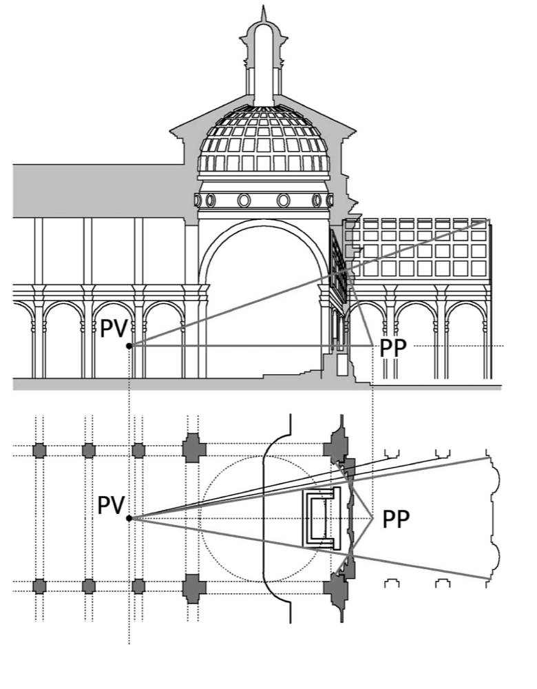
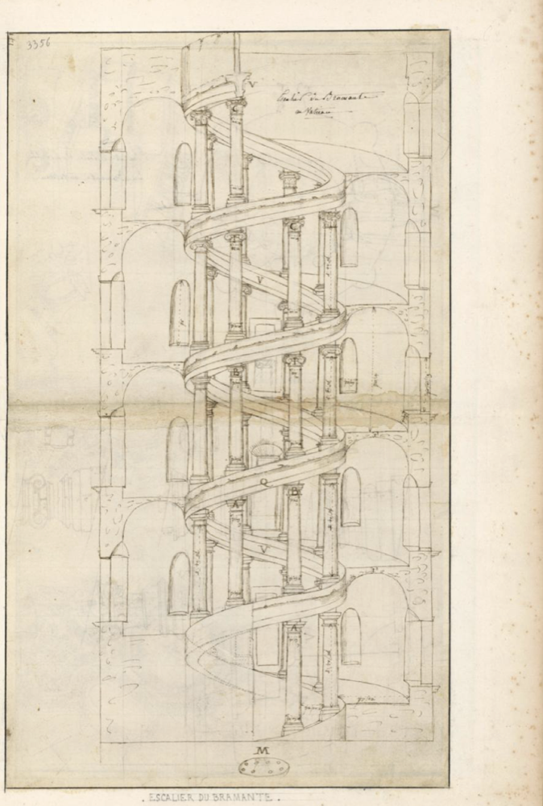
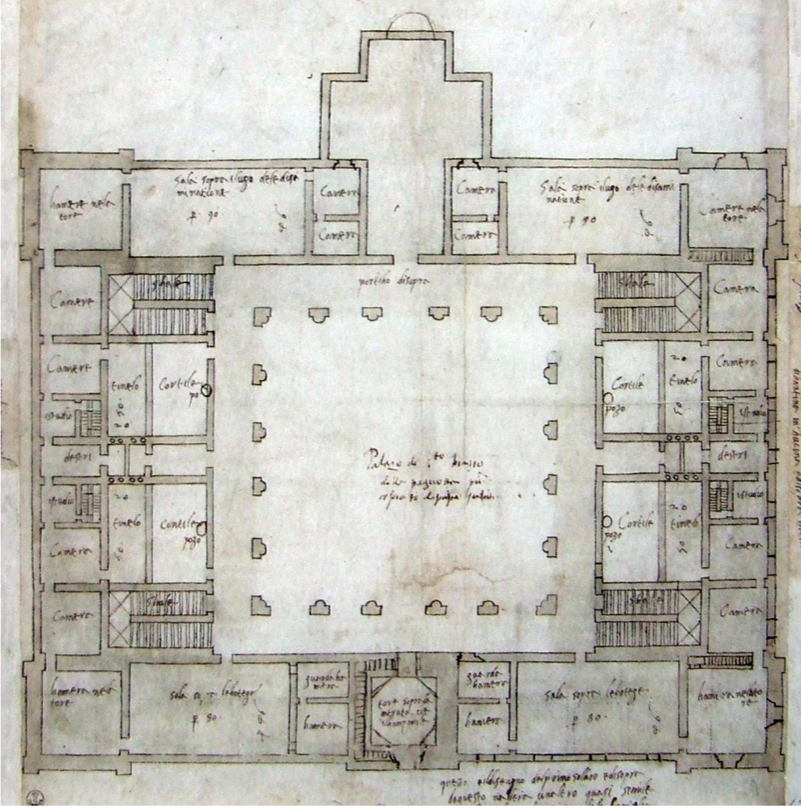

# Bramante: Giulio II, il Cortile del Belvedere e i palazzi

> [!info] Note collegate
> Sbobina: [[21-bramante-belvedere-e-palazzi]]
>
> Argomenti collegati: [[19-gotico-italiano-federico-ii-e-primo-rinascimento]] · [[20-leon-battista-alberti]] · [[09-villa-romana-e-villa-adriana]] · [[08-terme-di-caracalla]] · [[06-potere-imperiale-spettacolo-pompei]] · [[01-ordini-architettonici]] · [[12-architettura-paleocristiana-a-roma]] · [[05-costruzione-nel-mondo-antico]] · [[03-roma-foro-e-fori-imperiali]] · [[02-acropoli-e-partenone]] · [[17-romanico-in-italia-da-venezia-a-tuscania]]

Donato Bramante (1444-1514) è il terzo grande architetto del Rinascimento che il corso affronta dopo Filippo Brunelleschi, formato come orafo, e Leon Battista Alberti, formato come umanista. La sua formazione è quella di un pittore prospettico, capace di disegnare l'illusione dello spazio, e questa abilità accompagna tutta la sua opera, dalla Milano degli Sforza alla Roma di Giulio II. A Roma, sul finire del Quattrocento, Bramante incontra lo studio diretto delle antichità e in particolare del sistema degli ordini architettonici, che declina nel chiostro di Santa Maria della Pace e, con un'attenzione archeologica, nel Tempietto di San Pietro in Montorio. Al servizio di Giulio II progetta il Cortile del Belvedere, che collega gli appartamenti vaticani alla villa di Innocenzo VIII rievocando la villa antica, e la scala elicoidale, una sorta di trattato di architettura in pietra; accanto a queste opere si colloca una fase dedicata ai palazzi, rappresentata da Palazzo Castellesi e dal progetto, rimasto incompiuto, del Palazzo dei Tribunali in via Giulia. Bramante non scrive alcun trattato, e la sua teoria dell'architettura si deduce soprattutto da ciò che ha costruito.

## LA FORMAZIONE: DA URBINO A MILANO

### Un architetto formato come pittore

Donato Bramante nasce a Urbino nel 1444 e muore a Roma nel 1514. Il suo ritratto più famoso lo mostra di profilo su una medaglia fusa in occasione della posa della prima pietra della nuova basilica di San Pietro, il cantiere di cui sarà uno degli architetti. Bramante si forma come pittore: dopo Brunelleschi, formato come orafo, e Alberti, formato come umanista, è il terzo modo di diventare architetto nel Rinascimento, e con lui si apre la ricchissima categoria degli architetti che si formano come pittori. Nel Quattrocento, del resto, non esiste una scuola per diventare architetti: si arriva all'architettura attraverso la pratica delle botteghe e il confronto con gli altri artisti, e soltanto Alberti fa eccezione.

### La corte di Urbino

La formazione di Bramante avviene alla corte di Urbino, un contesto culturalmente molto vivace, che ha il suo centro nel Palazzo Ducale, sede della corte dei Montefeltro. Federico da Montefeltro, signore di Urbino nella seconda metà del Quattrocento, si fa ritrarre da Pedro Berruguete (1476-1477) in una veste singolare: indossa l'armatura, e l'elmo in primo piano ne richiama il mestiere delle armi, ma sopra l'armatura porta abiti eleganti e tiene in mano un libro. La posa dichiara la sua doppia natura di militare e di uomo di cultura, che fa della propria corte un luogo di importantissimi scambi culturali.

Nel Palazzo Ducale di Urbino è ambientato *Il libro del cortegiano* di Baldassarre Castiglione, pubblicato nel 1528, uno dei testi più importanti della letteratura del Cinquecento. È un dialogo che costituisce una sorta di manuale di comportamento del cortigiano, cioè di chi vive nelle corti, che sono in questo momento i luoghi della vita culturale e artistica. Castiglione riconosce nella corte dei Montefeltro il centro della vita di corte della penisola tra Quattro e Cinquecento e definisce il palazzo di Federico un palazzo «in forma di città», sia per la sua articolazione architettonica sia perché vi si riunisce tutta la corte. Questa piccola città è il luogo in cui si formano alcuni dei più importanti artisti del Rinascimento, tra cui Bramante.

### L'incisione Prevedari: un progetto sulla carta

Dagli anni Settanta del Quattrocento, e in particolare dal 1477, Bramante è documentato in Lombardia, prima a Bergamo e poi a Milano. È una fase della sua biografia su cui si hanno poche informazioni, ma nel 1481 la sua presenza a Milano è certa, perché esegue la sua prima architettura, un'architettura che resta sulla carta: l'incisione intitolata *Tempio in rovina*, nota anche come incisione Prevedari, dal nome del committente. Vi è rappresentato un tempio colto in un crollo in corso, costruito per mezzo della prospettiva: il disegno geometrico del pavimento enfatizza la convergenza delle linee verso il punto di fuga, e una serie di archi separa le navate di un edificio dall'orientamento non facilmente riconoscibile.

L'incisione è considerata un vero progetto architettonico per la complessità dell'opera rappresentata sulle due dimensioni. Ne sono state proposte varie ricostruzioni: la più diffusa immagina un corpo quadrato articolato in campate, con una struttura a base ottagonale e una cupola su tamburo, e individua il punto di vista dell'osservatore. Ogni ricostruzione, però, parte da presupposti non verificabili, come la simmetria dell'edificio, che porta ad aggiungere una terza navata a sinistra per bilanciare le due visibili, mentre le campate non rappresentate potrebbero essere molte di più, o nessuna. Ciò che si può riscontrare con certezza è la grandissima abilità di Bramante nel controllo dello spazio architettonico attraverso la prospettiva: quello che si presenta allo sguardo è un'architettura definita in tutti i suoi dettagli, senza approssimazioni né semplificazioni.

### Santa Maria presso San Satiro: lo spazio che non c'è

 Questa abilità porta Bramante a un passaggio successivo nel secondo progetto milanese, la chiesa di Santa Maria presso, o sopra, San Satiro (1482-1486), commissionata da Gian Galeazzo Sforza, signore di Milano. San Satiro è un sacello longobardo del IX secolo di forma circolare, accanto al quale Bramante costruisce la nuova chiesa di Santa Maria, in continuità con esso. Il progetto ha due vincoli: da un lato la posizione del tempietto di San Satiro, a cui la nuova chiesa deve riallacciarsi; dall'altro la topografia dell'isolato, perché dietro la chiesa passa una strada che non può essere invasa. Ne risulta un impianto a T, che non lascia spazio per un coro oltre il transetto.

Chi entra nella chiesa vede un impianto basilicale che conduce all'altare, collocato in uno spazio voltato a botte oltre il transetto, sotto la cupola posta all'incrocio tra il corpo longitudinale e quello trasversale. È un'illusione prospettica: avvicinandosi all'altare, e soprattutto guardandolo di lato dal transetto, si scopre che quello che sembrava uno spazio monumentale e profondo ha una profondità di meno di un metro. Non potendo costruire oltre il transetto, Bramante dipinge un'architettura, e rispetto all'incisione Prevedari, che è piatta, sfrutta anche questo piccolo spessore per potenziare l'effetto. Usa così le regole scientifiche della prospettiva per indurre l'osservatore a immaginare uno spazio che di fatto è compresso: progettare architetture dipinte richiede una conoscenza molto accurata della rappresentazione prospettica, piegata allo scopo dell'architetto per ottenere un'architettura fittizia ma inserita in uno spazio reale.

Il vincolo della strada è uno di quelli che Sebastiano Serlio, autore di uno dei trattati più importanti del Cinquecento, chiama gli «accidenti»: tutte le condizioni che si impongono all'architetto nel momento in cui progetta, come la topografia, le preesistenze o, in questo caso, uno spazio molto limitato, che Bramante supera con la sua abilità nell'uso della prospettiva.

### L'elogio di Vasari

Questa abilità tecnica è lodata da Giorgio Vasari nella *Vita di Bramante*: ogni ordine d'architettura «tirato per consiglio o modello di questo artefice», scrive, «riuscì sempre maraviglioso a chiunque lo vide», e se i Greci furono gli inventori dell'architettura e i Romani i loro imitatori, Bramante «non solo imitandogli con invenzion nuova ci insegnò», ma accrebbe all'arte bellezza e difficoltà. È la genealogia della storia dell'arte costruita da Vasari: i Greci inventori, i Romani imitatori, il periodo confuso del Medioevo, che Vasari critica ogni volta che può, e infine Bramante, che con invenzione nuova riporta l'architettura allo splendore del mondo antico. Questo elogio è una delle ragioni della grandissima celebrità dell'architetto.

## BRAMANTE A ROMA: SANTA MARIA DELLA PACE E IL TEMPIETTO

### Il Giubileo del 1500 e la Roma di fine Quattrocento

In prossimità del Giubileo del 1500 Bramante arriva a Roma, chiamato per la decorazione pittorica della porta della basilica di San Giovanni in Laterano, uno dei lavori che la città avvia, come di consueto, in occasione del Giubileo. Viene dunque a Roma come pittore, e come pittore è noto in questo momento; la decorazione lateranense, distrutta nel Seicento, si conosce solo attraverso le fonti. La Roma che Bramante trova è quella di una celebre veduta conservata a Mantova: dentro la cinta muraria spiccano in bianco gli edifici antichi, il Colosseo, il Pantheon, le colonne Traiana e di Marco Aurelio, a ricordare il travertino che li riveste, mentre la zona del Campo Marzio è una distesa di case rossastre, l'edilizia diffusa che in quel periodo l'aveva occupata.

Anche per Bramante l'impatto con l'Urbe è decisivo. Comincia a cimentarsi nello studio dell'architettura antica, come aveva fatto Brunelleschi venendo a Roma dopo il concorso perduto per la porta del Battistero di Firenze, e come aveva fatto Alberti alla corte di Niccolò V: da questo momento ha la possibilità di confrontarsi ogni giorno con gli esempi dell'architettura antica, di studiarli, disegnarli e reinventarli.

### Il chiostro di Santa Maria della Pace

Nei primi anni del Cinquecento, intorno al 1501, il cardinale di Napoli Oliviero Carafa affida a Bramante il chiostro di Santa Maria della Pace, a pochi passi da piazza Navona: è uno dei suoi primi progetti architettonici e certamente il primo che realizza a Roma. La chiesa era stata costruita durante il pontificato di Sisto IV, negli anni Settanta del Quattrocento, e Bramante interviene più di vent'anni dopo per completare il complesso su incarico del cardinale, che aveva titolo sulla chiesa. Carafa si era fatto ritrarre in preghiera, in una scultura quasi a grandezza naturale, nel succorpo della cattedrale di Napoli, lo spazio ipogeo che si trova sotto la cattedrale.

Il chiostro è addossato alla chiesa ma non è parallelo né perpendicolare al suo corpo longitudinale: è ruotato rispetto al suo orientamento. Ha la forma canonica del chiostro, un quadrato di circa 12 metri di lato, percorribile sotto un portico disegnato da pilastri lungo tutto il perimetro; vi si entra passando dallo spazio lasciato tra la chiesa e il chiostro, più o meno dal centro di uno dei lati, ma arrivando da una traiettoria obliqua e non frontale.

Due caratteri rendono l'impianto singolare, quasi perturbante. Il primo è il pieno in asse: al centro di ogni lato non si apre un arco ma si trova un pilastro, così che lo sguardo di chi entra si fissa su un punto pieno, sul quale nel registro superiore si colloca un secondo sostegno, mentre di norma il centro di un'architettura resta libero per segnalare un passaggio. Il secondo riguarda il registro superiore: alla sequenza di archi e pilastri del primo ordine risponde un'alternanza di pilastri e colonne, e le colonne sono collocate al centro degli archi sottostanti, cioè su un vuoto, invece di essere allineate agli altri sostegni.

### Gli ordini del chiostro

Nel chiostro Bramante comincia a usare elementi che rimandano allo studio degli ordini antichi. Al primo registro paraste ioniche sostengono la trabeazione, nel cui fregio corre un'epigrafe che celebra il committente; accanto a esse gli archi poggiano su paraste minori di ordine tuscanico, molto semplificato, che si ripetono anche contro il muro che circonda il chiostro. Nell'angolo Bramante cita la parasta filiforme della Sacrestia Vecchia di San Lorenzo di Brunelleschi, ma con l'ordine ionico, e l'incontro delle due volute crea una sorta di forma a cuore. Al registro superiore, in corrispondenza delle paraste ioniche, si trovano paraste composite, mentre le colonne poste al centro degli archi sono corinzie, così che si alternano sostegni a sezione quadrangolare e sostegni a sezione circolare. Tuscanico, ionico, corinzio e composito: Bramante sembra voler mostrare di conoscere tutti gli ordini del mondo antico, tranne il dorico, di cui farà un uso straordinario nel Tempietto di San Pietro in Montorio. Gli ordini del chiostro, tuttavia, si riferiscono al lessico dell'architettura antica senza esserne citazioni precise. Con questa committenza cardinalizia privata Bramante compie il suo esordio come architetto a Roma.

### Il Tempietto: il luogo del martirio di san Pietro

È ancora Oliviero Carafa a mettere Bramante in contatto con i re cattolici, i sovrani di Spagna, che più o meno negli stessi anni gli affidano una piccola opera di grande significato, il Tempietto di San Pietro in Montorio (1502), sul Gianicolo. Secondo la tradizione il Gianicolo, o *Mons Aureus*, si trovava in posizione intermedia, non esattamente a metà, tra la Meta Remi e la Meta Romuli, come mostra la mappa di Roma dipinta da Taddeo di Bartolo nel 1413-1414 nel Palazzo Pubblico di Siena. Le mete erano due piramidi sepolcrali di età augustea, testimonianza del gusto per l'Egitto che si diffonde a Roma quando l'Egitto viene assoggettato; prendono il nome, per analogia formale, dalle mete dei circhi antichi, le strutture a cono o a piramide che organizzavano lo spazio della corsa. La Meta Remi è la Piramide di Caio Cestio, ancora visibile presso Porta San Paolo e le Mura Aureliane; la Meta Romuli, vicina al Vaticano e a Castel Sant'Angelo, nota da un disegno degli anni Ottanta del Quattrocento, fu demolita alla fine del 1499 da Alessandro VI Borgia per aprire la via Alessandrina.

Secondo la tradizione, *inter duas metas*, cioè tra le due piramidi, era avvenuta la crocifissione di san Pietro: il Gianicolo era quindi riconosciuto come il luogo del sacrificio del primo papa e aveva un significato fortissimo per la tradizione cristiana. I re cattolici, noti con questo nome proprio per il loro fervore religioso, incaricano Bramante di costruirvi una piccola chiesa che celebri il martirio dell'apostolo. Da questa ragione d'essere derivano la dedicazione e anche le scelte formali.

### La forma circolare e i suoi modelli

La forma circolare del Tempietto ha una duplice matrice. Da un lato rimanda all'*heroon*, l'edificio di forma solitamente circolare che il mondo antico dedicava agli eroi; dall'altro ai *martyria*, gli edifici con cui l'architettura paleocristiana e poi cristiana ricordava i luoghi del martirio dei santi. La cella circolare è circondata da sedici colonne doriche. Per un impianto di questo tipo Bramante aveva sotto gli occhi esempi antichi come il tempio di Vesta a Tivoli e il tempio di Ercole Vincitore a Roma; negli stessi anni, inoltre, la ricerca sulle architetture a pianta centrale, non necessariamente circolare, era ampiamente esplorata dagli artisti, come mostrano le architetture ottagonali che dominano lo sfondo, coprotagoniste delle figure, nella *Consegna delle chiavi* (1481-1482) e nello *Sposalizio della Vergine* (1502-1503) di Perugino. Bramante fonde così riferimenti antichi e contemporanei, pagani e cristiani.

### Tre livelli, la cripta e il cortile mai realizzato

Il Tempietto si articola su tre livelli: la cripta ipogea, il livello centrale del peribolo con le colonne, dove si trova la chiesa vera e propria, e la cupola che lo chiude in sommità. Questa ripartizione è stata letta anche in chiave simbolica: la cripta come mondo degli inferi, la chiesa come Chiesa militante, sulla terra, e la cupola come Chiesa celeste. Nella cripta un foro al centro segna, secondo la tradizione, il punto in cui fu piantata la croce su cui san Pietro fu crocifisso a testa in giù: la cripta ricorda fisicamente il martirio, e tutto il progetto cerca punti di contatto tra i luoghi della tradizione cristiana e la concezione dello spazio. Il pavimento della cripta, come quello della chiesa, segue la tradizione dei pavimenti cosmateschi, un altro espediente con cui Bramante lega l'opera alla tradizione costruttiva e decorativa medievale.

Oggi il Tempietto sta in un cortile stretto, quasi claustrofobico rispetto alle sue dimensioni. La tavola del *Terzo libro* di Serlio mostra che il progetto di Bramante prevedeva un allestimento completamente diverso: intorno al Tempietto si sarebbe dovuto aprire un cortile circolare, in cui le sedici colonne si sarebbero riverberate in un perimetro colonnato. Il progetto non fu realizzato nella sua integrità, e il Tempietto è rimasto un'opera isolata in uno spazio meno arioso di quello immaginato.

### Il dorico archeologico

Il dorico del Tempietto è stato definito un dorico archeologico, con un termine che anticipa una disciplina, l'archeologia, che nel 1500 non esisteva ancora, ma che sottolinea l'attenzione con cui Bramante ripropone il modo di costruire dell'antichità. Le colonne sono di granito, di spoglio, probabilmente antiche e riutilizzate. Sopra il capitello, con l'abaco e l'echino, si sviluppa la trabeazione tripartita: l'architrave, anch'esso tripartito, il fregio dorico con l'alternanza di metope e triglifi e le *guttae*, e la cornice. Tutti questi elementi sono ripresi puntualmente da un'opera dorica precisa, il Teatro di Marcello, di età augustea, di cui si confronta la ricostruzione grafica del capitello. A differenza del chiostro di Santa Maria della Pace, qui Bramante non si riferisce a un dorico astratto qualunque, ma cita in modo puntuale un edificio antico: per questo si parla di dorico archeologico, cioè assolutamente attento e consapevole dell'architettura antica.

È un passaggio fondamentale per comprendere il Rinascimento come rinascita dell'antico: con il Tempietto si vede, per la prima volta nel percorso del corso, un progetto architettonico ispirato davvero all'architettura antica. Ma è, come dice Vasari, un'invenzione nuova: il Tempietto non è la copia di nessuno dei templi circolari che Bramante poteva vedere, e ha una funzione liturgica cristiana del tutto diversa dalla vocazione pagana dei suoi modelli.

### Le metope e il fregio interno: Bramante e Vitruvio

Non mancano le differenze dai modelli. Nel Teatro di Marcello le semicolonne doriche non hanno base, mentre Bramante la inserisce nelle colonne del Tempietto. Diverse sono anche le metope, che contengono oggetti liturgici cristiani, estranei al mondo da cui proviene l'ordine dorico; l'idea di porre simboli e oggetti rituali nelle metope, però, è stata paragonata al fregio del tempio di Vespasiano al Foro, con il bucranio e le urne legati alle pratiche del sacrificio. È un'evocazione della funzione narrativa che il fregio aveva nell'architettura antica, come già nel [[02-acropoli-e-partenone|Partenone]], dove l'edificio si veste di un significato specifico attraverso le metope e il fregio ionico: anche qui il significato del Tempietto è esplicitato dalle decorazioni delle metope.

Il fregio diventa anche l'occasione per prendere le distanze dalle regole antiche. Chi si colloca sul peribolo, tra le colonne e la cella, e guarda la faccia interna del fregio, scopre che Bramante vi ripete l'articolazione di metope e triglifi. Secondo Vitruvio, però, i triglifi tamponano le testate delle travi lignee che sostengono il tetto, e le metope riempiono lo spazio tra una trave e l'altra: dietro un triglifo deve quindi esserci una trave, e non può esserci un altro triglifo sulla faccia posteriore del fregio. Bramante mostra invece che dietro non c'è nulla se non un'altra parte della trabeazione. L'opera oscilla così costantemente tra la citazione dell'antico e il riferimento, anche implicito, al testo di Vitruvio, qui contraddetto, come se Bramante dichiarasse di conoscerlo e insieme di scegliere di fare qualcosa di completamente diverso.

### Il Tempietto nei trattati

Il Tempietto è un'opera talmente innovativa, talmente dirompente rispetto al modo di fare architettura fino a quel momento, che entra nei trattati del Cinquecento accanto alle opere antiche: Sebastiano Serlio lo pubblica nel *Terzo libro* (1540), dedicato alle antichità, e Andrea Palladio nei *Quattro libri dell'architettura* (1570), in una delle parti dedicate all'architettura antica. Un'opera sostanzialmente contemporanea, di pochi decenni precedente e non certo antica, viene considerata capace di gareggiare con l'architettura del passato: all'inizio del Cinquecento Bramante ha già raggiunto un livello tale da guadagnarsi un posto accanto alle architetture dell'antichità.

## GIULIO II E IL CORTILE DEL BELVEDERE

### Giulio II committente

Giulio II della Rovere, papa dal 1503 al 1513 e ritratto da Raffaello nel 1511 (Londra, National Gallery), è uno dei pontefici più significativi per la storia della committenza artistica nella Roma di inizio Cinquecento. Ha una grandissima ambizione sia sul piano politico sia sul piano del rinnovamento della città, e durante il suo pontificato lavorano per lui contemporaneamente Raffaello, Michelangelo e Bramante, i tre artisti più celebrati del primo Cinquecento. L'incontro tra Bramante e Giulio II si colloca all'inizio del pontificato: dopo averne apprezzato l'abilità come architetto, il papa gli affida un importante progetto nel contesto dei Palazzi Vaticani e in seguito lo nominerà architetto della basilica di San Pietro.

### Un cortile tra gli appartamenti e la villa di Innocenzo VIII

Nel 1505 Giulio II chiede a Bramante di progettare lo spazio che oggi conosciamo come Belvedere Vaticano. Da un lato si trovavano gli appartamenti vaticani, addossati al corpo della basilica di San Pietro, che nel 1505 non aveva ancora la forma attuale: erano tradizionalmente gli appartamenti abitati dal papa. Dalla parte opposta, nella porzione più periferica del complesso, sorgeva la villa di Innocenzo VIII, una vera e propria villa costruita da quel pontefice nel corso degli anni Settanta del Quattrocento. L'idea di Giulio II è di collegare questi due corpi, fino ad allora indipendenti, con una sorta di grande cortile: uno spazio aperto, recintato e chiuso da strutture murarie, intermedio tra un giardino e un cortile, destinato ad accogliere almeno in parte la collezione di antichità raccolta dal pontefice.

Le dimensioni sono monumentali: circa 100 metri di larghezza e 300 di lunghezza, del tutto paragonabili a quelle dei grandi complessi termali come le [[08-terme-di-caracalla|Terme di Caracalla]]. È un intervento che raggiunge quasi la scala urbana, perché la sua funzione di collegamento, di cerniera tra i diversi punti del complesso vaticano, richiede uno sviluppo spaziale molto pronunciato. Nelle forme attuali il Belvedere si presenta come un rettangolo allungato ripartito in tre aree scoperte, tutte recintate: la prima, una seconda porzione più ridotta e l'ultima, che corrisponde al cosiddetto Cortile della Pigna, oltre il quale si trova la villa di Innocenzo VIII.

### La villa antica e l'*otium*

Dal punto di vista funzionale il Cortile del Belvedere doveva raccogliere la collezione di antichità del pontefice e configurarsi come una rivisitazione della villa antica, perché vi dialogavano gli spazi verdi progettati e le opere dell'antichità che Giulio II stava collezionando. Tutti i concetti che vi si fondono sono rivolti alla rivisitazione dell'antico: nell'immaginario del papa il cortile doveva evocare le ville descritte nelle lettere di Plinio, spazi per l'*otium* in cui il committente poteva ritirarsi a contemplare la natura e, insieme, la propria collezione di antichità. La componente letteraria del progetto è quindi assolutamente pronunciata. Un affresco dei Palazzi Vaticani mostra il cortile addirittura riempito d'acqua per giochi con le barche, segno di una vocazione rivolta alle pratiche dell'*otium* nelle sue diverse manifestazioni.

È un'idea molto importante nel Cinquecento: la rinascita dell'antico passa non soltanto attraverso le forme, ma anche attraverso il modo in cui gli edifici vengono usati. La citazione dell'antichità è quindi doppia, e diventa tripla se si tiene conto, oltre alle forme e al modo di vivere, anche delle tecniche costruttive.

### Il progetto di Bramante: le quote, le scale e la prospettiva

Il progetto realizzato, così come lo conosciamo, è molto lontano dalle idee originarie di Bramante, che si ricostruiscono attraverso alcune fonti iconografiche del Cinquecento. Il progetto non prevedeva l'attuale articolazione in tre aree, ma una sequenza di spazi scoperti collocati a quote diverse: la grande area scoperta cresceva di quota man mano che si allontanava dagli appartamenti del pontefice, e i dislivelli erano superati da scalinate. Tutto il progetto gioca su questa sequenza di scale e produce un effetto prospettico, perché quanto più ci si allontana dagli appartamenti, tanto più si sale, e si resta così visibili anche a una distanza maggiore. La formazione di Bramante come pittore prospettico, la sua abilità nel disegnare le illusioni dello spazio, viene qui applicata alla progettazione di uno spazio veramente tridimensionale.

![[belvedere-bramante-composizione-progetto.png|620]]

Lo schema della composizione mostra come funzionasse il progetto. Verso gli appartamenti vaticani si apre la grande area più bassa; una gradinata rettilinea, affiancata da due torri, sale al giardino intermedio; da qui scale a doppia rampa, con un ninfeo al centro, conducono alla terrazza superiore, chiusa dalla grande esedra con la scala concavo-convessa. Lungo i lati corrono i loggiati, e all'estremità opposta si trovano il cortile ottagono e la villa di Innocenzo VIII, l'altro punto di appoggio del progetto. Le scale di forma diversa, rettilinee e a doppia rampa, accelerano ed enfatizzano la prospettiva e rendono movimentato uno spazio lineare: l'abilità dell'architetto si manifesta nella gestione delle quote e nell'uso sapiente di scale concepite in modo differente.

Il disegno di Giovanni Antonio Dosio, della seconda metà del Cinquecento (Firenze, Gabinetto dei Disegni e delle Stampe degli Uffizi, inv. 2559), è una veduta del Belvedere presa dagli appartamenti vaticani. Vi si coglie l'accelerazione prospettica: la crescita della quota, raggiunta per mezzo delle scalinate, inquadra la parte conclusiva del complesso, il cosiddetto Nicchione, la grande esedra che chiude il cortile. Il disegno mostra anche il cantiere in opera, con alcune figure che trasportano materiali e blocchi di pietra, probabilmente di travertino, in fase di lavorazione.

### Le pareti: archi e sovrapposizione degli ordini

Il cortile era chiuso da una sequenza di archi inquadrati dall'ordine architettonico. È una citazione che guarda al modello dei [[03-roma-foro-e-fori-imperiali|fori antichi]] e ai loro spazi porticati, ma ancora di più alla volontà di rappresentare un'architettura fondata sulla sovrapposizione degli ordini. Le pareti si sarebbero articolate in tre ordini, dorico, ionico e corinzio, come nei teatri e negli anfiteatri antichi, creando una cornice simile a una scenografia teatrale intorno a tutto lo spazio del cortile. La sovrapposizione si legge nell'ortografia del progetto, intitolata «Orthographia pulcri videre pontificis»: ortografia è il termine usato da Vitruvio, e ripreso nel Cinquecento, per indicare quello che oggi chiamiamo prospetto, cioè una proiezione ortogonale frontale dell'edificio.

### Palestrina e Plinio: i modelli del Belvedere

Tra i riferimenti chiamati in causa per l'articolazione dello spazio del cortile c'è il santuario della Fortuna Primigenia a Palestrina, l'antica Praeneste, che presenta una sequenza molto simile di terrazze e di aree verdi. Vi si riconosce in particolare la doppia rampa, considerata uno dei riferimenti adottati da Bramante; nella parte conclusiva sorgeva il santuario vero e proprio, di forma semicircolare, che ricorda il Nicchione del Belvedere. Sulle sue fondazioni, a partire dal Seicento, sorge il Palazzo Colonna Barberini, che oggi ospita il Museo archeologico di Palestrina, mentre restano visitabili anche le terrazze antistanti. Accanto a questo modello architettonico vi sono i riferimenti letterari, in particolare le lettere di Plinio, che confermano la fortissima componente antiquaria del progetto: un consapevole richiamo all'antichità, riproposta in forma architettonica e, in senso più ampio, culturale, come spazio che fa rivivere l'architettura così come era vissuta nel mondo antico.

### Il cortile ottagono, la Pigna e il Laocoonte

All'estremità del complesso, a conclusione del Cortile della Pigna, si trova il cortile ottagono, il luogo prescelto per l'esposizione delle antichità di Giulio II. Il Cortile della Pigna deve il nome alla grande pigna che vi è esposta, collocata in origine nella [[12-architettura-paleocristiana-a-roma|basilica paleocristiana di San Pietro]] e prima ancora nelle Terme di Caracalla. La funzione che il cortile ottagono ha oggi nel complesso dei Musei Vaticani, quella di museo accessibile a tutti, era già prevista nel Cinquecento, non come museo pubblico ma come spazio di diletto e di collezionismo.

Le fonti ricordano che Giulio II espose in questo cortile le sue antichità, tra cui il gruppo scultoreo del Laocoonte, copia romana di un'opera di età ellenistica, ritrovato nel 1506 all'interno delle Terme di Caracalla. La scoperta suscitò lo stupore di umanisti e artisti e avviò quasi una gara di rappresentazione del gruppo, che attirava l'attenzione di tutte le figure di cultura del tempo; ad avere la meglio fu il pontefice, che se ne appropriò subito e lo inserì nel proprio palazzo. È l'esempio più celebre delle sculture raccolte nel cortile. La presenza delle statue antiche nella residenza del papa si coglie anche in una fonte più tarda, la *Veduta del Belvedere Vaticano* di Hendrick III van Cleve, del 1589 (Bruxelles, Museo Reale del Belgio), dipinta più di ottant'anni dopo la realizzazione del cortile, nella quale si riconosce anche il cantiere della basilica di San Pietro.

### La scala elicoidale

 All'interno del complesso del Belvedere Bramante progetta anche la scala elicoidale, propriamente una rampa, che serve lo spazio di connessione tra il cortile ottagono e l'ultima porzione dell'attuale Cortile della Pigna. In un disegno cinquecentesco della pianta la scala è segnata con la lettera A e l'esedra con la lettera B: sono lettere di richiamo, come asterischi con cui l'autore rimanda al dettaglio disegnato a una scala maggiore in un altro punto del foglio. La scala si sviluppa su una pianta circolare: all'interno una serie di colonne sostiene la rampa, mentre all'esterno la contiene un blocco murario che permette di svilupparla in altezza. La sua peculiarità è che Bramante rappresenta nella sequenza delle colonne tutti gli ordini architettonici, come se li srotolasse lungo la rampa: salendo, le forme passano dal dorico, l'ordine più semplice, allo ionico e poi a un corinzio-composito. Un disegno francese, l'«Escalier du Bramante», mostra il colonnato in prospetto e la muratura sezionata, e permette di capire come la scala si articoli sia dal punto di vista costruttivo sia da quello formale.

La cura del dettaglio non è scrupolosa come nel Tempietto di San Pietro in Montorio, perché la scala impone difficoltà notevoli. La prima è la pendenza: sopra i capitelli, rappresentati ortogonali, Bramante è costretto a inserire zeppe di pietra perché la struttura, che cresce continuamente verso l'alto, possa appoggiarvisi solidamente. La seconda è che le colonne mantengono tutte la stessa altezza, dalla parte inferiore a quella superiore, senza la variazione di proporzioni che si osserva nei teatri e negli anfiteatri antichi. È una condizione imposta dalla struttura: variando l'altezza delle colonne varierebbe la pendenza della rampa, e come in una scala un rapporto irregolare tra alzata e pedata fa inciampare, così una rampa, che è uno spazio continuo e non una sequenza di gradini, deve mantenere una pendenza costante.

### Un trattato di architettura in pietra

Bramante non scrive alcun trattato di architettura. Come per Brunelleschi, si è conservata solo una parte dei suoi disegni, soprattutto quelli per il progetto di San Pietro, rimasti nella fabbrica della basilica e oggi agli Uffizi di Firenze, mentre la maggior parte dei disegni per edifici privati è andata perduta. Il suo *corpus* grafico è dunque contenuto, lontano dalle centinaia di fogli che si conservano per altri architetti del Cinquecento, e buona parte della sua teoria dell'architettura, cioè di ciò che ha studiato, visto e conosciuto, si deduce osservando ciò che ha costruito. Per questo la scala del Belvedere è considerata una sorta di trattato di architettura in pietra: è come se Bramante avesse voluto raccontare ciò che aveva capito dell'architettura antica, e in particolare del sistema degli ordini, attraverso un'opera costruita.

## I PALAZZI

### Palazzo Castellesi e il travertino

Accanto alla formazione come pittore prospettico, all'incontro con gli ordini a Roma e al servizio di Giulio II, la biografia architettonica di Bramante comprende la progettazione di palazzi e residenze. Una delle opere più famose è Palazzo Castellesi, costruito per il cardinale Adriano Castellesi da Corneto, sull'attuale via della Conciliazione, a pochi passi da San Pietro. L'attribuzione a Bramante è certa sulla base di Vasari, che descrive il palazzo come realizzato su disegno dell'architetto; l'edificio ha molti punti in comune con Palazzo Riario, o Palazzo della Cancelleria, nella zona del Campo Marzio.

Il progetto acquista rilievo anzitutto per la scelta del materiale: il prospetto è interamente rivestito in travertino, e la fabbrica gareggia così con lo splendore delle architetture antiche. Se nella veduta di Roma della fine del Quattrocento soltanto gli edifici antichi erano dipinti in bianco, per il colore della loro pietra, il palazzo del cardinale Castellesi è già, a partire dal materiale, una precisa evocazione dell'architettura del passato.

### La facciata: la gerarchia dell'impaginato

La facciata si compone di un basamento, anch'esso rivestito in travertino e aperto da finestre rettangolari, sopra il quale si sviluppano due piani nobili scanditi dall'ordine architettonico, realizzato con una sequenza di paraste binate, cioè accoppiate due a due, anche qui con una variazione degli ordini. Il primo piano nobile presenta finestre ad arco con una trabeazione, le aperture più decorate della facciata; il registro sommitale ha aperture più piccole che chiudono il prospetto. La gerarchia dell'impaginato, cioè quale sia il piano più importante della facciata, si capisce subito dal tipo di elementi architettonici impiegati.

Anche l'altezza dei piani varia: il basamento è il più alto, e i due piani nobili decrescono progressivamente. È un principio che Bramante riprende dall'architettura antica, dalla variazione delle altezze nei registri sovrapposti dei teatri e degli anfiteatri, qui citata nella costruzione di una facciata di palazzo. Bramante usa l'ordine in facciata circa cinquanta o sessant'anni dopo [[20-leon-battista-alberti|Palazzo Rucellai di Alberti]] a Firenze: nel frattempo l'impiego degli ordini sulle facciate dei palazzi è diventato più usuale.

### Il Palazzo dei Tribunali: un impianto intorno al cortile

 Il Palazzo dei Tribunali, come dice il nome, non ha una funzione residenziale: doveva ospitare il tribunale civile, laico, di Roma e il tribunale ecclesiastico. È un grande progetto avviato nel 1508, sempre per volontà di Giulio II, di cui resta il disegno della pianta. Al centro si apre un grande cortile quadrato, intorno al quale si organizzano gli ambienti destinati all'attività quotidiana del tribunale, gli uffici; l'impianto è caratterizzato da una notevole simmetria, enfatizzata dai corpi scala collocati nei quattro angoli del cortile. Questo schema diventerà in qualche modo canonico anche per gli edifici destinati all'abitazione: la centralità del cortile, come elemento che definisce la composizione e l'organizzazione degli spazi del palazzo, sarà un tema su cui rifletteranno tutti gli architetti, fino a una definizione molto precisa dell'impianto dell'edificio.

### Via Giulia e il cantiere interrotto

Il palazzo sarebbe sorto in via Giulia, l'arteria che porta il nome del pontefice, aperta da Giulio II per collegare la zona del Campo Marzio con il Vaticano. Di questa idea grandiosa, che avrebbe dato a Roma un edificio straordinariamente monumentale, si costruiscono solo alcuni frammenti: l'unico pezzo realizzato è un angolo in massicci blocchi di travertino, un'opera che si deve immaginare estremamente dispendiosa e impegnativa da fabbricare. I lavori si protraggono, e alla morte di Giulio II, nel 1513, il cantiere resta incompiuto. Nell'edificio che oggi ingloba i blocchi, un albergo, si vede dall'interno che il travertino occupa tutta la profondità del muro: non si tratta di un rivestimento in lastre, ma di blocchi che avrebbero dovuto costruire la fabbrica. Ciò fa capire quanto fosse impegnativo l'approvvigionamento del materiale, dall'estrazione nelle cave al taglio dei blocchi, che in un'opera isodoma devono avere un'altezza regolare almeno all'interno di ogni filare, per garantire la stabilità costruttiva e insieme un'ordinata organizzazione della facciata.

Con il Palazzo dei Tribunali si interrompe il dialogo tra Bramante e Giulio II, come si interrompe, per Bramante, il cantiere della basilica di San Pietro in Vaticano, di cui egli vede soltanto l'avvio: una vicenda che si protrarrà per diversi decenni, fino alla cupola di Michelangelo, e che sarà oggetto di una delle ultime lezioni del corso.

## Collegamenti

Bramante prosegue il racconto dell'architettura del Rinascimento aperto con Brunelleschi, nella lezione sul [[19-gotico-italiano-federico-ii-e-primo-rinascimento|gotico in Italia e l'inizio del Rinascimento]], e continuato con [[20-leon-battista-alberti|Leon Battista Alberti]]: alla formazione dell'orafo e a quella dell'umanista si aggiunge quella del pittore prospettico, e come per Brunelleschi anche per Bramante il *corpus* dei disegni è in gran parte perduto, mentre a differenza di Alberti egli non scrive alcun trattato. Nel chiostro di Santa Maria della Pace Bramante cita la parasta filiforme della Sacrestia Vecchia di Brunelleschi, e il suo arrivo a Roma per studiarne le antichità ripete l'esperienza dei due architetti del Quattrocento. L'uso dell'ordine sulla facciata di Palazzo Castellesi si misura con quello di Palazzo Rucellai, e la veduta di Roma in cui gli edifici antichi spiccano in bianco richiama lo studio delle rovine compiuto da Brunelleschi e da Alberti. Il Cortile del Belvedere rievoca la [[09-villa-romana-e-villa-adriana|villa romana]] e le lettere di Plinio il Giovane, già lette per la villa Laurentina, insieme all'ideale dell'*otium*; le sue dimensioni si confrontano con quelle delle [[08-terme-di-caracalla|Terme di Caracalla]], da cui, secondo la lezione, provengono sia la Pigna sia il Laocoonte, e la Pigna stessa era già stata incontrata nel quadriportico della [[12-architettura-paleocristiana-a-roma|basilica paleocristiana di San Pietro]], esempio di reimpiego. La sovrapposizione di dorico, ionico e corinzio nelle pareti del cortile, e la variazione delle altezze dei piani di Palazzo Castellesi, rimandano al Teatro di Marcello e al Colosseo studiati nella lezione sul [[06-potere-imperiale-spettacolo-pompei|potere imperiale e gli edifici per lo spettacolo]], mentre la sequenza degli ordini della scala elicoidale e del Tempietto presuppone il sistema descritto negli [[01-ordini-architettonici|ordini architettonici]], compresa la spiegazione vitruviana di triglifi e metope che il fregio interno del Tempietto contraddice, mentre le metope con gli oggetti liturgici riprendono la funzione narrativa del fregio già vista nel [[02-acropoli-e-partenone|Partenone]]; la forma circolare del Tempietto richiama i *martyria* dell'[[12-architettura-paleocristiana-a-roma|architettura paleocristiana]], e i suoi pavimenti cosmateschi la tradizione medievale dei Cosmati incontrata nel [[17-romanico-in-italia-da-venezia-a-tuscania|romanico a Roma]]; gli archi inquadrati dall'ordine e gli spazi porticati richiamano i [[03-roma-foro-e-fori-imperiali|fori antichi]]. I blocchi di travertino del Palazzo dei Tribunali, disposti in filari regolari, sono un'opera isodoma come quelle descritte tra le tecniche della [[05-costruzione-nel-mondo-antico|costruzione nel mondo antico]]. La pianta del Palazzo dei Tribunali, con il cortile al centro, anticipa i palazzi che il corso affronterà nelle prossime lezioni, e il cantiere di San Pietro avviato da Bramante sarà ripreso nella lezione dedicata alla basilica, fino alla cupola di Michelangelo. Infine, la costruzione prospettica del coro di Santa Maria presso San Satiro, con il punto di vista e il quadro, è la stessa prospettiva che si costruisce in Geometria descrittiva con il [[13-prospettiva-metodo-della-pianta|metodo della pianta]].
