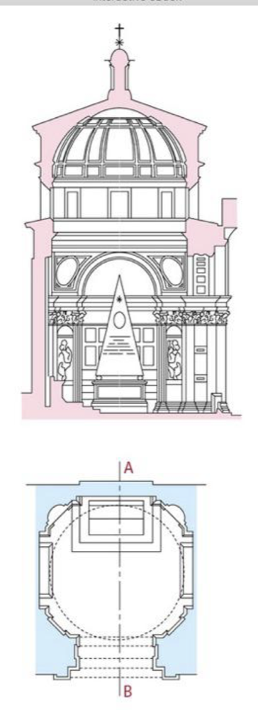
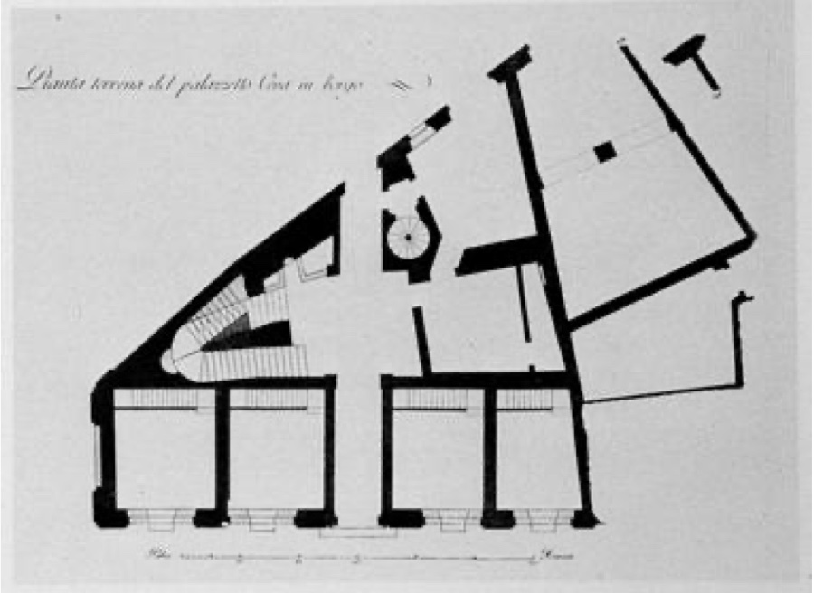

# Raffaello pittore e architetto

> [!info] Note collegate
> Sbobina: [[22-raffaello-architetto]]
>
> Argomenti collegati: [[21-bramante-giulio-ii-e-il-belvedere]] · [[10-pantheon-da-agrippa-ad-adriano]] · [[09-villa-romana-e-villa-adriana]] · [[16-visita-ostia-antica]] · [[01-ordini-architettonici]] · [[03-roma-foro-e-fori-imperiali]] · [[11-architettura-tardoantica-da-baalbek-a-spalato]] · [[08-terme-di-caracalla]] · [[02-acropoli-e-partenone]]

Raffaello Sanzio (1483-1520) è una figura centrale dell'architettura del Cinquecento, strettamente legata alla biografia di Bramante. Come Bramante si forma come pittore, e si avvicina in maniera definitiva all'architettura proprio confrontandosi con lui: quando Giulio II affida a Bramante i cantieri del Vaticano, il pontefice chiama Raffaello a decorare le Stanze vaticane, e i due artisti si trovano così a lavorare per lo stesso committente, nello stesso periodo e nello stesso luogo. Da questa vicinanza molto concreta nasce l'influenza decisiva dell'opera di Bramante su quella di Raffaello. Il percorso di Raffaello verso l'architettura passa attraverso la pittura, la prospettiva e lo studio sistematico dell'antico, e converge poi nelle opere costruite dopo il 1514, quando, morto Bramante, egli ne prende il posto come architetto del papa: la Cappella Chigi, i palazzetti per i committenti della Roma di Leone X e la grande villa dei Medici, Villa Madama.

## RAFFAELLO PITTORE: LA FORMAZIONE E LE STANZE VATICANE

### Una carriera breve e una bottega influente

Raffaello muore a trentasei anni, in un'età assolutamente giovane, e si dedica in maniera intensiva all'architettura solo dopo la morte di Bramante, nel 1514, perché finché Bramante è in vita i grandi incarichi di architettura sono affidati a lui. La sua attività di architetto si concentra dunque in poco più di sette anni, un periodo molto circoscritto che spiega il numero ridotto di progetti che gli si possono attribuire. Molti dei suoi cantieri, come ricorda già Giorgio Vasari, non furono conclusi, e dei suoi disegni di architettura ne restano pochissimi, perché la maggior parte del suo *corpus* grafico è andata dispersa. Si tratta quindi di un architetto che lavora per pochi anni, progetta poche opere, in gran parte incompiute e scarsamente documentate nei disegni.

Eppure il suo ruolo è centrale, non solo per la sua statura di pittore e di grande conoscitore dell'antico, ma anche perché Raffaello è a capo di una bottega nella Roma del Cinquecento in cui si formano alcuni dei più importanti artisti che gli succederanno: Giulio Romano, Baldassarre Peruzzi e, per certi versi, Antonio da Sangallo il Giovane. La sua influenza passa anche attraverso questo ruolo di maestro, e il suo insegnamento si dissemina nel tempo attraverso l'opera dei suoi allievi.

### La formazione con Perugino e le prime architetture dipinte

Raffaello nasce a Urbino, alla corte dei Montefeltro, e si forma come pittore a contatto con alcuni grandi artisti, tra cui il Perugino, che lo accoglie giovanissimo nella sua bottega. Il confronto tra lo Sposalizio della Vergine di Perugino (1502-1503) e quello di Raffaello (1504) mostra l'affinità tra maestro e allievo: in entrambe le opere la scena si svolge in primo piano, è dominata da un uso molto accurato della prospettiva e ha per fondale un'architettura, un edificio a pianta centrale che testimonia la riflessione sugli edifici centrici diffusa all'inizio del Cinquecento, la stessa da cui nasce il Tempietto di San Pietro in Montorio di Bramante.

Anche nel caso di Raffaello, quindi, le prime architetture sono architetture dipinte. Nella Presentazione al Tempio (1502-1503) la scena è raccontata per mezzo della prospettiva e di un'architettura che accoglie i personaggi, un ambiente scandito da colonne ioniche. La dimestichezza con la prospettiva si conferma uno degli ingredienti fondamentali per la costruzione delle architetture dipinte.

### Giulio II, le Stanze e il Belvedere

L'abilità di Raffaello come pittore lo porta alla corte di Giulio II (1503-1513), che dal 1508 lo incarica della decorazione pittorica delle Stanze vaticane. Per Raffaello, che fino a quel momento aveva lavorato per committenti privati, avere come committente il pontefice segna un salto di carriera decisivo: arriva a Roma e vi si stabilisce, impegnato in un cantiere pittorico di grandissima importanza. Le Stanze sono gli appartamenti del pontefice nel palazzo Vaticano, e godono di una vista privilegiata sul cortile del Belvedere, che Giulio II fa costruire nello stesso periodo da Bramante per accogliere la sua collezione di antichità, come una grande villa ispirata a quelle antiche. I due progetti sono strettamente collegati: il punto da cui meglio si poteva osservare il Belvedere erano proprio gli appartamenti del papa, decorati contemporaneamente da Raffaello.

Le quattro stanze formano una sequenza di ambienti rettangolari, i primi tre di dimensioni minori rispetto all'ultimo, a cui si accede dalla zona della Cappella Sistina. La loro numerazione segue l'ordine cronologico dei lavori: la Stanza della Segnatura (1), la Stanza di Eliodoro (2), la Stanza dell'Incendio di Borgo (3) e infine la Stanza di Costantino (4), che segna il passaggio di testimone tra Raffaello e il suo allievo più importante, Giulio Romano. È un cantiere pittorico diffuso e organizzato, che Raffaello gestisce ambiente per ambiente.

### La Scuola di Atene

La Stanza della Segnatura ospitava molto probabilmente la biblioteca di Giulio II, e ciascuna delle sue pareti è dedicata a un tema: la Disputa del Sacramento, la Scuola di Atene, il Parnaso e la Consegna delle Leggi. Per seguire l'avvicinamento di Raffaello all'architettura la parete più significativa è quella della Scuola di Atene, un tema antiquario ambientato nell'Atene antica: una conversazione tra i più grandi pensatori del mondo greco e romano, tra i quali compaiono anche contemporanei di Raffaello, letterati come Egidio da Viterbo e Fedra Inghirami e, in primo piano, Michelangelo, ritratto pensieroso mentre, appoggiato a un tavolo, scrive su un foglio. Il soggetto celebra le figure più alte della cultura e dell'arte dall'antichità fino al tempo di Raffaello, e l'architettura fa da cornice alla scena.

La prospettiva è di nuovo protagonista: le linee del pavimento convergono verso il centro della composizione e il loro disegno si riflette nelle strutture voltate che chiudono la scena in alto. Queste volte sono citazioni delle grandi coperture dei complessi antichi, e il loro modello principale è la Basilica di Massenzio. Raffaello appare così intriso di cultura umanistica e antiquaria, e l'affresco mostra come egli guardasse all'architettura che aveva davanti agli occhi. Accanto alla Basilica di Massenzio c'era però un'altra grande opera che lascia un segno nel suo immaginario: il cantiere della nuova basilica di San Pietro, diretto da Bramante proprio negli anni in cui Raffaello decorava le Stanze. Un disegno dell'olandese Marten van Heemskerck mostra il cantiere ancora in gran parte da realizzare, più simile a una rovina che a un edificio costruito; e proprio questa incompiutezza, così vicina all'immagine delle architetture antiche, esercitava un grande fascino sugli artisti. La formazione romana di Raffaello lo mette in contatto, insieme, con i grandi esempi del passato e con i progetti più innovativi del suo tempo.

### L'Incendio di Borgo e gli ordini dipinti

La Stanza dell'Incendio di Borgo prende il nome dalla sua scena principale, che racconta l'incendio divampato nell'847 nel Borgo, il quartiere vicino a San Pietro: secondo la tradizione cristiana il pontefice Leone IV lo spense impartendo la benedizione dalla finestra dei suoi appartamenti. La stanza è decorata diversi anni dopo la Segnatura, nel 1514, quando Giulio II era già morto e sul soglio pontificio era salito Leone X: scegliere un episodio che celebrava un papa con il suo stesso nome era per Leone X un modo per celebrare se stesso, e infatti il pontefice affacciato a benedire la folla ha le sue fattezze.

Tra le figure in fuga dalle fiamme Raffaello dipinge una serie di architetture: colonne con capitelli compositi, colonne ioniche e la loggia dorica da cui si affaccia il papa, riconoscibile dal fregio con metope e triglifi. Come Bramante nella rampa elicoidale del Belvedere aveva esposto in sequenza gli ordini, quasi un trattato in pietra, così Raffaello mette in scena gli ordini architettonici con tutte le loro caratteristiche formali e decorative, dimostrando di aver appreso la lezione degli antichi. Le colonne con capitelli compositi citano il Tempio di Marte Ultore nel Foro di Augusto, mentre la forma dei capitelli riprende quella degli archi della dinastia flavia, come l'arco di Tito, che predilige questo ordine. Le colonne ioniche si avvicinano al Tempio della Fortuna Virile, modello almeno di riferimento generale: l'invenzione pittorica di Raffaello le trasforma infatti in colonne di marmi colorati e pregiati, mentre nel tempio sono scanalate e tutte dello stesso colore.

Il confronto tra questi capitelli ionici e quelli della giovanile Presentazione al Tempio rivela lo sviluppo della formazione di Raffaello. Nei primi le volute sembrano fogli accartocciati, quasi privi di sostanza materiale; nei secondi sono riproduzioni precise dei capitelli ionici che Raffaello poteva vedere passeggiando tra le antichità di Roma. Il soggiorno romano e il confronto quotidiano con le architetture del passato hanno accresciuto la sua sensibilità e la sua accuratezza nel rappresentarle.

Nella loggia dorica, dove l'epigrafe *Leo Pontifex IIII* identifica il papa, il fregio rivela un dettaglio significativo. Le gocce associate ai triglifi, che nell'architettura antica sono sei, qui sono cinque. Non è un segno di scarsa conoscenza dell'antico, ma una variazione consapevole: Raffaello vuole mostrare di saper giocare con l'architettura antica e di avere verso il passato un atteggiamento creativo, come Bramante nel Tempietto di San Pietro in Montorio, dove cita con grande accuratezza il dorico antico ma introduce soluzioni che se ne discostano.

## LO STUDIO DELL'ANTICO

### Raffaello architetto del papa

Nel 1513 muore Giulio II e nel 1514 muore anche Bramante: il sodalizio tra il pontefice e il suo architetto si interrompe per la morte quasi contemporanea dei due. Sale al soglio Leone X, Giovanni de' Medici, esponente della famiglia fiorentina già incontrata tra i committenti di Brunelleschi, e il ruolo di Bramante passa a Raffaello, che nel 1514 diventa il nuovo architetto del pontefice, soprattutto nel contesto del Vaticano. Da questo momento Raffaello studia l'architettura antica in modo ancora più sistematico: se le architetture dipinte delle Stanze sono già indizi preziosi della sua cultura, ora intraprende consapevolmente un vero percorso di studio.

### La lettera a Baldassarre Castiglione

Lo dichiara lui stesso in una lettera scritta nella primavera del 1514 a Baldassarre Castiglione, letterato importantissimo del Cinquecento e suo amico, di cui dipinge anche il ritratto (1514-1515, Parigi, Louvre). Parlando dell'incarico della fabbrica di San Pietro, Raffaello scrive: «Ma io mi levo col pensiero più alto. Vorrei trovar le belle forme degli edifici antichi, né so se il volo sarà d'Icaro. Me ne porge una gran luce Vitruvio, ma non tanto che basti». Il richiamo a Icaro, che vola verso il sole con le ali di cera e precipita, esprime il dubbio di riuscire nell'impresa. La seconda frase è ancora più importante: il *De architectura* di Vitruvio, l'unico trattato di architettura antica giunto fino a noi e quindi l'unico testo su cui gli architetti del Cinquecento potevano studiare l'antico, illumina molto, ma non basta. Per Raffaello occorre confrontarsi direttamente con l'architettura del passato, senza limitarsi alla sua conoscenza libresca.

### La lettera a Leone X e il rilievo di Roma antica

L'amicizia tra Raffaello e Castiglione investe anche lo studio dell'antico. Intorno al 1519 i due scrivono insieme una lettera a Leone X, il papa che Raffaello ritrae con i cardinali Giulio de' Medici e Luigi de' Rossi (Firenze, Uffizi). Un pittore e architetto e un umanista e letterato si rivolgono al pontefice per sostenere la necessità di ricostruire graficamente, cioè di rilevare e disegnare, i principali monumenti di Roma antica, restituendo attraverso il disegno ciò che era andato perduto. Camminando ogni giorno per Roma, Raffaello constatava che gran parte del patrimonio architettonico antico era scomparso, e riteneva fondamentale salvare quel poco che restava: proteggendo le rovine da ulteriori devastazioni, ma anche rilevando praticamente tutto e ricostruendo con il disegno quello che non c'era più. La lettera è un documento prezioso non solo per la storia dell'architettura, ma anche perché è considerata uno dei primi testi dedicati a quella che oggi chiameremmo tutela del patrimonio: uno sguardo al passato attento a preservarlo anche materialmente.

### Il Pantheon di Raffaello

Della grande campagna di rilievo promessa al pontefice non restano tracce tra i disegni di Raffaello, ma alcuni fogli documentano il suo studio dell'antico. Due disegni sono dedicati al Pantheon: uno raffigura il portale centrale, riconoscibile per la volta cassettonata e le specchiature ai lati dell'accesso; l'altro, tra i più celebri, rappresenta l'interno dell'edificio nella sua interezza.

![[pantheon-raffaello-interno-e-pianta.png|650]]

*Raffaello, l'interno del Pantheon (Firenze, Gabinetto Disegni e Stampe degli Uffizi), a confronto con la pianta dell'edificio.*

Raffaello aveva una particolare affezione per questo monumento, tanto da scegliere di essere sepolto al suo interno, dove la sua tomba si trova ancora oggi.

## LA CAPPELLA CHIGI E I PALAZZI ROMANI

### La Cappella Chigi in Santa Maria del Popolo

 La pittura, la prospettiva e lo studio dell'antico convergono nelle prime opere architettoniche di Raffaello. Una delle prime è la cappella di Agostino Chigi nella basilica di Santa Maria del Popolo a Roma, iniziata nel 1514. È un ambiente unico, di dimensioni contenute: la pianta è un quadrato con gli angoli smussati, che si avvicina così alla forma di un ambiente circolare, ed è coperto da una cupola su tamburo che dall'esterno della chiesa non si vede, ma che la sezione rende leggibile. Le paraste hanno capitelli corinzi che sono copie esatte di quelli del Pantheon. Benché realizzata all'inizio della sua carriera di architetto, l'opera è già una chiara manifestazione della cultura antiquaria di Raffaello e della sua capacità inventiva.

Il committente, Agostino Chigi (1466-1520), è un banchiere di un'importante famiglia senese e un grande committente di architettura: oltre alla cappella di famiglia affidata a Raffaello, commissionerà a Baldassarre Peruzzi la sua villa suburbana, la villa Chigi alla Lungara, oggi nota come Villa Farnesina.

I disegni di Giovanni Antonio Dosio, che rappresentano la pianta e la sezione della cappella, ne sottolineano la spazialità, definita da un impianto quasi centrale coperto dalla cupola. Il confronto tra i capitelli della cappella e quelli del Pantheon conferma non solo la somiglianza dei singoli elementi, ma anche la ripresa della composizione delle paraste del portale del Pantheon. È un'opera piccola che ambisce a evocare, nei dettagli e nello studio dello spazio, la forma dell'opera antica per eccellenza.

All'interno si trovano le tombe di due esponenti della famiglia, Agostino e Sigismondo Chigi. Lo spazio è governato da una sequenza di archi sostenuti da paraste, collegati da segmenti di muro disposti in obliquo agli angoli: gli archi proseguono quasi senza interruzione sulle varie pareti e creano uno spazio continuo. Raffaello dimostra così di controllare insieme il disegno dell'architettura, lo spazio e il disegno dei dettagli.

### Palazzo Alberini e il tipo del palazzetto

Con Palazzo Alberini, progettato tra il 1514 e il 1515, Raffaello affronta un edificio residenziale. Il palazzo sorge in via dei Banchi, vicino a Castel Sant'Angelo, in una zona abitata soprattutto dai fiorentini trasferiti a Roma, che vi avevano organizzato una sorta di quartiere. Il committente, Giulio Alberini, voleva un edificio che ospitasse la propria residenza e, al piano terreno, una serie di botteghe da affittare, così da ricavare un reddito dall'opera; gli affittuari erano banchieri fiorentini, una delle comunità di forestieri provenienti da altre città della penisola che si riunivano a Roma. Una mappa catastale, disegnata a fil di ferro, cioè con semplici linee e senza lo spessore dei muri, perché serviva a mostrare la suddivisione delle proprietà e non a studiare l'architettura, indica la casa di Giulio Alberini affacciata sulla via dei Banchi.

Il palazzo apre il tema della costruzione del palazzo nel Rinascimento. I grandi palazzi romani, come Palazzo Venezia, Palazzo della Cancelleria e Palazzo Farnese, sono commissionati da cardinali, a volte destinati a diventare papi, cioè dai committenti più alti della gerarchia romana. Giulio Alberini invece non è una figura ecclesiastica, ma un uomo d'affari che si arricchisce con il proprio lavoro, e il suo edificio è piuttosto un palazzetto: un tipo che ha la stessa funzione del palazzo, residenza di lusso nel cuore della città, ma dimensioni ridotte e nessuna piazza antistante, pur condividendo con il palazzo il ragionamento sulle forme architettoniche e sulla composizione della pianta.

La pianta del piano terreno mostra un grande cortile centrale intorno a cui si organizzano gli ambienti e, verso la strada, una sequenza razionale di locali tutti simili per forma e dimensione, le botteghe. L'articolazione con le attività commerciali al piano terreno e le abitazioni al piano nobile non è un'invenzione di Raffaello: era già diffusa nel Medioevo e affonda le radici in una tradizione antichissima, come mostra a Ostia il Caseggiato di Diana. Raffaello trasforma il linguaggio architettonico con cui si interpreta un tipo edilizio molto più antico, fondato sulla commistione tra spazi commerciali e residenziali.

### La facciata e il modello di Palazzo Caprini

Poiché la mancanza di una piazza impedisce di fotografare il palazzo frontalmente, la facciata si legge meglio in un'incisione. Al piano terreno le botteghe occupano vani rettangolari sormontati da piccole finestre che rivelano la presenza dei mezzanini, ambienti intermedi usati come depositi dei negozi. Questo registro basamentale, destinato al commercio, è rivestito da un bugnato gentile, cioè dalla superficie levigata, e non ha ordine architettonico. L'ordine compare invece al piano nobile, riservato all'abitazione del committente, sotto forma di paraste; le finestre sono allineate alle botteghe sottostanti, con una coerenza verticale del prospetto, mentre cambiano le forme architettoniche: scompare il bugnato, compare l'ordine. L'ultimo livello, anch'esso residenziale, rinuncia all'ordine e semplifica la decorazione, ma le specchiature dipinte sulla parete mantengono l'allineamento verticale con le paraste del piano nobile.

![[palazzo-caprini-e-palazzo-alberini-prospetti.jpg|700]]

*A sinistra Palazzo Caprini di Bramante, con le semicolonne binate al piano nobile; a destra Palazzo Alberini di Raffaello, con le paraste singole (incisioni del Cinquecento).*

Questa articolazione, con il bugnato per le funzioni commerciali e l'ordine architettonico per nobilitare la residenza, deriva da un modello che Raffaello conosceva benissimo: Palazzo Caprini, progettato da Bramante, che dal 1516 diventa la casa di Raffaello e la sede della sua bottega. Anche Palazzo Caprini divide la facciata in due parti: le botteghe del piano terreno, identiche nel disegno a quelle di Palazzo Alberini, e il piano nobile, scandito da semicolonne binate, cioè accoppiate a due a due. Le differenze, paraste al posto delle semicolonne e paraste singole invece che binate, non nascondono la ripresa di un modello ricomposto da Raffaello; e anche Palazzo Caprini appartiene al tipo del palazzetto.

### La finestra del tempio di Vesta a Tivoli

Alcuni dettagli della facciata di Palazzo Alberini sono citazioni precise di edifici antichi. La finestra dell'ultimo piano è copiata da quella del tempio di Vesta a Tivoli: non è una semplice finestra rettangolare, per la quale sarebbe difficile individuare un modello, ma una finestra la cui cornice sporge in alto e in basso con quelle che si chiamano orecchie, come se la finestra assumesse una forma antropomorfa. La stessa doppia orecchia, superiore e inferiore, si trova nella finestra del tempio di Tivoli. Con le finestre inginocchiate, che si incontreranno più avanti, si delinea tutta una genealogia di elementi architettonici che prendono il nome dalle parti del corpo umano.

### Palazzo Jacopo da Brescia

Il palazzo di Jacopo da Brescia, costruito tra il 1515 e il 1519, è commissionato dal medico di Leone X, l'archiatra, come si chiamava il medico del pontefice. Dopo il banchiere, un medico: committenti che non appartengono né al clero né all'aristocrazia, ma a quello che oggi definiremmo ceto borghese, figure con un'attività lavorativa che Vasari, nella vita di Raffaello, chiama «gentiluomini poveri». Poveri per modo di dire, naturalmente, perché non chiunque poteva chiedere a Raffaello di costruirgli la casa, e per giunta, come in questo caso, nel Borgo, a pochi passi dal Vaticano, in una zona di grande prestigio.

La facciata declina lo schema già visto. Una fascia basamentale a bugnato racchiude le botteghe, sormontate dai mezzanini come a Palazzo Alberini. Al primo piano nobile compare l'ordine, in forma di paraste affiancate ai lati da due semiparaste, e nelle campate si apre una sequenza di finestre con frontoni triangolari e curvilinei, soluzioni riprese dall'architettura antica. Il registro superiore, come a Palazzo Alberini, è più basso e più semplice, ma mantiene la coerenza degli allineamenti verticali. Il capostipite di questa serie di edifici con botteghe, bugnato e ordine architettonico resta Palazzo Caprini. Il rapporto tra basamento bugnato e ordine si trovava però già nelle architetture dipinte di Raffaello: la loggia da cui Leone IV si affaccia nell'Incendio di Borgo, se se ne isola una campata, presenta gli stessi elementi della facciata del palazzo, il basamento bugnato, la parasta e la trabeazione con metope e triglifi.

### La pianta nell'isolato trapezoidale

 Il palazzo di Jacopo da Brescia propone anche un'interessante soluzione di pianta. L'edificio sorge in un isolato trapezoidale, la cui forma è dettata da due strade oblique che convergono in un punto: la topografia impone angoli acuti, e l'angolo è da sempre il tema progettuale più difficile per gli architetti di ogni epoca, perché crea spazi ristretti, difficili da riempire e da utilizzare. Raffaello dispone verso la strada quattro botteghe con pareti ortogonali al fronte; l'ingresso si apre al centro, tra le botteghe, e conduce a uno spazio che diventa il cuore dell'edificio, intorno a cui si organizzano le altre stanze. Nell'angolo acuto colloca la scala, un elemento di servizio disegnato in funzione dello spazio: così sfrutta un punto difficile da progettare e insieme crea una soluzione compositiva strategica, perché la scala, seguendo la forma dell'angolo, diventa il perno della composizione.

Un lato del palazzo confinava con altre costruzioni, mentre il lato corto, largo quanto una bottega, si affacciava su una piccola piazza, nel punto in cui convergono le linee che la definiscono. Raffaello prosegue anche qui il ragionamento sulle forme: la bottega è inquadrata dal bugnato come sul fronte principale, e nella parte superiore si apre una grande nicchia inquadrata dall'ordine in forma di paraste con la trabeazione, ripresa dal piano nobile. Un prospetto stretto e sacrificato, che un architetto meno colto avrebbe lasciato privo di decorazione, diventa così un elemento spettacolare della scenografia urbana, in dialogo con la città e lo spazio circostante. È una delle grandi capacità di Raffaello: combinare soluzioni antiche diverse e trovarne di originali, adattate a ogni singola opera.

La sorte del palazzo è stata sfortunata. Nel 1936, con l'abbattimento della spina di Borgo per aprire via della Conciliazione, l'edificio viene demolito, e a pochi metri ne viene ricostruita una sorta di copia della facciata: un edificio del Novecento, in cui per di più si perde il prospetto laterale e resta solo quello principale. Per questo l'opera si studia attraverso le incisioni e le fotografie scattate prima della demolizione, che, essendo avvenuta nel Novecento, ha almeno permesso una documentazione fotografica.

### Palazzo Branconio dell'Aquila

Gli stessi temi tornano nel palazzo di Giovan Battista Branconio dell'Aquila, cortigiano di Leone X legato alla cerchia del pontefice, che ne affida la costruzione a Raffaello nel 1518. Il palazzo è noto da un'incisione che ne rappresenta il prospetto e da un disegno che restituisce anche la vita dell'edificio, perché non si limita a raffigurarne le forme architettoniche ma mostra anche le persone che frequentavano le botteghe.

## VILLA MADAMA

### I Medici committenti di ville

Villa Madama, avviata nel 1516, è la villa dei Medici a Roma ed è legata ai due papi medicei, Leone X (1513-1521) e Clemente VII (1523-1534), cioè il cardinale Giulio de' Medici ritratto accanto a Leone X da Raffaello. La famiglia aveva una lunga tradizione di ville in Toscana, che le slide della lezione richiamano con due esempi: la villa medicea di Poggio a Caiano, con il suo volume compatto su un basamento a portico, e la villa di Pratolino, rappresentata in una lunetta come un grande complesso immerso in un parco di viali, boschi e giardini. La villa romana sorge su un pendio boscoso, come mostrano le vedute aeree, e la sua pianta attuale comprende una loggia, un giardino chiuso e una peschiera. Al progetto partecipano, accanto a Raffaello, gli artisti della sua cerchia, tra cui Antonio da Sangallo il Giovane e Giulio Romano (1499-1546).

### Il modello della villa di Plinio

La villa è conosciuta attraverso i disegni, che lasciano intuire quale sarebbe stato il suo aspetto se fosse stata completata, e attraverso una lettera in cui Raffaello stesso la descrive. La lettera rivela le sue intenzioni progettuali, anzitutto la volontà di riproporre l'impianto della villa Laurentina di Plinio il Giovane, la villa vicino a Roma in cui Plinio si ritirava per osservare la natura e leggere i suoi amati libri, e che descrive nelle sue *Lettere* (II, 17) con l'atrio, il portico «in forma di D» intorno a un piccolo cortile, il triclinio sul mare, le camere e la stanza ellittica che segue il corso del sole. L'ispirazione a un edificio antico è dunque consapevole ed esplicitamente dichiarata da Raffaello.

### Il progetto nel disegno di Antonio da Sangallo il Giovane

Il progetto iniziale è noto grazie a un bellissimo disegno di Antonio da Sangallo il Giovane (Firenze, Gabinetto Disegni e Stampe degli Uffizi, inv. 273A). Il fatto che i disegni di uno stesso progetto non siano tutti di mano di Raffaello, ma anche dei suoi collaboratori, documenta il lavoro collettivo della bottega.

![[villa-madama-progetto-sangallo.jpg|750]]

*Antonio da Sangallo il Giovane, progetto per Villa Madama: al centro il cortile circolare, in alto il teatro sul pendio, in basso le terrazze.*

La pianta prevista era molto più articolata di quella realizzata, che ne corrisponde solo a una porzione. Il cortile, pensato circolare, è costruito solo per metà; restano gli ambienti con la loggia affacciata verso il giardino pensile e la peschiera, la vasca d'acqua. Tutto ciò che sta fuori dalla parte costruita rivela un progetto ancora più grandioso: era previsto perfino un teatro, che riprendeva la forma circolare del cortile, un teatro all'antica in tutti i sensi, perché avrebbe sfruttato la pendenza naturale del terreno su cui sorge la villa, come i teatri greci adagiati sulle pendici dei colli. Si accedeva alla villa attraverso un cortile anteriore, che conduceva ai primi ambienti e poi al cortile circolare e agli spazi aperti. L'edificio poggiava su una base sopraelevata rispetto al terreno, anche questa derivata dai modelli antichi: la *basis villae*, la piattaforma su cui si costruisce la villa vera e propria.

### Terrazze e giardini: il modello di Palestrina

Altri disegni riguardano le terrazze e gli spazi aperti che dovevano estendersi davanti all'edificio. Secondo la ricostruzione, una serie di terrazze si sarebbe disposta a quote diverse lungo il pendio, combinando forme architettoniche differenti. Il modello, come per il cortile del Belvedere, è il santuario della Fortuna Primigenia a Palestrina, l'antica *Praeneste*, con le sue terrazze a quote diverse che salivano al santuario. I modelli di Villa Madama sono dunque antiquari e provengono insieme dai testi, come la lettera di Plinio, e dall'osservazione diretta delle opere antiche.

### Il cortile, la loggia e la peschiera

Della villa resta una porzione del progetto concepito da Raffaello e dai suoi collaboratori. Il cortile semicircolare è scandito da una sequenza di semicolonne che inquadrano finestre rettangolari, e da qui si accede agli ambienti interni e quindi al giardino pensile. La differenza di quota tra il giardino e la peschiera, più in basso, rende visibili le strutture che sorreggono la piattaforma su cui sorgono sia il giardino sia la villa.

### Ordine gigante, finestra termale e fregio pulvinato

All'esterno la *basis villae* si presenta come una sostruzione su cui si innalza la facciata, scandita da paraste ioniche di ordine gigante, così chiamato perché un solo elemento abbraccia più livelli dell'edificio. Nell'architettura antica la colonna o la parasta dettavano l'altezza di ciascun registro; qui invece racchiudono più piani, mentre semicolonne di ordine minore, più basse delle paraste, si inseriscono nel disegno. La sequenza dell'ordine è interrotta da una grande finestra termale, semicircolare e divisa in tre parti, citazione delle finestre degli edifici termali antichi. Raffaello mescola così elementi dell'architettura antica, sia nell'uso degli ordini sia nei singoli elementi della costruzione, come la finestra termale e la *basis villae*.

L'ordine ionico è abbinato a una trabeazione con fregio pulvinato. Il termine pulvino indica un rigonfiamento, un cuscino o un guanciale, e il fregio pulvinato ha infatti una sezione curva, rigonfia; da questo momento sarà associato spessissimo all'ordine ionico. Raffaello contribuisce così a definire una nuova grammatica degli ordini architettonici.

### Ordini e materia

La villa è costruita interamente in laterizio e tufelli, materiali poveri e di poco costo, prodotti in cantiere come i mattoni o ricavati dal tufo. Solo alcune parti sono in travertino: gli elementi dell'ordine, capitelli e basi, e gli elementi con funzione strutturale, come gli spigoli della cornice, che come elementi di raccordo richiedono una maggiore resistenza, garantita dalla pietra rispetto al laterizio. È un aspetto curioso, perché si tratta di una villa commissionata dal pontefice, e ci si aspetterebbe un edificio interamente in travertino o in marmo: Raffaello invece fa economia nell'uso dei materiali. L'intenzione era comunque di rivestire il prospetto con uno strato di intonaco che uniformasse i diversi colori dei materiali, oggi a vista. Scelte di questo tipo facevano parte del modo di lavorare degli architetti, che univano sempre la cura nella scelta dei materiali a quella per la loro messa in opera.

### Le logge di Giulio Romano e Giovanni da Udine

La loggia verso il giardino pensile mostra all'esterno lo stesso uso dei materiali, ma all'interno accoglie una delle decorazioni più ricche del complesso, dipinta e a stucco, opera di Giulio Romano e di Giovanni da Udine, un altro allievo della bottega di Raffaello. La decorazione delle tre campate, con la sua articolazione geometrica dello spazio, riprende le decorazioni del mondo antico: anche nella scelta dei temi iconografici e pittorici Raffaello si affida al vocabolario dell'architettura antica.

### La fortuna e il degrado della villa

Poiché la villa è giunta incompiuta, si è tentato più volte di ricostruirne la forma originaria. Oltre alla ricostruzione del sistema di terrazze e giardini, un modello ligneo realizzato nel 1989 restituisce la villa completa in tutte le sue parti e permette di immaginarne l'interno, il teatro con le sue gradinate, la frontescena e la vista sul cortile circolare.

Benché incompiuta, Villa Madama diventa subito un esempio celebre, legato alla fama di Raffaello, che la morte prematura trasforma in una sorta di mito, ed è studiata moltissimo dagli architetti del Cinquecento: Andrea Palladio la disegna durante uno dei suoi viaggi a Roma, negli anni Cinquanta del secolo. Anche gli architetti di epoche successive se ne occupano, come Charles Percier, architetto di Napoleone, tra la fine del Settecento e l'inizio dell'Ottocento: in una copia del disegno di Sangallo distingue con colori diversi la parte realizzata, in nero, da quella rimasta incompiuta, in fucsia, e in un altro foglio si ispira al disegno di Palladio. I disegni circolano, vengono copiati e diventano a loro volta uno strumento per studiare l'architettura, soprattutto quando non la si ha davanti agli occhi.

L'incompiutezza causa però un degrado quasi immediato. Un disegno di Marten van Heemskerck degli anni Trenta del Cinquecento (1532-1537, Berlino, *Taccuino romano*) mostra la villa con le sculture antiche allestite nel giardino, perché, come Giulio II nei palazzi vaticani, anche Leone X espone nella sua villa le proprie opere. Nel Settecento un disegno di Hubert Robert (1762) mostra invece un ambiente delle logge invaso da frasche e vegetazione, ormai quasi una rovina. La villa sarà poi restaurata, e l'immagine che ne vediamo oggi è una sorta di ritorno al momento straordinario della sua progettazione nel Cinquecento.

## Collegamenti

Raffaello si comprende accanto a Bramante, di cui prende il posto nel 1514: la rampa elicoidale del Belvedere con la sequenza degli ordini, il Tempietto di San Pietro in Montorio con il suo dorico variato e Palazzo Castellesi, con cui si è aperto il tema del palazzo nel Rinascimento, sono studiati nella lezione su [[21-bramante-giulio-ii-e-il-belvedere|Bramante, Giulio II e il Belvedere]], dove compare anche il santuario della Fortuna Primigenia a Palestrina, che torna nelle terrazze di Villa Madama. Palazzo Caprini, di Bramante, modello dei palazzetti di Raffaello e sua casa dal 1516, sarà ripreso nella lezione sulle case degli artisti. Il disegno dell'interno del Pantheon e i capitelli copiati nella Cappella Chigi rimandano al [[10-pantheon-da-agrippa-ad-adriano|Pantheon]], studiato nelle sue fasi e nelle sue nicchie a colonne binate, dove il disegno di Raffaello è già servito come esercizio di lettura critica delle fonti. Il fregio dorico della loggia dell'Incendio di Borgo, con le sue cinque gocce invece di sei, si misura sulla regola di metope e triglifi descritta negli [[01-ordini-architettonici|ordini architettonici]], mentre il Tempio di Marte Ultore citato nell'Incendio di Borgo è quello del Foro di Augusto, studiato tra i [[03-roma-foro-e-fori-imperiali|Fori imperiali]]. Le volte della Scuola di Atene derivano dalla Basilica di Massenzio, studiata nell'[[11-architettura-tardoantica-da-baalbek-a-spalato|architettura tardoantica]], e la finestra termale di Villa Madama riprende le grandi aperture delle [[08-terme-di-caracalla|terme imperiali]]. La commistione di botteghe e abitazioni nei palazzetti di via dei Banchi e del Borgo ha un precedente antico nel Caseggiato di Diana osservato durante la [[16-visita-ostia-antica|visita a Ostia antica]]. Villa Madama, infine, è il tentativo consapevole di far rivivere la villa Laurentina descritta da Plinio il Giovane, già letta nella lezione sulla [[09-villa-romana-e-villa-adriana|villa romana e Villa Adriana]], e il suo teatro adagiato sul pendio riprende il principio del [[02-acropoli-e-partenone|teatro greco]]. La bottega di Raffaello prepara le lezioni successive, dedicate ai suoi allievi, da Baldassarre Peruzzi, autore della villa di Agostino Chigi alla Lungara, a Giulio Romano e ad Antonio da Sangallo il Giovane.
