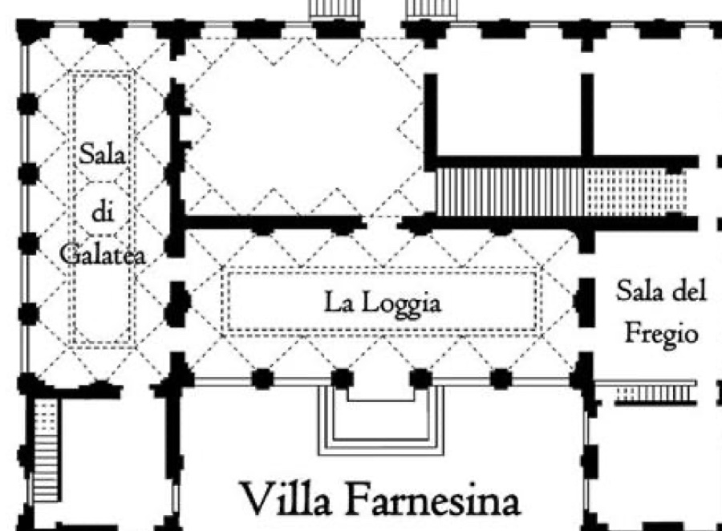
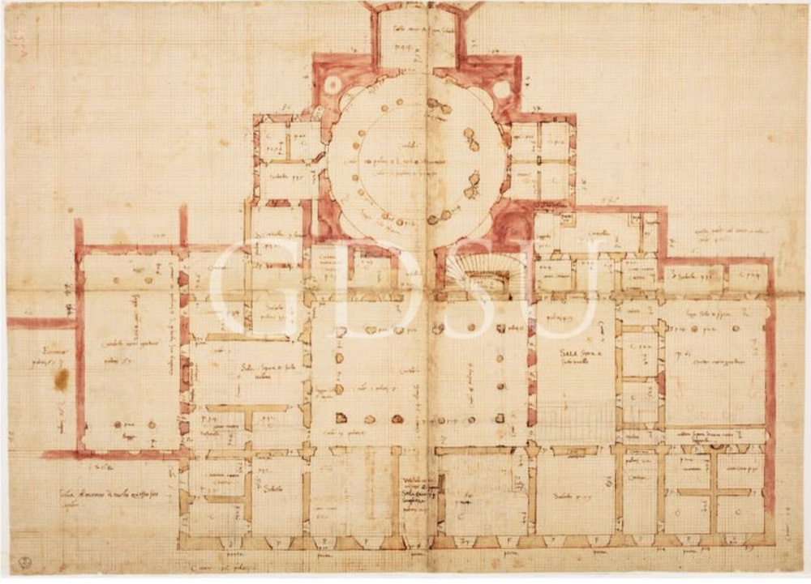
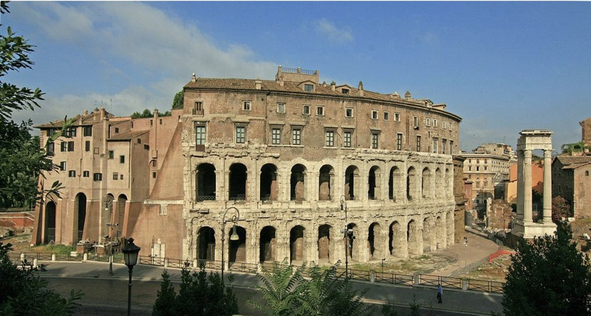
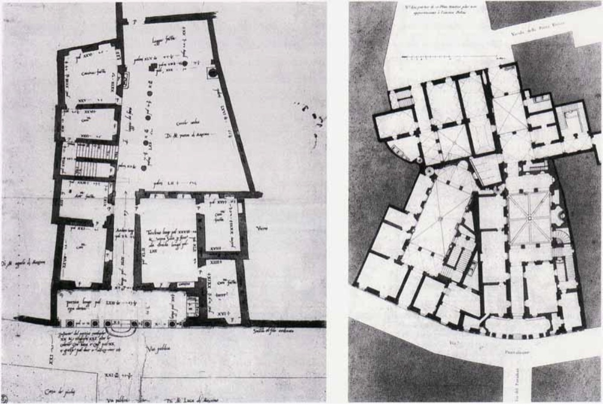

# Baldassarre Peruzzi

> [!info] Note collegate
> Sbobina: [[23-peruzzi-e-l-antico]]
>
> Argomenti collegati: [[22-raffaello-pittore-e-architetto]] · [[21-bramante-giulio-ii-e-il-belvedere]] · [[10-pantheon-da-agrippa-ad-adriano]] · [[06-potere-imperiale-spettacolo-pompei]] · [[03-roma-foro-e-fori-imperiali]] · [[07-residenza-romana-palatino-domus-aurea]] · [[17-romanico-in-italia-da-venezia-a-tuscania]] · [[04-via-appia-cecilia-metella-massenzio]]

Baldassarre Peruzzi (1481-1536), senese, è una delle figure centrali della Roma del primo Cinquecento. Pittore e architetto, lavora in cantiere accanto a Raffaello e trova in Agostino Chigi il committente della sua opera più celebre, la villa sulla riva del Tevere che oggi chiamiamo Farnesina. Più di ogni altro architetto del suo tempo, Peruzzi fa del disegno lo strumento per conoscere l'antico: lo rileva a Roma e nei viaggi nel Lazio e in Umbria, ne studia le tecniche costruttive, e arriva a progettare residenze che si appoggiano fisicamente alle rovine, come il palazzo degli Orsini sulle terme di Agrippa, rimasto sulla carta, e il palazzo dei Savelli costruito sopra il teatro di Marcello. Il Sacco di Roma del 1527 interrompe bruscamente questa stagione; quando Peruzzi ritorna a Roma dopo gli anni trascorsi a Siena, il suo modo di fare architettura è cambiato, e Palazzo Massimo alle Colonne, con la sua facciata curva, ne è la testimonianza più alta.

## PERUZZI, RAFFAELLO E AGOSTINO CHIGI

### In cantiere con Raffaello

La vicenda di Peruzzi si intreccia con quella di Raffaello, con cui condivide i cantieri della Roma dei papi. Lo ricorda l'incisione che apre la lezione, con la facciata di Palazzo Caprini, la casa di Raffaello, costruita a Roma, come dice l'iscrizione «Raph. Urbinat. ex lapide coctili Romae extructum», *ex lapide coctili*, cioè in laterizio: un basamento a bugnato con le aperture delle botteghe e, sopra, un piano nobile scandito da coppie di colonne e da finestre con frontoni. È il tipo di palazzo romano con cui anche Peruzzi si confronta, e che proprio lui, nell'ultima fase della sua carriera, arriverà a rovesciare.

### Villa Chigi a Siena

La prima opera documentata di Peruzzi è la villa costruita per la famiglia Chigi nella campagna senese tra il 1500 e il 1505: un volume compatto e isolato, aperto da una loggia ad arcate, al centro di un recinto di giardini e campi. È il tema della villa, la residenza fuori città, che Peruzzi porterà a Roma pochi anni dopo.

### Il committente: Agostino Chigi

Agostino Chigi, della stessa famiglia senese della villa presso Siena, è il committente per cui Peruzzi costruisce a Roma, a partire dal 1505, la villa sulla riva del Tevere oggi nota come Villa Farnesina, o Villa Farnesina Chigi. Il rapporto tra Peruzzi e Chigi mostra come a Roma l'architettura delle residenze nasca dall'incontro tra committenti colti e artisti capaci di dare forma alle loro ambizioni.

## VILLA FARNESINA

### La villa e i suoi prospetti

 La Farnesina è un edificio su due piani, con la facciata verso il giardino organizzata intorno a una loggia di cinque arcate racchiusa tra due avancorpi. La pianta del piano terra rende leggibile questa disposizione a U: al centro la Loggia di Amore e Psiche, che si apre sul giardino; nell'ala di sinistra la Sala di Galatea; nell'ala di destra la Sala del Fregio. Un disegno di progetto del prospetto mostra lo stesso impianto, con le arcate della loggia al piano terra e un ricco apparato decorativo nella parte alta.

Il linguaggio delle facciate è affidato agli ordini architettonici. Su entrambi i piani una sequenza di paraste scandisce il prospetto in campate regolari, entro le quali si aprono le finestre, incorniciate e coronate da timpani, e piccole aperture quadrate di mezzanino; in alto, sotto il cornicione, corre un fregio decorato. La facciata è dunque costruita come una griglia di ordini sovrapposti, un impaginato in cui ogni piano ha la sua scansione verticale: è il sistema che Peruzzi abbandonerà del tutto in Palazzo Massimo alle Colonne.

### La Sala di Galatea

La Sala di Galatea, decorata tra il 1511 e il 1512, occupa l'ala sinistra della villa, guardando la facciata verso il giardino. Le pareti sono scandite da pilastri dipinti a grottesche e da lunette con paesaggi, mentre la volta, divisa in vele e pennacchi, accoglie riquadri con scene mitologiche. Pittura e architettura lavorano insieme, e il cantiere della villa è il luogo in cui Peruzzi e Raffaello si trovano fianco a fianco.

### La Loggia di Amore e Psiche

La loggia centrale, aperta sul giardino, è decorata da Raffaello e dalla sua bottega con le storie di Amore e Psiche. Sulla volta, al centro, due grandi scene popolate di divinità sono incorniciate da festoni vegetali che seguono le vele e le lunette, e la decorazione pittorica si estende a tutta la copertura della loggia.

### La Sala delle Prospettive

Al piano superiore, tra il 1518 e il 1519, Peruzzi dipinge la Sala delle Prospettive, il salone in cui la pittura simula un'architettura. Le pareti sono articolate da colonne e pilastri dipinti, e tra le colonne si aprono vedute illusorie della campagna e della città di Roma, con i suoi campanili e i suoi edifici, come se la sala fosse una loggia affacciata sul paesaggio. Le colonne e i pilastri imitano marmi antichi riconoscibili: il marmo tessalico o verde antico (*marmor Thessalicum*, da Larissa, in Tessaglia), l'alabastro cinerino, il marmo luculleo o africano (*marmor Lucullaeum*, dall'Asia Minore). La pittura diventa così un modo di evocare la ricchezza materiale dell'architettura antica e insieme di mettere alla prova la prospettiva. Sulle pareti della sala restano anche i graffiti lasciati dai lanzichenecchi durante il Sacco del 1527.

## PERUZZI E LO STUDIO DELL'ANTICO

### La Rocca di Ostia e la fortuna della Colonna Traiana

Giorgio Vasari, nelle *Vite* del 1568, racconta che Peruzzi, appena «cominciato a essere in buon credito», fu «condotto a Ostia, dove nel maschio della rocca dipinse di chiaro scuro in alcune stanze storie bellissime, e particolarmente una battaglia da mano, in quella maniera che usavano di combattere anticamente i Romani», con uno squadrone di soldati che danno l'assalto a una rocca, «coperti colle targhe», appoggiando le scale alla muraglia mentre quelli di dentro li ributtano «con fierezza terribile». Vasari sottolinea gli «instrumenti da guerra antichi» e le diverse «sorti d'armi» rappresentate, e ricorda che Peruzzi fu aiutato da Cesare da Milano. Le pitture si trovano nella sala dell'episcopio della Rocca di Giulio II a Ostia e risalgono al 1511-1512: sono monocrome, a chiaroscuro, e i loro rilievi dipinti con battaglie e macchine da guerra rivelano lo studio della Colonna Traiana, il grande «libro di pietra» delle guerre daciche, che diventa per gli artisti del Rinascimento un repertorio di armi, soldati e costumi dei Romani.

### Il taccuino di viaggio

Lo strumento con cui Peruzzi conosce l'antico è il disegno. Ne è testimonianza il cosiddetto Taccuino dei viaggi, un piccolo libro di 22 per 16 centimetri, oggi al Gabinetto dei Disegni e delle Stampe degli Uffizi, a Firenze, che raccoglie i disegni eseguiti tra il 1519 e il 1521. I fogli permettono di ricostruire un itinerario attraverso il Lazio e l'Umbria: Roma, Terracina e Gaeta verso sud, Ferento, Bomarzo e Todi verso nord. Il disegno è insieme memoria, rilievo e studio: Peruzzi annota misure, profili, piante e dettagli costruttivi, con un'attenzione che va oltre la forma degli edifici e ne indaga il modo di costruire.

### Terracina

A Terracina, lungo la via Appia, di cui un segmento lastricato attraversa ancora il centro della città, Peruzzi disegna i resti romani inglobati negli edifici successivi. Nei fogli degli Uffizi (GDSU 404, 401, 422) compaiono i profili delle modanature, misurati in piedi, una cappella e le parti di un ordine con le loro quote; in un altro foglio (GDSU 556Ar), intitolato al foro di Terracina, Peruzzi rileva le piante dei templi e dei portici dell'area. Accanto a questi disegni la lezione mostra il Duomo di Terracina, con il suo portico colonnato e il campanile: Peruzzi legge la città del suo tempo per ritrovarvi quella antica.

### Ferento e Todi

A Ferento, presso Viterbo, Peruzzi disegna a sanguigna il teatro romano, di cui restano la cavea e le arcate della facciata: il foglio, che porta l'annotazione «theatro a Ferento opera antiqua», unisce la pianta della cavea, l'alzato delle arcate e i profili delle cornici. A Todi studia i cosiddetti Nicchioni, le grandi nicchie romane incorporate nelle costruzioni della città, di cui disegna il prospetto e la pianta con le misure. In questo foglio Peruzzi è attento a rappresentare il modo in cui sono distribuiti i conci che compongono le calotte delle nicchie: è un esempio molto chiaro di stereotomia, cioè della tecnica di tagliare i conci di pietra in modo da costruire superfici curve, che Peruzzi studia sull'antico con lo sguardo di un costruttore.

## PROGETTARE SULLE ROVINE DI ROMA

### Tre progetti a contatto con l'antico

Lo studio dell'antico condotto attraverso il disegno si traduce, nell'opera di Peruzzi, in progetti che si collocano fisicamente in continuità con le strutture antiche. Tre fogli degli Uffizi, riconoscibili dalla filigrana della raccolta, documentano questo atteggiamento: il progetto per la chiesa di Sant'Adriano al Foro Romano (GDSU 625Ar), quello per il palazzo Orsini alle terme di Agrippa (GDSU 456Ar) e quello per il monastero di Santa Maria Liberatrice (GDSU 593Ar). Sono progetti che pensano di collocare architetture nuove, in particolare residenze, sulle rovine e insieme alle rovine.

### Il palazzo Orsini alle terme di Agrippa

 Uno dei progetti più straordinari di Peruzzi, rimasto irrealizzato, è il palazzo per la famiglia Orsini, una delle più importanti della Roma del primo Cinquecento, accanto alle terme di Agrippa. Il complesso termale, costruito tra il 25 e il 19 a.C. da Agrippa, la figura legata alla costruzione del primo Pantheon, sorgeva nel Campo Marzio; oggi ne resta soltanto il cosiddetto Arco della Ciambella, alle spalle di Largo Argentina e a pochi passi da Santa Maria sopra Minerva, un tratto di muratura curva inglobato da una serie di costruzioni più recenti, addossate all'antico.

Peruzzi progetta di sfruttare l'Arco della Ciambella per costruire un grande ambiente di forma circolare, destinato a diventare il salone del palazzo, e di utilizzare i muri antichi come punto di partenza di un'opera che si sarebbe poi sviluppata in autonomia. Nel disegno le murature sono rese con due colori: Peruzzi distingue così le strutture antiche, che intende recuperare, da quelle moderne del suo progetto. Doveva essere un edificio grandioso: se l'Arco della Ciambella diventa soltanto una porzione di un ambiente interno, il palazzo si sarebbe esteso in prospetto per diverse centinaia di metri.

Il progetto, pur rimasto sulla carta, chiarisce l'approccio di Peruzzi all'architettura antica e un atteggiamento abbastanza diffuso nel Rinascimento. Con la parola Rinascimento si intende la rinascita dell'antico, e questa rinascita passa anche attraverso un riuso effettivo e materiale dell'architettura antica: non soltanto il reimpiego di alcuni pezzi, di colonne o frammenti, già incontrato in altre occasioni, ma il rifacimento di un'opera architettonica in continuità con un'opera del passato.

### Il palazzo dei Savelli sul teatro di Marcello

 L'atteggiamento che nel palazzo Orsini resta sulla carta si realizza quando Peruzzi costruisce il palazzo della famiglia Savelli sopra i resti del teatro di Marcello. Del teatro di epoca augustea si conservano soltanto i primi due registri, una sequenza di arcate inquadrate dagli ordini dorico e ionico, interamente in travertino. Il rapporto di Peruzzi con l'antico è qui complesso: da un lato c'è l'ammirazione per il passato, dall'altro nessuna esitazione a costruire il nuovo edificio in diretta continuità con quello antico. Sopra le strutture in travertino si aggiungono due piani in laterizio, che diventano la residenza di una famiglia romana decisa a porre la propria dimora sopra uno dei monumenti più significativi del passato.

Peruzzi si inserisce in un processo di trasformazione già secolare. Nel Cinquecento del teatro restava molto poco: come la maggior parte degli anfiteatri, una volta cessato l'uso nel mondo antico, nel Medioevo era diventato una cava di materiale, da cui si toglievano i blocchi di travertino per altre costruzioni, e l'opera era stata progressivamente erosa e stratificata. Nei periodi politicamente più incerti teatri e anfiteatri, grazie alla loro forma chiusa, venivano usati come piccole rocche fortificate, occupate dagli abitanti delle zone vicine che vi trovavano riparo. Al Rinascimento arrivano quindi soltanto segmenti murari, parti di architetture già trasformate. Peruzzi prosegue questo riuso, anche funzionale, di un edificio che da secoli era diventato residenza, ma ne ricava un'opera destinata a un'unica famiglia: un intervento che oggi nessuna soprintendenza autorizzerebbe, ma che offre un esempio straordinario di riutilizzo dei resti dell'antico.

Pur costruendo esattamente sopra il teatro, Peruzzi sceglie di prenderne le distanze. Le finestre dei nuovi piani non sono allineate alle arcate antiche, e questo distacco tra l'architettura antica e quella moderna diventa un rispetto esibito, rimarcato anche dal materiale: la sopraelevazione è costruita in laterizio, e soltanto alcuni elementi delle finestre sono in travertino.

### Le testimonianze: Dosio, Serlio, Dupérac, Heemskerck

Gli artisti del Cinquecento erano molto attenti a questo processo di trasformazione, e consapevoli di ciò che era antico e di ciò che non lo era. Un disegno di Giovanni Antonio Dosio della fine del secolo (Uffizi, 2532Ar) mostra il teatro di Marcello come appariva allora, con alcune costruzioni poi demolite: Dosio si concentra sui due registri antichi, ma accenna anche alla struttura costruita da Peruzzi e alle merlature, segno delle trasformazioni medievali che avevano fatto del teatro una rocca. L'attribuzione del palazzo a Peruzzi è garantita da Sebastiano Serlio, il trattatista già incontrato nel corso, e sarà poi ripetuta da altre fonti. Nella sua veduta di Roma, l'incisore francese Étienne Dupérac, attivo negli anni Sessanta e Settanta del Cinquecento, scrive nella didascalia: «Vestigii del Theatro che fù edificato da Augusto in nome di Marcello suo nipote [...] Sopra le sue rovine è edificato il palazzo de Signori Savelli, e oggidi si chiama volgarmente quella contrada piazza montanara». Un disegno degli anni Trenta-Quaranta del Cinquecento, nell'album di Maarten van Heemskerck oggi a Berlino (Kupferstichkabinett), mostra infine il teatro con il palazzo nel tessuto della città.

### Il Mausoleo di Augusto e il giardino dei Soderini

Il teatro di Marcello non è l'unico monumento antico che si pensa di riutilizzare. Anche il Mausoleo di Augusto, nel Campo Marzio, vicino al luogo in cui oggi si trova il museo dell'Ara Pacis, diventa nel Cinquecento il giardino della famiglia Soderini. Lo ricorda un'altra incisione di Dupérac, la cui didascalia descrive i «Vestigij del Mausoleo d'Augusto, qual fu un belliss[im]o sepolcro» e aggiunge che «oggidi sopra q[uesto] edificio ui e un belliss[im]o giardino che serue alla casa de Sig[no]ri Soderini»: il corpo cilindrico del monumento è interamente occupato da un giardino geometrico. Il Mausoleo, che le slide definiscono insieme «monumento, fortezza, giardini», è stato oggetto di trasformazioni anche in anni recenti: le fotografie dell'allestimento originario dell'Ara Pacis mostrano l'area prima della nuova piazza, progettata di recente, che ha trasformato completamente questa porzione di Roma. Questi esempi mostrano quanto fossero praticati, nel Cinquecento, il dialogo e la continuità tra le opere antiche e quelle moderne.

## IL SACCO DI ROMA

### La crisi religiosa

Gli anni romani di Peruzzi, nel primo Cinquecento, sono anni di intensissimo studio dell'antico, di architetture e di decorazioni, che restituiscono il clima della Roma del tempo e i rapporti con committenti di grande prestigio. Tutto questo conosce un'improvvisa interruzione nel 1527, quando Roma viene messa a sacco da un esercito di mercenari, i lanzichenecchi.

Il Sacco è l'ultimo e il più estremo episodio di un percorso che da meno di dieci anni aveva messo in crisi la centralità di Roma, sul piano religioso e su quello politico. La crisi era iniziata nel 1517, quando Martin Lutero aveva affisso a Wittenberg le 95 tesi, proponendo una sostanziale riforma della Chiesa: sono gli episodi che avviano la Riforma protestante. La Riforma vuole incidere sulla vita religiosa del tempo, ma è radicata anche nella politica e nell'economia del Cinquecento: una delle ragioni che spingono Lutero a scrivere le tesi è il costo che il cantiere della basilica di San Pietro, la ricostruzione voluta da Giulio II e proseguita dai suoi successori, stava assumendo per tutta la cristianità. Il cantiere era sostenuto dalle tasse che il pontefice imponeva ai fedeli, e Lutero si fa portavoce di tutti coloro che a Roma non sarebbero mai andati, o vi sarebbero andati soltanto in pellegrinaggio, e che protestano contro una politica dall'impatto finanziario così violento. La protesta si diffonde attraverso opuscoli e testi pubblicati oltralpe che criticano duramente il papato.

### Carlo V e i lanzichenecchi

Il malcontento viene sfruttato dal re di Francia e dall'imperatore Carlo V d'Asburgo, che cercano di scardinare il potere del pontefice e di conquistare la penisola. È il periodo delle guerre d'Italia, in cui la penisola è costantemente attraversata da scontri, spesso tra la Francia e Carlo V. Colto l'indebolimento del papato provocato dalla contestazione luterana, nel 1527 Carlo V assolda un esercito di mercenari, i lanzichenecchi, che non appartenevano ai popoli da lui direttamente controllati, in modo che l'invasione non fosse direttamente riconducibile alla sua volontà. Nel maggio del 1527 i lanzichenecchi entrano a Roma dal Gianicolo e arrivano a conquistare Castel Sant'Angelo, come mostrano le rappresentazioni del tempo. Le tracce della loro presenza sono numerose: i graffiti nella Sala delle Prospettive della Farnesina e, nel salone di Villa Turini Lante al Gianicolo, una piccola scritta datata 6 maggio 1527, incisa sulla parete come segno del passaggio.

### La fine dei cantieri e il ritorno di Peruzzi

Il Sacco ha conseguenze immediate sull'architettura. La città in stato di guerra perde ogni sicurezza, e tutto ciò che riguarda la committenza artistica e architettonica passa in secondo piano: nel 1527 si interrompono tutti i cantieri avviati, e la maggior parte degli artisti e degli architetti resta senza lavoro. La corte pontificia, fino ad allora la più ricca e felice dell'Italia del Cinquecento, diventa un territorio invaso, messo a ferro e fuoco, con i palazzi occupati e gli abitanti uccisi; e l'occupazione non dura pochi giorni, ma diversi mesi, imprimendo alla città un vero cambio di rotta. Gli artisti si disperdono: Peruzzi torna a Siena, la sua città natale, dove trascorre alcuni anni in attesa che la situazione si normalizzi.

Quando ritorna a Roma, il contesto è cambiato: le condizioni non sono più quelle che precedevano il Sacco, e gli artisti che rientrano dopo la diaspora, dalle loro città d'origine o da altre corti, sono a loro volta trasformati dalle esperienze vissute fuori dall'Urbe.

## PALAZZO MASSIMO ALLE COLONNE

### Un palazzo sulla via Papale

L'opera che documenta il cambiamento del gusto e del modo di fare architettura di Peruzzi è Palazzo Massimo alle Colonne, costruito dal 1532 sulle macerie del palazzo della famiglia Massimo distrutto durante il Sacco. Sorge lungo la via Papale, il percorso corrispondente all'attuale corso Vittorio Emanuele, e un'incisione settecentesca di Giuseppe Vasi ne fa cogliere subito la caratteristica più straordinaria, che lo rende un caso unico: la facciata curva, che segue la topografia del luogo e si adatta alla curvatura della strada. Il nome viene dalle colonne che si trovano sulla facciata.

### Topografia e stratificazione

L'andamento della via Papale è cambiato con l'apertura di corso Vittorio Emanuele, che ha comportato anche la demolizione di alcune costruzioni. In origine tutto l'isolato apparteneva alla famiglia Massimo, e Peruzzi lo riprogetta con la volontà di entrare in dialogo con la struttura topografica della città: non solo della città contemporanea, ma anche di quella antica. In quest'area di Roma sorgevano infatti alcuni edifici antichi, tra cui l'Odeon, destinato alla rappresentazione degli spettacoli, e la forma curva del prospetto può essere un'evocazione di questa stratificazione. Il rapporto con l'antico raggiunge così un livello diverso: non riguarda più soltanto le forme, ma il dialogo con la topografia e con la stratificazione del territorio.

L'isolato viene diviso tra i tre fratelli Massimo, che vi costruiscono tre palazzi addossati l'uno all'altro: il palazzo Massimo alle Colonne, il palazzo Massimo di Pirro e il palazzo Massimo con la facciata graffita. Ancora oggi di fronte alla facciata corre una strada strettissima, che ne consente solo una visione parziale. La scelta del prospetto curvo è legata anche all'impossibilità di vedere l'edificio frontalmente: Peruzzi preferisce offrire allo sguardo la possibilità di seguire la curva, l'andamento della facciata immersa nella topografia della città.

### Dal primo progetto alla pianta realizzata

 La soluzione realizzata è il risultato di un lungo ragionamento, che si legge confrontando il primo progetto con la pianta dell'edificio costruito. Nel primo progetto, in assenza di una piazza che creasse uno slargo, una pausa nel tessuto della città, Peruzzi prevede un andito d'ingresso, uno spazio di passaggio tra l'esterno, le strade, e l'interno del palazzo; da qui un secondo andito conduce al cortile, intorno al quale si sviluppano gli ambienti, compresa la scala per il piano superiore. Il disegno parla chiaramente della sequenza degli spazi, ma denuncia anche la completa subordinazione del progetto al disegno dell'isolato: la distribuzione degli ambienti e soprattutto la forma irregolare del cortile, trapezoidale, dipendono da ciò che la topografia impone all'architetto.

Questa irregolarità diventa il tema del ragionamento di Peruzzi, che arriva a una soluzione in cui domina la topografia, pur adattando il progetto allo spazio disponibile. Nella pianta realizzata il tema progettuale e la sequenza degli spazi restano invariati: un ingresso che fa da filtro tra la strada e gli interni, un andito che introduce al cuore del palazzo, il cortile, gli ambienti disposti intorno al cortile e la scala collocata accanto al portico che vi si affaccia. Ma i singoli spazi sono regolarizzati: Peruzzi rinuncia alla forma trapezoidale e disegna un cortile rettangolare, e usa gli spazi di risulta, conseguenza dell'inclinazione del muro di confine che dipende dagli accordi con gli edifici vicini e non può essere modificato, per ricavare piccoli ambienti e ospitare la scala.

È un atteggiamento concettualmente affine a quello di Raffaello nel palazzo di Jacopo da Brescia: la capacità di inserire in un lotto irregolare un progetto che, pur scendendo a patti con le preesistenze e con le condizioni del contesto, resta il risultato di un ragionamento progettuale e non la semplice occupazione di uno spazio. In uno stesso edificio Peruzzi dialoga con la stratificazione del luogo, immaginando la facciata curva, e costruisce un palazzo ispirato alla *domus* antica in un lotto difficile.

### Abitare all'antica

La sequenza degli spazi di Palazzo Massimo, un andito d'accesso che conduce a uno spazio chiuso ma scoperto intorno al quale si organizzano gli ambienti, richiama la struttura della *domus* romana. Gli architetti del Cinquecento non potevano conoscerla attraverso gli esempi di Pompei, ancora sepolta dai detriti dell'eruzione del Vesuvio, ma la conoscevano attraverso il trattato di Vitruvio. Abitare un palazzo del Cinquecento significava quindi, per gli architetti come per i committenti, ricostruire un'architettura ispirata all'antico non soltanto nelle forme e nei dettagli, ma anche nella composizione della pianta: abitare all'antica voleva dire ridisegnare le case degli antichi. La sezione del palazzo lo conferma: oltre l'andito si apre il cortile, che conduce alla parte posteriore dell'edificio, in un'alternanza di spazi coperti e scoperti vicina a quella che si legge nelle sezioni delle *domus*.

### Il prospetto

La facciata è un caso unico nel suo tempo. Al piano terra la porzione centrale, in corrispondenza dell'andito d'ingresso, è completamente smaterializzata da una sequenza di colonne, disposte a distanze variabili che accentuano l'idea della superficie curva e creano una sorta di effetto ottico. Nelle due porzioni laterali, chiuse da una superficie muraria per la necessità di ricavarvi degli ambienti, i sostegni verticali si trasformano in paraste, che racchiudono finestre rettangolari sormontate da piccole aperture di mezzanino. Le colonne generano un effetto di trasparenza del piano terra; all'interno dell'andito il disegno dei cassettoni del soffitto accompagna la curva, e ai lati, in nicchie, sono collocate le sculture.

Sopra colonne e paraste corre una trabeazione, oltre la quale l'impaginato cambia completamente. Gli ordini architettonici spariscono, e ogni riferimento a essi è obliterato: il tema della parte superiore è il rivestimento, un bugnato gentile disposto secondo l'opera isodoma, con una cortina regolare che forma una superficie omogenea. In questa superficie Peruzzi apre tre ordini di finestre, corrispondenti ai tre piani di abitazione, e la gerarchia tra i piani, dal piano nobile a quelli superiori, è affidata al disegno delle finestre. Non è più l'ordine architettonico a scandire i livelli della facciata: sono le finestre a ordinarli.

### Un modello rovesciato

Questo disegno è esattamente l'opposto del modello dei palazzi romani di Raffaello, come Palazzo Alberini e il palazzo di Jacopo da Brescia, in cui il piano terra era bugnato e ospitava le botteghe, mentre i piani nobili erano scanditi dall'ordine architettonico. Palazzo Massimo sovverte quel modello: l'enfasi si sposta sul piano terra, quello che si vede attraversando la città, con lo spazio colonnato dell'ingresso, mentre la parte superiore resta più spoglia e regolare.

### Il bugnato simulato e il tempio di Marte Ultore

A prima vista la facciata appare rivestita da un grande bugnato in pietra. Osservando da vicino il punto di contatto con gli edifici adiacenti, però, si nota una fascia che separa i due elementi e rivela che il bugnato non è fatto di blocchi lapidei: è un bugnato simulato, ottenuto modellando la superficie della facciata come se fosse composta da bugne di pietra. Anche questa soluzione viene dall'antico, e in particolare dal tempio di Marte Ultore nel Foro di Augusto, nella cui cella si trovano bugne realizzate con lo stesso sistema di simulazione del materiale; Peruzzi le studia e le disegna in un foglio datato al 1531-1535. In Palazzo Massimo l'antichità viene dunque ripresa a tre livelli: nella topografia del luogo, che conserva la memoria degli edifici antichi; nella pianta, che segue lo schema della *domus*; nelle tecniche costruttive, in dialogo con quelle di edifici come il tempio di Marte Ultore.

### Il portale e i cortili

La stessa attenzione all'antico si ritrova nei dettagli, come il portale d'ingresso, di cui resta un disegno di Peruzzi con il profilo della cornice e delle mensole. All'interno, le colonne della facciata vengono riprese nel cortile, dove sostengono la loggia che si sviluppa su due registri.

## Collegamenti

Peruzzi completa il ritratto degli architetti della Roma dei papi avviato con [[21-bramante-giulio-ii-e-il-belvedere|Bramante]] e proseguito con [[22-raffaello-pittore-e-architetto|Raffaello]], con cui condivide il cantiere della Farnesina e il tema del palazzo in un lotto irregolare: Palazzo Massimo alle Colonne si misura proprio con il palazzo di Jacopo da Brescia e con Palazzo Alberini, rovesciandone l'impaginato. Il disegno come strumento per conoscere l'antico, che nel taccuino di viaggio diventa rilievo misurato, prosegue la strada aperta da Brunelleschi a Roma, raccontata nella lezione su [[19-gotico-italiano-federico-ii-e-primo-rinascimento|l'inizio del Rinascimento]], e il richiamo a Vitruvio come via per conoscere la casa antica rimanda al dialogo con il *De architectura* avviato da Leon Battista Alberti. I monumenti su cui Peruzzi progetta sono quelli studiati nel modulo sull'antichità: le terme di Agrippa e l'Arco della Ciambella compaiono nella lezione sul [[10-pantheon-da-agrippa-ad-adriano|Pantheon]]; il teatro di Marcello, con i suoi registri dorico e ionico, l'Ara Pacis e il Mausoleo di Augusto nella lezione sugli [[06-potere-imperiale-spettacolo-pompei|edifici per lo spettacolo e il potere imperiale]]; il tempio di Marte Ultore, che già interessava Peruzzi, e la Colonna Traiana, modello delle battaglie dipinte a Ostia, nella lezione sul [[03-roma-foro-e-fori-imperiali|Foro e i Fori imperiali]]. Lo schema della *domus*, con la sua alternanza di spazi coperti e scoperti che Palazzo Massimo ripropone, è descritto nella lezione sulla [[07-residenza-romana-palatino-domus-aurea|residenza romana]]. La trasformazione del teatro di Marcello in cava e poi in rocca fortificata si accosta al mausoleo di Cecilia Metella inglobato nel *castrum* medievale lungo la [[04-via-appia-cecilia-metella-massenzio|via Appia]], e lo studio dei conci dei Nicchioni di Todi riprende la stereotomia incontrata nelle cupole in pietra di Palermo, nella lezione sul [[17-romanico-in-italia-da-venezia-a-tuscania|romanico in Italia]]. I marmi antichi imitati nella Sala delle Prospettive, dal verde antico al marmo africano, sono gli stessi materiali dell'esercitazione sull'Atlante dei materiali, e mostrano come anche la pittura partecipi alla geografia della pietra.
